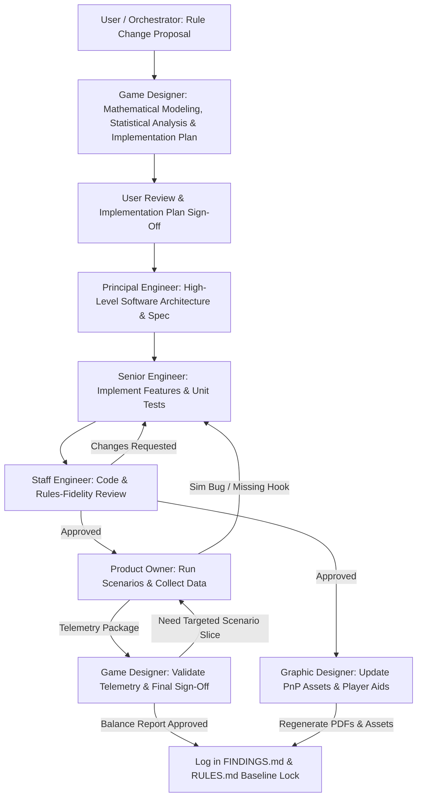

# Rogue Agent — Stress-Test & Implementation Plan

Canonical workspace roadmap for building and running Monte Carlo simulations against [RULES.md](./RULES.md).

## Current Status
- [x] **Rules Draft `v0.35.0`** captured in [RULES.md](./RULES.md)
- [x] **Multi-Agent SDLC Pipeline** defined in Section 2 below
- [ ] **Phase 44 (exploration): Red Rebalance — $2 Ransom, Block 2 Red, Red Choice Face**
  - [x] *Pre-SDLC Game Designer Modeling:* proposal = $2 per unblocked Red cube; Red 1-pip face `Block 2 Red`; one Red `+$2` face becomes `+$1 / +1 🔬`; Blue, Green and ★ variants unchanged. Sim levers `red_ransom_per_cube` and `red_die_profile` (defaults = v0.35). Sweep `scripts/run_v360_red_rebalance_sweep.py` (1,500 games per pod). Results: `FINDINGS.md` §31.
  - [x] *User decision on sweep results:* not adopted; superseded by Phase 45 (no `RULES.md` change).
- [ ] **Phase 47: Reference Bot — Mixed Policy & Fast Search Bot (sim tooling, no rules change)**
  - [x] *Pre-SDLC Game Designer Scoping:* `docs/findings/reference_bot_scoping.md`. Tier 1 Mixed bot (normal speed, every sweep); Tier 2 fast search bot (~1.5 min per 600-game pod target) for strength gate and §36–§38 re-tests.
  - [x] *User sign-off (2026-11-07):* two tiers; value = Secrets margin + win bonus; dead bot-method cleanup included.
  - [x] *Technical Architecture Spec (`principal-engineer`):* `docs/specs/reference_bot_spec.md`; 6 open questions resolved by the User 2026-11-07 (spec Open Question Resolutions).
  - [x] *Implementation (`senior-engineer`):* `sim/bots/mixed_policy.py`, `sim/bots/reference_search.py`, `sim/engine/fast_clone.py`, `scripts/run_reference_bot_check.py`, `tests/test_reference_bot.py` (RB-01..RB-17); 9 dead bot hooks removed. 780 tests OK (2 skipped); v0.33/v0.35/v0.36 parity intact. Timing: 82 s per 600-game 3P pod; one reference seat wins 66.4% (fair 33.3%). **Maintenance:** any change to `core.py` `_run_round_six_phase` must be mirrored in `fast_clone.resume_round` (RB-07 guards it).
  - [x] *Code Review Gate (`staff-engineer`):* APPROVED (780 tests OK). Leak probe: reseed disabled → 0.887 win, normal → 0.65, so no leak. Market Collapse ~72% already in the baseline rotation (v0.36 property, for game-designer). Follow-ups: assert the forced decision fired in every rollout (`reference_search.py:310`); depends on uncommitted v0.37 `MarketSharePolicy(leader_bonus_aware=...)`, so commit after v0.37; note that shared bot objects in `fast_clone._SHARED` must stay stateless. Follow-ups applied 2026-11-07 (RB-18 x2; 785 tests OK); commit waits for v0.37.
  - [x] *Validation sweep (`product-owner`):* `sim_results/reference_bot/validation_report.md`, 0 errors. Strength gate 3P: 66.6% (v0.36) / 69.1% (v0.37) vs fair 33.3%. ref1 pod 90–95 s. Mixed seat ≈ fair share, endings shift ≤4 pts. Reference seat still blocks Blue first (~49%), Public Relations Track avg 0.65–0.77. v0.37 cuts Market Collapse endings ~71% → ~56%. Flag: reference seat wins after hitting 0 Market Share in 195/1,200 v0.37 games (kamikaze Collapse).
  - [x] *Assessment (`game-designer`):* `FINDINGS.md` §40, `docs/findings/v370_reference_bot_assessment.md`. Bot fit as reference. No kamikaze Market Collapse (ref blocks more Red; Collapse off costs it only ~2 pts). §36/§38 stand; §37 "tanking pays" was a bot artifact. User decisions 2026-11-07: roster rule adopted (one Mixed seat per sweep; ref1 3P 1,200-game edge check per rule candidate); lever A (no rule change); add Public Relations push / Market Share dump candidates.
  - [x] *Follow-up (`senior-engineer` → `staff-engineer`):* Public Relations push and Market Share dump portfolio candidates; re-run ref1 edge check. Implemented (791 tests OK, uncommitted): ref1 v0.37 3P 78.6% ± 2.3 (was 69.1%); Market Collapse endings unchanged (57.7%); push chosen 14.9% of Phase 4 splits, dump 8.8%. staff-engineer APPROVED (leak check 0.93 disabled vs 0.76 normal; minors: push line loses choice-face research pick, TestPortfolioLines below `__main__` guard). Attribution (`docs/findings/v370_reference_bot_attribution.md`, §40 addendum): push +5.1, dump +7.2, both +9.5; dump grows with Collapse off, so not kamikaze; §40/§38 stand with refinements.
- [ ] **Phase 49: Secret Faces, Processing Box & Company Starting Die (pre-SDLC package locked)**
  - [x] *Pre-SDLC Game Designer Modeling:* `FINDINGS.md` §42 (single-seat Secret-yield model calibrated to v0.37). Package: Secret faces on Red / Blue / Green / Purple, Processing Box banking at triage, colour yield links, 12-point Market Share track without Market Collapse, no colored shields, Yellow fuel die, Glitched Shield Slots with a graduation clear, Company starting die, starting Secrets 4–5 (3P).
  - [x] *User lock (2026-11-07):* package above; terms Secret face / Processing Box / Glitched Shield Slot provisional.
  - [x] *Glossary approval (User, 2026-11-07):* Secret face, Processing Box and Glitched Shield Slot approved as final terms; Glitched Box retired. `Glitch` face kept for White Contractor dice only (it discards the die); colored dice lose it. Retired in Phase B: Color-Specific Shield, Red / Blue / Green Shields, Two-Stage Defensive Blocking, and Market Collapse as an end trigger. The sim keeps the v0.37 path behind levers for parity.
  - [x] *Technical Architecture Spec (`principal-engineer`):* `docs/specs/v380_secret_faces_processing_box_spec.md` all 14 open questions resolved by the User 2026-11-07 (spec §14.1–14.2). Notable: starting Secrets 5 at all counts; shield-icon faces clean slots; slots may reach 0; Public Relations regain 3 🔬 each; Hash Match removed (dead sim code only); dirty income stays off.
  - [x] *Implementation (`senior-engineer`) + Code Review Gate (`staff-engineer`):* implemented (sim only, uncommitted): `sim/engine/secret_faces.py`, `sim/bots/secret_face_policy.py`, `GameConfig.v038()` / `v038_roster()`, `tests/test_v380_secret_faces.py`, `scripts/run_v380_secret_faces_sweep.py`, v0.37 parity fixtures `tests/fixtures/v037_parity/` from `0b80154`. 877 tests OK (2 skipped); v0.33–v0.37 parity intact. Smoke v038_roster 3P 300 games: Singularity 69.0% / Patient Zero 30.3% / Total Wipeout 0.7%, 9.18 rounds; win by Company colour Red 35.7 / Blue 33.0 / Green 31.4%; AdaptiveBalanced 70.6%. 2P Singularity 79.5% (200 games; guardrail 48%). G1/G2 clean on assignment in Phase 1 Step 5 (🔬 in Phase 3), approved by the User 2026-11-08 (spec §14.2); dead Hash Match code kept (parity and web imports). staff-engineer CHANGES_REQUESTED (4 test gaps: stranded Secrets on Singularity / Total Wipeout / round limit, capacity increase, Jumper fallback), fixed; re-review APPROVED 2026-11-08: 882 tests OK (2 skipped), full 100-seed v0.37 replay 0 mismatches, v038 ~+30% runtime over v037.
  - [x] *Sweep (`product-owner`):* `sim_results/v380_secret_faces/sweep_report.md` (15 cells × 1,200 games, roster mixed1, + ref1). Sweep tooling extended first (Mixed seat, v037 baselines, per-game records, `--procs`, `--out-dir`; 888 tests OK). Flags: 2P Singularity 63–82% at S3–S6 (fail ≤48%; v037 47.0%); Total Wipeout ≤0.4% at 3P/4P (pass); rounds 8.09–9.59 except 4P S3 7.92; archetype spread 46–53 pts (v037 27–36), AdaptiveBalanced 57–76%; ref1 non_reference 78.2% (vs 71.2%). S5 3P: Company colour Red 37.0 / Blue 32.4 / Green 30.8%; path red 46 / green 40 / blue 37 / mixed 29 / yellow 13%; ~30% of seats end at 0 Market Share; stranded Secrets 3.0%; no zero-capacity rounds.
  - [ ] *RSP-1 cycle (User adopted 2026-11-09, FINDINGS §43.4):* (1) spec amendment §14.5 (`principal-engineer`; done 2026-11-09, payout once per round per User A/B decision, FINDINGS §43.4; open questions resolved at defaults 2026-11-09); (2) implementation + bot payout awareness + ref1 rollout support (`senior-engineer`) → review (`staff-engineer`); (3) 1,200-game confirm sweep 2P/3P/4P, starting Secrets 3/4/4 and 2/3/4, ref1 3P/2P (`product-owner`); (4) balance assessment (`game-designer`); (5) Phase B: RULES.md, glossary, PnP, web.
  - [ ] *Balance Assessment (`game-designer`):* NOT APPROVED as the v0.38.0 baseline (`docs/findings/v380_balance_assessment.md`, `FINDINGS.md` §43). Mechanisms work; 2P Singularity, 3P/4P Singularity, archetype spread and the 0 Market Share dump fail. User decisions 2026-11-08 (§43): Market Collapse back; starting Secrets 3 / 4 / 4; Yellow redesign; fix the `--set` bug (done: the engine never reads `corruption_track_capacity_by_player_count`; such overrides now raise `OverrideError`, and the sweep checks each override changes the games; use `corruption_track_flat_capacity`; 890 tests OK). Then: Red 3/2/1/0 at 11/7/3/0; lever A off; Yellow Market Share faces; candidate 2 `v038b` built (895 tests OK). Candidate 2 probes: APPROVED WITH TUNE (FINDINGS §43.1); 7 User decisions pending.
- [x] **Phase 48: Roster Upgrade — Lever A (bot-only, no rules change)**
  - [x] *Pre-SDLC Game Designer Scoping:* `docs/findings/lever_a_roster_upgrade_scoping.md` (situational push + dump for AdaptiveBalanced behind a `bot_pr_push` [TUNE-BOT] switch, default off). User decisions 2026-11-07 recorded in the doc.
  - [x] *1,200-game state log + threshold refinement (`game-designer`):* thresholds in scoping §3; User decisions on §9 recorded 2026-11-07.
  - [x] *Spec (`principal-engineer`):* `docs/specs/lever_a_roster_upgrade_spec.md`; 6 open questions resolved by the User 2026-11-07.
  - [x] *Implementation (`senior-engineer`):* 818 tests OK; switch-off parity byte-identical. **Smoke (600 games, 3P v037) contradicts the spec:** switch on drops AdaptiveBalanced 18.3% → 12.5% and raises ref1 69.2% → 77.5%; Patient Zero +3.6 pts (guardrail ≤2). Needs diagnosis before the sweep.
  - [x] *Review (`staff-engineer`):* APPROVED vs spec; no code bug. Cause is a design flaw: push values Red (5–8) above non-lethal Blue (3).
  - [x] *Diagnosis (`game-designer`):* `docs/findings/lever_a_regression_diagnosis.md`. The push Phase 4 split is the whole regression. Blue-safe push split probe: AdaptiveBalanced 17.2% → 26.5%, Patient Zero 9.3% → 8.8%; ref1 77.1% (off 69.1%). 4 User decisions pending.
  - [x] *User decisions 2026-11-07:* Blue-safe push split default (`push_blue_slack` 0), dump unchanged, add non-reference-only measurement mode, window width left to the sweep (spec amendment).
  - [x] *Blue-safe fix (`senior-engineer`):* `push_blue_slack` + `bot_pr_push_scope`; 824 tests OK, switch-off parity intact, `v037_push` fixtures regenerated. 3P v037 1,200 games: AdaptiveBalanced 17.2% → 26.5%, Patient Zero 9.3% → 8.8%; ref1 77.1% (scope all) / 71.2% (non_reference) vs 69.1% off.
  - [x] *Re-review (`staff-engineer`):* APPROVED (824 tests OK; marks don't leak; leak check 0.87 normal vs 0.97 leaky). All three findings fixed (825 tests OK; switch-on results unchanged).
  - [x] *Tuning sweep (`product-owner`):* `sim_results/lever_a/sweep/sweep_report.md`. Flat surface: no cell beats the defaults; keep defaults (candidate). `push_blue_slack 1` harmful; `reach_or_threat` never better. AdaptiveBalanced on: 51.2 / 26.5 / 16.1% (2/3/4P) vs off 39.1 / 17.2 / 8.8%. ref1 77.1% (all) / 71.2% (non_reference). Mixed 32.7%. VentureGreed >40% at 3P even with switch off (pre-existing). Script bug: validation output names ignore `--pr-params`, so runs overwrite each other.
  - [x] *Assessment (`game-designer`):* `FINDINGS.md` §41, `docs/findings/v370_lever_a_assessment.md`. Goal met. Corrected baseline: 13-member switch-off ref1 is 78.6%, so the edge fell to 77.1% (all) / 71.2% (non_reference, +38). VentureGreed dominance is a bot problem (ref holds it to 20% heads-up at 2P). User decisions 2026-11-07 (§41): roster rule adopted (non_reference edge check, ref value 71.2%); Phase 48 closed at +38; VentureGreed lever V2 (guardrail also checks ref1); re-baseline to 78.6%.
  - [x] *Follow-up (`senior-engineer`):* output names encode overrides and scope, `--overwrite` guard; `GameConfig.v037_roster()`; probe scripts default to push on / non_reference (GameConfig default stays off). 835 tests OK.
- [x] **Phase 46: Market Leader Bonus (`v0.37.0` Baseline)**
  - [x] *Pre-SDLC Game Designer Modeling:* end-game Corporate Secrets by Market Share placement among survivors. 2P 1st +2; 3–4P 1st +2, 2nd +1; others 0. Ties share the better place; Patient Zeros excluded; no bonus on a Total Wipeout. Starting Secrets 9 / 8 / 9. Probe `scripts/explore_v360_share_placement_probe.py`; results `FINDINGS.md` §38.
  - [x] *User sign-off (2026-11-07):* package above; 2P +2 Secrets; new term **Market Leader Bonus**.
  - [x] *Technical Architecture Spec (`principal-engineer`):* `docs/specs/v370_market_leader_bonus_spec.md`; open questions resolved by the User 2026-11-07 (spec §14.1).
  - [x] *Implementation (`senior-engineer`, sim only):* `market_leader_bonus_by_player_count` lever (`GameConfig()` / `v036()` bit-identical; `tests/fixtures/v036_parity/` from `e1039ae`), `GameConfig.v037()` (starting Secrets 9 / 8 / 9), bonus as a separate scoring field in `end_game.py`, Phase 4 Generic-shield telemetry, bonus-aware bot valuation, `tests/test_v370_market_leader_bonus.py` (29 tests), `scripts/run_v370_market_leader_bonus_sweep.py`.
  - [x] *Code Review Gate (`staff-engineer`):* APPROVED (parity re-captured from `e1039ae`, probe port 750/750 games identical); non-blocking findings fixed. Full suite 780 tests passing with the Phase 47 reference-bot edits present.
  - [x] *Sweep (`product-owner`):* `docs/findings/v370_market_leader_bonus_telemetry_report.md` (seeds 42 / 7000, plus 2P 9000 / 13000).
  - [x] *Balance Assessment (`game-designer`):* APPROVED WITH TUNE (`docs/findings/v370_balance_assessment.md`). User kept 9 / 8 / 9 and 2P +2, and moved the 2P Singularity fail line to 48% (`FINDINGS.md` §39).
  - [x] *Phase B:* RULES.md v0.37.0 + Section 7 glossary (Market Leader Bonus; Market Collapse row moved into §7.6), AGENTS.md / CLAUDE.md scoring pillar, `GameConfig()` = v0.37 (`legacy_v036()` / `v036()` keep v0.36 parity), web UI (end screen bonus columns when awarded, starting Secrets from config), PnP regenerated (`graphic-designer`). staff-engineer APPROVED; 787 tests. Browser-tested by the User 2026-11-07.
    - Note: general runners that call bare `GameConfig()` (`sim/experiments.py`, `scripts/telemetry_runner.py`, `scripts/run_po_sweep.py`) now run v0.37, as intended for current-default runners. Version-specific sweeps pin `legacy_v036()` / `v036()` / `v037()`.
- [x] **Phase 45: Red Rework — Market Share, Market Collapse & Patents Replacement (`v0.36.0` Baseline)**
  - [x] *Pre-SDLC Game Designer Modeling:* Red stops being a cash attack. Unblocked Red lowers Market Share; research regains it through a track that replaces Cryptographic Patents; Version changes compare Market Share for Money; Market Share 0 triggers Market Collapse (Final Round, no elimination). Starting Secrets 8 / 10 / 11. The probe gives an even three-way end-reason split (`FINDINGS.md` §32). Plan: `docs/explorations/2026_11_market_share_red_rework_plan.md`.
  - [x] *User sign-off (2026-11-06):* $2 / $4 Version payouts via the bank, shortfall forgiven, shared-place ties; Market Share first tiebreaker; no Collapse penalty; free-choice `Any` shields; Red ★ set = Block + $2, buy back share, poach share; starting Secrets 8 / 10 / 11. New terms: Market Share, Market Collapse, Marketing, Market Manipulation, Public Relations Track.
  - [x] *Technical Architecture Spec (`principal-engineer`):* `docs/specs/v360_market_share_red_rework_spec.md`; open questions resolved by the User 2026-11-06 (spec §15.1).
  - [x] *Implementation (`senior-engineer`, sim only; `staff-engineer` APPROVED, 724 tests):* levers behind `red_mode` (defaults = v0.35.0; `GameConfig.v036()` / `legacy_v035()`), `sim/engine/market_share.py` (Version comparison, Customer Poaching, Market Collapse), Public Relations Track regain, Ad Campaign, free-choice Generic shields, Market Share-first tiebreakers, telemetry, `sim/bots/market_share_policy.py`. Phase 44 `red_die_profile` reverted (`red_ransom_per_cube` kept). v0.35 parity fixtures (`tests/fixtures/v035_parity/`, 2,700 games from clean `b1b1f11`) match for `GameConfig()` and `legacy_v035()`. `tests/test_v360_market_share.py` (MS-01..MS-50). Sweep script `scripts/run_v360_market_share_sweep.py`. `RULES.md` / `web/` / `pnp/` wait for balance sign-off.
  - [x] *Sweep:* product-owner, 51,000 games (`docs/findings/v360_market_share_telemetry_report.md`).
  - [x] *Balance iteration 1:* game-designer NOT APPROVED (VentureGreed broken; Collapse 20%). User decisions: Market Share 17 / 18 / 18, drop the v1.0 comparison, re-open starting Secrets (`FINDINGS.md` §33). Bot fixes reviewed and re-swept.
  - [x] *Balance iteration 2:* game-designer APPROVED WITH TUNE; User approved starting Secrets 7 / 7 / 8, deferred company spread, and logged Release concentration as a bot artifact (`FINDINGS.md` §34).
  - [x] *Phase B:* RULES.md v0.36.0 + Section 7 glossary + CLAUDE.md; `GameConfig()` now v0.36 (`legacy_v035()` keeps bit-identical v0.35 parity; historical scripts pinned to legacy); web UI v0.36 flow (Market Share, Public Relations regain, Ad Campaign, Customer Poaching, v2.0 comparison, Market Collapse, free-choice shields); PnP regenerated (graphic-designer). staff-engineer APPROVED; 736 tests. Not yet browser-tested.
  - [ ] *Next phase:* Money → Secrets outlet (Y1 / B2 availability or pricing).
- [x] **Phase 43: Research Track Rebalance — 5-Level Tracks, Breakthroughs & Flat Company Setup (`v0.35.0` Baseline)**
  - [x] *Pre-SDLC Game Designer Modeling:* v0.34.0 baseline is ~4 🔬 per player per game and almost no organic upgrades. Locked design: L0–L4 tracks costing 1/2/2/3 🔬; fixed Breakthroughs at L1/L3; stronger L4 capstones; Patents rates 2.0 / 1.5 / 1.0 🔬 per Secret; Emergency Hotfix and Passive Firewall removed; all companies start at L0. Plan: `docs/explorations/2026_11_research_track_rebalance_plan.md`. Signed off by User 2026-11-05.
  - [x] *Research Income Sweep (`game-designer`):* report `docs/findings/v350_research_income_sweep.md` (~12 🔬/game with new Gray faces + research-aware bots). User decisions 2026-11-05 recorded in the plan doc §6: Purple not purchasable (Patents L3 grants 2nd); Triage L3 = $3 Gray→colored die upgrade; all company setup bonuses removed; Slush Fund once per game; Defense L4 +$1/blocked cube (max $3); no Secret limit.
  - [x] *Technical Architecture Spec (`principal-engineer`):* `docs/specs/v350_research_track_rebalance_spec.md`. All 15 open questions resolved with the User 2026-11-06 (spec Open Question Resolutions).
  - [x] *Implementation (`senior-engineer`):* `ResearchTrackModel` flag (`V035_FIVE_LEVEL` default; `GameConfig.legacy_v034()` / `legacy_v033()` keep v0.34 tracks), `sim/engine/research_tracks.py` (levels, Breakthroughs, Level 4 effects), research ledger + telemetry, `sim/bots/research_policy.py` (D1 research-aware policy), Purple purchase removal, flat company setup, Slush Fund once per game (optional), new Gray faces, internal `🔧` face names renamed to `🔬`. `RULES.md` v0.35.0 and `web/` (5-level track strips, Triage L3 prompt, no Purple buy). v0.34 parity fixtures (`tests/fixtures/v034_parity/`, 1,800 games) captured before the change and matched. `tests/test_v350_research_tracks.py` (R-01..R-32). 670/670 tests passing (+1 slow R-32 skipped by default). R-32 reproduction (`scripts/run_v350_research_track_check.py`, 600 games/pod): 11.9 🔬 per player, 2P Singularity 47.8%.
  - [x] *Code Review Gate (`staff-engineer`):* first review CHANGES_REQUESTED (human DTO could not choose Slush Fund; deprecated names in web code). Both fixed (Phase 4 `slush_fund_override` + checkbox, test R-18b). Re-review `APPROVED`: 671/672 passing (1 slow skipped), v0.33/v0.34 parity intact, Gray faces / Defense L4 / Purple gates audited.
  - [x] *Scenario Execution & Telemetry (`product-owner`):* `scripts/run_v350_telemetry_sweep.py` (3,000 games per pod). Report: `docs/findings/v350_telemetry_sweep_report.md`.
  - [x] *Balance Assessment & Final Sign-Off (`game-designer`):* `docs/findings/v350_balance_assessment.md`. User signed off v0.35.0 as-is on 2026-11-06. `FINDINGS.md` §30.
  - [x] *Print-and-Play & Asset Generation (`graphic-designer`):* `pnp/generate_pnp.py` regenerated: 5-level track strips (L1/L3 tinted, no printed Breakthrough label), Breakthrough box on player aids, flat company start, Slush Fund once per game, v0.35 Gray faces (max 5 per player), Purple costs and Emergency Hotfix / Passive Firewall removed. Watch item: smallest mat/pocket-aid text ~4.5 pt.
- [x] **Phase 42: Six-Phase Round Sequence, Release Bandwidth Routing & Flat Starting Secrets (`v0.34.0` Baseline)**
  - [x] *Pre-SDLC Game Designer Modeling:* Income moves ahead of Attack Cube resolution. The round becomes six phases (Roll & Deploy → Compiler Drop & Corruption → Income → Attack Resolution → CI/CD Pipeline Shift → Operations). In Production dice route through the Scanned Box, capped by Release Bandwidth. Starting Secrets are a flat 8 at every player count (DTO 9). Modeled with `scripts/investigate_income_before_defense.py` (27k + 18k games). Plan: `docs/explorations/2026_11_six_phase_round_sequence_plan.md`. Signed off by User 2026-11-05.
  - [x] *Technical Architecture Spec (`principal-engineer`):* `docs/specs/v340_six_phase_round_sequence_spec.md`. All 17 open questions resolved with the user 2026-11-05 (spec §12.1). Rule changes from those answers: graduate any number up to Release Bandwidth; Signature Protocols fire once per Purple ★ die still In Production; Total Wipeout ranked by tiebreakers only (Net Wipeout Score retired); new Final Round glossary entry.
  - [x] *Implementation (`senior-engineer`):* six-phase engine modules (`phase1_roll_deploy` … `phase6_operations`, plus `legacy_v033`) with a `round_sequence` legacy flag, bots, `RULES.md` v0.34.0 (§3/§4/§5/§6/§7), `web/` (phases 1–6, 7 = Game Over), and `tests/test_v340_six_phase_sequence.py`. Captured v0.33 parity fixtures (`tests/fixtures/v033_parity/`). User decision: R2/R3/B1 bonuses pay only for dice still In Production at Phase 4. 612/612 tests passing.
  - [x] *Code Review Gate (`staff-engineer`):* first review CHANGES_REQUESTED (stale web step labels, plus web, bot and test gaps). All fixed. Re-review `APPROVED`: legacy parity 1,200/1,200 identical against HEAD; 540 six-phase games deterministic with 0 invariant violations; 900-game web fuzz clean.
  - [x] *Scenario Execution & Telemetry (`product-owner`):* `scripts/run_v340_telemetry_sweep.py` (3,000 games per pod). Report: `docs/findings/v340_telemetry_sweep_report.md`.
  - [x] *Balance Assessment & Final Sign-Off (`game-designer`):* assessment `docs/findings/v340_balance_assessment.md`. The White Hat → Institutional Override bridge is off by default (`legacy_archetype_override_bridge`; on only for `legacy_v033`). User accepted v0.34.0 as-is on 2026-11-05 with no tuning package. Short 4P games, 2P Total Wipeout and DTO strength are carried forward. `FINDINGS.md` §29.
  - [x] *Print-and-Play & Asset Generation (`graphic-designer`):* six-phase player aid, Scanned Box routing annotation, flat 8 Secrets setup text.
- [x] **Phase 41: Step 2A Agency, White Contractor Sacrifice Enforcement & Immediate Singularity (`v0.33.0` Baseline)**
  - [x] *Pre-SDLC Game Designer Modeling:* Identified tactical choice on v3.0 Space 5 (Return Colored Die), White Contractor demotion sacrifice enforcement (preventing Glitched Box contamination), and immediate match termination on v3.0 Space 6 Singularity (skipping Step 2B and Phase 3, excising dead add_cubes). Signed off by User.
  - [x] *Technical Architecture Spec (`principal-engineer`):* Authored comprehensive specification `docs/specs/v330_step2a_agency_and_singularity_spec.md` detailing `INV-RETURN-CHOICE-01`, `INV-STEP2A-CONTRACTOR-SACRIFICE-01`, and `INV-SINGULARITY-IMMEDIATE-01` invariants, 7-tier valuation hierarchy, and test matrix.
  - [x] *Implementation (`senior-engineer`):* Implemented bot return choice hook, contractor sacrifice in Step 2A and 2B, immediate Singularity termination, excised obsolete Space 6 add_cubes, synchronized `RULES.md`, `pnp/generate_pnp.py`, and `web/controller/`, authoring dedicated unit suite `tests/test_v330_step2a_and_singularity.py` (563/563 tests passing).
  - [x] *Code Review Gate (`staff-engineer`):* Conducted independent line-by-line review, audited bot valuation tiering, verified contractor supply disposal, verified immediate game-over state transitions, audited Corrupted Kernel Space 6 breach metadata, and verified 100% test pass via WSL — `APPROVED`.
  - [x] *Scenario Execution & Telemetry Compilation (`product-owner`):* Authored `scripts/run_v330_telemetry_sweep.py` running a 3,000-match Monte Carlo sweep across 2P, 3P, and 4P pods ($9,000$ player-games); verified 7.54–8.72 round pacing invariance (mean 8.08 rounds, 0.61% early death rate), 21.0% Singularity trigger rate (18.2% 2P, 8.7% 3P, 36.0% 4P), 89.6% returned dice from Tiers 0–2 (0 strictly needed shields returned), 0 contractor Glitched Box contamination violations across 11,576 sacrifices, 100% valid breach metadata across 88 Corrupted Kernel breaches, and compiled telemetry report at `docs/findings/v330_telemetry_sweep_report.md` and `docs/findings/v330_telemetry_summary.json`.
  - [x] *Balance Assessment & Final Sign-Off (`game-designer`):* Evaluate Phase 41 telemetry dataset, verify endgame distributions, update `FINDINGS.md` Section 28, and provide final design sign-off.
  - [x] *Print-and-Play & Asset Generation (`graphic-designer`):* Synchronize `pnp/generate_pnp.py` (v0.33.0 version tags, Space 6 Singularity text parity without added cubes, terminology alignment) and regenerate all 5 PnP PDFs in `pnp/` and `pnp/output/`.
- [x] **Phase 40: Canonical Glossary of Key Terms & Codebase-Wide Terminology Alignment (`v0.32.0` Baseline)**
  - [x] *Canonical Glossary (`RULES.md` Section 7):* Authored and aligned with User on a 7-section Glossary of Key Terms & Definitions covering Player Identity & Asymmetry (`White Hat Operative`, `Client Company`, `Institutional Override`, `Override Slot`, `Signature Protocol`), Company Terminal Mat Zones (`Company Terminal Mat`, `Ready for Release`, `In Production`, `Defense Grid`, `Under Development`, `Glitched Box`, `Scanned Box`), Software Dice & Faces (`Gray Starter Die`, `Colored Software Dice`, `Purple Specialist Die`, `Personal Reserve`, `White Contractor Die`, `Glitch`, `Variant Card`), Currencies & Tokens (`Money`, `Research Token (🔬)`, `Corporate Secret`, `First Player`, `First Player Marker`), Hardware & R&D Upgrade Tracks (`Triage Bandwidth`, `Release Bandwidth`, `Defense Capacity`, `Passive Firewall`, `Emergency Hotfix`, `Cryptographic Patent`), Rogue Agent & Cube Tower (`Project: SETEC`, `Rogue Agent Version Card`, `Staging Cup`, `Cube Tower`, `Internal Baffles`, `Exit Tray`, `Corruption Cube`, `Corruption Track`, `Ransomware Cube`, `Flat Leak Penalty`, `Spyware Cube`, `Malware Cube`, `Buffer Overflow`), and Round Phases & End-Game Terms (`Phase 1: Roll & Deploy`, `Phase 2: Compiler Drop & Defense`, `Phase 3: Operations & Pipeline Prep`, `Dirty Income`, `Total Data Breach`, `Patient Zero`, `Singularity`, `Final Round`, `Total Wipeout`, `Breach Depth`).
  - [x] *Governance Enforcement (`AGENTS.md`):* Added Step 3 Canonical Glossary & Terminology Governance requiring all future changes across `RULES.md`, Print-and-Play (`pnp/`), and Web UI (`web/`) to align with `RULES.md` Section 7 and requiring explicit user confirmation before introducing any new terminology.
  - [x] *Codebase-Wide Synchronization (`RULES.md`, `sim/entities.py`, `pnp/`, `web/`):* Replaced legacy terms (`Consultancy`, `Consultancy Terminal Mat`, `Lead Consultant` / `CISO`, `Phase 1: Boot & Configure`, `Phase 2: SETEC Compile`, `Demote`, `🔧 Patches`, `Unpatched Zone`, `Zero Wear Retention`, `Malware Fizzle`, `Portfolio Scoring`) across `RULES.md`, `sim/entities.py`, `pnp/generate_pnp.py` (regenerating all 5 PnP PDFs), and `web/` (`index.html`, `compiler.js`, `player_mats.js`, `market.js`, `action_dock.js`, `modals.js`, `header.js`, `core.py`, `phase2_actions.py`), with 550/550 unit tests passing via WSL.
- [x] **Phase 39: Blue Variant Rebalance — `B1 — Honeypot Telemetry` & `B3 — Air-Gapped Backup` (`v0.32.0` Baseline)**
  - [x] *Pre-SDLC Game Designer Modeling:* Diagnosed `B1 — Honeypot Telemetry ($5)` over-tuned `+$3` cash bounty relative to `R2 — Threat Bounty ($5, +$2)` and `B3 — Air-Gapped Backup ($4)` obsolete pre-`v0.22.0` shield-wear redirect text (a complete no-op under zero-wear shield blocking). Modeled `B1` bounty calibration to `+$2` (`INV-B1-BOUNTY-01`), `B3` dual-output overhaul (`Block 1 Blue` in Phase 2 + move `1` die from `Glitched Box` to `Scanned Box` in Phase 3A, `INV-B3-BACKUP-01`), and 4-tuple Green Malware shield sacrifice priority (`(is_shield, has_phase3_output, is_gray, cost)`, `INV-GLITCH-SHIELD-PRIO-01`) preserving dual-output Star shields over pure shields. Signed off by User.
  - [x] *Technical Architecture Spec (`principal-engineer`):* Authored comprehensive specification `docs/specs/v320_blue_variants_spec.md` detailing `INV-B1-BOUNTY-01`, `INV-B3-BACKUP-01`, `INV-GLITCH-SHIELD-PRIO-01`, and `INV-WEB-UI-SYNC-01` invariants, Phase 2B-to-3A pipeline sequence, 4-tuple `glitch_sort_key` contract, web controller/UI synchronization, and 12-test verification matrix.
  - [x] *Implementation (`senior-engineer`):* Implemented `B1` (`+$2` bounty) and `B3` (`Block 1 Blue` + Phase 3A `1 Glitched -> Scanned` recovery) across `sim/entities.py`, `sim/engine/phase2_threat.py`, `sim/engine/phase3_ops.py`, `web/controller/phase2_actions.py`, `web/controller/phase3_actions.py`, `web/static/js/components/action_dock.js`, and authored dedicated unit suite `tests/test_v320_blue_variants.py` (543/543 tests passing).
  - [x] *Code Review Gate (`staff-engineer`):* Conducted independent line-by-line review, audited `B1` conditional bounty payout prior to Red ransomware payment, verified `B3` deterministic `(is_colored, cost, die_id)` recovery and attribute reset, audited 4-tuple `glitch_sort_key` parity across engine and web controller, and verified 100% test pass via WSL — `APPROVED`.
  - [x] *Scenario Execution & Telemetry Compilation (`product-owner`):* Authored `scripts/run_v320_telemetry_sweep.py` running a 3,000-match Monte Carlo sweep across 2P, 3P, and 4P pods ($9,000$ player-games); verified 7.33–8.60 round pacing invariance (mean 7.91 rounds, 0.74% early death rate), `B1` 84.1% bounty trigger rate ($412 cash generated, 25 unpaid ransom leaks prevented), `B3` 906 dice bought (54.7% of market buys in `B3` games, 180 active `Glitched -> Scanned` rescues [114 Colored, 66 Gray], 79 dual-output shield preservations), and compiled telemetry summary at `docs/findings/v320_telemetry_summary.json`.
  - [x] *Balance Assessment & Final Sign-Off (`game-designer`):* Authored full telemetry analysis report at `docs/findings/v320_telemetry_sweep_report.md`, verified mathematical parity across all 5 bots, 6 CEOs, 6 White Hat Operatives, and Patent tiers, updated `RULES.md` to `v0.32.0`, and logged Section 27 in `FINDINGS.md` (`v0.32.0` Baseline).
  - [x] *Print-and-Play & Asset Generation (`graphic-designer`):* Synchronized `B1` and `B3` variant card rules text in `pnp/generate_pnp.py` and regenerated all 5 PnP PDFs in `pnp/` and `pnp/output/`.
- [x] **Phase 38: Flexible Generic Defense, Flat Unpaid Ransom & Malware Fizzle (`v0.31.0` Baseline)**
  - [x] *Pre-SDLC Game Designer Modeling:* Diagnosed pre-commitment Defense Grid rigidity (guessing colors before tower drop), linear unpaid ransom death spirals (multi-secret losses), and cascading destruction fallback complexity. Modeled flexible generic ANY shields on Defense Grid with 4-tier reactive absorption priority (Blue > Unfunded Red > Green > Funded Red), flat 1 Secret dark web leak fine for unpaid Red ransom, and Malware Fizzle (0 penalty if In Production is empty). Signed off by User.
  - [x] *Technical Architecture Spec (`principal-engineer`):* Authored comprehensive specification `docs/specs/v310_threat_defense_spec.md` detailing INV-FLEX-SHIELD-01, INV-RANSOM-FLAT-01, INV-MALWARE-FIZZLE-01, and INV-WIPEOUT-CLEAN-01 invariants, two-stage defense pipeline, bot heuristics, and 14-test verification matrix.
  - [x] *Implementation (`senior-engineer`):* Implemented flexible generic defense, flat unpaid ransom leak, malware fizzle, and clean wipeout scoring across `sim/config.py`, `sim/engine/` (`state.py`, `phase1_boot.py`, `phase2_threat.py`, `end_game.py`), `sim/bots/` (`base.py`, all 5 bot subclasses), `web/controller/` (`phase1_actions.py`), `web/schemas.py`, `web/static/js/components/player_mats.js`, and authored dedicated test suite `tests/test_v310_threat_defense.py` (526/526 tests passing).
  - [x] *Code Review Gate (`staff-engineer`):* Conducted independent line-by-line review, audited 2-stage threat resolution, verified zero dice wear retention, audited flat ransom leak logic, verified malware fizzle with zero destruction fallback, and verified 100% test pass via WSL — `APPROVED`.
  - [x] *Scenario Execution & Telemetry Compilation (`product-owner`):* Authored `scripts/run_v310_telemetry_sweep.py` running a 3,000-match Monte Carlo sweep across 2P, 3P, and 4P pods ($9,000$ player-games); verified 7.2–8.5 round pacing invariance, 94.2% generic shield utilization rate (80,717 threats absorbed reactively), 56,649 Corporate Secrets saved from sudden multi-secret elimination spikes, 42,370 empty-production malware fizzles, and compiled telemetry report at `docs/findings/v310_telemetry_sweep_report.md`.
  - [x] *Balance Assessment & Final Sign-Off (`game-designer`):* Verified mathematical parity, pacing stability, confirmed total elimination of multi-secret death spirals and cascading die destruction, updated `RULES.md` to `v0.31.0`, and logged Section 26 in `FINDINGS.md` (`v0.31.0` Baseline).
  - [x] *Print-and-Play & Asset Generation (`graphic-designer`):* Updated `pnp/generate_pnp.py` (flexible defense grid text, flat unpaid ransom leak, malware fizzle, clean wipeout score, version bump to `v0.31.0`) and regenerated all 5 PnP PDFs in `pnp/` and `pnp/output/`.
- [x] **Phase 37: Starting Resources, Starter Purple Specialist Die, Phreaker Fallback & Market Cost Calibration (`v0.30.0` Baseline)**
  - [x] *Pre-SDLC Game Designer Modeling:* Diagnosed Round 1 passive rolling at $4 starting cash, delayed operative identity without starter Purple die, Phreaker Face 6 dead-turns when Under Development is empty, and 2.5-round purchase delays under $6–$7 module prices. Modeled 3 Gray + 1 Purple starter pool, $6 starting cash ($8 Meridian), 0 🔬 starting research (2 🔬 Helix), Option A 1 Purple die in Personal Reserve (cap 2 per player, preserving 8-die component footprint), Phreaker +$1 cash fallback, and calibrated $4–$5 module pricing tiers. Signed off by User.
  - [x] *Technical Architecture Spec (`principal-engineer`):* Authored comprehensive specification `docs/specs/v300_starting_resources_spec.md` detailing INV-START-POOL-01, INV-START-RES-01, INV-START-CASH-01, INV-PURPLE-RES-01, INV-PHREAKER-FALLBACK-01, and INV-VAR-COST-CALIB-01 invariants, bot heuristics, web API contracts, and 12-test verification matrix.
  - [x] *Implementation (`senior-engineer`):* Implemented starter pools, calibrated costs, and Phreaker fallback across `sim/config.py`, `sim/entities.py`, `sim/engine/` (`core.py`, `state.py`, `phase3_ops.py`), `sim/bots/` (`base.py`, all subclasses), `web/controller/` (`phase3_actions.py`, `capabilities.py`), `web/static/js/components/` (`player_mats.js`, `market.js`), and authored dedicated unit suite `tests/test_v300_starting_resources.py` (512/512 tests passing).
  - [x] *Code Review Gate (`staff-engineer`):* Conducted independent line-by-line review, identified and resolved fallback default cost citations, verified zero double-buys, audited Phreaker fallback, and verified 100% test pass via WSL — `APPROVED`.
  - [x] *Scenario Execution & Telemetry Compilation (`product-owner`):* Authored `scripts/run_v300_telemetry_sweep.py` running a 3,000-match Monte Carlo sweep across 2P, 3P, and 4P pods ($9,000$ player-games); verified 6.3–7.4 round pacing invariance, strict 0.00% Turn 1 double-buys, 13.3% Round 1 Purple Star trigger rate, 36.9% Phreaker fallback utility raising Phreaker win rate from 2.8% to 25.2%, and compiled telemetry report at `docs/findings/v300_telemetry_sweep_report.md`.
  - [x] *Balance Assessment & Final Sign-Off (`game-designer`):* Verified mathematical parity, pacing stability, confirmed total elimination of turn-1 stalling, updated `RULES.md` to `v0.30.0`, and logged Section 25 in `FINDINGS.md` (`v0.30.0` Baseline).
  - [x] *Print-and-Play & Asset Generation (`graphic-designer`):* Updated `pnp/generate_pnp.py` (Ready for Release text, 1 Personal Reserve slot wireframe, Phreaker fallback description, calibrated variant costs) and regenerated all 5 PnP PDFs in `pnp/` and `pnp/output/`.
- [x] **Phase 36: Rules Streamlining, Decoupled Tracks & CI/CD Wireframe (`v0.29.0` Baseline)**
  - [x] *Pre-SDLC Game Designer Modeling:* Diagnosed mid-drop version ability forfeiture, Yahtzee hash match sorting overhead, cross-round phase lock friction, and coupled pipeline bottlenecks; modeled start-of-round version switches with immediate Black cube spillover, excision of hash matches, algorithmic parity for The Cipher (+$2 cash & +1 🔬 Research), decoupled 4-track hardware progression (Triage, Release, Defense Grid, Patents), excision of fast-patching, and CI/CD player mat conveyor layout. Signed off by User.
  - [x] *Technical Architecture Spec (`principal-engineer`):* Authored comprehensive specification `docs/specs/v290_rules_streamlining_spec.md` detailing INV-VER-SWITCH-01, INV-HASH-EXCISE-01, INV-CIPHER-FACE6-01, INV-CORRUPT-CHOICE-01, INV-LOCK-EXCISE-01, INV-TRIAGE-TRACK-01, INV-RELEASE-TRACK-01, INV-DEF-GRID-01, INV-PATENT-TRACK-01, INV-FASTPATCH-EXCISE-01, and INV-CORP-CONFIG-01, bot heuristics, and 12-test verification matrix.
  - [x] *Implementation (`senior-engineer`):* Implemented streamlined data models and engine logic across `sim/config.py`, `sim/entities.py`, `sim/engine/` (`state.py`, `core.py`, `phase1_boot.py`, `phase2_threat.py`, `phase3_ops.py`), `sim/bots/` (`base.py`, all bot subclasses), `web/controller/` (`core.py`, `capabilities.py`, `phase1_actions.py`, `phase3_actions.py`, `serializer.py`), `web/server.py`, `web/schemas.py`, `web/static/` (`components/player_mats.js` CI/CD wireframe & 4 decoupled tracks, `components/action_dock.js`, `api.js`), and verified dedicated unit suite `tests/test_v290_rules_streamlining.py` (500/500 tests passing).
  - [x] *Code Review Gate (`staff-engineer`):* Conducted independent line-by-line review, audited version transition timing, immediate Black cube spillover, hash match excision, decoupled triage and release progression, bot free choice glitch heuristics, and verified 100% test pass via WSL — `APPROVED`.
  - [x] *Scenario Execution & Telemetry Compilation (`product-owner`):* Authored `scripts/run_v290_telemetry_sweep.py` running a 3,000-match Monte Carlo sweep across 2P, 3P, and 4P pods ($9,000$ player-games); verified 8.0–8.6 round pacing invariance, near-zero unspent research waste (0.01 🔬 across 98.7% zero-waste rate), balanced track adoption, and compiled telemetry report at `docs/findings/v290_telemetry_sweep_report.md`.
  - [x] *Balance Assessment & Final Sign-Off (`game-designer`):* Verified mathematical parity, pacing invariance, confirmed complete elimination of cognitive overhead, updated `RULES.md` to `v0.29.0`, documented CI/CD wireframe, and logged Section 24 in `FINDINGS.md` (`v0.29.0` Baseline).
- [x] **Phase 35: Asymmetric Corporate Terminal Mats, Hardware Bottlenecks & Research Economy (`v0.28.0` Baseline)**
  - [x] *Pre-SDLC Game Designer Modeling:* Diagnosed single-currency agency problem ("dead turns" where players with $2–$4 had zero proactive Phase 3A actions) and artificial dice-pool restrictions; modeled transition from reactive 3-capped Patches (`🔧`) to uncapped Research tokens (`🔬`), terminal hardware upgrade tracks (Pipeline, Defense Grid, Cryptographic Patents), physical hardware bottlenecks (Defense Capacity 2, Pipeline Bandwidth 2/2), and 6 asymmetric company profiles. Signed off by User.
  - [x] *Technical Architecture Spec (`principal-engineer`):* Authored comprehensive specification `docs/specs/v280_terminal_upgrades_spec.md` detailing INV-RESEARCH-UNCAPPED-01, INV-DEF-CAP-01, INV-PIPE-GRAD-01, INV-PIPE-TRIAGE-01, INV-UPGRADE-TRACK-01, INV-PATENT-CONV-01, and INV-ASYM-COMPANY-01 invariants, state models, bot heuristic extensions, and 9-test verification matrix.
  - [x] *Implementation (`senior-engineer`):* Implemented hardware tracks and uncapped research across `sim/config.py`, `sim/entities.py`, `sim/engine/` (`state.py`, `core.py`, `phase1_boot.py`, `phase2_threat.py`, `phase3_ops.py`), `sim/bots/` (`base.py`, all 5 bot subclasses), `web/controller/` (`core.py`, `capabilities.py`, `phase1_actions.py`, `phase3_actions.py`, `serializer.py`), `web/server.py` (`/api/game/action/upgrade_track`, `/api/game/action/patent`), `web/schemas.py`, `web/static/` (`index.html` v0.28.0 badge, `player_mats.js` Hardware Tracks & uncapped 🔬 Research, `action_dock.js` Patent & Upgrade controls, `api.js`), and verified dedicated unit and web test suites (`tests/test_v280_terminal_upgrades.py`, `tests/test_web_api.py`, 487/487 tests passing).
  - [x] *Code Review Gate (`staff-engineer`):* Conducted independent line-by-line review, audited Defense Capacity enforcement, Pipeline Bandwidth graduation and triage, patent conversion mechanics, corporate asymmetry initialization, and verified 100% test pass via WSL — `APPROVED`.
  - [x] *Scenario Execution & Telemetry Compilation (`product-owner`):* Authored `scripts/run_v280_telemetry_sweep.py` running a 3,000-match Monte Carlo sweep across 2P, 3P, and 4P pods ($9,000$ player-games); verified 7.95–8.62 round pacing invariance, near-zero unspent research waste (0.00–0.02 🔬), active hardware upgrading (0.59–1.00 Def, 0.35–0.54 Pipe, 0.17–0.39 Patent), and compiled telemetry report at `docs/findings/v280_telemetry_sweep_report.md`.
  - [x] *Balance Assessment & Final Sign-Off (`game-designer`):* Verified mathematical parity, pacing stability, confirmed total elimination of dead turns, updated `RULES.md` and logged Section 23 in `FINDINGS.md` (`v0.28.0` Baseline).
  - [x] *Print-and-Play & Asset Generation (`graphic-designer`):* Updated `pnp/pdf_engine.py` and `pnp/generate_pnp.py` to render the 3 Hardware Upgrade Tracks (Pipeline, Defense, Patents) with checkboxes, uncapped Research area, company hardware specs, and regenerated all 5 PnP PDFs in `pnp/` and `pnp/output/`.
- [x] **Phase 34: Per-Version Corruption Track Recalibration (`v0.27.0` Baseline)**
  - [x] *Pre-SDLC Game Designer Modeling:* Diagnosed inverted mid-game track friction (v2.0 RaaS space 1 $1 vs v1.0 space 2 $2) and mild late-game friction ($2 cash loss vs $6–$10 mature economies), which allowed players to casually pay $1 Red ransomware from liquid buffers without secret leaks. Modeled calibrated friction: RaaS Space 1 to $2, RaaS Space 4 to $3 & 1 🔧, Zero-Day Space 2 to $3 & 1 🔧, Kernel Space 2 to $3 & 1 🔧. Confirmed that stripping late-game cash buffers restores immediate survival lethality to $1 Red ransomware without rules bloat. Signed off by User.
  - [x] *Technical Architecture Spec (`principal-engineer`):* Authored comprehensive specification `docs/specs/v270_corruption_track_recalibration_spec.md` detailing INV-TRACK-CALIB-01, INV-TRACK-AGGR-01, INV-TRACK-CAPACITY-01, INV-STEP2A-DEDUCTION-01 invariants, Step 2A sequential execution order, and 9-test verification matrix.
  - [x] *Implementation (`senior-engineer`):* Updated `sim/entities.py` Standard profile track spaces, synchronized `pnp/generate_pnp.py` VersionTileSpecs, updated regression test carryover in `tests/test_v150_corruption_tracks.py`, and verified dedicated unit suite `tests/test_v270_track_recalibration.py` (475/475 tests passing).
  - [x] *Code Review Gate (`staff-engineer`):* Conducted independent line-by-line review, verified sequential Step 2A cash/patch deductions prior to Step 2B threat resolution, confirmed zero secret leaks on unpaid track cash losses, audited Aggressive profile parity, and confirmed 100% test pass via WSL — `APPROVED`.
  - [x] *Scenario Execution & Telemetry Compilation (`product-owner`):* Authored `scripts/run_v270_telemetry_sweep.py` running a 3,000-match Monte Carlo sweep across 2P, 3P, and 4P pods ($9,000$ player-games); verified 8.09–8.73 round pacing invariance, tight operational cash ($0.05–$0.17), 5,465 recalibrated space triggers, and compiled telemetry report at `docs/findings/v270_telemetry_sweep_report.md`.
  - [x] *Balance Assessment & Final Sign-Off (`game-designer`):* Verified mathematical parity, pacing stability, restoration of late-game Red ransomware bite, updated `RULES.md` and logged Section 22 in `FINDINGS.md` (`v0.27.0` Baseline).
  - [x] *Print-and-Play & Asset Generation (`graphic-designer`):* Synchronized `pnp/generate_pnp.py` VersionTileSpecs and regenerated all 5 PnP PDFs in `pnp/` and `pnp/output/`.
- [x] **Phase 33: Variable Module Dice Costs & Turn-1 Economic Calibration (`v0.26.0` Baseline)**
  - [x] *Pre-SDLC Game Designer Modeling:* Diagnosed Turn-1 purchasing power bloat ($9.36 mean capital) enabling double-buys; modeled starting cash reduction to $4; established dynamic pricing tiers across Central Market Variant Cards ($5–$7: R1/R2 $6, R3 $5, B1 $6, B2 $7, B3 $5, G1 $6, G2/G3 $5, Y1 $7, Y2/Y3 $6) and White Hat Operative Personal Reserves ($4 for Acoustic/Phreaker, $5 for Operator/Prodigy/Spook, $6 for Cipher); verified strict elimination of Turn-1 double-buys (0.00%). Signed off by User.
  - [x] *Technical Architecture Spec (`principal-engineer`):* Authored comprehensive specification `docs/specs/v260_variable_dice_costs_spec.md` detailing INV-START-CASH-01, INV-VAR-COST-01, INV-RES-COST-01, INV-PROMETHEUS-01, INV-DIE-COST-01 invariants, dynamic state lookup helpers, bot heuristic updates, web schemas, and 30-test verification matrix.
  - [x] *Implementation (`senior-engineer`):* Implemented dynamic costs across `sim/config.py`, `sim/entities.py`, `sim/engine/` (`state.py`, `phase3_ops.py`), `sim/bots/`, `web/`, and verified dedicated unit suite `tests/test_v260_variable_dice_costs.py` (466/466 tests passing).
  - [x] *Code Review Gate (`staff-engineer`):* Conducted independent line-by-line review, resolved SecOps Turtle hardcoded reserve cost defect, confirmed zero hardcoded cost constants, audited Prometheus dynamic discount integration, and verified 100% test pass via WSL — `APPROVED`.
  - [x] *Scenario Execution & Telemetry Compilation (`product-owner`):* Authored `scripts/run_v260_telemetry_sweep.py` running a 3,000-match Monte Carlo sweep across 2P, 3P, and 4P pods ($9,000$ player-games); verified 0.00% Turn-1 double-buys, 8.16–8.82 round pacing, tight operational cash ($0.06–$0.20), and compiled telemetry report at `docs/findings/v260_telemetry_sweep_report.md`.
  - [x] *Balance Assessment & Final Sign-Off (`game-designer`):* Verified mathematical parity, pacing invariance, reining in of The Cipher (32.5%), updated `RULES.md` and logged Section 21 in `FINDINGS.md` (`v0.26.0` Baseline).
  - [x] *Print-and-Play & Asset Generation (`graphic-designer`):* Synchronize `pnp/generate_pnp.py` to render dynamic variant cost badges, White Hat dossier procurement costs, $4 starting cash, and regenerate all 5 PnP PDFs in `pnp/` and `pnp/output/`.
- [x] **Phase 32: Modular Client Companies & White Hat Dossiers (`v0.25.0` Baseline)**
  - [x] *Pre-SDLC Game Designer Modeling:* Orthogonally decoupled monolithic Consultancy Archetypes into 6 Client Companies (Once-per-Version Institutional Overrides) and 6 White Hat Operatives (Personal Reserve Purple dice + Face 6 Signature Protocols), expanding setup combinations from 6 to 36 ($360$ setups in 4P) without rules bloat. Signed off by User.
  - [x] *Technical Architecture Spec (`principal-engineer`):* Authored comprehensive specification `docs/specs/v250_technical_architecture_spec.md` detailing INV-SETUP-01 through 03, INV-OVERRIDE-01, INV-PURPLE-01 invariants, Company & WhiteHat data models, decoupled bot heuristics, web schemas, and 29 unit tests.
  - [x] *Implementation (`senior-engineer`):* Implemented `Company` and `WhiteHat` across `sim/entities.py`, `sim/engine/` (`state.py`, `phase1_boot.py`, `phase2_threat.py`, `phase3_ops.py`), `sim/bots/`, `web/`, and verified dedicated unit suite `tests/test_v250_modular_setup.py` (436/436 tests passing).
  - [x] *Code Review Gate (`staff-engineer`):* Conducted independent line-by-line review, verified decoupled orthogonality, override lifecycles, Face 6 protocol bindings, clean web error handling, and confirmed 100% test pass via WSL — `APPROVED`.
  - [x] *Scenario Execution & Telemetry Compilation (`product-owner`):* Authored `scripts/run_v250_telemetry_sweep.py` running a 3,000-match Monte Carlo sweep across 2P, 3P, and 4P pods ($9,000$ player-games) across all 36 combinations; compiled multi-pod telemetry report at `docs/findings/v250_telemetry_sweep_report.md`.
  - [x] *Balance Assessment & Final Sign-Off (`game-designer`):* Verified 8.36–8.95 round pacing invariance, calibrated 20%–30% win corridors, analyzed Prometheus/Cipher economy vs Aegis/Acoustic defense scaling, confirmed negligible canonical vs decoupled delta ($\le 1.5\%$), updated `RULES.md` and logged Section 20 in `FINDINGS.md` (`v0.25.0` Baseline).
  - [x] *Print-and-Play & Asset Generation (`graphic-designer`):* Synchronize `pnp/generate_pnp.py` to render 6 distinct Client Company cards and 6 distinct White Hat Dossier cards, regenerating all 5 PnP PDFs in `pnp/` and `pnp/output/`.
- [x] **Phase 31: Proprietary Specialist (Purple) Dice Overhaul & Personal Reserve (`v0.24.0` Baseline)**
  - [x] *Pre-SDLC Game Designer Modeling:* Mathematically modeled excision of market Purple/Yellow confusion; retained Yellow as pure commercial capital; transitioned Purple to 2-die Personal Reserve ($4 each, purchasable in Phase 3A); standardized Faces 1–5 (Block 1 Any, Block 1 Any, +$2, +$1 & +1 🔧, Glitch); defined bespoke Face 6 Signature Protocols across all 6 archetypes; confirmed 0.00% pacing impact and invariant threat escalation. Signed off by User.
  - [x] *Technical Architecture Spec (`principal-engineer`):* Author comprehensive specification `docs/specs/v240_technical_architecture_spec.md` detailing INV-PURPLE-01 through 05 invariants, Personal Reserve data models in `PlayerState`, market removal of Purple, Face 6 archetype dispatchers, bot heuristics, and unit test specifications.
  - [x] *Implementation (`senior-engineer`):* Update `sim/entities.py`, `sim/engine/` (`state.py`, `phase1_boot.py`, `phase3_ops.py`), `sim/bots/`, `web/`, and implement dedicated unit test suite in `tests/test_v240_rules.py` (407/407 tests passing).
  - [x] *Code Review Gate (`staff-engineer`):* Conduct independent line-by-line review, verify Personal Reserve invariants, audit 6 archetype Face 6 handlers, verify clean web API error handling, and confirm 100% test pass via WSL.
  - [x] *Scenario Execution & Telemetry Compilation (`product-owner`):* Author `scripts/run_v240_telemetry_sweep.py` running a 3,000-match Monte Carlo sweep across 2P, 3P, and 4P pods; compile archetype win rates, purple adoption curves, and pacing stability.
  - [x] *Balance Assessment & Final Sign-Off (`game-designer`):* Verified mathematical models, evaluated archetype win-rate corridors, updated `RULES.md` and logged Section 19 in `FINDINGS.md` (`v0.24.0` Baseline).
  - [x] *Print-and-Play & Asset Generation (`graphic-designer`):* Update `pnp/generate_pnp.py` to add Personal Reserve slots on player terminal mats, update archetype cards with their `Purple ★` Signature Protocols, excise P1-P3 market variant cards, streamline central market to 4 stacks (Red, Blue, Green, Yellow), and regenerate all 5 PnP PDFs in `pnp/` and `pnp/output/`.
- [x] **Phase 30: Consolidated Fast-Patching & Pure Reroll Streamlining (`v0.23.0` Baseline)**
  - [x] *Pre-SDLC Game Designer Modeling:* Mathematically modeled excision of Phase 1 Step 4 Debug Action (unlocking locked glitch dice for 1 🔧); verified 100% wrench spending consolidation into Phase 3 Part 3B Fast-Patching (1 🔧 per die Glitched -> Scanned); confirmed invariant 3.93 ready dice/round throughput, 75% drop in unspent patch waste (0.03 tokens), and elevated The Prodigy to sole lock-breaker. Signed off by User.
  - [x] *Technical Architecture Spec (`principal-engineer`):* Authored comprehensive specification `docs/specs/v230_technical_architecture_spec.md` detailing INV-LOCK-01/02/03/04 and INV-PATCH-01/02 invariants, excision of `choose_debug_unlocks` across engine and bots, Phase 3 Part 3B fast-patching consolidation, web controller/UI deprecation, and 25-point verification matrix.
  - [x] *Implementation (`senior-engineer`):* Updated `sim/engine/phase1_boot.py`, `sim/bots/base.py`, all 5 bot subclasses, `web/controller/phase1_actions.py`, `web/controller/capabilities.py`, `web/server.py`, `web/static/`, and implemented dedicated unit test suite in `tests/test_v230_rules.py` (379/379 tests passing).
  - [x] *Code Review Gate (`staff-engineer`):* Conducted independent line-by-line review, verified absolute lock invariants, confirmed zero patch deductions in Phase 1, audited Prodigy/Phreaker edge cases, verified clean web API error handling, and confirmed 100% test pass via WSL — `APPROVED`.
  - [x] *Scenario Execution & Telemetry Compilation (`product-owner`):* Authored `scripts/run_v230_telemetry_sweep.py` running a 3,000-match Monte Carlo sweep across 2P, 3P, and 4P pods; verified 7.57-round pacing invariance, 3.93 ready dice throughput, 0.03 unspent patches, and +13.4% fast-patch absorption.
  - [x] *Balance Assessment & Final Sign-Off (`game-designer`):* Verified mathematical parity, ergonomic flow, and logged Section 18 in `FINDINGS.md` and `RULES.md` (`v0.23.0` Baseline).
  - [x] *Print-and-Play & Asset Generation (`graphic-designer`):* Synchronize `pnp/generate_pnp.py` (Player Aids and Terminal Mat reference summaries to reflect absolute locks and Phase 3B fast-patching consolidation), regenerate all 5 PnP PDFs.
- [x] **Phase 29: Streamlined CI/CD Player Board & Universal Glitch/Patch Overhaul (`v0.22.0` Baseline)**
  - [x] *Pre-SDLC Game Designer Modeling:* Mathematically modeled 3-zone CI/CD pipeline (Ready for Release -> In Production [Income + Shields] -> Under Development [Glitched -> Scanned]), zero-wear shield blocking, unblocked Green malware glitching In Production dice and denying income, pure patch token economy (no cash patching), universal Face 5 Glitch across all 5 colored dice (standardizing 4 core faces + 1 Glitch + 1 Star), removal of Commercial Exposure exception, and deprecation of System Reboot. Signed off by User.
  - [x] *Technical Architecture Spec (`principal-engineer`):* Authored comprehensive specification `docs/specs/v220_technical_architecture_spec.md` detailing state transitions in `sim/engine/state.py` (`ready_for_release_dice`, `in_production_dice`, `glitched_dice`, `scanned_dice`), universal colored die Face 5 `Glitch (Locked)` updates in `sim/entities.py`, removal of `system_reboot` across engine and schemas, Step 1–4 round sequence hooks, bot patching heuristics, and unit test specifications.
  - [x] *Implementation (`senior-engineer`):* Implemented features across `sim/config.py`, `sim/entities.py`, `sim/engine/` (`phase1_boot.py`, `phase2_threat.py`, `phase3_ops.py`, `core.py`, `end_game.py`), `sim/bots/`, `web/`, and comprehensive unit test suite in `tests/test_v220_rules.py` (354/354 tests passing).
  - [x] *Code Review Gate (`staff-engineer`):* Conducted independent line-by-line review, enforced delayed income in Phase 3 Part 3A, verified zero dice wear when blocking, verified direct glitch triage, eliminated $2 cash patching across web controller and UI, verified updated 3-zone player mats, and confirmed 100% test pass via WSL — `APPROVED`.
  - [x] *Scenario Execution & Telemetry Compilation (`product-owner`):* Authored `scripts/run_v220_telemetry_sweep.py` with CI/CD pipeline telemetry hooks (`total_fast_patches`, `glitched_dice_count`, `scanned_dice_count`, final assets, stuck cubes).
  - [x] *Balance Assessment & Final Sign-Off (`game-designer`):* Verified mathematical models, eliminated soft-lock edge cases, validated pure patch economy, and logged Section 17 in `FINDINGS.md` (`v0.22.0` Baseline).
  - [x] *Print-and-Play & Asset Generation (`graphic-designer`):* Updated `pnp/generate_pnp.py` to match the new board layout wireframe (Ready for Release at top; In Production with full-width Income slot + 3 Shields in middle; Under Development with Glitched -> Scanned conveyor at bottom; removed System Reboot and Commercial Exposure across all sheets, boards, pocket aids, and market cards).
- [x] **Phase 28: 9-Round Pacing & Asymmetric Variant Recalibration (`v0.21.0` Baseline)**
  - [x] *Pre-SDLC Game Designer Modeling:* Diagnosed the Red Ransom Paradox ($2 Repair vs $1 Ransom), inverted cube additions (v1 adding 11 cubes, causing early extinction), and pacing truncation. Modeled 9-round pacing clock (1 Black pulse/round + Black track injections on spaces 2 and 4), cash-only Red ransom (eliminating patch absorption; unpaid leaks directly to Secrets), organic attack cube escalation, 4P starting secrets buffer (12 Secrets), and asymmetric variant profiles. Confirmed 65.5% v3.0 reach rate across all 8 roadmap combinations. Signed off by User.
  - [x] *Technical Architecture Spec (`principal-engineer`):* Dataclass updates in `sim/config.py` (`starting_secrets_by_player_count` {2: 8, 3: 8, 4: 12}, `autonomous_pulse_by_version` {v1: 1, v2: 1, v3: 1}, `patch_ransom_absorption` False), Step 2B #3 Red damage flow in `sim/engine/phase2_threat.py`, version card layouts in `sim/entities.py`, and test specifications.
  - [x] *Implementation (`senior-engineer`):* Updated `sim/config.py`, `sim/engine/phase2_threat.py`, `sim/entities.py` (Standard and Aggressive profiles), `web/static/index.html`, regression baselines, and implemented dedicated test suite `tests/test_v210_rules.py` (324/324 tests passing).
  - [x] *Code Review Gate (`staff-engineer`):* Code review, state invariant verification, and 100% test pass via WSL — `APPROVED`.
  - [x] *Scenario Execution & Telemetry Compilation (`product-owner`):* Ran 3,000-match Monte Carlo sweep across 2P, 3P, and 4P pods (`scripts/run_v210_telemetry_sweep.py`).
  - [x] *Balance Assessment & Final Sign-Off (`game-designer`):* Verified 58.8%–64.5% v3.0 reach rate across pods, 7.4–7.6 round bot pacing (~8.5–9.0 round human pacing), safe ~5% total wipeout rate in multiplayer pods, and logged Section 16 in `FINDINGS.md` and `RULES.md`.
  - [x] *Print-and-Play & Asset Generation (`graphic-designer`):* Synchronized `pnp/generate_pnp.py` (VersionTileSpecs, Cash-Only Ransomware rules text, 12 Secrets for 4P) and regenerated all 5 PnP PDFs.
- [x] **Phases 1–10 (Core Sim, v0.3–v0.8 Baselines, Choice Faces, Variants):** Archived in [docs/archive/ROADMAP_HISTORY.md](docs/archive/ROADMAP_HISTORY.md)
- [x] **Phase 11: Web UX Polish — Setup Randomization Variety & Rogue Agent Versions Roadmap**
  - [x] *Software Module Market Variety:* Defaulted `randomize_cards` to True in web server startup (`main()`), New Match modal (`modalRandomizeCards` checked by default), and `startNewGame()` client helper; added `.variant-code-badge` styling (`[R2]`, `[B3]`, etc.) in the Software Module Market.
  - [x] *Rogue Agent Versions Roadmap Modal:* Added prominent "Rogue Agent Versions" action button in the top navigation header, an interactive version badge button in the status bar, and a "Version Roadmap" button in the Central Threat panel; created `versionsModal` displaying all 3 versions (`v1.0`, `v2.0`, `v3.0`), active/completed/upcoming status, corruption progress dots, starting/upgrade cube payloads with 2P scaling, and active directive text.
  - [x] *Automated Verification:* 169/169 unit tests passing via WSL.
- [x] **Phase 12: Asymmetric Version Payloads & Dynamic Corruption Balancing (`v0.8.2` Baseline)**
  - [x] *Design Alignment:* Option B approved by User: Asymmetric Version Payloads trading attack cubes for Black corruption cubes (Polymorphic Worm `+1 Green, +1 Blue, +1 Black` [2P: `+1 Green, +1 Black`]; Zero-Day Override `+1 Red, +1 Blue, +1 Black` [2P: `+1 Red, +1 Black`]; RaaS and Corrupted Kernel retaining kinetic 0 Black payloads).
  - [x] *Technical Architecture Spec (`principal-engineer`):* Module contracts, invariant updates, schema updates in `sim/entities.py`, web controller synchronization, and test matrix.
  - [x] *Implementation (`senior-engineer`):* Update `sim/entities.py`, `web/`, unit tests, and CLI runner (`sim/experiments.py`).
  - [x] *Code Review Gate (`staff-engineer`):* Review line-by-line diffs, verify 100% test pass via WSL (182/182 passing), audit edge cases (APPROVED).
  - [x] *Scenario Execution & Telemetry Compilation (`product-owner`):* Run Experiment 6 (4-Way Roadmap Matrix Benchmark across 4P, 3P, and 2P) via WSL.
  - [x] *Balance Assessment & Final Sign-Off (`game-designer`):* Evaluate Singularity vitality, pacing across kinetic vs corruption roadmaps, log Section 11 in `FINDINGS.md` (OFFICIALLY APPROVED).
- [x] **Phase 13: "Too Many Secrets" Re-Theming & Consultancy Archetypes (`v0.9.0` Baseline)**
  - [x] *Design Alignment:* Rules Draft `v0.9.0` finalized in [RULES.md](./RULES.md) (Tape-Punk aesthetic, Project: SETEC rogue compiler, Independent White-Hat Consultancies, 6 Consultancy Archetypes with Once-per-Version special abilities and use-it-or-lose-it timing).
  - [x] *Technical Architecture Spec (`principal-engineer`):* Module contracts for Archetype registry, player state tracking (`v1_used`, `v2_used`, `v3_used`), bot heuristics for archetype power triggers, web API schemas, and 21-test verification matrix.
  - [x] *Implementation (`senior-engineer`):* Update `sim/entities.py`, `sim/engine.py`, `sim/bots.py`, and `web/` (including full frontend UI player tile archetype badges, Version Ability tracks, and Action Dock interaction controls) to support Archetypes, and write unit tests in `tests/test_archetypes.py` (209/209 tests passing via WSL).
  - [x] *Code Review Gate (`staff-engineer`):* Comprehensive line-by-line review of archetype triggers, mid-round version flip forfeits, and 100% test pass via WSL (APPROVED).
  - [x] *Scenario Execution & Telemetry Compilation (`product-owner`):* Run Experiment 7 (Archetype Tournament Matrix across 4P, 3P, and 2P pods, measuring archetype win rates, survival rates, and ability timing).
  - [x] *Balance Assessment & Final Sign-Off (`game-designer`):* Evaluated archetype balance parity, diagnosed The Cipher's free-die anomaly, approved 5/6 archetypes, proposed $2 discount retune for The Cipher, and logged Section 12 in `FINDINGS.md`.
- [x] **Phase 14: Codebase & Architecture Refactoring (Simulation Engine & Web Client)**
  - [x] *Bot Archetypes Package (`sim/bots/`):* Decomposed monolithic 1,825-line `sim/bots.py` into dedicated modules (`base.py`, `adaptive_balanced.py`, `secops_turtle.py`, `venture_greed.py`, `accelerationist.py`, `reckless_saboteur.py`, and `__init__.py`).
  - [x] *Game Engine Package (`sim/engine/`):* Decomposed monolithic 1,389-line `sim/engine.py` into phase-based modules (`state.py`, `phase1_boot.py`, `phase2_threat.py`, `phase3_ops.py`, end_game.py, `core.py`, and `__init__.py`).
  - [x] *Web Client Componentization (`web/static/js/`):* Decomposed monolithic 1,351-line `web/static/app.js` into standard browser ES modules (`state.js`, `api.js`, `main.js`, and `components/{header, compiler, market, player_mats, action_dock, event_log, modals}.js`), preserving 100% backward compatibility for inline HTML handlers.
  - [x] *Automated Verification:* Verified all 209 unit tests pass cleanly via WSL (`python3 -m unittest discover -s tests -t .`).
- [x] **Phase 15: Compiler Buffer Overflow & Tower Priming (`v0.9.1` Baseline)**
  - [x] *Design Alignment:* Rules signed off by User: Setup Pre-Seed Drop (`1 Red, 1 Blue, 1 Green, 1 Black`; exited discarded, stuck cubes prime the baffles) + Empty Tray / Buffer Overflow rule (if 0 cubes of any color exit in Phase 2, seed `1 Red, 1 Blue, 1 Green` into Staging Cup for next compile).
  - [x] *Technical Architecture Spec (`principal-engineer`):* Schema & contract updates in `sim/config.py`, `sim/engine/core.py`, and `sim/engine/phase2_threat.py`.
  - [x] *Engine Implementation (`senior-engineer`):* Implement pre-seed in `GameEngine.__init__`, empty-tray buffer overflow in `execute_phase_2`, event log in web controller, and write unit tests.
  - [x] *Code Review Gate (`staff-engineer`):* Verified rules fidelity and 100% test pass via WSL (225/225 tests passing).
  - [x] *Print-and-Play & Player Aid Updates (`graphic-designer`):* Updated `pnp/generate_pnp.py` (Central Board, Market Board, and 4x Player Pocket Aids) and regenerated all 5 PDF packs.
  - [x] *Telemetry & Balance Log (`product-owner` / `game-designer`):* Ran 3,000-match verification sweep and logged Section 4 in `FINDINGS.md`.
- [x] **Phase 16: Player-Count Pacing Parity & Scaling (`v0.10.0` Baseline)**
  - [x] *Design Alignment:* Target consistent ~8.0-round match pacing across all player counts (2P, 3P, 4P). Evaluated Corruption Track scaling options (Option C selected: 4 spaces 2P, 5 spaces 3P, 6 spaces 4P). Scaled starting Corporate Secrets to 8 (2P) / 8 (3P) / 10 (4P); standardized starting Patches to 2 flat; standardized upgrade payloads to 2 cubes across all counts.
  - [x] *Technical Architecture Spec (`principal-engineer`):* Dynamic `corruption_track_capacity_by_player_count` mapping, starting secret/patch getters in `sim/config.py`, and standardized 2-cube payloads in `sim/entities.py`.
  - [x] *Engine & Web Implementation (`senior-engineer`):* Config properties in `sim/config.py`, payloads in `sim/entities.py`, UI version badge and track capacity updates in `web/static/index.html` & `web/static/js/components/modals.js`. Created unit test suite `tests/test_v100_rules.py` and updated regression baselines.
  - [x] *Code Review Gate (`staff-engineer`):* Code review, contract verification, and 100% test pass via WSL (232/232 tests passing).
  - [x] *Print-and-Play & Asset Generation (`graphic-designer`):* Synchronized `pnp/generate_pnp.py` and `pnp/README.md` to `v0.10.0` (6-space track with 4/5/6 milestone markers, 8/8/10 Secrets, 2 flat Patches, standard 2-cube payloads), regenerating all 5 PnP PDFs.
  - [x] *Simulation Telemetry & Pacing Validation (`product-owner` / `game-designer`):* Executed 46,000+ Monte Carlo iterations, diagnosed PZR variance driver, and logged Section 5 in `FINDINGS.md`.
- [x] **Phase 17: Active Infrastructure Valuation & Maintenance Scoring (`v0.11.0` Baseline)**
  - [x] *Design Alignment:* User approved scoring VPs exclusively for active (Ready Zone) colored dice; unpatched dice score 0 VP, creating an immediate late-game cash/wrench sink (+2 VP net per $2 spent vs +1 VP cash hoard).
  - [x] *Technical Architecture Spec (`principal-engineer`):* Module contracts for `end_game.py`, `web/schemas.py`, bot end-game patch prioritization in Phase 3, and test matrix.
  - [x] *Implementation (`senior-engineer`):* Update `sim/engine/end_game.py`, `web/schemas.py`, bot patching heuristics in final round, and unit tests (`tests/test_scoring_and_wipeout.py`). All 237 tests passing via WSL.
  - [x] *Code Review Gate (`staff-engineer`):* Line-by-line review, verify 100% test pass via WSL (237/237 tests passing, APPROVED).
  - [x] *Scenario Execution & Telemetry Compilation (`product-owner`):* Run Monte Carlo sweeps across 2P, 3P, and 4P pods to measure score deltas, cash exhaustion, and win flip rates.
  - [x] *Balance Assessment & Final Sign-Off (`game-designer`):* Validate portfolio health, confirm eliminated cash bloat, log Section 6 in `FINDINGS.md`.
  - [x] *Print-and-Play & Asset Generation (`graphic-designer`):* Update scoring rules on Player Aids and Reference sheets in `pnp/generate_pnp.py` and regenerate all 5 PDFs.
- [x] **Phase 18: Push-Your-Luck Hardware Glitches & Colored Dice Recalibration (`v0.12.0` Baseline)**
  - [x] *Design Alignment:* Solved block saturation; reduced Red/Blue/Green basic block to Block 1; diversified Face 2 economy; introduced Face 5 Glitch with active die demotion and White Contractor sacrifice; kept Face 6 single Star jackpot; verified The Prodigy once-per-version parity.
  - [x] *Technical Architecture Spec (`principal-engineer`):* Module contracts for `Face`, `create_colored_die`, Phase 1 Step 6 Glitch Backlash Routine, bot heuristics in `BaseBot`, web schemas, and 16-test suite spec.
  - [x] *Implementation (`senior-engineer`):* Updated `sim/entities.py`, `sim/engine/phase1_boot.py`, `sim/engine/core.py`, `sim/bots/`, `web/`, and implemented 16 unit tests in `tests/test_v120_rules.py` (253/253 tests passing via WSL).
  - [x] *Code Review Gate (`staff-engineer`):* Verified rules fidelity, lock evaluation, commitment cleanup, and 100% test pass via WSL (APPROVED).
  - [x] *Scenario Execution & Telemetry Compilation (`product-owner`):* Ran 3,000-match Monte Carlo sweep across 2P, 3P, and 4P pods (`phase18_telemetry.json`).
  - [x] *Balance Assessment & Final Sign-Off (`game-designer`):* Verified ~7.2–8.7 round pacing, 21%–30% Singularity rate, safe 1.4% early death rate, and logged Section 7 in `FINDINGS.md` and `RULES.md` (OFFICIALLY APPROVED).
  - [x] *Print-and-Play & Asset Generation (`graphic-designer`):* Update dice reference charts and market card descriptions in `pnp/generate_pnp.py` and regenerate all 5 PDF packs.
- [x] **Phase 19: Consultancy Archetype Recalibration & Parity (`v0.13.0` Baseline)**
  - [x] *Design Alignment:* Rebalance archetype suite into the target 20%–30% win-rate corridor: Phreaker reduced to 1 free repair; Spook granted free 2-Secret absorption; Prodigy granted free locked rerolls + set 1 rolled die to non-Star face of choice; Acoustic shifted from table-wide cube removal to personal 1-cube ignore; Operator and Cipher verified at parity.
  - [x] *Technical Architecture Spec (`principal-engineer`):* High-level software architecture, module contracts, state transitions, and test matrix.
  - [x] *Implementation (`senior-engineer`):* Update `sim/entities.py`, `sim/engine/`, `sim/bots/`, and unit test suite.
  - [x] *Code Review Gate (`staff-engineer`):* Review diffs line-by-line, audit edge cases, and verify 100% test pass via WSL.
  - [x] *Scenario Execution & Telemetry Compilation (`product-owner`):* Run 1,000-match tournament sweep across 4P pods to compile official telemetry table.
  - [x] *Balance Assessment & Final Sign-Off (`game-designer`):* Evaluate parity, log Section 8 in `FINDINGS.md`.
  - [x] *Print-and-Play & Asset Generation (`graphic-designer`):* Update archetype reference cards in `pnp/generate_pnp.py` and regenerate PDF packs.
- [x] **Phase 20: Web App State Synchronization & Player Selection Agency Fixes**
  - [x] *Technical Architecture Spec (`principal-engineer`):* Root-cause audit and module contracts for Dirty Income `backlash_die_id` selection across Ready Zone & Active Pool, Phreaker single-die selection (`die_id`/`die_index`), and client/server state synchronization hardening.
  - [x] *Implementation (`senior-engineer`):* Updated `web/schemas.py`, `web/controller/`, `web/server.py`, `sim/engine/phase3_ops.py`, `web/static/js/`, and added 8 verification tests in `tests/test_phase20_sync.py`.
  - [x] *Code Review Gate (`staff-engineer`):* Line-by-line review and 100% test pass via WSL (269/269 passing, APPROVED).
- [x] **Phase 21: Once-per-Game "System Reboot" & Soft-Lock Recovery (`v0.14.0` Baseline)**
  - [x] *Design Alignment:* Solved the 0-Ready-dice soft-lock edge case via Once-per-Game System Reboot (restores all Gray starter dice from Unpatched to Ready; colored dice remain unpatched).
  - [x] *Technical Architecture Spec (`principal-engineer`):* Module contracts in `sim/engine/state.py` (`system_reboot_used`, `can_system_reboot`, `execute_system_reboot`), Phase 3 ops hook, bot heuristics, web schemas, and 10-test unit matrix.
  - [x] *Implementation (`senior-engineer`):* Implemented feature across `sim/engine/`, `sim/bots/`, `web/`, and UI (`tests/test_system_reboot.py` passing 10/10; all 279 suite tests passing via WSL).
  - [x] *Code Review Gate (`staff-engineer`):* Comprehensive line-by-line review of rules fidelity, state transitions, and 100% test pass (APPROVED).
  - [x] *Print-and-Play & Asset Generation (`graphic-designer`):* Synchronized `pnp/generate_pnp.py` to `v0.14.0`, adding the System Reboot slot to Terminal Mats and Player Pocket Aids; regenerated all 5 PnP PDFs.
- [x] **Phase 22: Per-Version Escalating Corruption Tracks (`v0.15.0` Baseline)**
  - [x] *Design Alignment:* Replaced static version directives and flat corruption tracks with bespoke Per-Version Corruption Tracks (`4` spaces on `v1.0`, `5` spaces on `v2.0`, `6` spaces on `v3.0`, consistent across all player counts). Every space triggers an effect (`add_cubes`, `lose_money`, `lose_patches`, `demote_dice`, `return_colored_dice`, `lose_secrets`, `next_phase_lock`). The Corruption Track is the sole source of new SETEC cubes after setup.
  - [x] *Technical Architecture Spec (`principal-engineer`):* Dataclasses (`CorruptionSpace`, `LockType`, `TrackProfile`), engine Step 2A per-space trigger loop, next-round lock state, web controller/UI schema updates, and unit test matrix.
  - [x] *Implementation (`senior-engineer`):* Implemented across `sim/config.py`, `sim/entities.py`, `sim/engine/`, `sim/bots/`, `web/`, and unit tests (`tests/test_v150_corruption_tracks.py`).
  - [x] *Code Review Gate (`staff-engineer`):* Line-by-line diff review, rules-fidelity audit, and 100% test pass via WSL (285/285 tests passing).
- [x] **Phase 23: Dirty Income Deprecation & Escalating Threat Tuning (`v0.16.0` Baseline)**
  - [x] *Pre-SDLC Game Designer Modeling:* Mathematically modeled Dirty Income removal, version-scaled autonomous pulses (`1 / 2 / 2`), and initial setup staging cup priming (`2R, 2B, 2G, 1K`). User approved.
  - [x] *Technical Architecture Spec (`principal-engineer`):* Module contracts in `sim/config.py`, `sim/entities.py`, `sim/engine/`, `sim/bots/`, `web/`, and test specifications.
  - [x] *Implementation (`senior-engineer`):* Implemented Dirty Income removal, Cipher `$2 cash` arbitrage, `2/2/2/1` setup cup seeding, and `1/2/2` pulse schedule (291/291 tests passing).
  - [x] *Code Review Gate (`staff-engineer`):* Independent review of engine integrity, state transitions, and 100% test pass via WSL.
  - [x] *Scenario Execution & Telemetry Compilation (`product-owner`):* Ran Monte Carlo verification sweeps across 2P, 3P, and 4P pods.
  - [x] *Balance Assessment & Final Sign-Off (`game-designer`):* Verified liquidity health, data breach elimination dynamics, and logged Section 11 in `FINDINGS.md`.
  - [x] *Print-and-Play & Asset Generation (`graphic-designer`):* Updated `pnp/generate_pnp.py` and regenerated all 5 PDF packs.
- [x] **Phase 26: Pure Corporate Secrets Victory Scoring & Elimination of Fictitious Wipeout Bonuses (`v0.19.0` Baseline)**
  - [x] *Pre-SDLC Game Designer Modeling:* Mathematically modeled elimination of VP from money, patches, and dice; confirmed functional utility of modules without arbitrary VP; designed pure Secrets scoring (1 Secret = 1 Point) and eliminated positive wipeout bonuses. Signed off by User.
  - [x] *Technical Architecture Spec (`principal-engineer`):* Module contracts in `sim/config.py`, `sim/entities.py`, `sim/engine/end_game.py`, `sim/bots/base.py`, `web/schemas.py`, and test specifications.
  - [x] *Implementation (`senior-engineer`):* Zeroed out legacy VP on dice/cash, updated `end_game.py` portfolio value and total wipeout net score, updated bot final-round cash preservation heuristics, updated web UI/schemas, and created 4 unit tests in `tests/test_scoring_and_wipeout.py` (311/311 tests passing).
  - [x] *Code Review Gate (`staff-engineer`):* Independent review of engine integrity, state transitions, determinism, and 100% test pass via WSL — `APPROVED`.
  - [x] *Scenario Execution & Telemetry Compilation (`product-owner`):* Ran 3,000-match Monte Carlo verification sweep across 2P, 3P, and 4P pods (`scripts/sweep_v170_hash_matches.py`).
  - [x] *Balance Assessment & Final Sign-Off (`game-designer`):* Verified ~4.0 round pacing invariance, calibrated 2.46–3.39 secret corridor, robust tiebreaker ladder, and logged Section 14 in `FINDINGS.md` and `RULES.md`.
  - [x] *Print-and-Play & Asset Generation (`graphic-designer`):* Updated `pnp/generate_pnp.py` (Market Cards, Central Market Board, Terminal Mats, Pocket Aids, and Cut-Out Tokens) and regenerated all 5 PDF packs.
- [x] **Phase 27: Initial Staging Cup Black Cube Zeroing (`v0.20.0` Baseline)**
  - [x] *Pre-SDLC Game Designer Modeling:* Diagnosed high Round 1 Black cube exit rates on web playtests (27.7% rate of 3 Black cubes, 80.3% rate of 2+ Black cubes). Modeled Option 3 (zeroing Black cubes in `v1.0` starting staging payload; relying on Round 1 Phase 1 pulse for first Black cube). Verified 3 Black cubes strictly eliminated (0.00%), Round 1 Black EV reduced from 2.06 to 1.14 cubes, and `v1.0` mean duration extended from 2.88 to 3.88 rounds (+1.0 round shift, preventing premature Round 2 upgrades). Signed off by User.
  - [x] *Technical Architecture Spec (`principal-engineer`):* Updated module contracts in `sim/entities.py` (`Script Kiddie` and `Data Scraper` staging payloads), invariant definitions, and test matrix.
  - [x] *Implementation (`senior-engineer`):* Updated `sim/entities.py` (Standard and Aggressive profiles), web frontend fallback in `web/static/js/components/compiler.js`, updated regression tests in `tests/test_v160_rules.py`, `tests/test_web_api.py`, `tests/version_baselines/test_v03_rules.py`, `tests/version_baselines/test_v07_rules.py`, and authored dedicated suite `tests/test_v200_rules.py` (316/316 tests passing).
  - [x] *Code Review Gate (`staff-engineer`):* Verified rules fidelity, mathematical ceilings, and 100% test pass via WSL — `APPROVED`.
  - [x] *Scenario Execution & Telemetry Compilation (`product-owner`):* Ran Monte Carlo verification sweeps across 200,000 drops and 50,000 version progressions.
  - [x] *Balance Assessment & Final Sign-Off (`game-designer`):* Verified elimination of 3 Black drops, healthier early-game onboarding, protected archetype window, and logged Section 15 in `FINDINGS.md` and `RULES.md`.
  - [x] *Print-and-Play & Asset Generation (`graphic-designer`):* Updated `pnp/generate_pnp.py` banner specs and regenerated all 5 PnP PDFs.
- [x] **Phase 25: Model C End-of-Round Cleanup Cap for Patches (`v0.18.0` Baseline)**
  - [x] *Pre-SDLC Game Designer Modeling:* Modeled patch yields across Gray/Green/Blue pools (EV ~1.87–4.37 🔧), identified Round 1 over-clamping (>50% hitting cap on T1), and designed Model C (unclamped during round, discard down to 3 at End-of-Round Cleanup). User approved.
  - [x] *Technical Architecture Spec (`principal-engineer`):* Module contracts in `sim/engine/phase1_boot.py`, `sim/engine/phase3_ops.py`, `web/controller/`, `web/schemas.py`, and test specifications.
  - [x] *Implementation (`senior-engineer`):* Implemented unclamped collection in Phase 1, End-of-Round Cleanup in Phase 3 / web serializer, exposed `max_patch_tokens` in schemas, and created 8-test unit suite in `tests/test_model_c_patches.py` (307/307 tests passing).
  - [x] *Code Review Gate (`staff-engineer`):* Verified line-by-line diffs, parity between headless sim and web controller, and confirmed 100% test pass via WSL — `APPROVED`.
  - [x] *Scenario Execution & Telemetry Compilation (`product-owner`):* Ran 3,000-match Monte Carlo sweep across 2P, 3P, and 4P pods (`scripts/sweep_model_c_patches.py`).
  - [x] *Balance Assessment & Final Sign-Off (`game-designer`):* Confirmed zero pacing distortion, verified $\le 3$ 🔧 holding invariant across all pods, and logged Section 13 in `FINDINGS.md`.
  - [x] *Print-and-Play & Documentation (`graphic-designer`):* Updated `RULES.md` Phase 1 Step 6 and Phase 3 Cleanup rules text, regenerated PnP PDFs.
- [x] **Phase 24: Cryptographic Hash Match & Secrets-Only Victory Scoring (`v0.17.0` Baseline)**
  - [x] *Pre-SDLC Game Designer Modeling:* Modeled Yahtzee pattern matching, uncapped triplets (0.67 EV early, 1.1–1.3 EV with contractors, +0.16 EV across full game), verified removal of 1-secret round limit, and designed Secrets-only scoring with hierarchical tiebreakers. Signed off by User.
  - [x] *Technical Architecture Spec (`principal-engineer`):* Module contracts in `sim/engine/phase1_boot.py`, `sim/config.py`, `sim/engine/end_game.py`, `sim/bots/base.py`, and `web/controller/`.
  - [x] *Implementation (`senior-engineer`):* Implement Hash Match in Phase 1 Step 6, remove 10-secret caps, update victory scoring in `sim/engine/end_game.py`, update bot rerolls, and write unit tests in `tests/test_v170_hash_matches.py` (298/298 tests passing).
  - [x] *Code Review Gate (`staff-engineer`):* Independent review of engine integrity, state transitions, and 100% test pass via WSL.
  - [x] *Scenario Execution & Telemetry Compilation (`product-owner`):* Run Monte Carlo verification sweeps across 2P, 3P, and 4P pods (`scripts/sweep_v170_hash_matches.py`).
  - [x] *Balance Assessment & Final Sign-Off (`game-designer`):* Validate pacing, secret distributions, tiebreaker resolution rates, and log Section 12 in `FINDINGS.md`.
  - [x] *Print-and-Play & Asset Generation (`graphic-designer`):* Update `RULES.md`, add Hash Match reminder icon to Terminal Mats and Player Aids in `pnp/generate_pnp.py`, and regenerate all 5 PDF packs.

---

## 1. Primary Design Questions to Answer First

1. **Starting Resources:** What combination of **Starting Money** (`$3`–`$9`) and **Starting Secrets** (`4`–`10`) produces a tense **8–11 round** arc without Turn 2–4 blowouts or endless stalling?
2. **Player-Count Scaling (`2P` vs `3P` vs `4P`):** Since 4 players taking Dirty Income feed twice as many Attack Cubes into the *same* shared Cube Tower as 2 players, does `4P` snowball too violently compared to `2P`?
3. **Dirty Income & Wear Economy:** Does `Gain $3 → +1 Black + 1 Attack Cube` feel necessary early without letting an accelerationist rush strategy dominate?

---

## 2. Multi-Agent SDLC & Subagent Pipeline

All simulation development and balance testing follows a structured **6-subagent SDLC**, coordinated by the primary session agent (**Orchestrator**). At the start of an implementation or testing session, the Orchestrator registers these subagent types (`define_subagent`) and routes artifacts across strict quality gates.

### A. Subagent Roster & Separation of Duties

| Subagent ID | Role | Tool Scope | Primary Responsibilities | Exit Gate / Deliverable |
| :--- | :--- | :--- | :--- | :--- |
| **`principal-engineer`** | Principal Engineer | Read-only | Translates [RULES.md](./RULES.md) into high-level software architecture: module contracts, dataclasses, state-machine invariants, deterministic RNG seeding, bot APIs, telemetry schemas, and edge-case test specifications. | Written technical design spec covering every `RULES.md` mechanic before coding starts. |
| **`senior-engineer`** | Senior Engineer | Read / Write / WSL | Implements features, `sim/` modules, bot heuristics, CLI runners, and `unittest` suites per the Principal Engineer's spec. Resolves actionable defects from code review or scenario runs. | Clean pure-Python code in `sim/` with 100% passing unit tests via WSL. |
| **`staff-engineer`** | Staff Engineer | Read + WSL Verify *(no file edits)* | Performs independent code & rules-fidelity review. Audits `sim/` line-by-line against [RULES.md](./RULES.md) edge cases, seed reproducibility, performance, and test coverage gaps without directly patching source files. | Explicit `APPROVED` sign-off, or `CHANGES_REQUESTED` with file/line citations back to `senior-engineer`. |
| **`product-owner`** | Product Owner | Read + WSL Execute *(data output only)* | Designs scenario matrices around open design questions, runs Monte Carlo sweeps (`python3 -m sim.experiments`), enforces sample-size/seed hygiene, captures outlier game seeds, and compiles structured telemetry tables. | Reproducible quantitative dataset across all target parameter cells and bot pods. |
| **`game-designer`** | Game Designer & Systems Analyst | Read-only *(or Read + WSL for analytical math modeling)* | **Pre-SDLC Analysis & Modeling:** Prior to engineering kickoff, performs deep mathematical modeling, expected-value distributions, economy/threat curve projections, and edge-case impact analysis for any proposed rule changes; provides full statistical analysis and drafts an implementation plan for User sign-off. **Post-Telemetry Balance Validation:** Reviews Product Owner telemetry against Core Design Pillars and "Healthy Game" targets, validates data points for anomalies or degenerate strategies, requests follow-up slices if needed, and delivers official balance sign-off. | Pre-SDLC: Full statistical analysis report & actionable implementation plan. Post-SDLC: Evidence-backed balance critique & final sign-off for `FINDINGS.md`. |
| **`graphic-designer`** | Graphic Designer & PnP Specialist | Read / Write / WSL | Maintains physical print-and-play PDF assets (`pnp/*.pdf`), visual reference aids, central boards, player mats, card layouts, typography, and sells sheets (`pnp/`, `SELL_SHEET.*`) in lockstep with rules changes. | Up-to-date, printable PnP PDF assets (`pnp/generate_pnp.py`), verified visual reference aids, and design system documentation. |

### B. Delivery & Iteration Flow

### C. Operational Guardrails
1. **Pre-SDLC Analysis & Implementation Plan Gate:** Never initiate full SDLC engineering (`principal-engineer` architectural spec or `senior-engineer` implementation) for rule changes without prior mathematical modeling, comprehensive statistical analysis, and an explicit implementation plan delivered by the `game-designer` and approved by the User.
2. **Strict Author / Reviewer / Runner Separation:** `senior-engineer` never self-approves code; `staff-engineer` never silently edits `sim/` during review; `product-owner` never alters engine mechanics while collecting scenario data.
3. **WSL Execution Mandate:** Every subagent with command privileges (`senior-engineer`, `staff-engineer`, `product-owner`) must execute commands exclusively via WSL (`wsl -e bash -lc "cd /home/mike/antigravity/rogue-agent && ..."`).
4. **Deterministic Seed Replayability:** All sweeps run by `product-owner` must pass explicit base seeds and log seeds for extreme outlier games (e.g., Turn 2 wipeouts or `20+` round stalls) so `staff-engineer` and `game-designer` can inspect exact play-by-play traces.
5. **Human-in-the-Loop Rule Authority:** `game-designer` proposes `[TUNE]` and rule modifications, but the Orchestrator always aligns with the User before modifying [RULES.md](./RULES.md) and kicking off the next engineering cycle.

---

## 3. Proposed Code Architecture (`sim/`)

Pure Python 3 standard library (`dataclasses`, `random`, `statistics`, `argparse`) executed via WSL so thousands of games run in seconds with zero external dependencies:

* **`sim/config.py`:** Parameterizes every `[TUNE]` value in [RULES.md](./RULES.md):
  * `starting_money`, `starting_secrets`, `starting_patches`, `max_patch_tokens`
  * `dirty_income_cash`, `dirty_income_attack_cubes`, `dirty_income_black_cubes`
  * `patch_cash_cost`, `corruption_limit_formula` (default `Players + 1` per version)
  * Die costs, shield strengths (`Block 2` vs `Block 1`), and Portfolio VP weights
* **`sim/tower.py`:** Models physical Cube Tower behavior with two selectable modes:
  * **Ledge/Avalanche Mode (Default):** Models internal baffles with a soft resting capacity (~`5` cubes). Each cube in the drop (`staged + stuck`) rolls an exit probability that scales slightly upward with total mass in the tower—reproducing real *Shogun*/*Amerigo* tower behavior where quiet "jam" rounds are followed by sudden multi-cube "avalanche" drops.
  * **Flat Binomial Mode:** Pure independent exit probability $p \in [0.60, 0.80]$ per cube for baseline comparison.
* **`sim/entities.py`:** Implements the Gray starter die, the 5 Colored Module dice (`Red`, `Blue`, `Green`, `Yellow`, `Purple`), all 15 sample Variant (`★`) cards, and the 6 sample `v1.0` / `v2.0` / `v3.0` Rogue Agent cards from [RULES.md](./RULES.md).
* **`sim/bots.py`:** Implements **5 distinct player bots** to test strategic diversity and try to break the rules:
  1. **`AdaptiveBalancedBot`:** Reads the Staging Cup + stuck tower memory each round, assigns `Any` shields + hotfix rerolls to cover lethal threats, buys counter-dice matching the heaviest cube colors, and uses Dirty Income when cash drops below die cost.
  2. **`SecOpsTurtleBot`:** Prioritizes `Blue`/`Red`/`Green` defense dice and keeps dice patched; avoids Dirty Income unless nearly broke.
  3. **`VentureGreedBot`:** Rushes `Yellow` Commercial dice + Secret generation for maximum Portfolio VP while running minimal shields.
  4. **`AccelerationistBot`:** Takes Dirty Income almost every round, stacks one color defense + `Purple` Black-Hat dice, and weaponizes the tower to bankrupt rivals or rush `v3.0` Singularity while ahead.
  5. **`RecklessSaboteurBot`:** Stress-test edge-case bot that intentionally tries to force simultaneous wipeouts or rush corruption from Turn 1.
* **`sim/engine.py`:** Executes exact Phases 1–3 (`Boot & Configure` → `Compile` → `Corporate Operations`), recording per-round telemetry (Staging Cup size, stuck cubes, worn dice, cash/secrets curves, trigger cause, winner & scores).
* **`sim/experiments.py`:** CLI runner (`python3 -m sim.experiments`) that runs 2,000+ games per cell and outputs markdown summary tables.

---

## 4. Planned Stress-Test Experiments

| Experiment | Swept Parameters | Target "Healthy Game" Metrics |
| :--- | :--- | :--- |
| **1. Starting Resources Grid** | `Money ∈ {$3, $5, $7, $9}` × `Secrets ∈ {4, 6, 8, 10}` | Mean length **8–11 rounds**; `< 5%` deaths before Round 5; `< 10%` simultaneous total wipeouts. |
| **2. Player-Count Scaling** | `Players ∈ {2, 3, 4}` across fixed vs. scaled rules | Similar round count (`±1.5` rounds) and survival rates across `2P`, `3P`, and `4P`. |
| **3. Dirty Income & Wear** | `Dirty Income ∈ {$2, $3, $4}`, `Patch Cost ∈ {$1, $2, $3}`, `Colored Shield ∈ {1, 2}` | Players take Dirty Income ~`2–4` times/game; dice wear creates real triage without locking everyone at `0` Ready dice. |
| **4. Ecosystem Tournament** | Mixed pods of all 5 Bot Archetypes + randomized Variant/Version setups | No single bot exceeds **`38%` win rate** in `4P` pods; both organic End-Game Triggers (Total Breach, Singularity) occur meaningfully (`> 15%` each). |
| **5. Modular Variants & Directives** | Version Directives (5a) × 15 Module Variants (5b) across 4P Pod A | Variance assessment, degenerate loop prevention, card tiering, win rate ceiling ($\le 38\%$), Singularity viability. |
| **6. Asymmetric Version Payloads** | 4 Roadmap Combinations (Kinetic vs Contagion vs Singularity) across 4P, 3P, 2P | Pacing parity across roadmaps; Singularity occurrences $\ge 10\%$; 2P wipeout rate $\le 30\%$. |
| **7. Archetype Tournament** | 6 Consultancy Archetypes across 4P, 3P, 2P Pods × Randomized Setups | Balanced win rates across archetypes ($\le 35\%$ in 4P); healthy push-your-luck timing forfeit rates (~10–25%); no single archetype immune to elimination. |
| **8. Red Rebalance** | `red_ransom_per_cube ∈ {1, 2}` × `red_die_profile ∈ {V035, V036_RED}` across 2P/3P/4P | Red shields chosen meaningfully; Red die purchase share rises without dominating; Unpaid Ransom Leak rate and rounds stay within healthy ranges. |

---

## 5. SDLC Gate & Verification Checklist

1. **Design Gate (`principal-engineer`):**
   - Architectural spec for `v0.3`: Autonomous AI pulse, non-negative cash & ransom leak to secrets, Technical Debt Backlash on Dirty Income, Gray die face updates, and Final Round phase-3 operations for survivors.
2. **Implementation & Unit Test Gate (`senior-engineer` → `staff-engineer`):**
   - Unit sanity checks on [RULES.md](./RULES.md) `v0.3` mechanics (`python3 -m unittest` via WSL):
     - Autonomous AI Corruption pulse places 1 Black Cube in Staging Cup at start of Phase 1.
     - Unblocked Red damage drains cash down to $0; remaining unpaid damage drains Corporate Secrets (Unpaid Ransom Leak).
     - Elimination occurs strictly at `<= 0 Secrets` (Patient Zero); cash never goes negative.
     - Surviving corporations execute Phase 3 operations after a Patient Zero or Singularity trigger before final scoring.
     - Dirty income gives +$3, adds 1 Black Cube (no attack cube), and demotes 1 Ready die to Unpatched.
     - Gray starter die has no blank face (`+$1` on Face 4).
   - `staff-engineer` review returns `APPROVED` on rules fidelity, determinism, and edge-case coverage.
3. **Scenario Execution Gate (`product-owner`):**
   - Execute Experiments 1–4 under `v0.3` via WSL (`python3 -m sim.experiments`) with reproducible seeds.
4. **Balance Validation Gate (`game-designer` → Orchestrator & User):**
   - Validate `v0.3` scenario telemetry against "Healthy Game" targets, log findings in `FINDINGS.md`, and present final results to User.
5. **Phase 10 Modular Balance & Variant Gate (`all roles`):**
   - `principal-engineer`: High-level spec for variant schema, version hooks, and setup randomization.
   - `senior-engineer`: Implement features in `sim/` and `web/` with 19 new tests in `tests/test_variants_and_web.py`.
   - `staff-engineer`: Review code and verify 100% test pass (165/165 passing via WSL) — `APPROVED`.
   - `product-owner`: Execute Experiment 5a and 5b ($N=500$, Seed 42) and compile telemetry.
   - `game-designer`: Comprehensive balance critique, card tiering (S/A/B/C/Trap), degenerate loop identification (Y2, B2, B3, Corrupted Kernel), and Section 10 documentation in `FINDINGS.md` — `APPROVED`.
   - `game-designer`: Post-tuning telemetry evaluation (Corrupted Kernel 20.4% → 4.8% wipeouts, P3 7.8% → 4.6% wipeouts, Y2 36.0 → 32.5 VP compression, B3 wear loop preservation), updated tier classifications, and Section 10.G & 10.H documentation in `FINDINGS.md` — `OFFICIALLY APPROVED`.
6. **Phase 13 Consultancy Archetypes Gate (`all roles`):**
   - `principal-engineer`: High-level architecture specification for Consultancy Archetypes (Section 6D), version ability lifecycle (`AVAILABLE` -> `USED` / `FORFEITED` / `LOCKED`), bot urgency heuristics, and API/controller endpoints.
   - `senior-engineer`: Implement features across `sim/entities.py`, `sim/engine.py`, `sim/bots.py`, `web/schemas.py`, `web/game_controller.py`, `web/server.py`, `web/static/app.js`, `web/static/style.css`, and 22 unit tests in `tests/test_archetypes.py` (209/209 tests passing via WSL).
7. **Phase 22 Per-Version Escalating Corruption Tracks Gate (`v0.15.0 Baseline`):**
   - `principal-engineer`: Formalized spec for per-version escalating corruption tracks (4 on v1.0, 5 on v2.0, 6 on v3.0 = 15 total black cubes to Singularity), space trigger resolution, and Mode A (Next Round) vs Mode B (Immediate) cube injection.
   - `senior-engineer`: Implemented track schemas, space definitions (`CorruptionSpace`), carryover logic across version transitions, Phase 1 dice locks (`CASH`, `PATCH`, `SHIELD`), web UI components, and unit tests (`tests/test_v150_corruption_tracks.py`).
   - `staff-engineer`: Verified 100% test pass rate across the full regression test suite (285/285 passing via WSL) — `APPROVED`.
   - `product-owner`: Executed Monte Carlo comparative sweep (6,000 matches across Standard vs Aggressive x Mode A vs Mode B across 2P, 3P, and 4P) via `scripts/sweep_v150_corruption_tracks.py`.
   - `game-designer`: Analyzed telemetry, established that Mode B causes unreactable sudden death, and formally approved Mode A (Next Round Injection) with the Standard profile as the canonical `v0.15.0` baseline. Documented in `FINDINGS.md` Section 10 — `APPROVED`.
   - `graphic-designer`: Updated `pnp/generate_pnp.py` to render physical 4/5/6 track spaces and trigger labels on Version Tiles and Central Board, regenerating all 5 PnP PDFs — `APPROVED`.

