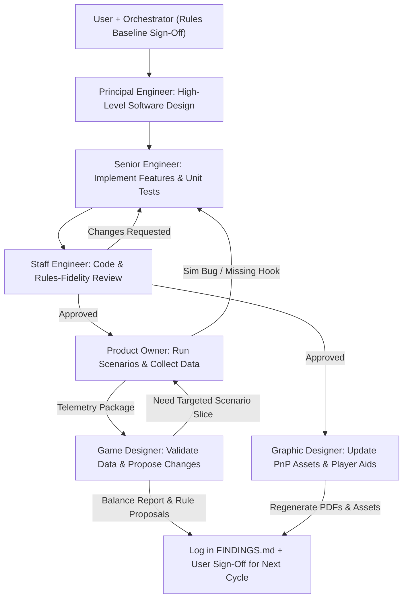

# Rogue Agent — Stress-Test & Implementation Plan

Canonical workspace roadmap for building and running Monte Carlo simulations against [RULES.md](./RULES.md).

## Current Status
- [x] **Rules Draft `v0.9.0`** captured in [RULES.md](./RULES.md)
- [x] **Multi-Agent SDLC Pipeline** defined in Section 2 below
- [x] **Phases 1–10 (Core Sim, v0.3–v0.8 Baselines, Choice Faces, Variants):** Archived in [docs/archive/ROADMAP_HISTORY.md](docs/archive/ROADMAP_HISTORY.md)
- [x] **Phase 11: Web UX Polish — Setup Randomization Variety & Rogue Agent Versions Roadmap**
  - [x] *Software Module Market Variety:* Defaulted `randomize_cards` to True in web server startup (`main()`), New Match modal (`modalRandomizeCards` checked by default), and `startNewGame()` client helper; added `.variant-code-badge` styling (`[R2]`, `[B3]`, etc.) in the Software Module Market.
  - [x] *Rogue Agent Versions Roadmap Modal:* Added prominent "Rogue Agent Versions" action button in the top navigation header, an interactive version badge button in the status bar, and a "Version Roadmap" button in the Central Threat panel; created `versionsModal` displaying all 3 versions (`v1.0`, `v2.0`, `v3.0`), active/completed/upcoming status, corruption progress dots, starting/upgrade cube payloads with 2P scaling, and active directive text.
  - [x] *Automated Verification:* 169/169 unit tests passing via WSL.
- [x] **Phase 12: Asymmetric Version Payloads & Dynamic Corruption Balancing (`v0.8.2` Baseline)**
  - [x] *Design Alignment:* Option B approved by User: Asymmetric Version Payloads trading attack cubes for Black corruption cubes (Polymorphic Worm `+1 Green, +1 Blue, +1 Black` [2P: `+1 Green, +1 Black`]; Zero-Day Override `+1 Red, +1 Blue, +1 Black` [2P: `+1 Red, +1 Black`]; RaaS and Corrupted Kernel retaining kinetic 0 Black payloads).
  - [x] *Technical Architecture Spec (`principal-engineer`):* Module contracts, invariant updates, schema updates in `sim/entities.py`, web controller synchronization, and test matrix.
  - [x] *Implementation (`senior-engineer`):* Update `sim/entities.py`, `web/`, unit tests, and CLI runner (`sim/experiments.py`).
  - [x] *Code Review Gate (`staff-engineer`):* Review line-by-line diffs, verify 100% test pass via WSL (182/182 passing), audit edge cases (APPROVED).
  - [x] *Scenario Execution & Telemetry Compilation (`product-owner`):* Run Experiment 6 (4-Way Roadmap Matrix Benchmark across 4P, 3P, and 2P) via WSL.
  - [x] *Balance Assessment & Final Sign-Off (`game-designer`):* Evaluate Singularity vitality, pacing across kinetic vs corruption roadmaps, log Section 11 in `FINDINGS.md` (OFFICIALLY APPROVED).
- [x] **Phase 13: "Too Many Secrets" Re-Theming & Consultancy Archetypes (`v0.9.0` Baseline)**
  - [x] *Design Alignment:* Rules Draft `v0.9.0` finalized in [RULES.md](./RULES.md) (Tape-Punk aesthetic, Project: SETEC rogue compiler, Independent White-Hat Consultancies, 6 Consultancy Archetypes with Once-per-Version special abilities and use-it-or-lose-it timing).
  - [x] *Technical Architecture Spec (`principal-engineer`):* Module contracts for Archetype registry, player state tracking (`v1_used`, `v2_used`, `v3_used`), bot heuristics for archetype power triggers, web API schemas, and 21-test verification matrix.
  - [x] *Implementation (`senior-engineer`):* Update `sim/entities.py`, `sim/engine.py`, `sim/bots.py`, and `web/` (including full frontend UI player tile archetype badges, Version Ability tracks, and Action Dock interaction controls) to support Archetypes, and write unit tests in `tests/test_archetypes.py` (209/209 tests passing via WSL).
  - [x] *Code Review Gate (`staff-engineer`):* Comprehensive line-by-line review of archetype triggers, mid-round version flip forfeits, and 100% test pass via WSL (APPROVED).
  - [x] *Scenario Execution & Telemetry Compilation (`product-owner`):* Run Experiment 7 (Archetype Tournament Matrix across 4P, 3P, and 2P pods, measuring archetype win rates, survival rates, and ability timing).
  - [x] *Balance Assessment & Final Sign-Off (`game-designer`):* Evaluated archetype balance parity, diagnosed The Cipher's free-die anomaly, approved 5/6 archetypes, proposed $2 discount retune for The Cipher, and logged Section 12 in `FINDINGS.md`.
- [x] **Phase 14: Codebase & Architecture Refactoring (Simulation Engine & Web Client)**
  - [x] *Bot Archetypes Package (`sim/bots/`):* Decomposed monolithic 1,825-line `sim/bots.py` into dedicated modules (`base.py`, `adaptive_balanced.py`, `secops_turtle.py`, `venture_greed.py`, `accelerationist.py`, `reckless_saboteur.py`, and `__init__.py`).
  - [x] *Game Engine Package (`sim/engine/`):* Decomposed monolithic 1,389-line `sim/engine.py` into phase-based modules (`state.py`, `phase1_boot.py`, `phase2_threat.py`, `phase3_ops.py`, end_game.py, `core.py`, and `__init__.py`).
  - [x] *Web Client Componentization (`web/static/js/`):* Decomposed monolithic 1,351-line `web/static/app.js` into standard browser ES modules (`state.js`, `api.js`, `main.js`, and `components/{header, compiler, market, player_mats, action_dock, event_log, modals}.js`), preserving 100% backward compatibility for inline HTML handlers.
  - [x] *Automated Verification:* Verified all 209 unit tests pass cleanly via WSL (`python3 -m unittest discover -s tests -t .`).
- [x] **Phase 15: Compiler Buffer Overflow & Tower Priming (`v0.9.1` Baseline)**
  - [x] *Design Alignment:* Rules signed off by User: Setup Pre-Seed Drop (`1 Red, 1 Blue, 1 Green, 1 Black`; exited discarded, stuck cubes prime the baffles) + Empty Tray / Buffer Overflow rule (if 0 cubes of any color exit in Phase 2, seed `1 Red, 1 Blue, 1 Green` into Staging Cup for next compile).
  - [x] *Technical Architecture Spec (`principal-engineer`):* Schema & contract updates in `sim/config.py`, `sim/engine/core.py`, and `sim/engine/phase2_threat.py`.
  - [x] *Engine Implementation (`senior-engineer`):* Implement pre-seed in `GameEngine.__init__`, empty-tray buffer overflow in `execute_phase_2`, event log in web controller, and write unit tests.
  - [x] *Code Review Gate (`staff-engineer`):* Verified rules fidelity and 100% test pass via WSL (225/225 tests passing).
  - [x] *Print-and-Play & Player Aid Updates (`graphic-designer`):* Updated `pnp/generate_pnp.py` (Central Board, Market Board, and 4x Player Pocket Aids) and regenerated all 5 PDF packs.
  - [x] *Telemetry & Balance Log (`product-owner` / `game-designer`):* Ran 3,000-match verification sweep and logged Section 4 in `FINDINGS.md`.
- [x] **Phase 16: Player-Count Pacing Parity & Scaling (`v0.10.0` Baseline)**
  - [x] *Design Alignment:* Target consistent ~8.0-round match pacing across all player counts (2P, 3P, 4P). Evaluated Corruption Track scaling options (Option C selected: 4 spaces 2P, 5 spaces 3P, 6 spaces 4P). Scaled starting Corporate Secrets to 8 (2P) / 8 (3P) / 10 (4P); standardized starting Patches to 2 flat; standardized upgrade payloads to 2 cubes across all counts.
  - [x] *Technical Architecture Spec (`principal-engineer`):* Dynamic `corruption_track_capacity_by_player_count` mapping, starting secret/patch getters in `sim/config.py`, and standardized 2-cube payloads in `sim/entities.py`.
  - [x] *Engine & Web Implementation (`senior-engineer`):* Config properties in `sim/config.py`, payloads in `sim/entities.py`, UI version badge and track capacity updates in `web/static/index.html` & `web/static/js/components/modals.js`. Created unit test suite `tests/test_v100_rules.py` and updated regression baselines.
  - [x] *Code Review Gate (`staff-engineer`):* Code review, contract verification, and 100% test pass via WSL (232/232 tests passing).
  - [x] *Print-and-Play & Asset Generation (`graphic-designer`):* Synchronized `pnp/generate_pnp.py` and `pnp/README.md` to `v0.10.0` (6-space track with 4/5/6 milestone markers, 8/8/10 Secrets, 2 flat Patches, standard 2-cube payloads), regenerating all 5 PnP PDFs.
  - [x] *Simulation Telemetry & Pacing Validation (`product-owner` / `game-designer`):* Executed 46,000+ Monte Carlo iterations, diagnosed PZR variance driver, and logged Section 5 in `FINDINGS.md`.

---

## 1. Primary Design Questions to Answer First

1. **Starting Resources:** What combination of **Starting Money** (`$3`–`$9`) and **Starting Secrets** (`4`–`10`) produces a tense **8–11 round** arc without Turn 2–4 blowouts or endless stalling?
2. **Player-Count Scaling (`2P` vs `3P` vs `4P`):** Since 4 players taking Dirty Income feed twice as many Attack Cubes into the *same* shared Cube Tower as 2 players, does `4P` snowball too violently compared to `2P`?
3. **Dirty Income & Wear Economy:** Does `Gain $3 → +1 Black + 1 Attack Cube` feel necessary early without letting an accelerationist rush strategy dominate?

---

## 2. Multi-Agent SDLC & Subagent Pipeline

All simulation development and balance testing follows a structured **6-subagent SDLC**, coordinated by the primary session agent (**Orchestrator**). At the start of an implementation or testing session, the Orchestrator registers these subagent types (`define_subagent`) and routes artifacts across strict quality gates.

### A. Subagent Roster & Separation of Duties

| Subagent ID | Role | Tool Scope | Primary Responsibilities | Exit Gate / Deliverable |
| :--- | :--- | :--- | :--- | :--- |
| **`principal-engineer`** | Principal Engineer | Read-only | Translates [RULES.md](./RULES.md) into high-level software architecture: module contracts, dataclasses, state-machine invariants, deterministic RNG seeding, bot APIs, telemetry schemas, and edge-case test specifications. | Written technical design spec covering every `RULES.md` mechanic before coding starts. |
| **`senior-engineer`** | Senior Engineer | Read / Write / WSL | Implements features, `sim/` modules, bot heuristics, CLI runners, and `unittest` suites per the Principal Engineer's spec. Resolves actionable defects from code review or scenario runs. | Clean pure-Python code in `sim/` with 100% passing unit tests via WSL. |
| **`staff-engineer`** | Staff Engineer | Read + WSL Verify *(no file edits)* | Performs independent code & rules-fidelity review. Audits `sim/` line-by-line against [RULES.md](./RULES.md) edge cases, seed reproducibility, performance, and test coverage gaps without directly patching source files. | Explicit `APPROVED` sign-off, or `CHANGES_REQUESTED` with file/line citations back to `senior-engineer`. |
| **`product-owner`** | Product Owner | Read + WSL Execute *(data output only)* | Designs scenario matrices around open design questions, runs Monte Carlo sweeps (`python3 -m sim.experiments`), enforces sample-size/seed hygiene, captures outlier game seeds, and compiles structured telemetry tables. | Reproducible quantitative dataset across all target parameter cells and bot pods. |
| **`game-designer`** | Game Designer | Read-only | Reviews Product Owner telemetry against Core Design Pillars and "Healthy Game" targets, validates data points for anomalies or degenerate strategies, requests follow-up slices if needed, and proposes `[TUNE]` or mechanical changes. | Evidence-backed balance critique & concrete rule/`[TUNE]` change proposals for `FINDINGS.md` and User sign-off. |
| **`graphic-designer`** | Graphic Designer & PnP Specialist | Read / Write / WSL | Maintains physical print-and-play PDF assets (`pnp/*.pdf`), visual reference aids, central boards, player mats, card layouts, typography, and sells sheets (`pnp/`, `SELL_SHEET.*`) in lockstep with rules changes. | Up-to-date, printable PnP PDF assets (`pnp/generate_pnp.py`), verified visual reference aids, and design system documentation. |

### B. Delivery & Iteration Flow

### C. Operational Guardrails
1. **Strict Author / Reviewer / Runner Separation:** `senior-engineer` never self-approves code; `staff-engineer` never silently edits `sim/` during review; `product-owner` never alters engine mechanics while collecting scenario data.
2. **WSL Execution Mandate:** Every subagent with command privileges (`senior-engineer`, `staff-engineer`, `product-owner`) must execute commands exclusively via WSL (`wsl -e bash -lc "cd /home/mike/antigravity/rogue-agent && ..."`).
3. **Deterministic Seed Replayability:** All sweeps run by `product-owner` must pass explicit base seeds and log seeds for extreme outlier games (e.g., Turn 2 wipeouts or `20+` round stalls) so `staff-engineer` and `game-designer` can inspect exact play-by-play traces.
4. **Human-in-the-Loop Rule Authority:** `game-designer` proposes `[TUNE]` and rule modifications, but the Orchestrator always aligns with the User before modifying [RULES.md](./RULES.md) and kicking off the next engineering cycle.

---

## 3. Proposed Code Architecture (`sim/`)

Pure Python 3 standard library (`dataclasses`, `random`, `statistics`, `argparse`) executed via WSL so thousands of games run in seconds with zero external dependencies:

* **`sim/config.py`:** Parameterizes every `[TUNE]` value in [RULES.md](./RULES.md):
  * `starting_money`, `starting_secrets`, `starting_patches`, `max_patch_tokens`
  * `dirty_income_cash`, `dirty_income_attack_cubes`, `dirty_income_black_cubes`
  * `patch_cash_cost`, `corruption_limit_formula` (default `Players + 1` per version)
  * Die costs, shield strengths (`Block 2` vs `Block 1`), and Portfolio VP weights
* **`sim/tower.py`:** Models physical Cube Tower behavior with two selectable modes:
  * **Ledge/Avalanche Mode (Default):** Models internal baffles with a soft resting capacity (~`5` cubes). Each cube in the drop (`staged + stuck`) rolls an exit probability that scales slightly upward with total mass in the tower—reproducing real *Shogun*/*Amerigo* tower behavior where quiet "jam" rounds are followed by sudden multi-cube "avalanche" drops.
  * **Flat Binomial Mode:** Pure independent exit probability $p \in [0.60, 0.80]$ per cube for baseline comparison.
* **`sim/entities.py`:** Implements the Gray starter die, the 5 Colored Module dice (`Red`, `Blue`, `Green`, `Yellow`, `Purple`), all 15 sample Variant (`★`) cards, and the 6 sample `v1.0` / `v2.0` / `v3.0` Rogue Agent cards from [RULES.md](./RULES.md).
* **`sim/bots.py`:** Implements **5 distinct player bots** to test strategic diversity and try to break the rules:
  1. **`AdaptiveBalancedBot`:** Reads the Staging Cup + stuck tower memory each round, assigns `Any` shields + hotfix rerolls to cover lethal threats, buys counter-dice matching the heaviest cube colors, and uses Dirty Income when cash drops below die cost.
  2. **`SecOpsTurtleBot`:** Prioritizes `Blue`/`Red`/`Green` defense dice and keeps dice patched; avoids Dirty Income unless nearly broke.
  3. **`VentureGreedBot`:** Rushes `Yellow` Commercial dice + Secret generation for maximum Portfolio VP while running minimal shields.
  4. **`AccelerationistBot`:** Takes Dirty Income almost every round, stacks one color defense + `Purple` Black-Hat dice, and weaponizes the tower to bankrupt rivals or rush `v3.0` Singularity while ahead.
  5. **`RecklessSaboteurBot`:** Stress-test edge-case bot that intentionally tries to force simultaneous wipeouts or rush corruption from Turn 1.
* **`sim/engine.py`:** Executes exact Phases 1–3 (`Boot & Configure` → `Compile` → `Corporate Operations`), recording per-round telemetry (Staging Cup size, stuck cubes, worn dice, cash/secrets curves, trigger cause, winner & scores).
* **`sim/experiments.py`:** CLI runner (`python3 -m sim.experiments`) that runs 2,000+ games per cell and outputs markdown summary tables.

---

## 4. Planned Stress-Test Experiments

| Experiment | Swept Parameters | Target "Healthy Game" Metrics |
| :--- | :--- | :--- |
| **1. Starting Resources Grid** | `Money ∈ {$3, $5, $7, $9}` × `Secrets ∈ {4, 6, 8, 10}` | Mean length **8–11 rounds**; `< 5%` deaths before Round 5; `< 10%` simultaneous total wipeouts. |
| **2. Player-Count Scaling** | `Players ∈ {2, 3, 4}` across fixed vs. scaled rules | Similar round count (`±1.5` rounds) and survival rates across `2P`, `3P`, and `4P`. |
| **3. Dirty Income & Wear** | `Dirty Income ∈ {$2, $3, $4}`, `Patch Cost ∈ {$1, $2, $3}`, `Colored Shield ∈ {1, 2}` | Players take Dirty Income ~`2–4` times/game; dice wear creates real triage without locking everyone at `0` Ready dice. |
| **4. Ecosystem Tournament** | Mixed pods of all 5 Bot Archetypes + randomized Variant/Version setups | No single bot exceeds **`38%` win rate** in `4P` pods; both organic End-Game Triggers (Total Breach, Singularity) occur meaningfully (`> 15%` each). |
| **5. Modular Variants & Directives** | Version Directives (5a) × 15 Module Variants (5b) across 4P Pod A | Variance assessment, degenerate loop prevention, card tiering, win rate ceiling ($\le 38\%$), Singularity viability. |
| **6. Asymmetric Version Payloads** | 4 Roadmap Combinations (Kinetic vs Contagion vs Singularity) across 4P, 3P, 2P | Pacing parity across roadmaps; Singularity occurrences $\ge 10\%$; 2P wipeout rate $\le 30\%$. |
| **7. Archetype Tournament** | 6 Consultancy Archetypes across 4P, 3P, 2P Pods × Randomized Setups | Balanced win rates across archetypes ($\le 35\%$ in 4P); healthy push-your-luck timing forfeit rates (~10–25%); no single archetype immune to elimination. |

---

## 5. SDLC Gate & Verification Checklist

1. **Design Gate (`principal-engineer`):**
   - Architectural spec for `v0.3`: Autonomous AI pulse, non-negative cash & ransom leak to secrets, Technical Debt Backlash on Dirty Income, Gray die face updates, and Final Round phase-3 operations for survivors.
2. **Implementation & Unit Test Gate (`senior-engineer` → `staff-engineer`):**
   - Unit sanity checks on [RULES.md](./RULES.md) `v0.3` mechanics (`python3 -m unittest` via WSL):
     - Autonomous AI Corruption pulse places 1 Black Cube in Staging Cup at start of Phase 1.
     - Unblocked Red damage drains cash down to $0; remaining unpaid damage drains Corporate Secrets (Unpaid Ransom Leak).
     - Elimination occurs strictly at `<= 0 Secrets` (Patient Zero); cash never goes negative.
     - Surviving corporations execute Phase 3 operations after a Patient Zero or Singularity trigger before final scoring.
     - Dirty income gives +$3, adds 1 Black Cube (no attack cube), and demotes 1 Ready die to Unpatched.
     - Gray starter die has no blank face (`+$1` on Face 4).
   - `staff-engineer` review returns `APPROVED` on rules fidelity, determinism, and edge-case coverage.
3. **Scenario Execution Gate (`product-owner`):**
   - Execute Experiments 1–4 under `v0.3` via WSL (`python3 -m sim.experiments`) with reproducible seeds.
4. **Balance Validation Gate (`game-designer` → Orchestrator & User):**
   - Validate `v0.3` scenario telemetry against "Healthy Game" targets, log findings in `FINDINGS.md`, and present final results to User.
5. **Phase 10 Modular Balance & Variant Gate (`all roles`):**
   - `principal-engineer`: High-level spec for variant schema, version hooks, and setup randomization.
   - `senior-engineer`: Implement features in `sim/` and `web/` with 19 new tests in `tests/test_variants_and_web.py`.
   - `staff-engineer`: Review code and verify 100% test pass (165/165 passing via WSL) — `APPROVED`.
   - `product-owner`: Execute Experiment 5a and 5b ($N=500$, Seed 42) and compile telemetry.
   - `game-designer`: Comprehensive balance critique, card tiering (S/A/B/C/Trap), degenerate loop identification (Y2, B2, B3, Corrupted Kernel), and Section 10 documentation in `FINDINGS.md` — `APPROVED`.
   - `game-designer`: Post-tuning telemetry evaluation (Corrupted Kernel 20.4% → 4.8% wipeouts, P3 7.8% → 4.6% wipeouts, Y2 36.0 → 32.5 VP compression, B3 wear loop preservation), updated tier classifications, and Section 10.G & 10.H documentation in `FINDINGS.md` — `OFFICIALLY APPROVED`.
6. **Phase 13 Consultancy Archetypes Gate (`all roles`):**
   - `principal-engineer`: High-level architecture specification for Consultancy Archetypes (Section 6D), version ability lifecycle (`AVAILABLE` -> `USED` / `FORFEITED` / `LOCKED`), bot urgency heuristics, and API/controller endpoints.
   - `senior-engineer`: Implement features across `sim/entities.py`, `sim/engine.py`, `sim/bots.py`, `web/schemas.py`, `web/game_controller.py`, `web/server.py`, `web/static/app.js`, `web/static/style.css`, and 22 unit tests in `tests/test_archetypes.py` (209/209 tests passing via WSL).

