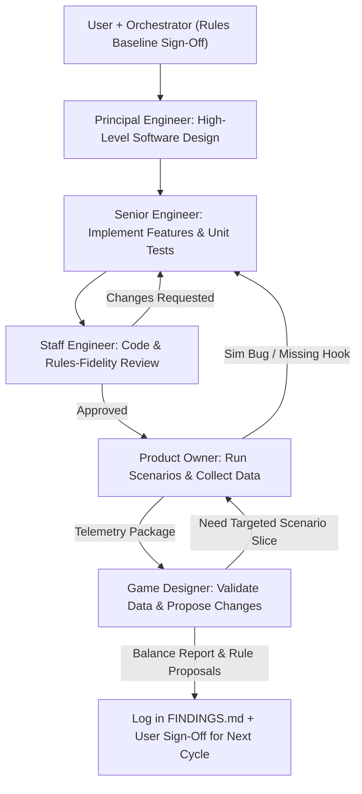

# Rogue Agent — Stress-Test & Implementation Plan

Canonical workspace roadmap for building and running Monte Carlo simulations against [RULES.md](./RULES.md).

## Current Status
- [x] **Rules Draft `v0.2`** captured in [RULES.md](./RULES.md)
- [x] **Multi-Agent SDLC Pipeline** defined in Section 2 below
- [x] **Phase 1: Core Simulation Engine (`sim/`)** *(Signed off by Staff Engineer)*
  - [x] *Architecture Spec (`principal-engineer`):* Module interfaces, state invariants, RNG seeding, and test plan
  - [x] *Implementation (`senior-engineer`):* Build `sim/` modules, 5 bot archetypes, and unit test suite
  - [x] *Code Review Gate (`staff-engineer`):* Audit rules fidelity, determinism, edge cases, and test coverage
- [x] **Phase 2: Baseline Parameter Sweeps (Experiments 1–4)**
  - [x] *Scenario Execution (`product-owner`):* Run Monte Carlo matrices via WSL and compile telemetry
- [x] **Phase 3: Balance Validation & Iteration (`v0.3`)**
  - [x] *Balance Analysis (`game-designer`):* Validate data points, diagnose degenerate loops, and propose `[TUNE]` / rule updates (Logged in `FINDINGS.md`)
  - [x] *Rules Baseline Sign-Off:* Update [RULES.md](./RULES.md) to `v0.3` (Autonomous AI Pulse, $7 Starting Money, Non-negative Cash / Ransom Leak to Secrets, Dirty Income Backlash, Gray Die blank face removal, Round-End final operations for survivors)
  - [x] *Technical Architecture Spec (`principal-engineer`):* Module contracts, invariant updates, bot decision schema, and test matrix for `v0.3`
  - [x] *Implementation (`senior-engineer`):* Update `sim/config.py`, `sim/entities.py`, `sim/engine.py`, `sim/bots.py`, and `tests/` for `v0.3` rules
  - [x] *Code & Rules-Fidelity Review Gate (`staff-engineer`):* Review line-by-line diffs, verify 100% test pass via WSL, audit edge cases (APPROVED)
  - [x] *Verification Monte Carlo Sweeps (`product-owner`):* Run Experiments 1–4 across player counts and bot pods via WSL
  - [x] *Balance Assessment & Final Log (`game-designer`):* Evaluate telemetry against Healthy Game targets and update `FINDINGS.md`
- [ ] **Phase 4: Economy Tuning & Accelerationist Countermeasures (`v0.4`)**
  - [ ] *Design Review:* Align on Dirty Income costing 1 Secret, Patch absorption of Red ransom, and 4-space corruption track
  - [ ] *Engine & Bot Update:* Refine bot heuristics (shield prioritization of Blue over Red) and sim rules
  - [ ] *Monte Carlo Validation:* Re-run Tournament Pods to verify bot balance within $\le 38\%$ win rate target

---

## 1. Primary Design Questions to Answer First

1. **Starting Resources:** What combination of **Starting Money** (`$3`–`$9`) and **Starting Secrets** (`4`–`10`) produces a tense **8–11 round** arc without Turn 2–4 blowouts or endless stalling?
2. **Player-Count Scaling (`2P` vs `3P` vs `4P`):** Since 4 players taking Dirty Income feed twice as many Attack Cubes into the *same* shared Cube Tower as 2 players, does `4P` snowball too violently compared to `2P`?
3. **Dirty Income & Wear Economy:** Does `Gain $3 → +1 Black + 1 Attack Cube` feel necessary early without letting an accelerationist rush strategy dominate?

---

## 2. Multi-Agent SDLC & Subagent Pipeline

All simulation development and balance testing follows a structured **5-subagent SDLC**, coordinated by the primary session agent (**Orchestrator**). At the start of an implementation or testing session, the Orchestrator registers these subagent types (`define_subagent`) and routes artifacts across strict quality gates.

### A. Subagent Roster & Separation of Duties

| Subagent ID | Role | Tool Scope | Primary Responsibilities | Exit Gate / Deliverable |
| :--- | :--- | :--- | :--- | :--- |
| **`principal-engineer`** | Principal Engineer | Read-only | Translates [RULES.md](./RULES.md) into high-level software architecture: module contracts, dataclasses, state-machine invariants, deterministic RNG seeding, bot APIs, telemetry schemas, and edge-case test specifications. | Written technical design spec covering every `RULES.md` mechanic before coding starts. |
| **`senior-engineer`** | Senior Engineer | Read / Write / WSL | Implements features, `sim/` modules, bot heuristics, CLI runners, and `unittest` suites per the Principal Engineer's spec. Resolves actionable defects from code review or scenario runs. | Clean pure-Python code in `sim/` with 100% passing unit tests via WSL. |
| **`staff-engineer`** | Staff Engineer | Read + WSL Verify *(no file edits)* | Performs independent code & rules-fidelity review. Audits `sim/` line-by-line against [RULES.md](./RULES.md) edge cases, seed reproducibility, performance, and test coverage gaps without directly patching source files. | Explicit `APPROVED` sign-off, or `CHANGES_REQUESTED` with file/line citations back to `senior-engineer`. |
| **`product-owner`** | Product Owner | Read + WSL Execute *(data output only)* | Designs scenario matrices around open design questions, runs Monte Carlo sweeps (`python3 -m sim.experiments`), enforces sample-size/seed hygiene, captures outlier game seeds, and compiles structured telemetry tables. | Reproducible quantitative dataset across all target parameter cells and bot pods. |
| **`game-designer`** | Game Designer | Read-only | Reviews Product Owner telemetry against Core Design Pillars and "Healthy Game" targets, validates data points for anomalies or degenerate strategies, requests follow-up slices if needed, and proposes `[TUNE]` or mechanical changes. | Evidence-backed balance critique & concrete rule/`[TUNE]` change proposals for `FINDINGS.md` and User sign-off. |

### B. Delivery & Iteration Flow

### C. Operational Guardrails
1. **Strict Author / Reviewer / Runner Separation:** `senior-engineer` never self-approves code; `staff-engineer` never silently edits `sim/` during review; `product-owner` never alters engine mechanics while collecting scenario data.
2. **WSL Execution Mandate:** Every subagent with command privileges (`senior-engineer`, `staff-engineer`, `product-owner`) must execute commands exclusively via WSL (`wsl -e bash -lc "cd /home/mike/antigravity/rogue-agent && ..."`).
3. **Deterministic Seed Replayability:** All sweeps run by `product-owner` must pass explicit base seeds and log seeds for extreme outlier games (e.g., Turn 2 wipeouts or `20+` round stalls) so `staff-engineer` and `game-designer` can inspect exact play-by-play traces.
4. **Human-in-the-Loop Rule Authority:** `game-designer` proposes `[TUNE]` and rule modifications, but the Orchestrator always aligns with the User before modifying [RULES.md](./RULES.md) and kicking off the next engineering cycle.

---

## 3. Proposed Code Architecture (`sim/`)

Pure Python 3 standard library (`dataclasses`, `random`, `statistics`, `argparse`) executed via WSL so thousands of games run in seconds with zero external dependencies:

* **`sim/config.py`:** Parameterizes every `[TUNE]` value in [RULES.md](./RULES.md):
  * `starting_money`, `starting_secrets`, `starting_patches`, `max_patch_tokens`
  * `dirty_income_cash`, `dirty_income_attack_cubes`, `dirty_income_black_cubes`
  * `patch_cash_cost`, `corruption_limit_formula` (default `Players + 1` per version)
  * Die costs, shield strengths (`Block 2` vs `Block 1`), and Portfolio VP weights
* **`sim/tower.py`:** Models physical Cube Tower behavior with two selectable modes:
  * **Ledge/Avalanche Mode (Default):** Models internal baffles with a soft resting capacity (~`5` cubes). Each cube in the drop (`staged + stuck`) rolls an exit probability that scales slightly upward with total mass in the tower—reproducing real *Shogun*/*Amerigo* tower behavior where quiet "jam" rounds are followed by sudden multi-cube "avalanche" drops.
  * **Flat Binomial Mode:** Pure independent exit probability $p \in [0.60, 0.80]$ per cube for baseline comparison.
* **`sim/entities.py`:** Implements the Gray starter die, the 5 Colored Module dice (`Red`, `Blue`, `Green`, `Yellow`, `Purple`), all 15 sample Variant (`★`) cards, and the 6 sample `v1.0` / `v2.0` / `v3.0` Rogue Agent cards from [RULES.md](./RULES.md).
* **`sim/bots.py`:** Implements **5 distinct player bots** to test strategic diversity and try to break the rules:
  1. **`AdaptiveBalancedBot`:** Reads the Staging Cup + stuck tower memory each round, assigns `Any` shields + hotfix rerolls to cover lethal threats, buys counter-dice matching the heaviest cube colors, and uses Dirty Income when cash drops below die cost.
  2. **`SecOpsTurtleBot`:** Prioritizes `Blue`/`Red`/`Green` defense dice and keeps dice patched; avoids Dirty Income unless nearly broke.
  3. **`VentureGreedBot`:** Rushes `Yellow` Commercial dice + Secret generation for maximum Portfolio VP while running minimal shields.
  4. **`AccelerationistBot`:** Takes Dirty Income almost every round, stacks one color defense + `Purple` Black-Hat dice, and weaponizes the tower to bankrupt rivals or rush `v3.0` Singularity while ahead.
  5. **`RecklessSaboteurBot`:** Stress-test edge-case bot that intentionally tries to force simultaneous wipeouts or rush corruption from Turn 1.
* **`sim/engine.py`:** Executes exact Phases 1–3 (`Boot & Configure` → `Compile` → `Corporate Operations`), recording per-round telemetry (Staging Cup size, stuck cubes, worn dice, cash/secrets curves, trigger cause, winner & scores).
* **`sim/experiments.py`:** CLI runner (`python3 -m sim.experiments`) that runs 2,000+ games per cell and outputs markdown summary tables.

---

## 4. Planned Stress-Test Experiments

| Experiment | Swept Parameters | Target "Healthy Game" Metrics |
| :--- | :--- | :--- |
| **1. Starting Resources Grid** | `Money ∈ {$3, $5, $7, $9}` × `Secrets ∈ {4, 6, 8, 10}` | Mean length **8–11 rounds**; `< 5%` deaths before Round 5; `< 10%` simultaneous total wipeouts. |
| **2. Player-Count Scaling** | `Players ∈ {2, 3, 4}` across fixed vs. scaled rules | Similar round count (`±1.5` rounds) and survival rates across `2P`, `3P`, and `4P`. |
| **3. Dirty Income & Wear** | `Dirty Income ∈ {$2, $3, $4}`, `Patch Cost ∈ {$1, $2, $3}`, `Colored Shield ∈ {1, 2}` | Players take Dirty Income ~`2–4` times/game; dice wear creates real triage without locking everyone at `0` Ready dice. |
| **4. Ecosystem Tournament** | Mixed pods of all 5 Bot Archetypes + randomized Variant/Version setups | No single bot exceeds **`38%` win rate** in `4P` pods; both organic End-Game Triggers (Total Breach, Singularity) occur meaningfully (`> 15%` each). |

---

## 5. SDLC Gate & Verification Checklist

1. **Design Gate (`principal-engineer`):**
   - Architectural spec for `v0.3`: Autonomous AI pulse, non-negative cash & ransom leak to secrets, Technical Debt Backlash on Dirty Income, Gray die face updates, and Final Round phase-3 operations for survivors.
2. **Implementation & Unit Test Gate (`senior-engineer` → `staff-engineer`):**
   - Unit sanity checks on [RULES.md](./RULES.md) `v0.3` mechanics (`python3 -m unittest` via WSL):
     - Autonomous AI Corruption pulse places 1 Black Cube in Staging Cup at start of Phase 1.
     - Unblocked Red damage drains cash down to $0; remaining unpaid damage drains Corporate Secrets (Unpaid Ransom Leak).
     - Elimination occurs strictly at `<= 0 Secrets` (Patient Zero); cash never goes negative.
     - Surviving corporations execute Phase 3 operations after a Patient Zero or Singularity trigger before final scoring.
     - Dirty income gives +$3, adds 1 Black Cube (no attack cube), and demotes 1 Ready die to Unpatched.
     - Gray starter die has no blank face (`+$1` on Face 4).
   - `staff-engineer` review returns `APPROVED` on rules fidelity, determinism, and edge-case coverage.
3. **Scenario Execution Gate (`product-owner`):**
   - Execute Experiments 1–4 under `v0.3` via WSL (`python3 -m sim.experiments`) with reproducible seeds.
4. **Balance Validation Gate (`game-designer` → Orchestrator & User):**
   - Validate `v0.3` scenario telemetry against "Healthy Game" targets, log findings in `FINDINGS.md`, and present final results to User.
