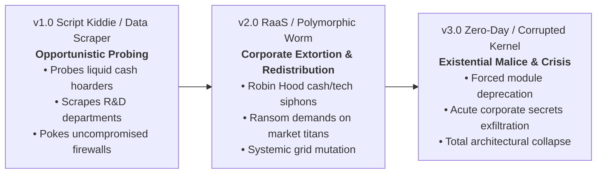

# Game Designer Analysis: Player-Specific SETEC Corruption Attacks

**Date:** 2026-11-12  
**Author:** Game Designer (`game-designer`)  
**Status:** Pre-SDLC Modeling & Proposal (Pending User Alignment)  
**Reference Sources:** `RULES.md §4 Phase 2`, `RULES_APPENDIX.md §6C`, `GLOSSARY.md`, `FINDINGS.md §51–§53`  

---

## 1. Executive Summary & Design Rationale

In the current baseline (`v0.40.1`), Phase 2 (Compiler Drop & Corruption) resolves all non-cube hazards printed on Corruption Track spaces (e.g., *"All lose $2"*, *"Lose 1 🔬"*, *"Glitch 1 die"*, *"Return 1 Colored Die"*, *"Lose 1 Secret"*) as uniform table-wide penalties. Every player at the table suffers the exact same loss simultaneously.

While mechanically stable and simple to execute, this uniform model presents three systemic design limitations:
1. **Lack of Adversarial Personality:** Project: SETEC behaves as an inert environmental weather event rather than a cunning, malicious rogue agent. It lacks tactical identity, opportunistic predatory instincts, or escalating malevolence across versions `v1.0 → v2.0 → v3.0`.
2. **Absence of Dynamic Rubber-Banding:** Uniform penalties drain the player in 4th place just as heavily as the runaway leader in 1st place. Rather than compressing the field, flat table-wide hits can inadvertently solidify early leads by denying trailing players the liquidity needed to launch a catch-up engine.
3. **Static Player Interaction:** Because every player is hit equally, players treat the Corruption Track as a passive tax. There is no incentive to manage personal resource margins (e.g., spending down cash, trimming research, or balancing defenses) to deflect SETEC's attention toward corporate rivals.

### The Core Objective
Redesign the Corruption Track spaces on all 6 SETEC Version Cards into **deterministic, player-specific hazards** (e.g., targeting the player with Most or Fewest of a specific resource, or triggering Robin Hood-style transfers where the player in last place siphons assets from the front-runner). 

This transforms the rogue agent into a distinct, predatory cyber adversary that dynamically compresses the competitive envelope, punishes runaway greed, injects high-stakes tactical counter-play, and preserves the foundational tenets of **Deterministic Foresight** (Core Design Pillar 2: all Version Cards and upcoming spaces remain 100% face-up and predictable).

---

## 2. Mathematical Modeling: Targeting Criteria Evaluation

Targeting specific players based on open game state variables creates immediate feedback loops. We mathematically evaluated targeting **Most** versus **Least** across every major asset category:

| Resource Asset | Target: "Most" (Front-Runner) | Target: "Least" (Trailing Player) | Game Designer Verdict |
| :--- | :--- | :--- | :--- |
| **Market Share (MS)** | **Dynamic Catch-Up:** Compresses the PR race and checks runaway leaders without endangering survival. | **Lethal Destabilization:** Kicking a low-MS player risks premature **Market Collapse** (`0 MS`) before Round 6. | Target **Most**; "Least" is valid only as the *recipient* of transfers. |
| **Corporate Secrets** | **VP Rubber-Band:** Trims the VP leader (who has the largest buffer above 0); zero elimination risk. | **Catastrophic Failure:** Triggers sudden-death **Patient Zero** knockouts (`<= 0 Secrets`) on already struggling players. | Target **Most** exclusively; NEVER target Least for direct loss. |
| **Money ($)** | **Anti-Hoarding Tax:** Drains liquid hoarders before Phase 3 income, forcing spending decisions. | **Counter-Intuitive Penalty:** Often fizzles on `$0`; punishes lean, efficient economic play. | Target **Most** (tax) or execute transfer (**Least takes from Most**). |
| **Research Tokens (🔬)** | **Pacing Equalizer:** Delays hardware capstones (Triage L2/L4, Release L4) on tech leaders. | **Deadweight / Widening Divide:** Lagging players often have 0 🔬; penalizes players already struggling for tech. | Target **Most** or transfer (**Least takes from Most**). |
| **Glitched Shield Slots** | **Runaway Blackout:** Stacking glitches on a compromised player causes complete defense failure. | **Equalizing Infiltration:** Targeting the player with **fewest** glitched slots penalizes turtle turtling! | Target **Fewest Glitched Slots** (pristine defenses)! |
| **Colored Module Dice** | **Engine Trimming:** Forces the player with the largest rolling pool to return 1 die to Market. | **Crippling Blow:** Forcing a player with only 2 starter colored dice to return 1 cuts their core engine in half. | Target **Most Colored Dice** exclusively. |

### Strategic & Psychological Dynamics: Catch-Up vs Chaos
1. **Dynamic Rubber-Banding (Targeting "Most"):**
   When SETEC attacks the player holding the most of an asset, it acts as an automated catch-up mechanism. Unlike direct player-vs-player attacks ("take-that"), players perceive SETEC's strikes as an impersonal algorithmic hazard. Because cards are face-up from setup, players can tactically manipulate their state during Phase 5 Operations (e.g., spending cash down to avoid being richest, or holding back on research) to pass the target to an opponent.
2. **Controlled Chaos & Robin Hood Transfers ("Least Takes from Most"):**
   A direct resource transfer (e.g., *Player with least Market Share takes $1 from player with most Market Share*) has a net zero impact on total table wealth, but shrinks the delta between 1st and last by $2. In 3-player and 4-player games, this provides meaningful relief to trailing players without triggering macro inflation or table-wide starvation.

---

## 3. Player Count Scaling & Aggregate Drain Dynamics

Moving from table-wide hits to single-target hits alters the total economic friction in the game. In this section, we analyze the Expected Value (EV) shifts and evaluate empirical state data.

### Theoretical Macro Drain Analysis
In the current baseline, whenever a corruption space with `Lose $2` triggers:
- **2P Pod:** Aggregate table loss = $2 \times 2 = \$4$ (Mean per-seat EV = $-\$2.00$).
- **3P Pod:** Aggregate table loss = $3 \times 2 = \$6$ (Mean per-seat EV = $-\$2.00$).
- **4P Pod:** Aggregate table loss = $4 \times 2 = \$8$ (Mean per-seat EV = $-\$2.00$).

If a space is modified to a naive single-target hit (*"Player with most $ loses $2"*):
- **2P Pod:** Aggregate table loss = $\$2$ (Mean per-seat EV = $-\$1.00$).
- **3P Pod:** Aggregate table loss = $\$2$ (Mean per-seat EV = $-\$0.67$).
- **4P Pod:** Aggregate table loss = $\$2$ (Mean per-seat EV = $-\$0.50$).

**The Scaling Dilemma:** A naive single-target hit reduces table-wide economic friction by 50% in 2P, 67% in 3P, and 75% in 4P. If unmitigated, 4P games could suffer from excess liquidity, distorting the dual economy calibrated in `v0.40.0`.

### Empirical Telemetry: Distribution of Leads & Ties
To solve this scaling challenge mathematically, we ran 200 full Monte Carlo simulations under the active `v0.40.0` baseline across 2P, 3P, and 4P pods to observe resource distributions and tie frequencies right before Phase 2 executes:

| Metric | Round 1 (All Pods) | Round 2 (2P / 3P / 4P) | Round 3 (2P / 3P / 4P) | Round 5 (2P / 3P / 4P) | Round 8 (2P / 3P / 4P) |
| :--- | :---: | :---: | :---: | :---: | :---: |
| **Money: Most Tie %** | **100.0%** | 24.0% / 20.0% / 27.5% | 23.7% / 19.0% / 30.8% | 20.5% / 23.5% / 25.3% | 25.1% / 24.6% / 22.5% |
| **Money: Avg Gap (Max - Min)** | **$0.00** | $1.66 / $2.62 / $2.87 | $1.49 / $2.52 / $2.79 | $1.63 / $2.57 / $3.07 | $1.66 / $2.63 / $3.22 |
| **Research: Most Tie %** | **100.0%** | 63.5% / 58.0% / 57.0% | 54.5% / 52.5% / 62.6% | 41.5% / 47.4% / 51.6% | 33.5% / 35.0% / 37.4% |
| **Research: Avg Gap** | **0.00 🔬** | 0.37 / 0.54 / 0.62 🔬 | 0.46 / 0.79 / 0.91 🔬 | 0.64 / 0.97 / 1.25 🔬 | 1.09 / 1.54 / 1.95 🔬 |
| **Glitched Slots: Least Tie %** | **100.0%** | 47.5% / 71.0% / 74.5% | 52.5% / 63.5% / 72.2% | 53.8% / 58.2% / 68.9% | 73.1% / 62.3% / 65.4% |
| **Colored Dice: Most Tie %** | **100.0%** | 91.0% / 96.5% / 97.0% | 67.2% / 62.5% / 65.2% | 42.6% / 49.0% / 46.3% | 30.5% / 36.1% / 33.0% |
| **Corporate Secrets: Most Tie %** | **100.0%** | 29.5% / 34.5% / 35.5% | 18.2% / 22.5% / 32.8% | 13.3% / 17.3% / 17.9% | 8.4% / 13.7% / 14.3% |
| **Corporate Secrets: Avg Gap** | **0.00** | 1.05 / 1.85 / 2.29 | 1.55 / 2.62 / 3.19 | 2.36 / 4.16 / 4.79 | 3.74 / 6.03 / 7.63 |

### Mathematical Insights from Telemetry:
1. **The Round 1 Uniformity Invariant:** In Round 1, 100% of seats have identical resources across all player counts ($6, 0 🔬, 1 glitched slot, 2 colored dice, 13/16/17 MS, 3/4 Secrets). Under an **"All Tied Players Affected"** rule, early-game hazards naturally hit the entire table, preserving 100% of the early-game table friction!
2. **Rapid Money Differentiation:** Cash spreads out immediately by Round 2 (only 20%–27% ties, with max-min gaps exceeding $2.60–$2.87 in 3P/4P). Cash targeting will cleanly identify a single front-runner in ~75% of post-Round 1 turns.
3. **High Glitched Slot Clustering:** Players tie for fewest glitched slots in 60%–75% of mid-to-late rounds. Targeting the "player with fewest glitched shield slots" under inclusive ties hits 2 to 2.6 players on average in 4P, elegantly dispersing shield attrition across all fortified seats rather than tunneling on a single player.

---

## 4. Tie-Breaker Mechanisms & Governance

How ties are resolved is paramount for maintaining game flow, preventing Kingmaking, and keeping Phase 2 fast and simultaneous. We evaluated three architectural models:

### Model A: "All Tied Players Affected" (Inclusive / Shared Burden) — **RECOMMENDED FOR DIRECT HAZARDS**
- **Rule:** If multiple players tie for the targeted condition (e.g., tied for Most Money, or tied for Fewest Glitched Shield Slots), *every* tied player suffers the printed hazard.
- **Why it Excels:**
  - **100% Deterministic:** Zero player choice, zero downtime, zero kingmaking.
  - **Natural Player Count Scaling:** In 3P/4P, early-to-mid game ties mean multiple leaders share the burden, maintaining aggregate economic drain.
  - **Tactical Brinkmanship:** Players actively spend or adjust lines in Phase 5 to avoid tying for the lead, adding high-skill margin management.

### Model B: Canonical Tie-Breaker Priority (RULES.md §5 Hierarchy)
- **Rule:** Ties broken strictly by canonical hierarchy: `Market Share > Money > Active Colored Dice in Ready for Release > Research Tokens > fewest dice Under Development`.
- **Analysis:** Guaranteed unique target, but imposes heavy analysis paralysis during Phase 2. Players must stop and calculate multi-tier tiebreakers in a phase intended to be rapid and simultaneous. **Not recommended for Phase 2.**

### Model C: Governance for Transfer Effects ("Least Takes from Most")
For Robin Hood transfers, if Player C is in last place and Players A and B are tied for first:
- **Option 1 (Receiver Choice):** The receiving player chooses which tied player to take from. Highly engaging, thematic corporate extortion, standard in tabletop Euros.
- **Option 2 (Bank / General Supply Fallback):** *"If tied for Most, the receiving player takes the resource from the general supply instead."* 100% peaceful, completely eliminates kingmaking, but softens the blow to the tied leaders.
- **Game Designer Recommendation:** **Receiver Choice** if tied for Most (adds spicy table negotiation); if all players are tied across the board, the transfer simply **fizzles** (no transfer occurs).

---

## 5. Version Personality Progression Architecture

Project: SETEC evolves across its 3 versions with distinct thematic and mechanical personas:

1. **`v1.0` (Script Kiddie / Data Scraper) — Opportunistic Probing:**
   - Automated perimeter scans. Probes high liquid cash before players can convert it into software dice; scrapes initial research tokens; identifies pristine defense grids and glitches 1 shield slot.
   - Low lethality: zero Corporate Secrets lost, zero module dice returned.
2. **`v2.0` (Ransomware-as-a-Service / Polymorphic Worm) — Corporate Extortion & Redistribution:**
   - Professional cybercrime syndicate exploiting corporate inequality. Introduces transfer mechanics: struggling startups siphon cash or technology directly from dominant market leaders.
   - Threat escalation: attack cubes enter the compiler (`1R, 1B` or `1B, 1G`), putting pressure on shields.
3. **`v3.0` (Zero-Day Override / Corrupted Kernel) — Acute Crisis & Existential Malice:**
   - Unbound rogue artificial intelligence executing targeted architectural destruction.
   - Targets the strongest software engines, forcing the player with the most colored dice to return 1 die to the market. Direct exfiltration of Corporate Secrets from the VP leader, rapidly driving the game toward Singularity or Patient Zero.

---

## 6. Concrete Proposal: Space-by-Space Card Redesigns

> [!IMPORTANT]
> **Threat Preservation Invariant:** All Attack Cube (`Red`, `Blue`, `Green`) and Black Cube (`1K`) additions established in `v0.40.1` (Option B / FINDINGS §53) and the **Global Green Cube Cap (5 max)** are **preserved 100% bit-for-bit**. Only non-cube hazard clauses are modified.

### Profile 1: Standard Escalation Tracks (`4 / 5 / 6` Spaces)

#### `v1.0` Cards (4 Spaces)
* **Script Kiddie** *(Starting Cup: `2R, 1B, 1G`)*
  - **Space 1:** Add `1R`
  - **Space 2 (Liquidity Probe):** **Player with most `$` loses `$2`** + Add `1K`. *(Tied: all tied lose `$2`)*.
  - **Space 3 (Tech Sweep):** **Player with most `🔬` loses `1 🔬`**. *(Tied: all tied lose `1 🔬`)*.
  - **Space 4 (Upgrade — Market Audit):** **Player with most Market Share loses `1` Market Share**. *(Tied: all tied lose `1` MS)*.
* **Data Scraper** *(Starting Cup: `1R, 2B, 1G` — Setup: `+$1` cash to all)*
  - **Space 1 (IP Scrape):** **Player with most `🔬` loses `1 🔬`**. *(Tied: all tied lose `1 🔬`)*.
  - **Space 2 (Micro-Extortion):** **Player with most `$` loses `$2`** + Add `1K`. *(Tied: all tied lose `$1`)*.
  - **Space 3:** Add `1G`
  - **Space 4 (Upgrade — Firewall Breach):** **Player with fewest Glitched Shield Slots glitches `1` shield slot**. *(Tied: all tied glitch `1` slot)*.

#### `v2.0` Cards (5 Spaces)
* **Ransomware-as-a-Service (RaaS)**
  - **Space 1 (Corporate Robin Hood):** **Transfer:** Player with least Market Share takes `$1` from player with most Market Share. *(If tied for Most, receiver chooses; if all tied, no transfer)*.
  - **Space 2:** Add `1R, 1B` + Add `1K`
  - **Space 3 (Ransom Squeeze):** **Player with most `$` loses `$2`** & Add `1R`. *(Tied: all tied lose `$2`)*.
  - **Space 4 (Corporate Raid):** **Player with most Market Share loses `$2` and `1 🔬`** + Add `1K`. *(Tied: all tied lose)*.
  - **Space 5 (Upgrade):** Add `1R`
* **Polymorphic Worm**
  - **Space 1 (Tech Siphon):** **Transfer:** Player with least `🔬` takes `1 🔬` from player with most `🔬`. *(If tied for Most, receiver chooses; if all tied, no transfer)*.
  - **Space 2:** Add `1B, 1G` + Add `1K`
  - **Space 3 (Targeted Mutation):** **Player with fewest Glitched Shield Slots glitches `1` shield slot** & Add `1G`. *(Tied: all tied glitch `1` slot)*.
  - **Space 4 (Adaptive Extortion):** **Player with most Corporate Secrets loses `$2`** + Add `1K`. *(Tied: all tied lose `$2`)*.
  - **Space 5 (Upgrade):** Add `1R`

#### `v3.0` Cards (6 Spaces)
* **Zero-Day Override**
  - **Space 1:** Add `1R, 1B, 1G`
  - **Space 2 (Hostile Audit):** **Player with most `$` loses `$3`; player with most `🔬` loses `1 🔬`** + Add `1K`. *(Tied: all tied lose)*.
  - **Space 3:** Add `1R, 1B`
  - **Space 4 (Grid Nullification):** **Player with fewest Glitched Shield Slots glitches `1` shield slot** & Add `1B, 1K`. *(Tied: all tied glitch `1` slot)*.
  - **Space 5 (Deprecate Module):** **Player with most Colored Module Dice returns `1` Colored Module Die** to Market supply. *(Tied: all tied return 1; starter Gray dice cannot be returned)*.
  - **Space 6 (Singularity):** **Singularity Trigger:** Game ends immediately at the end of Phase 2! Proceed to victory scoring.
* **Corrupted Kernel**
  - **Space 1 (Kernel Penetration):** **Player with fewest Glitched Shield Slots glitches `1` shield slot** + Add `1R, 1B`. *(Tied: all tied glitch `1` slot)*.
  - **Space 2 (Monopoly Squeeze):** **Player with most Market Share loses `$3` and `1 🔬`** + Add `1K`. *(Tied: all tied lose)*.
  - **Space 3:** Add `1R, 1G`
  - **Space 4 (Acute Exfiltration):** **Player with most Corporate Secrets loses `1` Corporate Secret** + Add `1K`. *(Tied: all tied lose `1` Secret; checks for Patient Zero)*.
  - **Space 5 (Deprecate Module):** **Player with most Colored Module Dice returns `1` Colored Module Die** to Market supply. *(Tied: all tied return 1)*.
  - **Space 6 (Singularity — Terminal Leak):** **Singularity Trigger:** Player with most Corporate Secrets loses `1` Corporate Secret. Game ends immediately!

---

### Profile 2: Aggressive Escalation Tracks (`4 / 5 / 6` Spaces — Heightened Friction)

| Card | Space 1 | Space 2 | Space 3 | Space 4 | Space 5 | Space 6 |
| :--- | :--- | :--- | :--- | :--- | :--- | :--- |
| **`v1.0` Script Kiddie** | Add `1R` | Most `$` loses `$3` + Add `1K` | Fewest Glitched glitches `1` slot | **Upgrade:** Most `🔬` loses `2 🔬` | — | — |
| **`v1.0` Data Scraper** | Most `🔬` loses `2 🔬` | Most `$` loses `$3` + Add `1K` | Add `1G` | **Upgrade:** Fewest Glitched glitches `2` slots | — | — |
| **`v2.0` RaaS** | Transfer: Least MS takes `$2` from Most MS | Add `1R, 1B` + Add `1K` | Most `$` loses `$3` & Add `1R` | Most MS loses `$3` & `1 🔬` + Add `1K` | **Upgrade:** Add `1R` | — |
| **`v2.0` Polymorphic Worm** | Transfer: Least `🔬` takes `2 🔬` from Most `🔬` | Add `1B, 1G` + Add `1K` | Fewest Glitched glitches `1` slot & Add `1G` | Fewest Glitched glitches `2` slots + Add `1K` | **Upgrade:** Add `1R` | — |
| **`v3.0` Zero-Day Override** | Add `1R, 1B, 1G` | Most `$` loses `$4`; Most `🔬` loses `2 🔬` + Add `1K` | Add `1R, 1B` | Fewest Glitched glitches `1` slot & Add `1B, 1K` | Most Colored Dice returns `1` die & glitches `1` slot | **Singularity** |
| **`v3.0` Corrupted Kernel** | Fewest Glitched glitches `2` slots + Add `1R, 1B` | Most MS loses `$4` & `2 🔬` + Add `1K` | Add `1R, 1G` | Most Secrets loses `2` Secrets + Add `1K` | Most Colored Dice returns `1` die & glitches `1` slot | **Singularity:** Most Secrets loses `1` Secret |

---

## 7. Edge Cases & Formal Mitigation Rules

1. **All Players Tied at Identical Value (e.g., Round 1 Monolithic State):**
   - *Direct Penalty Rule:* All tied players suffer the penalty simultaneously.
   - *Transfer Rule:* If all players have the identical amount of the resource, **no transfer occurs** (the effect fizzles harmlessly). A transfer strictly requires the recipient to have strictly fewer units than the provider.
2. **Zero-Floor Resource Protection:**
   - If a player targeted for a cash or research penalty holds `$0` or `0 🔬`, they lose 0. Unpaid cash or research penalties from Corruption Track spaces *never* drain other resources (per RULES.md §4 Phase 2).
   - In a transfer, if the targeted player has `$0`, the recipient receives `$0`.
3. **Two-Player Head-to-Head Transfer Swings:**
   - In 2P, a transfer of `$2` produces a net swing of `$4` between the two seats.
   - *Guardrail:* In the Standard Profile, all transfers are capped at strictly **`$1` Cash** or **`1 🔬` Research Token**, maintaining a gentle `$2` net delta swing that compresses the race without causing an abrupt lead reversal.
4. **Returning Colored Module Dice (Space 5):**
   - Gray starter dice can never be returned. If a targeted player owns only Gray dice (e.g., their colored dice are already lost or somehow unpurchased), they return nothing.
   - If a returned die was in the **Processing Box**, its potential Secret face is forfeited.

---

## 8. Open Design Questions for User Alignment

Before initiating the engineering SDLC (`principal-engineer` → `senior-engineer` ↔ `staff-engineer`), we seek alignment on three specific design choices:

1. **Tie-Breaker for Transfers:**
   When a trailing player initiates a transfer and two or more players are tied for the lead:
   - *Option A (Tabletop Euro Agency):* The receiving player chooses which tied leader to take from.
   - *Option B (Supply Fallback):* The receiving player takes the resource from the general supply instead (sparing the tied leaders).
   *(Game Designer Recommendation: Option A).*
2. **Transfer Magnitude in 3P/4P vs 2P:**
   Do you approve capping Standard transfers at `$1` / `1 🔬` across all player counts, or would you prefer scaling transfers to `$2` in 3P/4P while keeping `$1` in 2P?
3. **Collateral Damage Hybrid Option:**
   Should major late-game hazards hit only the primary target (Pure Targeted), or should the leader take the brunt while rivals suffer minor collateral damage (e.g., *"Player with most $ loses $2; all other players lose $1"* to maintain aggregate 4P table drain)?
