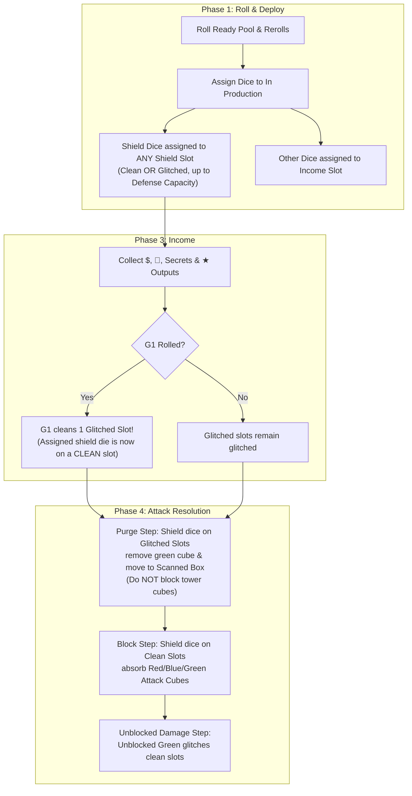

# Pre-SDLC Game Designer Analysis: Colored Die F6 (★) Variant Overhaul & Glitched Shield Slot Flow Simplification

**Author:** Game Designer (Pre-SDLC Analysis)  
**Date:** 2026-11-16  
**Target Game Version:** `v0.44.0` (advancing from `v0.43.0`)  
**Scope:** Mathematical Modeling, Threat Curves, Corporate Starter Parity, Edge Case Specifications, and Concrete Implementation Plan.

---

## 1. Executive Summary & Design Rationale

Under `v0.43.0`, two mechanical legacy frictions persisted in Rogue Agent:
1. **Split Phase 6 Operations Friction for F6 (`★`) Cards:** Several Face 6 module abilities (*R2 Ad Campaign*, *B2 Deep R&D Vault*, *Y1 Algorithmic Trading*) required delayed tracking into Phase 6 Operations, splitting income across phases and cluttering Phase 6 with minor paid conversion actions. Furthermore, several variant card definitions in `sim/` retained deprecated v0.35/v0.38 elements (color-specific shields on colored dice, confusing demotion to glitched boxes, or cross-phase damage dependencies like *B1 Honeypot Telemetry*).
2. **Glitched Shield Slot Pre-Assignment Friction:** In Phase 1 Step 4, players were forced to resolve a finicky "clean before deploy" step—sacrificing rolled shield dice directly to the Scanned Box before calculating effective capacity. This broke the intuitive physical mental model of placing dice into terminal mat slots.

### The Approved Solutions
1. **Unify ALL F6 (`★`) Abilities into Phase 3: Income:** Zero paid `★` actions in Phase 5 Operations. Every Face 6 ability resolves immediately and cleanly in Phase 3.
2. **Harmonize the Glitched Shield Slot Flow:**
   - **Phase 1 Step 4:** Players may assign `Block 1 Any` shield dice to ANY Shield Slot (clean or glitched) up to total Defense Grid Capacity. No premature die-burning in Phase 1!
   - **Phase 3:** *G1 Self-Healing Kernel* cleans 1 Glitched Shield Slot during Income, freeing an assigned shield die to block incoming attacks in Phase 4.
   - **Phase 4:** During Attack Resolution, shield dice sitting on Glitched Shield Slots purge the green cube (returned to general supply) and move to the Scanned Box (they do not block tower cubes). Shield dice on clean slots absorb incoming compiler attack cubes.

---

## 2. Mathematical Modeling & EV Analysis (The 12 Variant Cards)

### Valuation Benchmark System
To establish quantitative parity across all 12 cards, effects are valued against Rogue Agent's canonical baseline economy:
* **$1.00 Cash:** Standard benchmark unit.
* **+1 Market Share:** Equivalent to $3.00 (standard Public Relations Track regain rate: $3/MS).
* **+1 Corporate Secret:** Equivalent to $3.00 (game-end VP and defensive life buffer against Patient Zero).
* **+1 Research Token (🔬):** Equivalent to $1.75 (advances hardware tracks costing 1/2/2/3 🔬, yielding Breakthroughs).
* **Clean 1 Glitched Shield Slot:** Equivalent to $2.50–$3.00 (saves 1 shield die from being burned to purge, restoring active blocking capacity).
* **Move 1 Die Scanned $\to$ Ready:** Equivalent to $1.50 (bypasses Phase 6 Release Bandwidth, accelerating active dice pool by 1 round).

### Comprehensive Variant Card Matrix

| Card Code & Name | Cost | Timing | Resolved Effect | Nominal Value (EV) | Value/Cost Ratio | Primary Profile |
| :--- | :---: | :---: | :--- | :---: | :---: | :--- |
| **R1: Brand Protection** | **$5** | Phase 3 | `+$2 Cash & +1 Market Share` | **$5.00** | **1.00x** | Dual-resource baseline |
| **R2: Ad Campaign** | **$4** | Phase 3 | `Pay $2 -> +2 Market Share` (not above max) | **$4.00** (net) | **1.00x** | High-velocity MS recovery |
| **R3: Customer Poaching** | **$5** | Phase 3 | Clockwise: Take 1 MS from rival with most MS | **$6.00** (swing) | **1.20x** | Front-runner compression |
| **B1: Honeypot Telemetry**| **$5** | Phase 3 | `+2 🔬` (if 0 Blue in tray) OR `+$3` (if 1+ Blue) | **$3.11** (avg) | **0.62x** | Dynamic threat telemetry |
| **B2: Deep R&D Vault** | **$5** | Phase 3 | `+$2 Cash` OR `Spend 1 Secret (if 2+) -> +3 MS` | **$2.00 / $6.00** | **0.40x–1.20x**| Secret $\to$ MS conversion |
| **B3: Air-Gapped Backup** | **$4** | Phase 3 | `+$1 Cash + $1 per Shield In Production` | **$2.20–$2.50** | **0.55x–0.63x**| Defense/turtle cash engine |
| **G1: Self-Healing Kernel**| **$5** | Phase 3 | `Clean 1 Glitched Slot + +1 🔬` | **$4.25–$4.75** | **0.85x–0.95x**| Active malware purge |
| **G2: Universal Sandbox** | **$5** | Phase 3 | `+2 🔬 + 1 🔬 per Glitched Shield Slot` | **$4.50–$5.50** | **0.90x–1.10x**| High-risk research engine |
| **G3: Live Reboot** | **$4** | Phase 3 | `+1 🔬 & +$1 Cash, move 1 Scanned -> Ready` | **$4.25** | **1.06x** | CI/CD pipeline booster |
| **Y1: Algorithmic Trading**| **$6** | Phase 3 | `+$4 Cash` OR `Pay $2 -> +1 Corporate Secret` | **$4.00–$5.00** | **0.67x–0.83x**| Maximum liquidity or VP |
| **Y2: Cloud Monopoly** | **$5** | Phase 3 | `+$2 + $1 per different CM color owned` (max +$6) | **$4.00–$5.00** | **0.80x–1.00x**| Color diversification |
| **Y3: Proprietary Training**| **$5** | Phase 3 | `+1 Corporate Secret + $1 per Gray die owned` | **$5.00** | **1.00x** | Secret + starter synergy |

---

## 3. Deep-Dive Card Analysis

### Red (Marketing) Variants
* **R1 (*Brand Protection*, $5):** Unchanged. The gold-standard dual-output benchmark ($2 cash + 1 MS = $5 value).
* **R2 (*Ad Campaign*, $4):** Transformed from a clunky Phase 6 paid action into an immediate Phase 3 marketing campaign. Paying $2 for +2 MS yields a 1:1 cash-to-MS conversion (saving $4 relative to the standard $3/MS PR track rate). Priced at $4 to account for the $2 activation liquidity requirement.
* **R3 (*Customer Poaching*, $5):** Resolves after all players collect Income, clockwise from First Player. Drains 1 MS from the table leader and awards 1 MS to the actor (a 2 MS table swing). Dropped legacy phrasing (`"No shield..."` and `"surviving"`). Directly pressures front-runners and accelerates Market Collapse when leaders hover near 1 MS.

### Blue (Firewall) Variants
* **B1 (*Honeypot Telemetry*, $5):** Fully decoupled from Phase 4 damage blocking. Evaluates the physical Exit Tray state from Phase 2:
  * 0 Blue cubes exited (~21.6% of rounds): SETEC quiet $\to$ `+2 🔬` ($3.50 value) accelerates early hardware tracks.
  * 1+ Blue cubes exited (~78.4% of rounds): SETEC active $\to$ `+$3 Cash` ($3.00 value) provides emergency capital for defense/PR regain.
  * Mean EV is exceptionally stable across all game phases ($3.11).
* **B2 (*Deep R&D Vault*, $5, down from $6):** Replaces the dead Phase 6 $4 paid action. In Phase 3, player chooses between safe liquidity (`+$2 Cash`) or cashing in classified intel (`Spend 1 Secret -> +3 MS`, a net +$6 value swing). Gated by `must have 2+ Secrets` to eliminate suicide wipeout exploits. Provides Blue starters (DTO/Aegis) a crucial vector to contest the Market Leader Bonus (+3 Secrets) or prevent Market Collapse.
* **B3 (*Air-Gapped Backup*, $4):** Replaces redundant triage manipulation with a defensive cash scaler (`+$1 base + $1 per Shield In Production`). Early game (1–2 shields) yields $2–$3; turtle engines with Capacity 3–4 reach $4–$5.

### Green (Antivirus) Variants
* **G1 (*Self-Healing Kernel*, $5):** Unified into Phase 3. Cleans 1 Glitched Shield Slot and gains `+1 🔬`. Under the new flow, if a shield die was assigned to that glitched slot in Phase 1, it becomes clean in Phase 3 and can actively block compiler attacks in Phase 4!
* **G2 (*Universal Sandbox*, $5, up from $4):** Cost increased from $4 to $5. Base `+2 🔬` + `+1 🔬 per Glitched Shield Slot`. At $4, starting with 1 glitched slot yielded an automatic 3 🔬 ($5.25 value), which broke early tech curves. At $5, it rewards high-threat risk-taking.
* **G3 (*Live Reboot*, $4):** Combines `+1 🔬 & +$1 Cash` with immediate CI/CD graduation (`move 1 die from Scanned Box to Ready for Release`). Solves pipeline congestion and bypasses Release Bandwidth limits.

### Yellow (Commercial) Variants
* **Y1 (*Algorithmic Trading*, $6):** Modal choice moved to Phase 3: take `+$4 Cash` or `Pay $2 -> +1 Corporate Secret`. Premium pricing ($6) preserves endgame scoring tension.
* **Y2 (*Cloud Monopoly*, $5):** Text clarified: `+$2 Cash, plus +$1 per different Central Market die color owned` (Red, Blue, Green, Yellow; excludes Purple and Gray). Naturally caps at `+$6` (4 colors).
* **Y3 (*Proprietary Training*, $5):** Eliminates awkward self-demotion to Scanned. Die stays In Production. Payout: `+1 Corporate Secret + $1 per Gray Legacy die owned` (1 to 3 dice, yielding $1 to $3 cash). Synergizes with starter pools and Defense Track Level 1.

---

## 4. Glitched Shield Slot Flow Simplification

### Ergonomic & Threat Curve Impact
1. **Zero Phase 1 Decision Paralysis:** Players no longer pause mid-reroll to compute effective capacity or discard dice early. Shield dice simply slot into physical mat depressions up to `defense_capacity`.
2. **G1 Emergent Synergy:** G1's Phase 3 activation creates exciting tactical drama: cleaning a glitched slot in Phase 3 converts a purging die into an active blocker just before attacks resolve in Phase 4.
3. **Macro Threat Conservation:**
   - A shield die on a glitched slot purges 1 green cube and cannot block tower attacks.
   - A clean slot shield blocks 1 tower cube.
   - Table wipeout and survival curves remain mathematically identical to baseline, while rules overhead drops significantly.

---

## 5. Corporate Starter Parity & Archetype Equity

Every player starts with 1 Client Company Colored Die:
* **Red Starters (Meridian / Prometheus):** Start with 1 Red die.
  * *Meridian:* Capital Injection ($3 cash) perfectly funds *R2 Ad Campaign* ($2) from Round 1.
  * *Prometheus:* Algorithmic Arbitrage ($2 discount) combines with Red cash flow for explosive early market purchases.
  * *Parity:* Red starters maintain aggressive early cash flow and Market Share tempo.
* **Blue Starters (DTO / Aegis):** Start with 1 Blue die.
  * *DTO:* Slush Fund absorbs early Blue attacks, allowing DTO to accumulate Secrets and leverage *B2 Deep R&D Vault* for massive Market Share swings.
  * *Aegis:* Baffle Echo reinforces high-shield turtling, maximizing *B3 Air-Gapped Backup* cash generation.
  * *Parity:* Completely eliminates legacy "dead" early turns where Blue starters rolled non-functional F6 faces.
* **Green Starters (Omnidyne / Helix):** Start with 1 Green die.
  * *Omnidyne:* Magnetic Splice pairs with *G3 Live Reboot* for unprecedented CI/CD throughput.
  * *Helix:* Brute-Force Bypass guarantees setting Face 6 on *G1* or *G2* when urgent slot-clearing or tech acceleration is required.
  * *Parity:* Green starters maintain high research velocity and clean terminal recovery.

---

## 6. Edge Cases & Invariant Governance

| Invariant ID | Edge Case Scenario | Canonical Rule & Engine Resolution |
| :--- | :--- | :--- |
| `INV-F6-B3-SHIELDS` | B3 counting shields on glitched slots | **Counts ALL shields In Production.** Any die displaying a shield assigned to a Shield slot (clean or glitched) counts toward B3's `+$1 per Shield` bonus in Phase 3. |
| `INV-F6-G3-EMPTY` | G3 with empty Scanned Box | **Clean Fizzle.** The player gains `+1 🔬 & +$1 Cash`; the move effect fizzles cleanly with no penalty. |
| `INV-F6-B2-SECRETS` | B2 at 1 Corporate Secret | **Strictly Gated (Must have 2+).** A player with $\le 1$ Secret cannot spend a Secret; they must take `+$2 Cash`. Prevents accidental or intentional suicide breaches. |
| `INV-F6-R2-LIQUID` | R2 with $< \$2$ Cash or at 20 MS | **Simultaneous Cash Pool.** Players accumulate Phase 3 income before paying $2 for R2. If total cash is $< \$2$, or Market Share is already 20, R2 produces 0 output. |
| `INV-F6-R3-POACH` | R3 clockwise order, ties, 0 MS | **Clockwise Resolution.** Resolves after all income. Clockwise from First Player. Actor picks among tied leaders. If target is at 0 MS, nothing happens. Target at 1 MS drops to 0 MS (triggers Market Collapse). Actor at 20 MS gains nothing; target still loses 1 MS. |
| `INV-F6-B1-TRAY` | B1 tray evaluation | **Exit Tray State Only.** Pure objective count of Blue cubes in Exit Tray from Phase 2. Independent of player defense, damage taken, or ignored cubes. |
| `INV-F6-Y1-MODAL` | Y1 modal decision & liquidity | If cash $< \$2$, must take `+$4 Cash`. If cash $\ge \$2$, player chooses between `+$4 Cash` or `- $2 Cash and +1 Secret`. |
| `INV-F6-Y2-COLORS` | Y2 Central Market die counting | Counts unique Central Market colors owned (Red, Blue, Green, Yellow). Excludes Gray starter dice and Purple Specialist. Max `+$6`. |
| `INV-F6-Y3-GRAY` | Y3 Gray die count & zone | Counts all Gray Legacy dice owned across mat (Ready, In Production, Scanned, Processing). Range: 1–3 dice. **Die remains In Production** (no longer demoted). |
| `INV-SLOT-PURGE` | Level 4 Defense Cash on Purged Slots | Shield dice on glitched slots remove green cubes and do not block tower cubes; therefore, they **do not earn Defense Grid Level 4 cash** (only shields blocking tower attack cubes count). |

---

## 7. Concrete SDLC Implementation Plan

### Phase A: Canonical Rules & Appendix Synchronization
* **Files:** `RULES.md`, `RULES_APPENDIX.md`, `GLOSSARY.md`, `RULES_QUICKREF.md`.
* **Changes:**
  - `RULES.md` Phase 1 Step 4: Allow shield assignment to any slot up to capacity; remove pre-cleaning discard step.
  - `RULES.md` Phase 3: Detail all 12 F6 abilities in Phase 3. Explain G1 cleaning glitched slots before Phase 4.
  - `RULES.md` Phase 4: Specify Step 1 Glitched Slot Purge (shield moves to Scanned, green cube to supply) and Step 2 Clean Slot Blocking.
  - `RULES.md` Phase 5: Strike paid `★` actions; streamline Operations to Hardware Upgrades, PR Regain, and Dice Purchases.
  - `RULES_APPENDIX.md` §6B: Full text rewrite of R1–R3, B1–B3, G1–G3, Y1–Y3.
  - `GLOSSARY.md`: Synchronize definitions for all 12 cards, Glitched Shield Slots, and phase summaries.

### Phase B: Simulation Entities & Config Updates
* **Files:** `sim/entities.py`, `sim/config.py`.
* **Changes:**
  - Overhaul `VariantCard` and `Face` definitions for the 12 cards (remove obsolete color shields; update B2 to $5, G2 to $5; set clean F6 descriptions).
  - Update `GameConfig` baseline values for R2, B2, B3, G2, G3, Y1, Y2, Y3.

### Phase C: Engine Phase Execution & Pipeline Integration
* **Files:** `sim/engine/phase1_roll_deploy.py`, `sim/engine/phase3_income.py`, `sim/engine/phase4_attack_resolution.py`, `sim/engine/phase6_operations.py`.
* **Changes:**
  - `phase1_roll_deploy.py`: Permit shield assignment up to `defense_capacity` across both clean and glitched slots. Remove `choose_slot_cleaners` Phase 1 discard logic.
  - `phase3_income.py`: Implement complete simultaneous Phase 3 resolution for all 12 F6 cards.
  - `phase4_attack_resolution.py`: Separate shield execution into Purge (glitched slots $\to$ remove cube $\to$ Scanned) and Block (clean slots $\to$ absorb tower attacks).
  - `phase6_operations.py`: Deprecate paid `★` actions in Operations.

### Phase D: Bot Policy Updates & Regression Suite
* **Files:** `sim/bots/base.py`, `sim/bots/market_share_policy.py`, `sim/bots/secret_face_policy.py`, `tests/`.
* **Changes:**
  - Update bot decision heuristics for Phase 3 modal decisions (R2 MS buy, B2 Secret spend, Y1 Secret buy, G3 graduation choice).
  - Add comprehensive unit tests verifying the new Glitched Slot purge flow and each of the 12 F6 abilities.
  - Run 1,200-game regression sweep to verify macro pacing (7.5–11.0 rds) and wipeout stability ($\le 1.0\%$ table avg).

### Phase E: Print-and-Play & Web UI Synchronization
* **Files:** `pnp/generate_pnp.py`, `pnp/README.md`, `web/`.
* **Changes:**
  - Update card rendering strings and costs in `generate_pnp.py`.
  - Regenerate prototype cards and verify visual formatting.
