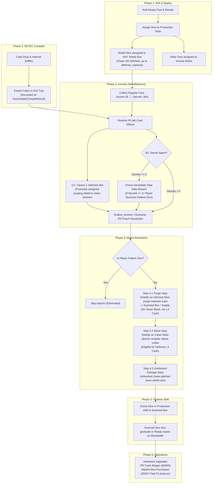

# Technical Architecture Specification: Colored Die F6 (★) Variant Card Overhaul & Glitched Shield Slot Flow

**Author:** Principal Engineer / Architect  
**Status:** Approved for Implementation (SDLC Architecture Phase)  
**Target Game Version:** `v0.44.0` (advancing from `v0.43.0`)  
**Scoping Document:** [`docs/plans/f6_overhaul_gd_plan.md`](file:///home/mike/.gemini/antigravity/worktrees/rogue-agent/colored_die_f6_abilities/docs/plans/f6_overhaul_gd_plan.md)  
**Governing Documents:**
- [`RULES.md`](file:///home/mike/.gemini/antigravity/worktrees/rogue-agent/colored_die_f6_abilities/RULES.md)
- [`RULES_APPENDIX.md`](file:///home/mike/.gemini/antigravity/worktrees/rogue-agent/colored_die_f6_abilities/RULES_APPENDIX.md)
- [`GLOSSARY.md`](file:///home/mike/.gemini/antigravity/worktrees/rogue-agent/colored_die_f6_abilities/GLOSSARY.md)

**Target Codebase Components:**
- [`sim/entities.py`](file:///home/mike/.gemini/antigravity/worktrees/rogue-agent/colored_die_f6_abilities/sim/entities.py) (Card costs, Face & VariantCard definitions)
- [`sim/config.py`](file:///home/mike/.gemini/antigravity/worktrees/rogue-agent/colored_die_f6_abilities/sim/config.py) (Baseline configs, F6 tuning values)
- [`sim/engine/phase1_roll_deploy.py`](file:///home/mike/.gemini/antigravity/worktrees/rogue-agent/colored_die_f6_abilities/sim/engine/phase1_roll_deploy.py) (Remove Phase 1 discard; unified shield deployment to any slot)
- [`sim/engine/phase3_income.py`](file:///home/mike/.gemini/antigravity/worktrees/rogue-agent/colored_die_f6_abilities/sim/engine/phase3_income.py) (Complete simultaneous Phase 3 F6 resolution, G1 slot cleaning, B2 Total Data Breach check)
- [`sim/engine/phase4_attack_resolution.py`](file:///home/mike/.gemini/antigravity/worktrees/rogue-agent/colored_die_f6_abilities/sim/engine/phase4_attack_resolution.py) (Two-step shield resolution: Glitched Slot Purge -> Clean Slot Blocking; decouple B1/R2/R3)
- [`sim/engine/phase6_operations.py`](file:///home/mike/.gemini/antigravity/worktrees/rogue-agent/colored_die_f6_abilities/sim/engine/phase6_operations.py) (Deprecate paid F6 actions; streamline Operations)
- [`sim/bots/base.py`](file:///home/mike/.gemini/antigravity/worktrees/rogue-agent/colored_die_f6_abilities/sim/bots/base.py) & [`sim/bots/market_share_policy.py`](file:///home/mike/.gemini/antigravity/worktrees/rogue-agent/colored_die_f6_abilities/sim/bots/market_share_policy.py) (Decision hooks for F6 cards and shield allocation)
- [`tests/test_f6_variant_overhaul.py`](file:///home/mike/.gemini/antigravity/worktrees/rogue-agent/colored_die_f6_abilities/tests/test_f6_variant_overhaul.py) (New regression and invariant validation test suite)

---

## 1. Executive Summary & Architectural Goals

Under `v0.43.0`, two mechanical legacy frictions persisted in the game engine and rules:
1. **Split Phase Operations Friction for F6 (`★`) Cards:** Several Face 6 module abilities (*R2 Ad Campaign*, *B2 Deep R&D Vault*, *Y1 Algorithmic Trading*) required cross-phase state tracking into Phase 6 Operations, splitting income resolution across phases, muddying telemetry, and cluttering Phase 6 with small paid conversion actions. Furthermore, several variant card definitions in `sim/` retained deprecated v0.35/v0.38 elements (color-specific shields, confusing demotion to glitched boxes, or cross-phase damage dependencies like *B1 Honeypot Telemetry*).
2. **Glitched Shield Slot Pre-Assignment Friction:** In Phase 1 Step 4, players were forced to resolve an unintuitive pre-cleaning discard step (`choose_slot_cleaners`), prematurely discarding rolled shield dice directly to the Scanned Box before calculating effective capacity.

### Core Architectural Mandates
1. **Unify ALL 12 Central Market F6 (`★`) Abilities into Phase 3: Income:** Zero paid `★` actions in Phase 6 Operations. Every Face 6 ability resolves immediately and cleanly in Phase 3.
2. **Harmonize the Glitched Shield Slot Flow:**
   - **Phase 1 Step 4:** Players assign `Block 1 Any` shield dice to ANY Shield Slot (clean or glitched) up to total Defense Grid Capacity (`defense_capacity`). No premature die burning in Phase 1!
   - **Phase 3:** *G1 Self-Healing Kernel* cleans 1 Glitched Shield Slot during Income. If a shield die was assigned to that slot in Phase 1, it becomes clean in Phase 3 and actively blocks compiler attacks in Phase 4!
   - **Phase 4:** Attack resolution separates into:
     - **Step 4.1 (Purge Step):** Shield dice sitting on Glitched Shield Slots purge the green malware cube (returned to general supply) and move to the Scanned Box (or contractor supply). They do **not** block tower cubes and do **not** earn Defense Grid Level 4 cash (`INV-SLOT-PURGE`).
     - **Step 4.2 (Block Step):** Shield dice sitting on clean slots absorb incoming compiler attack cubes (`Block 1 Any`) and earn Defense Grid Level 4 cash.
     - **Step 4.3 (Unblocked Damage Step):** Unblocked Green cubes glitch remaining clean shield slots up to capacity.
3. **Streamline Phase 6: Operations:** Phase 6 is restricted strictly to Hardware Upgrades, Public Relations Regain, and Colored Module Dice Purchases.

---

## 2. Invariant Specifications & Approved Rulings

The following invariants govern this overhaul, incorporating all user-approved rulings:

| Invariant ID | Title | Canonical Rule & Engine Contract |
| :--- | :--- | :--- |
| `INV-F6-B3-SHIELDS` | B3 Shield Count Scope | **Counts ALL shields In Production.** In Phase 3, B3 (*Air-Gapped Backup*) tallies every die assigned as a shield In Production (sitting on clean OR glitched slots). Payout is `+$1 base + $1 per shield die In Production`. |
| `INV-F6-B2-SECRETS` | B2 Secret Spend & Breach | **Spend Allowed at 1 Secret; Immediate Breach.** B2 (*Deep R&D Vault*) modal Option B (`Spend 1 Secret -> +3 Market Share`) does **not** require $\ge 2$ Secrets. A player at exactly 1 Secret may spend their last Secret. Doing so reduces Corporate Secrets to 0 and immediately triggers **Total Data Breach / Patient Zero** elimination in Phase 3. If all players are eliminated, the game ends in a **Total Wipeout**; if survivors remain, the **Final Round** is triggered (`final_round_trigger_phase = 3`). The eliminated player is skipped in Phase 4 attacks. |
| `INV-F6-G3-EMPTY` | G3 Empty Scanned Box Fizzle | **Clean Fizzle.** When G3 (*Live Reboot*) triggers, the player gains `+1 🔬 & +$1 Cash`. If the Scanned Box is empty, the graduation effect (`move 1 Scanned -> Ready`) fizzles cleanly with zero error or penalty. |
| `INV-SLOT-PURGE` | Purged Shield Cash Exclusion | **No Defense L4 Cash on Purged Slots.** Shield dice assigned to glitched shield slots purge green malware cubes during Phase 4 Step 4.1 and do not block tower cubes. Therefore, they **never earn Defense Grid Level 4 cash** (+$1 per blocked attack cube). |
| `INV-F6-G1-TIMING` | G1 Slot Cleansing Timing | **Phase 3 Cleansing & Shield Promotion.** G1 cleans 1 Glitched Shield Slot during Phase 3 Income. If a shield die was assigned to that glitched slot in Phase 1, that slot is now clean, converting that shield die into an active blocker for Phase 4 compiler attacks. |
| `INV-F6-R2-LIQUID` | R2 Income Liquidity | **Phase 3 Liquidity & MS Cap.** A player accumulates Phase 3 income before deciding to pay $2 for R2 (*Ad Campaign*). If total available cash is $< \$2$, or Market Share is already at `market_share_max` (20), R2 produces 0 output and charges $0. |
| `INV-F6-R3-POACH` | R3 Clockwise Poach | **Clockwise Execution after Income.** Resolves during `finalize_income` in clockwise seat order starting from the First Player. Steals 1 MS from the surviving rival with the most MS ($> 0$). If tied, actor chooses. If target drops to 0 MS, target survives but triggers Market Collapse check in Phase 4. If actor is at max MS, target still loses 1 MS and actor gains 0. |
| `INV-F6-B1-TRAY` | B1 Exit Tray Evaluation | **Exit Tray State Only.** B1 evaluates the objective exited cube count from Phase 2 Compiler: if 0 Blue exited $\to$ `+2 🔬`; if 1+ Blue exited $\to$ `+$3 Cash`. Completely decoupled from Phase 4 shields or damage taken. |
| `INV-F6-Y1-MODAL` | Y1 Liquidity & Choice | If total cash is $< \$2$, the player must take `+$4 Cash`. If total cash $\ge \$2$, the player chooses between `+$4 Cash` (Option A) or `-$2 Cash & +1 Corporate Secret` (Option B). |
| `INV-F6-Y2-COLORS` | Y2 Market Color Scope | Counts unique Central Market colors owned (`RED`, `BLUE`, `GREEN`, `YELLOW`). Excludes `GRAY` Legacy dice and `PURPLE` Specialist dice. Payout is `+$2 + $1 per CM color owned` (range $2 to $6). |
| `INV-F6-Y3-GRAY` | Y3 Gray Die Scaling & Mat Zone | Payout is `+1 Corporate Secret + $1 per Gray Legacy die owned` (range 1–3 Gray dice, yielding $1–$3 cash). **Die remains In Production** and advances normally in Phase 5 Pipeline Shift (zero demotion). |
| `INV-P6-PURITY` | Operations Phase Purity | Phase 6 Operations contains **zero** paid Face 6 actions. `use_b2_secret`, `use_y1_secret`, and `r2_actions_available` are completely eliminated from Phase 6. |

---

## 3. The 12 Variant Cards Specification Matrix

All 12 common market variant cards have their Face 6 (`★`) resolved in **Phase 3: Income** (or Phase 3 closing `finalize_income` for R3). Dynamic market purchase costs are printed on the cards and configured in `VariantCard.cost`.

| Code | Card Name | Cost | Resolved Face 6 Effect in Phase 3 | In Production Role |
| :---: | :--- | :---: | :--- | :---: |
| **R1** | **Brand Protection** | **$5** | Gain `+$2 Cash & +1 Market Share` (capped at max MS). | `INCOME` |
| **R2** | **Ad Campaign** | **$4** | You may pay `$2 Cash` to gain `+2 Market Share` (capped at max MS). | `INCOME` |
| **R3** | **Customer Poaching** | **$5** | Clockwise from First Player: take `1 Market Share` from rival with most MS. | `INCOME` |
| **B1** | **Honeypot Telemetry**| **$5** | Check Phase 2 tray: `+2 🔬` if 0 Blue cubes exited, OR `+$3 Cash` if 1+ Blue cubes exited. | `INCOME` |
| **B2** | **Deep R&D Vault** | **$5** | Choose: `+$2 Cash`, OR `Spend 1 Secret -> +3 Market Share` (triggers breach if secrets $\le 0$). | `INCOME` |
| **B3** | **Air-Gapped Backup** | **$4** | Gain `+$1 Cash + $1 per Shield die In Production` (clean or glitched). | `INCOME` |
| **G1** | **Self-Healing Kernel**| **$5** | Clean `1 Glitched Shield Slot` and gain `+1 🔬` (assigned shield promotes to clean slot). | `INCOME` |
| **G2** | **Universal Sandbox** | **$5** | Gain `+2 🔬 + 1 🔬 per Glitched Shield Slot`. | `INCOME` |
| **G3** | **Live Reboot** | **$4** | Gain `+1 🔬 & +$1 Cash`, and move `1 die Scanned Box -> Ready for Release` (fizzles if empty). | `INCOME` |
| **Y1** | **Algorithmic Trading**| **$6** | Choose: `+$4 Cash`, OR pay `$2 Cash -> +1 Corporate Secret`. | `INCOME` |
| **Y2** | **Cloud Monopoly** | **$5** | Gain `+$2 Cash + $1 per different Central Market die color owned` (max +$6). | `INCOME` |
| **Y3** | **Proprietary Training**| **$5** | Gain `+1 Corporate Secret + $1 per Gray die owned`. Die remains In Production. | `INCOME` |

*(Note: Costs for B2 updated from $6 to $5, and G2 updated from $4 to $5 per pre-SDLC EV balancing).*

---

## 4. Phase-by-Phase Engine Architecture & State Flow



### 4.1 Phase 1: Roll & Deploy
- **Removal of Premature Discard:** Completely delete the `choose_slot_cleaners` pre-discard logic from `sim/engine/phase1_roll_deploy.py`.
- **Unified Defense Grid Assignment:**
  - Player defense grid capacity is `player.defense_capacity` (base 2, upgradable to 3 or 4).
  - The number of glitched shield slots is `player.glitched_shield_slots` ($0 \le \text{glitched} \le \text{defense\_capacity}$).
  - Clean shield slots = `player.defense_capacity - player.glitched_shield_slots`.
  - Players may commit up to `player.defense_capacity` shield-capable dice to the Defense Grid.
  - Dice are tracked with roles:
    - `ProductionRole.CLEAN_SHIELD` (assigned to clean slots, up to clean slots count)
    - `ProductionRole.PURGING_SHIELD` (assigned to glitched slots, up to glitched slots count)
    - For backwards compatibility, `ProductionRole.ANY_SHIELD` / `RED_SHIELD` / `BLUE_SHIELD` / `GREEN_SHIELD` remain valid, with slot allocation tracked explicitly via `player.shields_on_clean_slots` and `player.shields_on_glitched_slots`.
  - All assigned shield dice remain physically **In Production** throughout Phase 1, Phase 2, and Phase 3!

### 4.2 Phase 2: SETEC Compiler
- The SETEC compiler drops cubes and resolves Internal Baffles as normal.
- `CompileResult.exited_cubes` preserves the exact tally of exited cubes (`RED`, `BLUE`, `GREEN`, `BLACK`) in the exit tray, which is directly consumed by Phase 3 B1 Honeypot Telemetry.

### 4.3 Phase 3: Income
All production income collects simultaneously. Execution order for Face 6 resolution:
1. **Base Income & Non-Modal Star Effects:**
   - **R1:** `player.money += 2`; `player.change_market_share(1, "r1")`.
   - **B1:** Check `engine.state.last_compile_result.exited_cubes.get(CubeColor.BLUE, 0)`:
     - If `== 0`: `player.gain_research(2, "b1")`.
     - If `>= 1`: `player.money += 3`.
   - **B3:** Count all dice in `player.in_production_dice` assigned as shields (clean or glitched).
     - Payout: `player.money += 1 + shield_count`.
   - **G1:**
     - `player.gain_research(1, "g1")`.
     - `secret_faces.clean_slots(player, 1, "g1")`.
     - **Shield Promotion Contract:** If `player.shields_on_glitched_slots > 0`, decrement `player.shields_on_glitched_slots -= 1` and increment `player.shields_on_clean_slots += 1`. Update die role from `PURGING_SHIELD` to `CLEAN_SHIELD`.
   - **G2:**
     - `payout = 2 + player.glitched_shield_slots`.
     - `player.gain_research(payout, "g2")`.
   - **G3:**
     - `player.gain_research(1, "g3")`; `player.money += 1`.
     - If `len(player.scanned_dice) > 0`: bot/player selects 1 die via `choose_g3_reboot_target`. Selected die is removed from `player.scanned_dice`, reset via `_reset_die()`, and appended to `player.ready_for_release_dice`.
     - If `len(player.scanned_dice) == 0`: graduation cleanly fizzles (`INV-F6-G3-EMPTY`).
   - **Y2:**
     - Count unique Central Market colors owned: `cm_colors = {d.color for d in player.owned_dice if d.color in (DieColor.RED, DieColor.BLUE, DieColor.GREEN, DieColor.YELLOW)}`.
     - Payout: `player.money += min(6, 2 + len(cm_colors))`.
   - **Y3:**
     - `player.gain_secrets(1, "y3")`.
     - `gray_count = len([d for d in player.owned_dice if d.color == DieColor.GRAY])`.
     - `player.money += gray_count`.
     - **Mat Zone Contract:** Die **remains** in `player.in_production_dice`. It is NOT moved to scanned or glitched boxes in Phase 3.
2. **Modal Star Effects (R2, B2, Y1):**
   - **R2 (*Ad Campaign*):**
     - Bot/player invokes `choose_r2_ad_campaign(player, state)`.
     - Condition: Valid only if `player.money >= 2` and `player.market_share < player.market_share_max`.
     - Action: `player.money -= 2`; `player.change_market_share(2, "r2")`.
   - **B2 (*Deep R&D Vault*):**
     - Bot/player invokes `choose_b2_vault_mode(player, state)`.
     - Option A (`"cash"`): `player.money += 2`.
     - Option B (`"market_share"`): Valid if `player.secrets >= 1`.
       - `player.gain_secrets(-1, "b2")`.
       - `player.change_market_share(3, "b2")`.
       - **Immediate Total Data Breach Check:** If `player.secrets <= 0`:
         - `player.is_patient_zero = True`
         - `player.elimination_round = engine.state.current_round`
         - `player.elimination_reason = "Total Breach (<= 0 Secrets)"`
         - `player.breach_depth = max(0, -player.secrets)`
         - Trigger end-game evaluation:
           - If `all(p.is_patient_zero for p in engine.state.players)`: `engine.state.game_over = True`, `engine.state.end_reason = EndGameReason.TOTAL_WIPEOUT`.
           - Else: `engine.state.is_final_round = True`, `engine.state.end_reason = EndGameReason.PATIENT_ZERO`, `engine.state.final_round_trigger_phase = 3`.
   - **Y1 (*Algorithmic Trading*):**
     - Bot/player invokes `choose_y1_algo_mode(player, state)`.
     - Option A (`"cash"`): `player.money += 4`.
     - Option B (`"secret"`): Valid if `player.money >= 2`.
       - `player.money -= 2`.
       - `player.gain_secrets(1, "y1")`.
3. **Phase 3 Closing (`finalize_income`):**
   - Resolves R3 (*Customer Poaching*) clockwise from First Player (`market_share.resolve_poaches`).
   - If target drops to 0 MS, target survives Phase 3; Market Collapse is evaluated after Phase 4 attacks.

### 4.4 Phase 4: Attack Resolution
Attack resolution is structured into three clean sequential sub-steps:
1. **Patient Zero Bypass (`INV-SEQ-PZ-SKIP-01`):** Any player with `is_patient_zero == True` (including players who breached via B2 in Phase 3) skips Phase 4 attack resolution entirely.
2. **Step 4.1: Glitched Slot Purge Step:**
   - Identify all dice assigned to glitched shield slots (`purging_shield_dice`).
   - For each purging shield die:
     - Purge 1 green malware cube: `player.glitched_shield_slots = max(0, player.glitched_shield_slots - 1)`.
     - Increment telemetry: `player.slots_purged_by_shields += 1`.
     - Remove die from `player.in_production_dice`.
     - If die is `DieColor.WHITE`: return to `engine.state.contractor_supply += 1`.
     - If die is permanent: append to `player.scanned_dice`.
     - Die does **not** block any incoming attack cubes.
     - Die does **not** earn Defense Grid Level 4 cash.
3. **Step 4.2: Clean Slot Shield Blocking Step:**
   - Active shields = count of dice in `clean_shield_dice`.
   - Each clean shield provides `Block 1 Any` against incoming attack cubes (`RED`, `BLUE`, `GREEN`).
   - Shield allocation priority follows standard policy (Blue first to protect secrets, Red if threatening collapse or cash shortfall, Green to prevent slot malware, Red to preserve cash).
   - Each clean shield that actively absorbs an incoming attack cube increments `player.attacks_blocked_this_round`.
   - If player has unlocked Defense Grid Level 4: `player.money += player.attacks_blocked_this_round` (capped at attack cubes blocked).
4. **Step 4.3: Unblocked Attack Damage & Malware Infection:**
   - Unblocked Red: reduces Market Share by unblocked amount (or triggers Market Collapse check).
   - Unblocked Blue: inflicts Secret loss (1 Secret per cube on v1/v2, 2 Secrets per cube on v3). Checks Patient Zero.
   - Unblocked Green: creates Glitched Shield Slots on remaining clean slots:
     ```python
     shortfall = unblocked_green
     added = min(shortfall, player.defense_capacity - player.glitched_shield_slots)
     player.glitched_shield_slots += added
     player.slots_glitched_this_round += added
     ```

### 4.5 Phase 6: Operations Streamlining
- Strip out all Face 6 paid hooks:
  - Remove `r2_actions_available` and `execute_ad_campaigns`.
  - Remove `b2_available` and `use_b2_secret`.
  - Remove `y1_available` and `use_y1_secret`.
- Phase 6 Operations execution loop contains only:
  1. `execute_hardware_upgrades(engine, player, plan)`
  2. `execute_pr_regain(engine, player, plan)`
  3. `execute_market_purchases(engine, player, plan)`

---

## 5. Module Contracts & Data Structure Updates

### 5.1 `sim/entities.py` Updates

```python
# Updated VariantCard Definitions
def get_v044_variant_cards() -> List[VariantCard]:
    return [
        # Red ★ Variants
        VariantCard(
            code="R1",
            name="Brand Protection",
            die_color=DieColor.RED,
            cost=5,
            description="Gain +$2 Cash & +1 Market Share.",
            star_face=Face(
                name="R1: Brand Protection",
                money=2,
                market_share=1,
                is_star=True,
                star_code="R1",
            ),
        ),
        VariantCard(
            code="R2",
            name="Ad Campaign",
            die_color=DieColor.RED,
            cost=4,
            description="You may pay $2 Cash to gain +2 Market Share.",
            star_face=Face(
                name="R2: Ad Campaign",
                is_star=True,
                star_code="R2",
            ),
        ),
        VariantCard(
            code="R3",
            name="Customer Poaching",
            die_color=DieColor.RED,
            cost=5,
            description="In Phase 3, take 1 Market Share from the rival with the most Market Share.",
            star_face=Face(
                name="R3: Customer Poaching",
                is_star=True,
                star_code="R3",
            ),
        ),
        # Blue ★ Variants
        VariantCard(
            code="B1",
            name="Honeypot Telemetry",
            die_color=DieColor.BLUE,
            cost=5,
            description="If 0 Blue cubes exited in Phase 2, gain +2 🔬; if 1+ Blue cubes exited, gain +$3 Cash.",
            star_face=Face(
                name="B1: Honeypot Telemetry",
                is_star=True,
                star_code="B1",
            ),
        ),
        VariantCard(
            code="B2",
            name="Deep R&D Vault",
            die_color=DieColor.BLUE,
            cost=5,  # Rebalanced from $6 to $5
            description="Gain +$2 Cash, OR spend 1 Corporate Secret to gain +3 Market Share.",
            star_face=Face(
                name="B2: Deep R&D Vault",
                money=2,
                is_star=True,
                star_code="B2",
            ),
        ),
        VariantCard(
            code="B3",
            name="Air-Gapped Backup",
            die_color=DieColor.BLUE,
            cost=4,
            description="Gain +$1 Cash, plus +$1 per Shield die In Production.",
            star_face=Face(
                name="B3: Air-Gapped Backup",
                money=1,
                is_star=True,
                star_code="B3",
            ),
        ),
        # Green ★ Variants
        VariantCard(
            code="G1",
            name="Self-Healing Kernel",
            die_color=DieColor.GREEN,
            cost=5,
            description="Clean 1 Glitched Shield Slot and gain +1 🔬.",
            star_face=Face(
                name="G1: Self-Healing Kernel",
                patches=1,
                clean_slots=1,
                is_star=True,
                star_code="G1",
            ),
        ),
        VariantCard(
            code="G2",
            name="Universal Sandbox",
            die_color=DieColor.GREEN,
            cost=5,  # Rebalanced from $4 to $5
            description="Gain +2 🔬, plus +1 🔬 per Glitched Shield Slot.",
            star_face=Face(
                name="G2: Universal Sandbox",
                patches=2,
                is_star=True,
                star_code="G2",
            ),
        ),
        VariantCard(
            code="G3",
            name="Live Reboot",
            die_color=DieColor.GREEN,
            cost=4,
            description="Gain +1 🔬 & +$1 Cash, and move 1 die from Scanned Box to Ready for Release.",
            star_face=Face(
                name="G3: Live Reboot",
                money=1,
                patches=1,
                is_star=True,
                star_code="G3",
            ),
        ),
        # Yellow ★ Variants
        VariantCard(
            code="Y1",
            name="Algorithmic Trading",
            die_color=DieColor.YELLOW,
            cost=6,
            description="Gain +$4 Cash, OR pay $2 Cash to gain +1 Corporate Secret.",
            star_face=Face(
                name="Y1: Algorithmic Trading",
                money=4,
                is_star=True,
                star_code="Y1",
            ),
        ),
        VariantCard(
            code="Y2",
            name="Cloud Monopoly",
            die_color=DieColor.YELLOW,
            cost=5,
            description="Gain +$2 Cash, plus +$1 per different Central Market die color owned (max +$6).",
            star_face=Face(
                name="Y2: Cloud Monopoly",
                money=2,
                is_star=True,
                star_code="Y2",
            ),
        ),
        VariantCard(
            code="Y3",
            name="Proprietary Training",
            die_color=DieColor.YELLOW,
            cost=5,
            description="Gain +1 Corporate Secret, plus +$1 per Gray Legacy die owned.",
            star_face=Face(
                name="Y3: Proprietary Training",
                secrets=1,
                is_star=True,
                star_code="Y3",
            ),
        ),
    ]
```

### 5.2 `sim/config.py` Configuration Additions

```python
@dataclass
class GameConfig:
    # Existing settings...
    
    # v0.44.0 Variant Overhaul Baselines:
    variant_profile: str = "V044"  # Default profile for v0.44.0
    r2_cost_cash: int = 2
    r2_gain_market_share: int = 2
    b1_quiet_research: int = 2
    b1_threat_cash: int = 3
    b2_base_cash: int = 2
    b2_secret_cost: int = 1
    b2_market_share_gain: int = 3
    b3_base_cash: int = 1
    b3_shield_multiplier: int = 1
    g1_research: int = 1
    g1_slots_cleaned: int = 1
    g2_base_research: int = 2
    g2_glitch_multiplier: int = 1
    g3_research: int = 1
    g3_cash: int = 1
    y1_base_cash: int = 4
    y1_secret_cost: int = 2
    y1_secret_gain: int = 1
    y2_base_cash: int = 2
    y2_cm_multiplier: int = 1
    y2_max_cash: int = 6
    y3_base_secrets: int = 1
    y3_gray_multiplier: int = 1
```

### 5.3 `PlayerState` Telemetry & Slot Tracking Fields

In `sim/engine/state.py` / `PlayerState`:
```python
# Shield assignment breakdown for the active round:
self.shields_on_clean_slots: int = 0
self.shields_on_glitched_slots: int = 0
self.purged_shields_this_round: int = 0

# F6 Overhaul cumulative telemetry:
self.f6_r2_activations: int = 0
self.f6_b2_cash_activations: int = 0
self.f6_b2_secret_activations: int = 0
self.f6_b2_suicide_breaches: int = 0
self.f6_g1_activations: int = 0
self.f6_g1_shield_promotions: int = 0
self.f6_g3_graduations: int = 0
self.f6_g3_fizzles: int = 0
self.f6_y1_cash_activations: int = 0
self.f6_y1_secret_activations: int = 0
self.slots_purged_by_shields_total: int = 0
```

---

## 6. Bot Decision Policies & Heuristics

All bot heuristics are centralized and configurable with clear defaults:

### 6.1 `choose_shield_slot_allocation`
- **Signature:** `choose_shield_slot_allocation(player: PlayerState, committed_shields: List[Die], clean_capacity: int, glitched_capacity: int, state: GameState) -> Tuple[List[Die], List[Die]]`
- **Default Policy:**
  - Allocate shields to clean slots first up to `clean_capacity` (to maximize active compiler attack absorption).
  - Any remaining committed shields ($> \text{clean\_capacity}$) are allocated to glitched slots (up to `glitched_capacity`) to purge malware cubes in Phase 4.

### 6.2 `choose_r2_ad_campaign`
- **Signature:** `choose_r2_ad_campaign(player: PlayerState, state: GameState) -> bool`
- **Default Policy:** Returns `True` if `player.money >= 2 + cash_cushion` (where `cash_cushion = 3` in early/mid game, `0` in final round) and `player.market_share <= player.market_share_max - 1`.

### 6.3 `choose_b2_vault_mode`
- **Signature:** `choose_b2_vault_mode(player: PlayerState, state: GameState) -> str` (`"cash"` or `"market_share"`)
- **Default Policy:**
  - **Suicide Prevention Guard:** If `player.secrets <= 1`, **always** return `"cash"` (prevents self-elimination).
  - Return `"market_share"` if `player.secrets >= 2` and:
    - Market Share is low (`player.market_share <= 12`), OR
    - Final round and spending 1 Secret gains the Market Leader Bonus (+3 Secrets, net +2 Secrets), OR
    - Immediate threat of Market Collapse exists.
  - Otherwise, return `"cash"`.

### 6.4 `choose_y1_algo_mode`
- **Signature:** `choose_y1_algo_mode(player: PlayerState, state: GameState) -> str` (`"cash"` or `"secret"`)
- **Default Policy:**
  - If `player.money < 2`, must return `"cash"`.
  - Return `"secret"` if `player.money >= 2 + cash_cushion` and:
    - `player.secrets <= 3` (defensive buffer against Blue attacks), OR
    - `state.is_final_round` (1 Secret = 1 VP endgame scoring).
  - Otherwise, return `"cash"`.

### 6.5 `choose_g3_reboot_target`
- **Signature:** `choose_g3_reboot_target(player: PlayerState, scanned_dice: List[Die], state: GameState) -> Optional[Die]`
- **Default Policy:**
  - If `scanned_dice` is empty, return `None`.
  - Prioritize colored module dice with highest market cost, then Purple Specialist, then Gray Legacy.

---

## 7. Verification & Test Suite Specifications

A new dedicated test file [`tests/test_f6_variant_overhaul.py`](file:///home/mike/.gemini/antigravity/worktrees/rogue-agent/colored_die_f6_abilities/tests/test_f6_variant_overhaul.py) must be created containing the following unit test specs:

### Test Case 1: `test_inv_f6_b3_shields`
- **Setup:** Player has 1 clean shield and 1 glitched shield In Production. Defense Grid Level 0.
- **Action:** Resolve Phase 3 income with B3 active.
- **Verification:** Assert player receives `$1 base + $2 for 2 shields = $3 Cash`.

### Test Case 2: `test_inv_f6_b2_secrets_suicide_breach`
- **Setup:** Player has exactly 1 Corporate Secret and rolls B2. Player opts for Option B (`"market_share"`).
- **Action:** Resolve Phase 3 income.
- **Verification:**
  - Assert `player.secrets == 0`.
  - Assert `player.is_patient_zero == True`.
  - Assert `player.elimination_reason == "Total Breach (<= 0 Secrets)"`.
  - Assert `state.is_final_round == True` and `state.end_reason == EndGameReason.PATIENT_ZERO`.
  - Advance to Phase 4: Assert this player is skipped during Phase 4 attack resolution (`INV-SEQ-PZ-SKIP-01`).

### Test Case 3: `test_inv_f6_g3_empty_scanned_box`
- **Setup:** Player rolls G3 In Production; `player.scanned_dice` is empty `[]`.
- **Action:** Resolve Phase 3 income.
- **Verification:**
  - Assert player receives `+1 🔬` and `+$1 Cash`.
  - Assert no exceptions raised; `player.f6_g3_fizzles == 1`.

### Test Case 4: `test_inv_slot_purge_and_defense_l4_exclusion`
- **Setup:** Player has 1 clean shield die and 1 purging shield die on a glitched slot. Player has Defense Grid Level 4 unlocked (+$1 per cube blocked). SETEC compiler drops 1 Red cube.
- **Action:** Resolve Phase 4 attacks.
- **Verification:**
  - Assert the purging shield die moves to `scanned_dice` and `player.glitched_shield_slots` decrements by 1.
  - Assert the clean shield die blocks the 1 Red cube.
  - Assert `player.money` increases by **exactly $1** (from the clean shield), NOT $2! Purged die does not earn L4 cash.

### Test Case 5: `test_g1_phase3_timing_and_shield_promotion`
- **Setup:** Player has 1 glitched shield slot in Phase 1 and assigns a shield die to it (`PURGING_SHIELD`). Player also rolls G1 In Production.
- **Action:** Resolve Phase 3 Income.
- **Verification:**
  - Assert G1 cleans the glitched slot (`player.glitched_shield_slots == 0`).
  - Assert the assigned shield die promotes to `CLEAN_SHIELD` (`player.shields_on_clean_slots == 1`, `player.shields_on_glitched_slots == 0`).
- **Phase 4 Follow-through:** Compiler deals 1 Blue attack cube.
  - Assert the promoted shield die successfully blocks the Blue cube in Step 4.2.

### Test Case 6: `test_r2_ad_campaign_phase3_resolution`
- **Setup:** Player has $3 Cash and 10 Market Share; rolls R2 In Production.
- **Action:** Resolve Phase 3 Income with R2 paid option accepted.
- **Verification:**
  - Assert `player.money == 1` (-$2 paid).
  - Assert `player.market_share == 12` (+2 gained).
  - Advance to Phase 6 Operations: assert `player.r2_actions_available == 0` and no R2 action exists in Phase 6.

### Test Case 7: `test_y1_algorithmic_trading_modal`
- **Setup:** Player rolls Y1. Test both paths:
  - Path A: Player takes Cash $\to$ assert `player.money += 4`.
  - Path B: Player has $2 Cash and takes Secret $\to$ assert `player.money -= 2` and `player.secrets += 1`.
  - Path C: Player has $1 Cash $\to$ verify cannot choose Option B, forced to take Option A.

### Test Case 8: `test_y2_and_y3_color_and_gray_scaling`
- **Setup:**
  - Y2: Player owns 1 Red, 1 Blue, 1 Green, 1 Gray, 1 Purple. Total CM colors = 3. Assert Y2 yields `+$2 + $3 = $5 Cash`.
  - Y3: Player owns 2 Gray Legacy dice. Assert Y3 yields `+1 Secret` and `+$2 Cash`. Assert Y3 die remains In Production.

### Test Case 9: `test_b1_exit_tray_telemetry`
- **Setup:**
  - Scenario A: Phase 2 exit tray has 0 Blue cubes. Assert B1 yields `+2 🔬` and `$0 Cash`.
  - Scenario B: Phase 2 exit tray has 2 Blue cubes. Assert B1 yields `+$3 Cash` and `0 🔬`.

---

## 8. Rollout & Validation Sequence

1. **Phase 1 (Entities & Config):** Overhaul `VariantCard` and `Face` definitions in `sim/entities.py` and defaults in `sim/config.py`.
2. **Phase 2 (Engine Updates):**
   - Streamline `phase1_roll_deploy.py` (remove pre-discard, enable clean/glitched slot assignments).
   - Implement Phase 3 F6 handling in `phase3_income.py`.
   - Update `phase4_attack_resolution.py` with the Purge $\to$ Block sequential pipeline and L4 cash rule.
   - Strip paid actions from `phase6_operations.py`.
3. **Phase 3 (Bot Policies & Tests):**
   - Implement bot decision hooks in `sim/bots/base.py` and `sim/bots/market_share_policy.py`.
   - Implement unit test suite in `tests/test_f6_variant_overhaul.py`.
   - Run full regression test suite (`pytest -q tests/`).
4. **Phase 4 (Macro Balance Sweep):**
   - Run a 1,200-game Monte Carlo sweep (`scripts/run_v044_f6_sweep.py`) to verify:
     - Game round pacing: 7.5 to 11.0 rounds.
     - Table wipeout rate: $\le 1.0\%$.
     - Corporate starter win-rate parity within $\pm 4.0\%$ spread across Red, Blue, and Green starters.
