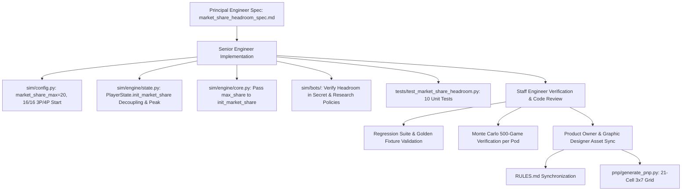

# Technical Architecture Specification: Unified Market Share Track & Headroom Architecture

**Author:** Principal Engineer / Architect  
**Status:** Approved for Implementation (SDLC Architecture Phase)  
**Target Baseline:** `v0.38e` / `market_share_balance_rework`  
**Dependencies:**
- [`docs/findings/market_share_early_pressure_analysis.md`](file:///home/mike/.gemini/antigravity/worktrees/rogue-agent/market_share_balance_rework/docs/findings/market_share_early_pressure_analysis.md)
- [`docs/specs/v380d_c2_green_clean_spec.md`](file:///home/mike/.gemini/antigravity/worktrees/rogue-agent/market_share_balance_rework/docs/specs/v380d_c2_green_clean_spec.md)
- [`docs/specs/v380_secret_faces_processing_box_spec.md`](file:///home/mike/.gemini/antigravity/worktrees/rogue-agent/market_share_balance_rework/docs/specs/v380_secret_faces_processing_box_spec.md)
- [`RULES.md`](file:///home/mike/.gemini/antigravity/worktrees/rogue-agent/market_share_balance_rework/RULES.md)
- [`GLOSSARY.md`](file:///home/mike/.gemini/antigravity/worktrees/rogue-agent/market_share_balance_rework/GLOSSARY.md)

**Target Components:**
- [`sim/config.py`](file:///home/mike/.gemini/antigravity/worktrees/rogue-agent/market_share_balance_rework/sim/config.py)
- [`sim/engine/state.py`](file:///home/mike/.gemini/antigravity/worktrees/rogue-agent/market_share_balance_rework/sim/engine/state.py)
- [`sim/engine/core.py`](file:///home/mike/.gemini/antigravity/worktrees/rogue-agent/market_share_balance_rework/sim/engine/core.py)
- [`sim/engine/market_share.py`](file:///home/mike/.gemini/antigravity/worktrees/rogue-agent/market_share_balance_rework/sim/engine/market_share.py)
- [`sim/bots/secret_face_policy.py`](file:///home/mike/.gemini/antigravity/worktrees/rogue-agent/market_share_balance_rework/sim/bots/secret_face_policy.py)
- [`sim/bots/market_share_policy.py`](file:///home/mike/.gemini/antigravity/worktrees/rogue-agent/market_share_balance_rework/sim/bots/market_share_policy.py)
- [`sim/bots/research_policy.py`](file:///home/mike/.gemini/antigravity/worktrees/rogue-agent/market_share_balance_rework/sim/bots/research_policy.py)
- [`pnp/generate_pnp.py`](file:///home/mike/.gemini/antigravity/worktrees/rogue-agent/market_share_balance_rework/pnp/generate_pnp.py)
- [`tests/test_market_share_headroom.py`](file:///home/mike/.gemini/antigravity/worktrees/rogue-agent/market_share_balance_rework/tests/test_market_share_headroom.py)

---

## 1. Executive Summary & Design Rationale

### 1.1 Problem Statement: Baseline Ceiling Paralysis & Dead Faces
Under baseline `v0.38.0` / `v0.38d`, the starting Market Share for each player was tightly coupled to the maximum capacity of the track:
$$\text{Market Share Start} = \text{Market Share Max} = 13 \text{ (2P)} \;/\; 16 \text{ (3P)} \;/\; 17 \text{ (4P)}$$

This coupling produced severe mechanical defects in early rounds:
1. **Dead & Collapsed Dice Faces ("Zero Blank Faces" Violation):**
   - **Red Face 1 (`+1 Market Share / +$1`):** In Round 1, 100.0% of players were at track maximum. The choice face collapsed into a forced single option (`+$1`), destroying player agency between corporate positioning and liquidity.
   - **Yellow Face 1 (`+2 Market Share`):** Yielded exactly 0 Market Share, 0 Money, and 0 Research—a completely blank face that violates Core Design Pillar 3.
   - **Yellow Face 2 (`+1 Market Share / +1 🔬`):** Collapsed into a forced research choice.
   - **Yellow Face 3 (`+$1 & +1 Market Share`) & R1 Star (*Brand Protection* — `+$2 & +1 Market Share`):** The `+1 Market Share` component was 100% wasted.
2. **Public Relations Track Paralysis:**
   - Players could not spend research tokens on the Public Relations Track because available headroom $\text{Room} = \text{Max} - \text{Current} = 0$.
   - Because early Red cube damage is low (55.0% of seats take zero Red damage in Round 1), Market Share remained a dormant, static number rather than an active corporate race.

### 1.2 Approved Architectural Solution: Candidate A4 (Unified Max 20 + Headroom)
To permanently eliminate dead faces while preserving critical game pacing and existential tension, the User and Game Designer approved **Candidate A4**:
1. **Central Market Share Track Unified Maximum:**
   - Unified ceiling at **`20`** (`market_share_max = 20`) across all player counts (2P, 3P, 4P).
   - Central board physical track layout features cells numbered `0` to `20` (21 cells arranged in a 3-column $\times$ 7-row grid).
2. **Starting Market Share Calibration:**
   - **2 Players:** Starting Market Share = **`13`** (+7 headroom up to 20).
   - **3 Players:** Starting Market Share = **`16`** (+4 headroom up to 20).
   - **4 Players:** Starting Market Share = **`16`** (+4 headroom up to 20, unified with 3P).
3. **Decoupled Architecture:**
   - Decouple `market_share_max` from `market_share_start` in `PlayerState` and `GameConfig`.
   - Players advance Market Share up to 20 via die faces (Red F1, Yellow F1/F2/F3, R1 Star), Customer Poaching, and the Public Relations Track (`3 🔬` per `+1 MS` up to round limit).
   - Clamping logic: floor at `0` (triggers Market Collapse at the end of Phase 4), ceiling at `20`.

### 1.3 Mathematical Justification: Buffer Invariance & Rejection of Alternatives
Empirical modeling across 5,200 matches established why Candidate A4 is mathematically superior to other proposed fixes:

```
+----------------------------------------------------------------------------------------------------------------------------------+
| Candidate Model                        | R1 Max% | Rds (3P) | Sing% | PZ%   | MC%   | Min MC Rd | Red WR% | Status               |
+----------------------------------------------------------------------------------------------------------------------------------+
| Baseline (Start = Max = 13/16/17)      | 100.0%  | 8.04 rds | 44.2% | 32.0% | 25.0% | Round 7   | 30.8%   | DEFECTIVE (Dead Faces)|
| A4: Unified Track Max 20 (Headroom +4) |   0.0%  | 8.17 rds | 47.5% | 30.0% | 25.0% | Round 7   | 37.9%   | APPROVED (Optimal)   |
| B1: Aggressive Red (-2 MS / cube)      | 100.0%  | 5.96 rds |  9.3% | 25.7% | 67.7% | Round 3   | 33.3%   | REJECTED (Meatgrinder)|
| C1: Asymmetric Start (±1 by Company)   |  66.9%  | 8.20 rds | 46.3% | 25.0% | 30.7% | Round 7   | 33.3%   | REJECTED (2:1 WR Skew)|
| D1: Headroom + Aggressive Red (-2 MS)  |   0.0%  | 5.64 rds |  7.0% | 22.7% | 73.0% | Round 2   | 34.0%   | REJECTED (Premature)  |
+----------------------------------------------------------------------------------------------------------------------------------+
```

- **Buffer Distance Invariant Preserved:**
  The distance to Market Collapse is $D_n = \text{market\_share\_start}(n) - 0$.
  - 2P: $D_2 = 13$ unblocked hits.
  - 3P: $D_3 = 16$ unblocked hits.
  - 4P: $D_4 = 16$ unblocked hits (unified with 3P; formerly 17).
  Because starting positions are preserved from `v0.38c`/`v0.38d`, the defensive buffer is 100% intact. Earliest observed Market Collapse remains strictly in late game (**Round 7+**), and average match length remains centered in the target envelope (**~8.17 rounds at 3P**, **~7.7 rounds at 2P/4P**).
- **Definitive Rejection of -2 Red Damage (Candidate B1):**
  Doubling Red damage halved defensive buffer from 16 to 8 hits, collapsing matches prematurely into Round 3–5 endings, and causing Market Collapse to monopolize 67.7% of all game ends while wiping out Singularity to 9.3%.
- **Definitive Rejection of Company Asymmetry (Candidates C1 & C2):**
  Starting with asymmetric Market Share (e.g. Meridian +1, Prometheus -1) distorted win rates by more than 2:1 between companies sharing the exact same color (51.3% vs 25.7%), violating competitive fairness. Symmetrical starting share ensures equal footing.

---

## 2. Invariants (System Rules)

- **INV-MS-HEADROOM-01 (Unified Central Track Ceiling):**  
  The Central Market Share Track has a fixed, unified maximum capacity of `20` (`market_share_max = 20`) across all player counts (2P, 3P, 4P).
- **INV-MS-HEADROOM-02 (Starting Market Share Calibration & Symmetry):**  
  Starting Market Share is symmetrically initialized across all players based strictly on player count:
  - `2 Players`: `13` (+7 headroom to ceiling 20).
  - `3 Players`: `16` (+4 headroom to ceiling 20).
  - `4 Players`: `16` (+4 headroom to ceiling 20, unified with 3P).
  Starting positions are identical for all Client Companies in a pod.
- **INV-MS-HEADROOM-03 (Decoupled State Initialization):**  
  `PlayerState.init_market_share(start: int, max_share: Optional[int] = None)` decouples starting value from maximum ceiling. When `max_share` is provided, `self.market_share_max = int(max_share)` and `self.market_share = self.market_share_start = self.market_share_min = int(start)`. If `max_share is None`, it defaults to `start` for backwards compatibility with legacy configurations.
- **INV-MS-HEADROOM-04 (Clamping Bounds & Range Invariant):**  
  For every surviving player, at all times throughout execution:
  $$0 \le \text{market\_share} \le \text{market\_share\_max} = 20$$
  Any positive delta from die faces, PR regain, Ad Campaign, or Customer Poaching is clamped at `20`. Any negative delta from unblocked Red cubes or Customer Poaching is clamped at `0`.
- **INV-MS-HEADROOM-05 (Red Damage Invariant):**  
  Each unblocked Red cube in Phase 4 reduces the defender's Market Share by exactly `1` (`delta = -1`), down to a minimum of `0`. Red cubes never cost Money or Corporate Secrets.
- **INV-MS-HEADROOM-06 (Market Collapse Trigger Invariant):**  
  At the end of Phase 4, if any surviving player has $\text{market\_share} \le 0$, Market Collapse is triggered. The current round becomes the Final Round. No player is eliminated, and surviving players at `0` continue through Phase 5, Phase 6, and game-end scoring normally.
- **INV-MS-HEADROOM-07 (Public Relations Regain Invariant):**  
  During Phase 6 Operations, players may spend research tokens at a rate of `3 🔬` per `+1 Market Share`, subject to:
  1. The player's current Public Relations level cap per turn (`1` at L0–1, `2` at L2–3, `3` at L4).
  2. The player's remaining headroom: $\text{room} = \min(\text{cap}, 20 - \text{market\_share})$.
  Research tokens cannot be spent on Market Share if $\text{market\_share} == 20$ ($\text{room} == 0$).
- **INV-MS-HEADROOM-08 (Market Leader Bonus Schedule Preservation):**  
  The Market Leader Bonus awards **1st Place = +3 Corporate Secrets**, **2nd Place = +1 Corporate Secret**, 3rd/4th Place = 0, with tied players sharing the better place. Awarded at the end of Phase 5 whenever $\ge 1$ Red Secret face banks, and once at game end (Singularity, Patient Zero, and Market Collapse endings; skipped on Total Wipeout).
- **INV-MS-HEADROOM-09 (Hierarchical End-Game Tiebreakers):**  
  Surviving players are ranked primarily by Corporate Secrets ($1 \text{ Secret} = 1 \text{ VP}$). Ties are resolved strictly by the canonical hierarchy:
  1. Market Share (highest final marker position)
  2. Operational Capital ($ Money)
  3. Active Colored Module Dice in Ready for Release
  4. Research Tokens (🔬)
  5. Fewest Module Dice Under Development (Processing Box + Scanned Box)
  6. Shared Victory
- **INV-MS-HEADROOM-10 (Backwards Parity & Configuration Isolation):**  
  Legacy configurations (`legacy_v036()`, `v037()`, `v038()`, `v038b()`, `v038c()`) retain their historical `market_share_start_by_player_count` and start=max semantics when instantiated. The headroom architecture applies to `v038d` (or updated `v038c` baseline / new preset `v038e`).

---

## 3. Dataclass & Configuration Architecture

### 3.1 `sim/config.py` Configuration Changes

```python
# --- Tunable Defaults for Headroom Architecture ---
V038E_MARKET_SHARE_START: Dict[int, int] = {2: 13, 3: 16, 4: 16}  # Unified 3P and 4P at 16
DEFAULT_MARKET_SHARE_MAX: int = 20

@dataclass
class GameConfig:
    # Existing fields ...
    market_share_start_by_player_count: Dict[int, int] = field(
        default_factory=lambda: {2: 17, 3: 18, 4: 18}  # Preserved default for v0.36 legacy
    )
    # NEW FIELD: Unified maximum Market Share across player counts (decoupled from start)
    market_share_max: int = 20

    def get_market_share_max(self, num_players: Optional[int] = None) -> int:
        """Returns the maximum Market Share ceiling (unified 20 across all player counts)."""
        return self.market_share_max

    def market_share_start(self, num_players: Optional[int] = None) -> int:
        """Starting Market Share for the player count (or self.num_players)."""
        n = num_players if num_players is not None else self.num_players
        return self.market_share_start_by_player_count.get(n, self.market_share_start_by_player_count.get(4, 16))
```

#### Presets Contract:
- `v038d(**overrides)` / `v038e(**overrides)`:
  - `overrides.setdefault("market_share_start_by_player_count", dict(V038E_MARKET_SHARE_START))`
  - `overrides.setdefault("market_share_max", DEFAULT_MARKET_SHARE_MAX)`
- Legacy factory methods (`legacy_v036`, `v037`, `v038`, `v038b`, `v038c`):
  - Retain their existing `market_share_start_by_player_count` maps.
  - To preserve legacy tests where `market_share_max == start`, legacy presets set `market_share_max` to the player count's starting value or let `init_market_share` default when unspecified.

### 3.2 `sim/engine/state.py` PlayerState & Ledgers

```python
class PlayerState:
    # Existing attributes ...
    market_share: Optional[int] = None
    market_share_max: Optional[int] = None
    market_share_min: Optional[int] = None
    market_share_start: Optional[int] = None
    market_share_peak: Optional[int] = None  # NEW: Tracks highest market share reached (telemetry)

    def init_market_share(self, start: int, max_share: Optional[int] = None) -> None:
        """Initializes Market Share, decoupling starting marker position from track ceiling.
        
        If max_share is None, defaults to start (preserving legacy test and fixture behavior).
        """
        self.market_share = self.market_share_min = self.market_share_start = self.market_share_peak = int(start)
        self.market_share_max = int(max_share) if max_share is not None else int(start)

    def change_market_share(self, delta: int, source: str) -> int:
        """Applies a Market Share change clamped to [0, market_share_max]; updates ledgers; returns actual delta.
        
        source is one of 'red', 'poach_lost', 'poach_gained', 'regain', 'r2', 'face'.
        """
        if self.market_share is None:
            return 0
        before = self.market_share
        after = max(0, min(self.market_share_max, before + int(delta)))
        actual = after - before
        self.market_share = after
        
        # Telemetry and ledgers
        if source == "red":
            self.market_share_lost_red += -actual
            self.market_share_red_overflow += max(0, -int(delta)) - (-actual)
        elif source == "poach_lost":
            self.market_share_lost_poach += -actual
        elif source == "poach_gained":
            self.market_share_gained_poach += actual
        elif source == "regain":
            self.market_share_regained += actual
        elif source == "r2":
            self.market_share_gained_r2 += actual
        elif source == "face":
            self.market_share_gained_face += actual
        else:
            raise ValueError(f"unknown Market Share source {source!r}")
            
        if self.market_share_min is None or after < self.market_share_min:
            self.market_share_min = after
        if self.market_share_peak is None or after > self.market_share_peak:
            self.market_share_peak = after
            
        return actual
```

### 3.3 `sim/engine/core.py` GameEngine Setup Contract

```python
# In GameEngine._init_players or setup sequence:
if config.is_market_share:
    start_ms = config.market_share_start(config.num_players)
    max_ms = config.get_market_share_max(config.num_players)
    player.init_market_share(start=start_ms, max_share=max_ms)
```

---

## 4. Engine Phase Execution Contracts

### 4.1 Phase 1: Roll & Deploy (Active Choice Faces)
- **Die Roll Resolution:** Players roll their active dice pool with rerolls.
- **Red Face 1 (`+1 Market Share / +$1`):**
  - Because `market_share < market_share_max` (e.g. 16 < 20 in Round 1), `+1 Market Share` evaluates with positive utility.
  - The player's bot or human UI can choose between taking `+1 Market Share` (to contest or secure 1st place in the Market Leader Bonus) or `+$1` (for operations cash).
- **Yellow Faces:**
  - Yellow Face 1 (`+2 Market Share`): Resolves to active `+2 Market Share`.
  - Yellow Face 2 (`+1 Market Share / +1 🔬`): Active choice between +1 MS and +1 🔬.
  - Yellow Face 3 (`+$1 & +1 Market Share`): Yields both `$1` and `+1 Market Share` without waste.
- **Star Face Outputs:**
  - *R1 Brand Protection* (`+$2 & +1 Market Share`): Yields `$2` and `+1 Market Share`.

### 4.2 Phase 2: Compiler Drop & Corruption
- Autonomous protocol and stage cubes drop through the Cube Tower.
- Stuck vs. exited cubes determined by `TowerMode.SHOGUN_BAFFLE`.
- Exited Red cubes enter the player attack tray for Phase 4 resolution.

### 4.3 Phase 3: Income & Customer Poaching
- **Income Collection:**
  - Die face Market Share resolves via `player.change_market_share(+row["market_share"], "face")`.
  - Advances marker along track towards 20.
- **Customer Poaching (R3 Star Ability):**
  - Resolved in clockwise order from First Player.
  - Identifies the surviving rival with the highest Market Share ($> 0$, not Patient Zero).
  - Target loses 1 MS: `taken = -target.change_market_share(-1, "poach_lost")`.
  - Actor gains MS up to ceiling: `gained = actor.change_market_share(taken, "poach_gained")`.
  - If actor is already at 20, `gained == 0`, but target still loses 1 (`taken == 1`), recording event reason `"actor_at_max"`.
  - A rival driven to `0` triggers Market Collapse at the end of Phase 4.

### 4.4 Phase 4: Attack Resolution & Market Collapse Check
- **Defense Assignment:**
  - Players assign Shield dice to block incoming cubes.
  - Priority: Blue cubes (threatens Secrets / instant wipeout), Green cubes (threatens Glitched Shield Slots), Red cubes (threatens Market Share).
- **Red Damage Resolution:**
  - For each unblocked Red cube: `player.change_market_share(-1, "red")`.
  - Clamped at `0`. Any unblocked hits below 0 increment `player.market_share_red_overflow` (telemetry).
- **Market Collapse Check (`sim/engine/market_share.check_market_collapse`):**
  - If any surviving player is at `market_share <= 0`, `market_collapse_triggered = True`.
  - The current round is designated the **Final Round** (`is_final_round = True`).
  - No player is eliminated. Surviving players at `0` continue to Phase 5 and Phase 6.

### 4.5 Phase 5: CI/CD Pipeline Shift & Red Secret Payout
- Dice move through the CI/CD pipeline (`Processing Box` $\to$ `Scanned Box` $\to$ `Ready for Release`).
- **Red Secret Banking:**
  - If $\ge 1$ Red Secret face banks this round, the **Market Leader Bonus** fires at the end of Phase 5.
  - Surviving players are placed by Market Share:
    $$\text{place}(p) = 1 + \sum_{q \in \text{survivors}} \mathbb{I}(\text{share}_q > \text{share}_p)$$
  - Schedule: **1st Place = +3 Secrets**, **2nd Place = +1 Secret**, 3rd/4th = 0 Secrets.
  - Ties share the better place (e.g., two players tied at 18 both gain +3 Secrets; next player is 3rd and receives 0).
  - Headroom allows players to hold genuine point spreads (e.g. 19 vs 17 vs 16), making 1st place contested and highly rewarding.

### 4.6 Phase 6: Operations & Public Relations Regain
- **Track Upgrades:** Upgrades on Defense, Triage, Release, and Public Relations.
- **Public Relations Track Regain:**
  - Player spends `3 🔬` per `+1 Market Share`, up to their PR level cap:
    $$\text{limit} \in \{1, 1, 2, 2, 3\} \text{ at Level } \{0, 1, 2, 3, 4\}$$
  - Room is dynamically computed against ceiling:
    $$\text{room} = \min\big(\text{limit} - \text{regain\_this\_turn},\, \text{market\_share\_max} - \text{market\_share}\big)$$
  - Trailing players can spend research tokens to regain Market Share, catch up to leaders, and compete for the +3 / +1 Market Leader Bonus.
- **Ad Campaign (*R2 Ad Campaign*):**
  - Paid action: Spend `$2` $\to$ `+1 Market Share`, up to `market_share_max`.
- **Market Die Purchases:** Purchase up to 2 colored dice from the Central Market.

### 4.7 Game End Scoring
- Final Market Leader Bonus awarded once more by final Market Share (Singularity, Patient Zero, and Market Collapse endings; skipped on Total Wipeout).
- Surviving players ranked by Corporate Secrets.
- Hierarchical tiebreakers applied: Market Share > Cash > Ready Colored Dice > Research Tokens > Fewest Under Development.

---

## 5. Bot Policy & Heuristic Specifications

### 5.1 `sim/bots/secret_face_policy.py`

#### Share Valuation Function (`share_value`):
```python
def share_value(player: "PlayerState", state: Optional["GameState"], n: int, share: Optional[int] = None) -> float:
    """Money-equivalent of +n Market Share clamped at market_share_max."""
    share = int(player.market_share or 0) if share is None else int(share)
    gain = max(0, min(int(n), int(player.market_share_max or 20) - share))
    if gain <= 0:
        return 0.0
    v = SHARE_VALUE * gain  # Base value ($1.2 per MS point)
    
    if state is None or state.config.die_face_profile == "V038_DRAFT":
        return v
        
    cfg = state.config
    # Tier drop valuation for Red dice
    red_w = _pending(player, DieColor.RED) + 0.3 * _owned(player, DieColor.RED)
    for k in range(1, gain + 1):
        v += SECRET_VALUE * red_w * _red_tier_drop(cfg, share + k)
        
    # Market Collapse proximity risk
    if getattr(cfg, "market_collapse_enabled", False):
        from sim.bots.market_share_policy import red_pressure
        if share == 0:
            v += 4.0
        elif share <= red_pressure(state) + 2:
            v += 2.0
            
    # Market Leader Bonus expected return
    from sim.bots import market_share_policy as msp
    pol = msp.DEFAULT_POLICY
    if msp.payout_active(player, state, pol):
        v += SECRET_VALUE * msp.payout_share_delta(player, state, share, share + gain, None, pol)
    elif msp.leader_bonus_active(player, state, pol):
        from sim.engine.market_share import expected_market_leader_bonus
        sched = cfg.market_leader_bonus_schedule(len(state.players))
        rivals = [int(q.market_share or 0) for q in state.players
                  if q.player_id != player.player_id and not q.is_patient_zero]
        d = expected_market_leader_bonus(share + gain, rivals, sched) - expected_market_leader_bonus(share, rivals, sched)
        v += msp.leader_bonus_time_weight(state, pol) * SECRET_VALUE * d
        
    return v
```

#### Choice Face Valuation (`face_value`):
- For Red Face 1 (`_choice(+1 Market Share, +$1)`):
  - In Round 1, `share = 16`, `market_share_max = 20`.
  - `share_value(player, state, 1)` yields $\approx \$1.20 - \$1.80$ depending on rival proximity and Red Secret presence.
  - The choice between `+$1.00` and `+1 MS` ($\approx \$1.50$) is now dynamically alive and competitive.

### 5.2 `sim/bots/market_share_policy.py`

#### Urgency & Room Calculation (`urgent_regain`):
```python
def urgent_regain(player: "PlayerState", state: "GameState", pol: MarketSharePolicy, cap: int) -> int:
    k0 = _urgent_regain_v036(player, state, pol, cap)
    if player.market_share is None:
        return 0
    room = min(cap, player.market_share_max - player.market_share)
    if room <= 0:
        return 0
        
    # RSP-1 Red Secret payout urgency
    if payout_active(player, state, pol):
        cost = int(state.config.share_regain_cost_by_level.get(player.patent_level, 3))
        best = k0
        for k in range(1, room + 1):
            gain = pol.blue_value * payout_share_delta(player, state, player.market_share, player.market_share + k, None, pol)
            if gain >= k * cost:
                best = max(best, k)
        return best
        
    # Market Leader Bonus urgency
    if leader_bonus_active(player, state, pol) and (state.current_version_index >= 1 or state.is_final_round):
        rivals = [int(p.market_share or 0) for p in state.players
                  if p.player_id != player.player_id and not p.is_patient_zero]
        if rivals:
            sched = state.config.market_leader_bonus_schedule(len(state.players))
            base = expected_market_leader_bonus(player.market_share, rivals, sched)
            for k in range(1, room + 1):
                if expected_market_leader_bonus(player.market_share + k, rivals, sched) > base:
                    return max(k0, k)
    return k0
```

#### Red Purchase Nudge (`apply_market_share_policy`):
- Threshold check: `low = player.market_share <= pol.red_buy_share_frac * player.market_share_max or is_critical(player, state, pol)`.
- With `market_share_max = 20` and `red_buy_share_frac = 0.5`, `low` triggers when `market_share <= 10`.
- Players starting at 16 (or 13) are well above this floor, preventing premature forced Red purchases in early rounds.

### 5.3 `sim/bots/research_policy.py`

#### Leftover Research Allocation:
```python
# In apply_research_policy Phase 6 Step 3:
cost, cap = rate(sim_lv["PATENT"])
room = max(0, min(cap, smax - share))
regain = min(room, res // cost if cost > 0 else 0)
```
- Previously, `smax - share == 0` at game start, completely blocking leftover research from buying Market Share.
- With headroom, `smax - share = 20 - 16 = 4 > 0`. Players who max their primary upgrade tracks can naturally invest leftover research into Market Share positioning.

---

## 6. Telemetry & Analytics Architecture

### 6.1 State-Level Ledgers
`PlayerState` maintains comprehensive accounting of all Market Share movements:
- `market_share_start`: Initial position (`13` for 2P, `16` for 3P/4P).
- `market_share_max`: Maximum ceiling (`20`).
- `market_share_min`: Lowest level reached during match (tracks collapse proximity).
- `market_share_peak`: Highest level reached during match (tracks headroom utilization).
- `market_share_lost_red`: Cumulative Market Share lost to unblocked Red cubes.
- `market_share_red_overflow`: Cumulative unblocked Red cubes received while at 0.
- `market_share_gained_face`: Cumulative Market Share gained from die faces (Red F1, Yellow faces, R1 Star).
- `market_share_regained`: Cumulative Market Share gained via Public Relations Track.
- `market_share_gained_r2`: Cumulative Market Share gained via Ad Campaign.
- `market_share_lost_poach` / `market_share_gained_poach`: Customer Poaching transfers.

### 6.2 Match-Level Aggregate Metrics
The simulation telemetry summary records:
1. `r1_players_at_max_pct`: Percentage of player-rounds at track maximum during Round 1 (Target: **`0.0%`**, down from 100.0%).
2. `r2_players_at_max_pct`: Percentage of player-rounds at track maximum during Round 2 (Target: **`< 5.0%`**, down from 70.3%).
3. `red_f1_share_choice_pct`: Percentage of times Red Face 1 selected `+1 Market Share` over `+$1` (Target: **`> 30.0%`**, up from 0.0%).
4. `yellow_wasted_face_pct`: Percentage of rolled Yellow Market Share outputs wasted due to ceiling clamping (Target: **`0.0%`**, down from ~45%).
5. `headroom_utilized_pct`: Percentage of players who advanced Market Share above their starting value during the match ($\text{market\_share\_peak} > \text{market\_share\_start}$).
6. `ceiling_reached_pct`: Percentage of players who reached the absolute maximum of 20.
7. `mean_game_rounds`: Pacing stability validation (Target: **`8.0–8.4 rounds at 3P`**, **`7.5–8.0 rounds at 2P/4P`**).
8. `end_trigger_distribution`: Singularity (40–50%), Patient Zero (25–35%), Market Collapse (20–30%).

---

## 7. Verification Plan & Test Architecture

A dedicated unit and integration test suite shall be implemented under [`tests/test_market_share_headroom.py`](file:///home/mike/.gemini/antigravity/worktrees/rogue-agent/market_share_balance_rework/tests/test_market_share_headroom.py) containing the following 10 verification test cases:

### Test Suite: `tests/test_market_share_headroom.py`

```python
class TestMarketShareHeadroom(unittest.TestCase):
    """Formal verification of Unified Market Share Track & Headroom Architecture."""
```

- **`test_ms_01_decoupled_initialization` (INV-MS-HEADROOM-03):**  
  Initialize `PlayerState.init_market_share(start=16, max_share=20)`.  
  Verify `market_share == 16`, `market_share_start == 16`, `market_share_min == 16`, `market_share_peak == 16`, and `market_share_max == 20`.
- **`test_ms_02_default_max_backwards_compatibility` (INV-MS-HEADROOM-03, INV-MS-HEADROOM-10):**  
  Initialize `PlayerState.init_market_share(start=16)` with `max_share=None`.  
  Verify `market_share_max == 16` (preserving legacy contract).
- **`test_ms_03_player_count_calibration` (INV-MS-HEADROOM-01, INV-MS-HEADROOM-02):**  
  Instantiate `GameEngine` for 2P, 3P, and 4P using `GameConfig.v038d()`.  
  Verify:
  - 2P: `start == 13`, `max == 20`, Headroom = `+7`.
  - 3P: `start == 16`, `max == 20`, Headroom = `+4`.
  - 4P: `start == 16`, `max == 20`, Headroom = `+4` (unified with 3P).
- **`test_ms_04_positive_advancement_and_ceiling_clamp` (INV-MS-HEADROOM-04):**  
  Set player at 16.  
  - Apply `change_market_share(+2, "face")` $\to$ share = 18, returns +2.  
  - Apply `change_market_share(+3, "regain")` $\to$ share = 20, returns +2 (clamped), `market_share_peak == 20`.  
  - Apply `change_market_share(+1, "r2")` $\to$ share = 20, returns 0, `market_share_peak == 20`.
- **`test_ms_05_red_damage_floor_and_overflow_telemetry` (INV-MS-HEADROOM-04, INV-MS-HEADROOM-05):**  
  Set player at 2.  
  - Unblocked Red cube = 1 $\to$ share = 1, `market_share_lost_red == 1`, `market_share_red_overflow == 0`.  
  - Unblocked Red cubes = 3 $\to$ share = 0, `market_share_lost_red == 2`, `market_share_red_overflow == 2`.
- **`test_ms_06_customer_poaching_headroom_and_actor_at_max` (INV-MS-HEADROOM-04):**  
  Set Actor at 19, Target at 18.  
  - Poach 1 $\to$ Target drops to 17, Actor rises to 20, reason `"ok"`.  
  Set Actor at 20, Target at 17.  
  - Poach 1 $\to$ Target drops to 16, Actor stays at 20, reason `"actor_at_max"`, `actor.market_share_gained_poach` unchanged.
- **`test_ms_07_round_1_choice_face_agency` (Core Design Pillar 3):**  
  In Round 1 with player at 16, roll Red Face 1 (`_choice(+1 Market Share, +$1)`).  
  Verify that `face_value` for `+1 Market Share` evaluates to $> 0$ and $> \$1.00$ when competing for the Market Leader Bonus, confirming choice face is not forced into `$1`.
- **`test_ms_08_yellow_face_waste_elimination` (Core Design Pillar 3):**  
  In Round 1 with player at 16, roll Yellow Face 1 (`+2 Market Share`).  
  Verify `collect_player_production_income` advances Market Share from 16 to 18 (2 actual points gained, 0 wasted).
- **`test_ms_09_public_relations_regain_headroom` (INV-MS-HEADROOM-07):**  
  Player at 16 with 3 🔬 and PR Level 0 (limit 1).  
  Verify Phase 6 PR regain action spends 3 🔬 to advance Market Share from 16 to 17.
- **`test_ms_10_market_collapse_at_zero_preserved` (INV-MS-HEADROOM-06):**  
  Player reduced to 0 Market Share in Phase 4.  
  Run `check_market_collapse`. Verify `market_collapse_triggered == True`, `is_final_round == True`, `end_reason == EndGameReason.MARKET_COLLAPSE`, and no player is eliminated.

### Regression & Fixture Parity Verification
- Run existing golden fixtures (`tests/test_v380_secret_faces.py`, `tests/test_v370_market_leader_bonus.py`, `tests/test_v360_market_share.py`).
- Confirm legacy configs (`v037`, `v038`, `v038b`, `v038c`) continue to pass without regression.

---

## 8. Print-and-Play (PnP) & Board Layout Specifications

### 8.1 Central SETEC Agent Board (Page 1 of `pnp/02_Central_Game_Boards.pdf`)
In [`pnp/generate_pnp.py`](file:///home/mike/.gemini/antigravity/worktrees/rogue-agent/market_share_balance_rework/pnp/generate_pnp.py), Column 3 (Right) renders the Shared Central Market Share Track (`x = 514.0`, `w = 238.0`, `col_top = 40.0`, `col_h = 532.0`).

#### Track Grid Geometry:
- **Constants:**
  ```python
  MARKET_SHARE_MAX = 20
  MARKET_SHARE_START = {
      13: "2P START",
      16: "3P & 4P START",
  }
  ```
- **Grid Layout (21 Cells: 20 down to 0):**
  - **Grid Configuration:** 3 columns $\times$ 7 rows = 21 cells.
  - `cw = (g_w - 2 * pad_x - 2 * gap_c) / 3.0` ($\approx 70.6\text{ pt}$).
  - `ch = (grid_h - 6 * gap_r) / 7.0` ($\approx 49.8\text{ pt}$).
- **Header & Subheader Strip:**
  - Rich line text:
    `**START:**  **13** (2P)  |  **16** (3P & 4P)   •   **MAX:**  **20**`
  - Explanatory note:
    `Place all players' Market Share Markers here. **-1** per unblocked {RED}.`
- **Cell Callouts & Badges:**
  - **Cell 20:** Top-left cell (`idx_val = 0`). Styled with solid red badge header `MAX 20`.
  - **Cell 16:** Row 1, Column 1 (`idx_val = 4`). Styled with red badge `3P & 4P START`.
  - **Cell 13:** Row 2, Column 1 (`idx_val = 7`). Styled with red badge `2P START`.
  - **Cell 0:** Bottom-right cell (`idx_val = 20`). Solid red fill with bold white text:
    `0` / `MARKET COLLAPSE` / `Final Round`.
  - **All other cells (1–12, 14–15, 17–19):** Soft paper tint with cell number and dotted marker placement guide circle.

---

## 9. Rules & Documentation Synchronization Matrix

When implementation reaches documentation sync, the following sections of [`RULES.md`](file:///home/mike/.gemini/antigravity/worktrees/rogue-agent/market_share_balance_rework/RULES.md) shall be synchronized:

1. **Section 2 (Core Components & Central Boards):**
   - Update description of Central Market Share Track:
     `Central Market Share Track (on the Central SETEC Agent Board, 0 to 20; starting values are 13 at 2 players, 16 at 3 and 4 players; maximum track capacity is 20 for all player counts).`
2. **Section 3 (Setup):**
   - Step 3 (Market Share):
     `Place your Market Share Marker on 13 at 2 players, or 16 at 3 and 4 players [TUNE: v0.38e]. The track maximum is 20 at all player counts, giving players headroom above their starting position.`
3. **Section 4 (Six-Phase Round Structure):**
   - Phase 1 & Phase 3 (Market Share dice):
     `Red Face 1 (+1 Market Share option) and Yellow Market Share faces raise your Market Share now, up to track maximum (20).`
   - Phase 3 (Customer Poaching):
     `Actor gains 1 Market Share up to track maximum (20). If actor is at 20, rival still loses 1.`
   - Phase 4 (Red cubes & Market Collapse):
     `Lower Market Share by 1 per unblocked Red cube (minimum 0). If any surviving player is at 0, Market Collapse triggers the Final Round.`
   - Phase 6 (Public Relations Track):
     `Spend 3 🔬 per +1 Market Share, up to Public Relations limit (1/1/2/2/3) and track maximum (20).`
4. **Section 5 (Victory & Corporate Secrets Scoring):**
   - Market Leader Bonus (+3 / +1 Secrets) and hierarchical tiebreakers remain unchanged.

---

## 10. Implementation Sequence & SDLC Handoff



1. **Senior Engineer:** Implement dataclass fields in `sim/config.py` and `sim/engine/state.py`, wire initialization in `sim/engine/core.py`, and create unit test suite `tests/test_market_share_headroom.py`.
2. **Staff Engineer:** Review code changes, execute unit tests and full-game sweeps (500 matches across 2P, 3P, 4P), and verify that Round 1 max rate is `0.0%` with buffer distance intact.
3. **Product Owner & Graphic Designer:** Synchronize `RULES.md` and regenerate PnP board PDF assets with the 21-cell grid.
