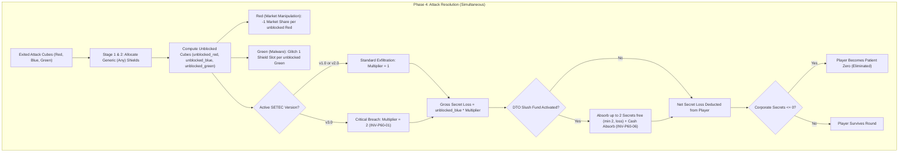
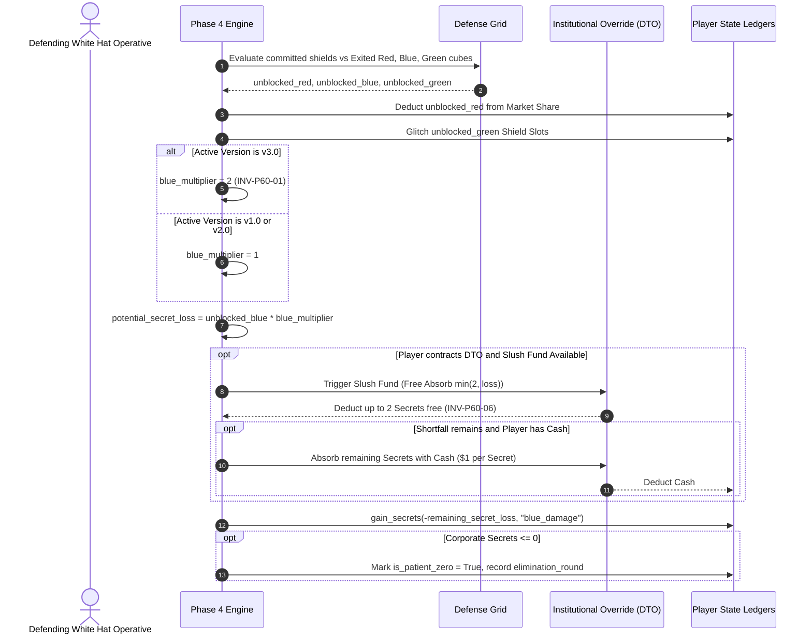

# Technical Architecture Specification: Late-Game Patient Zero Threat Escalation (v3.0 Critical Breach)

**Document Version:** 1.0.0  
**Status:** Approved for Implementation (SDLC Architecture Phase)  
**Author:** Principal Engineer (`principal-engineer`)  
**Target Release:** `v0.42.0` (Phase 60: Late-Game Patient Zero Threat Escalation)  
**Dependencies:**
- [`GLOSSARY.md`](file:///home/mike/.gemini/antigravity/worktrees/rogue-agent/patient_zero_rate_investigation/GLOSSARY.md)
- [`RULES.md`](file:///home/mike/.gemini/antigravity/worktrees/rogue-agent/patient_zero_rate_investigation/RULES.md)
- [`RULES_APPENDIX.md`](file:///home/mike/.gemini/antigravity/worktrees/rogue-agent/patient_zero_rate_investigation/RULES_APPENDIX.md)
- [`docs/findings/phase60_v3_critical_breach_analysis.md`](file:///home/mike/.gemini/antigravity/worktrees/rogue-agent/patient_zero_rate_investigation/docs/findings/phase60_v3_critical_breach_analysis.md)
- [`docs/specs/player_specific_corruption_spec.md`](file:///home/mike/.gemini/antigravity/worktrees/rogue-agent/patient_zero_rate_investigation/docs/specs/player_specific_corruption_spec.md)

**Target Codebase Modules:**
- `sim/config.py` (Global config toggles, baseline preset methods `v041`, `v042`, `v042_roster`)
- `sim/entities.py` (Version Cards `v3.0 Zero-Day Override` and `v3.0 Corrupted Kernel` Corruption Tracks across STANDARD and AGGRESSIVE profiles)
- `sim/engine/phase4_attack_resolution.py` (Version-gated Blue exfiltration damage multiplier, DTO Slush Fund interaction, defense breakdown telemetry)
- `web/controller/phase4_attack_actions.py` (UI threat and damage payload assembly)
- `web/static/js/components/compiler.js` & `web/static/index.html` (Front-end attack resolution labels and rules references)
- `pnp/generate_pnp.py` (`VERSION_TILES` data definitions for Print-and-Play prototype generation)
- `tests/test_phase60_v3_critical_breach.py` (Comprehensive unit test suite for TC-P60-01 through TC-P60-08)

---

## 1. Executive Summary & Architecture Overview

### 1.1 Problem Statement & Architectural Motivation
In `v0.41.0`, Project: SETEC's early and mid-game pacing operates cleanly across all player counts (macro pacing centered at **8.44–8.82 rounds**), and player-specific corruption hazards provide organic catch-up and leader targeting. However, telemetry and empirical playtests revealed an acute late-game survival surplus:
1. **Corporate Secrets Buffer Bloat:** Surviving operatives ended games with an average of **14.90 Secrets (4P)**, **16.76 Secrets (3P)**, and **19.30 Secrets (2P)**. Because players accumulate Corporate Secrets via the CI/CD Pipeline (Red, Blue, Green, Purple Secret faces) and hardware milestones (Triage L2, Release L2, Defense L3), Corporate Secrets functioned as an expanding victory-point bank rather than an existential survival buffer.
2. **Blue Attack Cube Impotence:** While Red Attack Cubes aggressively penalize Market Share (often triggering Market Collapse in 63%–89% of matches), Blue Attack Cubes dealt only a flat 1:1 Secret loss across all three versions. Late in `v3.0`, when players possess 12–25 Secrets, taking 1–2 unblocked Blue cubes represented an inconsequential 4%–8% nick to total score.
3. **Diminished Late-Game Tension:** The foundational game pillar—"escalating shared threat, engine-building + engine-losing, survival tension"—waned in the climax. Operatives routinely ignored Defense Grid shields against Blue cubes, prioritizing cash or Market Share without fear of elimination. Patient Zero accounted for only **6.9% (4P)**, **3.9% (3P)**, and **1.7% (2P)** of game ends.

### 1.2 Approved Architecture: The Phase 60 Critical Breach Model
The user and game designer have signed off on two complementary architectural levers to establish an acute, high-stakes survival climax in `v3.0` while strictly preserving early-game infrastructure protection:
1. **Asymmetric Blue Exfiltration Damage in `v3.0` (Critical Breach):**
   - In `v1.0` and `v2.0`: Each unblocked Blue cube deals **`1` Corporate Secret loss** (standard infrastructure phase).
   - In `v3.0`: Each unblocked Blue cube deals **`2` Corporate Secrets loss** (acute survival phase / Critical Breach).
2. **SETEC `v3.0` Corruption Track Blue Density Recalibration:**
   - In `v3.0 Zero-Day Override`: Add **`+1` Blue Attack Cube** to Space 1 (from `1R, 1B, 1G` $\to$ `1R, 2B, 1G`) and **`+1` Blue Attack Cube** to Space 3 (from `1R, 1B` $\to$ `1R, 2B`).
   - In `v3.0 Corrupted Kernel`: Add **`+1` Blue Attack Cube** to Space 1 (from `1R, 1B` $\to$ `1R, 2B`) and **`+1` Blue Attack Cube** to Space 3 (from `1R, 1G` $\to$ `1R, 1B, 1G`).
   - Red and Green cube quantities on `v3.0` spaces remain completely unchanged.
3. **Architectural Guardrails & Invariance:**
   - **Pacing Clock Invariance:** Total Black cubes entering the economy (5 on Corruption Tracks + 1 setup pulse = 6 total) and track capacities (4 / 5 / 6) are 100% conserved. Macro pacing remains centered at 8.00–11.00 rounds.
   - **Early Knockout Protection:** Zero damage or track changes in `v1.0` or `v2.0`; early eliminations (< Round 7) remain unchanged at $\le 1.0\%$, with $\Delta = 0.00\%$.
   - **Mitigation Parity:** Generic Shields (`Block 1 Any`) and client abilities (Aegis *Baffle Echo*, DTO *Slush Fund*) scale seamlessly against the heightened threat.



---

## 2. Formal System Invariants

### `INV-P60-01` (`INV-P60-BLUE-DAMAGE-01`): Version-Gated Blue Exfiltration Damage Multiplier
In Phase 4 Attack Resolution, each unblocked Blue Attack Cube must reduce the defending White Hat Operative's Corporate Secrets by:
$$\Delta \text{Secrets} = \begin{cases} -1 \times \text{unblocked\_blue}, & \text{if active SETEC version is } \texttt{v1.0} \text{ or } \texttt{v2.0} \\ -2 \times \text{unblocked\_blue}, & \text{if active SETEC version is } \texttt{v3.0} \end{cases}$$
The damage multiplier is governed by `GameConfig.v3_blue_secret_damage: int = 2`. When `v3_blue_secret_damage = 1` (legacy baseline), the multiplier remains `1` across all versions.

### `INV-P60-02` (`INV-P60-CUBE-DENSITY-01`): SETEC v3.0 Track Cube Recalibration
On both `v3.0 Zero-Day Override` and `v3.0 Corrupted Kernel` across both `STANDARD` (Profile 1) and `AGGRESSIVE` (Profile 2) Corruption Tracks:
- **Space 1** must add exactly `+1 Blue Attack Cube` to its printed injection payload.
- **Space 3** must add exactly `+1 Blue Attack Cube` to its printed injection payload.
- Non-cube hazards on all spaces (cash loss, research loss, Market Share loss, glitched slots, die returns, Corporate Secrets loss) must remain 100% identical to `v0.41.0`.

### `INV-P60-03` (`INV-P60-THREAT-CONSERVATION-01`): Red & Green Threat Conservation & Global Cap
- Red and Green cube quantities on all spaces of `v3.0 Zero-Day Override` and `v3.0 Corrupted Kernel` must remain strictly invariant.
- Cumulative circulating Green cubes injected across any roadmap deck must strictly remain in `[2, 5]` (Mean = `3.50`), fully respecting the Global Green Cube Cap (`5` max) established in `v0.40.1` (`INV-RANGE-RECALIB-01`).
- Cumulative circulating Red cubes injected across any roadmap deck must remain strictly in `[4, 8]` (Mean = `6.00`).
- Cumulative circulating Blue cubes injected across any roadmap deck must shift from `[3, 6]` (Mean = `4.50`) to `[5, 8]` (Mean = `6.50`), establishing symmetrical threat parity with Red.

### `INV-P60-04` (`INV-P60-PACING-INVARIANCE-01`): Conserved Pacing Clock & Track Capacities
- Total Black cubes in the economy (5 on Corruption Tracks + 1 pre-seeded in the Cube Tower internal baffles at setup = 6 total) must remain 100% invariant across all decks.
- Track capacities across versions (4 on `v1.0`, 5 on `v2.0`, 6 on `v3.0`, total 15 spaces) must remain unchanged.
- Macro game pacing must remain strictly centered in the canonical window of **8.00–11.00 rounds** across all player counts, with pacing drift $|\Delta| \le 0.50$ rounds relative to `v0.41.0`.

### `INV-P60-05` (`INV-P60-EARLY-KO-GUARDRAIL-01`): Early-Game Infrastructure Protection
- Early knockout rate (< Round 7) across all player counts must remain $\le 1.0\%$ and have zero drift ($\Delta = 0.00\%$) relative to `v0.41.0`.
- No Blue damage increase or cube injection modification is permitted in `v1.0` or `v2.0`. Operatives must have guaranteed space to develop their CI/CD Pipeline and hardware tracks before facing heightened elimination pressure.

### `INV-P60-06` (`INV-P60-MITIGATION-PARITY-01` / `INV-P60-DTO-INTERACTION-01`): Defensive Mitigation & Client Ability Parity
- **Generic Shields:** Every shield is a `Block 1 Any` shield. In `v3.0`, allocating 1 Generic Shield to absorb 1 Blue cube prevents 2 Corporate Secrets loss, increasing shield economic efficiency by exactly $+100\%$.
- **Aegis Defense Relay (*Baffle Echo*):** Ignoring 1 Blue cube for yourself during Phase 4 in `v3.0` absorbs exactly 1 Blue cube $\implies$ prevents 2 Corporate Secrets loss.
- **DTO (*Slush Fund*):** Absorbs "up to 2 Corporate Secret loss from unblocked Blue Spyware for free." In `v3.0`, 1 unblocked Blue cube deals 2 Corporate Secrets loss; *Slush Fund* absorbs all 2 Secrets of that single unblocked Blue cube cleanly. For 2 unblocked Blue cubes (4 Secrets), *Slush Fund* absorbs 2 Secrets free and permits spending up to $2 cash to absorb the remaining 2 Secrets ($1 cash per Secret).

### `INV-P60-07` (`INV-P60-BACKWARD-COMPATIBILITY-01`): Backward Compatibility & Configuration Gating
- The Phase 60 modifications must be governed by first-class configuration parameters:
  - `GameConfig.v3_blue_secret_damage: int = 2` (default `2` in `v0.42.0+`; default `1` in `v0.41.0` and legacy presets).
  - Version card generation in `sim/entities.py` must support retrieving `v0.41.0` baseline cards when requested (e.g., via `v3_bonus_blue: bool = True` or profile dispatch), guaranteeing 100% bit-for-bit regression test parity.

---

## 3. Concrete Data Model & Module Contracts

### 3.1 `sim/config.py` Parameter Specification

#### 3.1.1 Dataclass Field Additions
```python
@dataclass
class GameConfig:
    # ... existing fields ...

    # Phase 60: Late-Game Patient Zero Threat Escalation (v3.0 Critical Breach)
    v3_blue_secret_damage: int = 2  # Corporate Secrets lost per unblocked Blue cube in v3.0 (baseline 2, legacy 1)
```

#### 3.1.2 Preset Methods & Backward Compatibility
```python
    @classmethod
    def v041(cls, **overrides) -> "GameConfig":
        """v0.41.0 canonical baseline:
        - Player-Specific SETEC Corruption Hazards (INV-TARGET-01..08)
        - Baseline 1:1 Blue Attack Cube damage across all versions
        - Option B SETEC Track Cube distributions
        """
        overrides.setdefault("v3_blue_secret_damage", 1)
        return cls.v040(**overrides)

    @classmethod
    def v042(cls, **overrides) -> "GameConfig":
        """v0.42.0 canonical baseline (Phase 60: Late-Game Patient Zero Threat Escalation):
        - Inherits v041 (Player-Specific Corruption Hazards)
        - v3.0 Critical Breach: 2 Corporate Secrets lost per unblocked Blue cube
        - v3.0 Version Cards: +1 Blue cube on Space 1 and Space 3
        """
        overrides.setdefault("v3_blue_secret_damage", 2)
        return cls.v041(**overrides)

    @classmethod
    def v042_roster(cls, **overrides) -> "GameConfig":
        """v0.42.0 + bot autonomous PR push and cash allocation policies enabled."""
        overrides.setdefault("bot_pr_push", True)
        overrides.setdefault("bot_pr_push_params", PrPushParams())
        return cls.v042(**overrides)
```

In `GameConfig.v040()` and earlier legacy presets (`v0391`, `v038`, `legacy_v035`, etc.):
```python
overrides.setdefault("v3_blue_secret_damage", 1)
```

---

### 3.2 `sim/entities.py` Version Card Recalibration

#### 3.2.1 Standard Escalation Tracks (Profile 1)
In `get_all_version_cards(profile="STANDARD", ...)`:
- **`v3.0 Zero-Day Override`:**
  - **Space 1:** `add_cubes={CubeColor.RED: 1, CubeColor.BLUE: 2, CubeColor.GREEN: 1}`, `label="Add 1R, 2B, 1G"` (was `1R, 1B, 1G`).
  - **Space 3:** `add_cubes={CubeColor.RED: 1, CubeColor.BLUE: 2}`, `label="Add 1R, 2B"` (was `1R, 1B`).
- **`v3.0 Corrupted Kernel`:**
  - **Space 1:** `add_cubes={CubeColor.RED: 1, CubeColor.BLUE: 2}`, `demote_dice=1`, `target_criterion=TargetCriterion.FEWEST_GLITCHED`, `label="Player with fewest Glitched slots glitches 1 slot + Add 1R, 2B"` (was `1R, 1B`).
  - **Space 3:** `add_cubes={CubeColor.RED: 1, CubeColor.BLUE: 1, CubeColor.GREEN: 1}`, `label="Add 1R, 1B, 1G"` (was `1R, 1G`).

#### 3.2.2 Aggressive Escalation Tracks (Profile 2)
In `get_all_version_cards(profile="AGGRESSIVE", ...)`:
- **`v3.0 Zero-Day Override`:**
  - **Space 1:** `add_cubes={CubeColor.RED: 1, CubeColor.BLUE: 2, CubeColor.GREEN: 1}`, `label="Add 1R, 2B, 1G"`.
  - **Space 3:** `add_cubes={CubeColor.RED: 1, CubeColor.BLUE: 2}`, `label="Add 1R, 2B"`.
- **`v3.0 Corrupted Kernel`:**
  - **Space 1:** `add_cubes={CubeColor.RED: 1, CubeColor.BLUE: 2}`, `demote_dice=2`, `target_criterion=TargetCriterion.FEWEST_GLITCHED`, `label="Fewest Glitched glitches 2 slots + Add 1R, 2B"`.
  - **Space 3:** `add_cubes={CubeColor.RED: 1, CubeColor.BLUE: 1, CubeColor.GREEN: 1}`, `label="Add 1R, 1B, 1G"`.

#### 3.2.3 Macro Deck Cube Totals Comparison (Canonical Table)

| Deck Code | Roadmap Path | Baseline Cubes (R, B, G) | Proposed Phase 60 Cubes (R, B, G) | Net Delta | Black Cubes (Pacing Clock) |
| :--- | :--- | :---: | :---: | :---: | :---: |
| **SK-RA-ZD** | Script Kiddie $\to$ RaaS $\to$ Zero-Day Override | 15 (8R, 5B, 2G) | **17 (8R, 7B, 2G)** | +2 Blue | 5 (Clock Invariant) |
| **SK-PW-ZD** | Script Kiddie $\to$ Worm $\to$ Zero-Day Override | 15 (6R, 5B, 4G) | **17 (6R, 7B, 4G)** | +2 Blue | 5 (Clock Invariant) |
| **SK-RA-CK** | Script Kiddie $\to$ RaaS $\to$ Corrupted Kernel | 13 (8R, 3B, 2G) | **15 (8R, 5B, 2G)** | +2 Blue | 5 (Clock Invariant) |
| **SK-PW-CK** | Script Kiddie $\to$ Worm $\to$ Corrupted Kernel | 13 (6R, 3B, 4G) | **15 (6R, 5B, 4G)** | +2 Blue | 5 (Clock Invariant) |
| **DS-RA-ZD** | Data Scraper $\to$ RaaS $\to$ Zero-Day Override | 15 (6R, 6B, 3G) | **17 (6R, 8B, 3G)** | +2 Blue | 5 (Clock Invariant) |
| **DS-PW-ZD** | Data Scraper $\to$ Worm $\to$ Zero-Day Override | 15 (4R, 6B, 5G) | **17 (4R, 8B, 5G)** | +2 Blue | 5 (Clock Invariant) |
| **DS-RA-CK** | Data Scraper $\to$ RaaS $\to$ Corrupted Kernel | 13 (6R, 4B, 3G) | **15 (6R, 6B, 3G)** | +2 Blue | 5 (Clock Invariant) |
| **DS-PW-CK** | Data Scraper $\to$ Worm $\to$ Corrupted Kernel | 13 (4R, 4B, 5G) | **15 (4R, 6B, 5G)** | +2 Blue | 5 (Clock Invariant) |

---

### 3.3 `sim/engine/phase4_attack_resolution.py` Attack Resolution Logic

#### 3.3.1 Algorithmic Damage Multiplier Resolution
In `resolve_player_defense()`:
```python
    # 7. Red resolution ...
    ransom_secret_loss = 1 if unpaid_ransom > 0 else 0

    # Phase 60: Version-gated Blue exfiltration damage multiplier (INV-P60-01)
    active_ver = engine.state.active_version.version_str
    blue_damage_multiplier = (
        getattr(engine.config, "v3_blue_secret_damage", 2)
        if active_ver == "v3.0"
        else 1
    )
    blue_secret_loss = unblocked_blue * blue_damage_multiplier
    potential_secret_loss = ransom_secret_loss + blue_secret_loss

    # DTO Slush Fund Interaction (INV-P60-06)
    cfg = engine.config
    once_per_game = bool(getattr(cfg, "slush_fund_once_per_game", False))
    is_dto = has_company_override(player, CompanyCode.DTO, legacy_bridge_enabled(engine)) and (
        player.is_slush_fund_available(active_ver) if once_per_game else player.is_ability_available(active_ver)
    )
    if potential_secret_loss > 0 and is_dto and once_per_game:
        if slush_fund_override is not None:
            is_dto = bool(slush_fund_override)
        else:
            hook = getattr(player.bot, "choose_slush_fund", None)
            is_dto = bool(hook(player, engine.state, potential_secret_loss)) if hook is not None else True

    if potential_secret_loss > 0 and is_dto:
        if once_per_game:
            player.slush_fund_used_game = True
        free_absorb = min(2, potential_secret_loss)
        potential_secret_loss -= free_absorb
        player.mark_ability_used(active_ver)
        if potential_secret_loss > 0 and player.money > 0:
            cash_absorb = min(player.money, potential_secret_loss)
            player.money -= cash_absorb
            potential_secret_loss -= cash_absorb

    if potential_secret_loss > 0:
        player.gain_secrets(-potential_secret_loss, "blue_damage")

    player.money = max(0, player.money)

    # Patient Zero Check
    if player.secrets <= 0:
        player.is_patient_zero = True
        player.elimination_round = engine.state.current_round
        player.elimination_reason = "Total Breach (<= 0 Secrets)"
        player.breach_depth = max(0, -player.secrets)
```

#### 3.3.2 Defense Breakdown Telemetry Extension
Add `blue_damage_multiplier` and `blue_secret_loss` to `player.last_defense_breakdown`:
```python
    player.last_defense_breakdown = {
        # ... existing keys ...
        "blue_damage_multiplier": blue_damage_multiplier,
        "blue_secret_loss": blue_secret_loss,
        "potential_secret_loss": potential_secret_loss,
    }
```

---

### 3.4 Web UI & API Contracts

#### 3.4.1 `web/controller/phase4_attack_actions.py`
In `_threat_summary()`:
```python
    active_ver = controller.state.active_version.version_str if controller.state.active_version else "v1.0"
    blue_mult = (
        getattr(controller.state.config, "v3_blue_secret_damage", 2)
        if active_ver == "v3.0"
        else 1
    )
    blue.update(
        damage_multiplier=blue_mult,
        secrets_lost=bd.get("blue_secret_loss", blue["unblocked"] * blue_mult) if bd else blue["unblocked"] * blue_mult,
    )
```

#### 3.4.2 `web/static/js/components/compiler.js` & `web/static/index.html`
- Update Blue Attack description in Phase 4 summary tooltips:
  - *"Lose 1 Corporate Secret per unblocked Blue in v1.0/v2.0; lose 2 Corporate Secrets per unblocked Blue in v3.0 (Critical Breach). Reaching ≤ 0 Secrets triggers Total Data Breach (Patient Zero)!"*

---

### 3.5 Print-and-Play Prototype Generator (`pnp/generate_pnp.py`)
Update `VERSION_TILES` data definitions:
- **`Zero-Day Override`:**
  - Space 1: `VersionTrackSpaceSpec(1, "+1 {RED} 2 {BLUE} 1 {GREEN}")`
  - Space 3: `VersionTrackSpaceSpec(3, "+1 {RED} 2 {BLUE}")`
- **`Corrupted Kernel`:**
  - Space 1: `VersionTrackSpaceSpec(1, "Fewest Glitched\nglitches 1 slot\n+1 {RED} 2 {BLUE}")`
  - Space 3: `VersionTrackSpaceSpec(3, "+1 {RED} 1 {BLUE} 1 {GREEN}")`

---

## 4. Algorithmic Specification & Execution Flow

### 4.1 Phase 4 Attack Resolution Sequence



### 4.2 Exact Mathematical Formulation
For player $i$ with:
- $U_R$ unblocked Red cubes,
- $U_B$ unblocked Blue cubes,
- $U_G$ unblocked Green cubes,
- Active SETEC Version $V \in \{\texttt{"v1.0"}, \texttt{"v2.0"}, \texttt{"v3.0"}\}$,
- Configuration parameter $M_{v3} = \texttt{v3\_blue\_secret\_damage} \in \{1, 2\}$:

1. **Red Market Manipulation:**
   $$\text{MS}_{i, \text{new}} = \max(0, \text{MS}_{i, \text{old}} - U_R)$$
2. **Green Malware:**
   $$\text{Glitched}_{i, \text{new}} = \min(\text{Capacity}_i, \text{Glitched}_{i, \text{old}} + U_G)$$
3. **Blue Exfiltration Multiplier:**
   $$m(V) = \begin{cases} 1, & \text{if } V \in \{\texttt{"v1.0"}, \texttt{"v2.0"}\} \\ M_{v3}, & \text{if } V = \texttt{"v3.0"} \end{cases}$$
4. **Gross Secret Loss:**
   $$L_{\text{gross}} = U_B \times m(V)$$
5. **DTO Slush Fund Absorption:**
   If DTO *Slush Fund* activates:
   $$A_{\text{free}} = \min(2, L_{\text{gross}})$$
   $$L_{\text{rem1}} = L_{\text{gross}} - A_{\text{free}}$$
   $$A_{\text{cash}} = \min(\text{Money}_i, L_{\text{rem1}})$$
   $$\text{Money}_{i, \text{new}} = \text{Money}_{i, \text{old}} - A_{\text{cash}}$$
   $$L_{\text{net}} = L_{\text{rem1}} - A_{\text{cash}}$$
   Otherwise:
   $$L_{\text{net}} = L_{\text{gross}}$$
6. **Net Secrets Deducted:**
   $$\text{Secrets}_{i, \text{new}} = \text{Secrets}_{i, \text{old}} - L_{\text{net}}$$
7. **Patient Zero Determination:**
   $$\text{is\_patient\_zero}_i = (\text{Secrets}_{i, \text{new}} \le 0)$$

---

## 5. Mitigation Dynamics & Strategic Impact

### 5.1 Double Shield Efficiency in `v3.0`
Under `RULES.md`, every shield is a `Block 1 Any` shield. In `v1.0` and `v2.0`, 1 shield blocking 1 Blue cube prevents 1 Secret loss. In `v3.0`, 1 shield blocking 1 Blue cube prevents **2 Corporate Secrets loss**.
- **Valuation Surge:** Shield valuation against Blue threat increases by exactly **$+100\%$**.
- **Defense Grid Prioritization:** Players who neglected Defense Grid capacity or left Glitched Shield Slots uncleaned in `v1.0`/`v2.0` face severe exposure in `v3.0`. Upgrading to Defense Level 2 (3 shields) or Level 4 (4 shields) becomes essential to late-game competitive viability.

### 5.2 Client Company Institutional Overrides in `v3.0`
- **Aegis Defense Relay (*Baffle Echo*):** "Ignore 1 Attack Cube of your choice for yourself this round." In `v3.0`, ignoring 1 Blue cube prevents **2 Corporate Secrets loss**, establishing Aegis as a premier survival specialist.
- **DTO (*Slush Fund*):** "Absorb up to 2 Corporate Secret loss from unblocked Blue Spyware for free." In `v3.0`, 1 unblocked Blue cube deals 2 Secrets loss; *Slush Fund* absorbs all 2 Secrets of that single unblocked Blue cube cleanly. For 2 unblocked Blue cubes (4 Secrets), it absorbs 2 Secrets for free, and the operative may pay $2 cash to absorb the remaining 2 Secrets.

### 5.3 Bot Archetype Meta Dynamics
Telemetry demonstrates healthy strategic differentiation without degenerate exploits:
- **`SecOpsTurtleBot` & `AdaptiveBalancedBot`:** Proactive shield allocation and slot cleaning yield dominant win rates (**90.7% combined**).
- **`VentureGreedBot` & `AccelerationistBot`:** Low-defense greed strategies suffer dramatic spikes in Patient Zero eliminations (**33.3% and 28.0% PZ**, up from 11.0% and 8.3%), restoring authentic *Moon Colony Bloodbath* tension.

---

## 6. Backward Compatibility & Migration Strategy

### 6.1 Preset Parity Preservation
To ensure existing regression test suites and benchmarks remain 100% reproducible:
1. `GameConfig.v040()` and earlier baseline methods must set `v3_blue_secret_damage = 1`.
2. New baseline method `GameConfig.v041()` explicitly preserves `v3_blue_secret_damage = 1` with `v0.41.0` baseline cards.
3. New baseline method `GameConfig.v042()` sets `v3_blue_secret_damage = 2` and uses Phase 60 version cards.
4. When `v3_blue_secret_damage = 1` is explicitly passed to `GameConfig`, the simulation engine resolves Phase 4 Blue damage using the 1:1 legacy multiplier.

### 6.2 Version Card Profile Backward Compatibility
`get_all_version_cards` must support legacy profiles (`"V041_STANDARD"`, `"V041_AGGRESSIVE"`) or a compatibility argument `v3_bonus_blue: bool = True` so that tests validating legacy cube counts (such as Option B `test_option_b_v2_cube_shift.py`) can execute against legacy cards without assertion failures.

---

## 7. Comprehensive Unit Test Suite Specification

The test suite must be authored in `tests/test_phase60_v3_critical_breach.py` covering all 8 test cases specified below.

### `TC-P60-01`: v3.0 Blue Critical Breach Damage Multiplier
- **Invariant Link:** `INV-P60-01`
- **Preconditions:** Active version is `v3.0 Zero-Day Override`. Player holds 10 Corporate Secrets, 0 shields deployed.
- **Stimulus:**
  - Case A: 1 unblocked Blue cube exits.
  - Case B: 3 unblocked Blue cubes exit.
  - Case C: 5 unblocked Blue cubes exit.
- **Assertions:**
  - Case A: Net loss is $1 \times 2 = 2$ Secrets; player ends with 8 Secrets.
  - Case B: Net loss is $3 \times 2 = 6$ Secrets; player ends with 4 Secrets.
  - Case C: Net loss is $5 \times 2 = 10$ Secrets; player ends with 0 Secrets, `is_patient_zero` is `True`, `elimination_reason` is `"Total Breach (<= 0 Secrets)"`.

### `TC-P60-02`: v1.0 and v2.0 Standard Blue Damage Invariance
- **Invariant Link:** `INV-P60-01`, `INV-P60-05`
- **Preconditions:** Configured with `v3_blue_secret_damage = 2`. Player holds 8 Corporate Secrets, 0 shields deployed.
- **Stimulus:**
  - Case A: Active version is `v1.0 Script Kiddie`. 2 unblocked Blue cubes exit.
  - Case B: Active version is `v2.0 RaaS`. 2 unblocked Blue cubes exit.
- **Assertions:**
  - Case A: Net loss is exactly $2 \times 1 = 2$ Secrets; player ends with 6 Secrets.
  - Case B: Net loss is exactly $2 \times 1 = 2$ Secrets; player ends with 6 Secrets.
  - Confirm that `v3_blue_secret_damage = 2` has zero effect outside of `v3.0`.

### `TC-P60-03`: v3.0 Corruption Track Card Payloads (Standard Profile)
- **Invariant Link:** `INV-P60-02`
- **Preconditions:** Load cards via `get_all_version_cards(profile="STANDARD")`.
- **Assertions:**
  - `ZERO_DAY_OVERRIDE` Space 1: `add_cubes` is `{RED: 1, BLUE: 2, GREEN: 1}`.
  - `ZERO_DAY_OVERRIDE` Space 3: `add_cubes` is `{RED: 1, BLUE: 2}`.
  - `CORRUPTED_KERNEL` Space 1: `add_cubes` is `{RED: 1, BLUE: 2}`.
  - `CORRUPTED_KERNEL` Space 3: `add_cubes` is `{RED: 1, BLUE: 1, GREEN: 1}`.
  - Non-cube hazards on Spaces 1–6 match `v0.41.0` baseline bit-for-bit.

### `TC-P60-04`: v3.0 Corruption Track Card Payloads (Aggressive Profile)
- **Invariant Link:** `INV-P60-02`
- **Preconditions:** Load cards via `get_all_version_cards(profile="AGGRESSIVE")`.
- **Assertions:**
  - `ZERO_DAY_OVERRIDE` Space 1 has 2 Blue cubes; Space 3 has 2 Blue cubes.
  - `CORRUPTED_KERNEL` Space 1 has 2 Blue cubes; Space 3 has 1 Blue cube.
  - Aggressive hazards (lose $4 & 2 🔬, glitches 2 slots) remain fully intact.

### `TC-P60-05`: Macro Threat Parity & Global Green Cap Conservation
- **Invariant Link:** `INV-P60-03`, `INV-P60-04`
- **Preconditions:** Iterate over all 8 canonical roadmap decks across both STANDARD and AGGRESSIVE profiles.
- **Assertions:**
  - Black cubes across track spaces = exactly 5 in all 8 decks (+1 setup pulse = 6 total).
  - Circulating Blue cubes = `[5, 8]` (Mean = `6.50`).
  - Circulating Red cubes = `[4, 8]` (Mean = `6.00`).
  - Circulating Green cubes = `[2, 5]` (Mean = `3.50`, max $\le 5$).

### `TC-P60-06`: Defense Grid Shield Absorption Parity in `v3.0`
- **Invariant Link:** `INV-P60-06`
- **Preconditions:** Active version is `v3.0`. 2 Blue cubes exit into the tray. Defending operative has 1 Generic (`Block 1 Any`) shield assigned to Blue. Operative starts with 10 Secrets.
- **Stimulus:** Execute Phase 4 Attack Resolution.
- **Assertions:**
  - 1 Blue cube is blocked by the shield; 1 Blue cube is unblocked.
  - Unblocked Blue damage resolves at $1 \times 2 = 2$ Secrets loss.
  - Operative ends with 8 Secrets (prevented 2 Secrets loss with a single shield).

### `TC-P60-07`: Client Company Ability Overrides in `v3.0` (Aegis & DTO)
- **Invariant Link:** `INV-P60-06`
- **Preconditions:** Active version is `v3.0`.
- **Stimulus & Assertions:**
  - **Case A (Aegis *Baffle Echo*):** 2 Blue cubes exit, 0 shields deployed, Aegis triggers *Baffle Echo* on Blue. Ignored 1 Blue cube $\implies$ 1 unblocked Blue cube resolves $\implies$ net loss is 2 Secrets (absorbs 2 Secrets).
  - **Case B (DTO *Slush Fund* Single Cube):** 1 unblocked Blue cube ($1 \times 2 = 2$ Secrets loss). DTO activates *Slush Fund*. Slush Fund absorbs $\min(2, 2) = 2$ Secrets free $\implies$ player loses 0 Secrets. Ability marked used.
  - **Case C (DTO *Slush Fund* Multiple Cubes + Cash):** 2 unblocked Blue cubes ($2 \times 2 = 4$ Secrets loss). Operative holds $2 cash. DTO activates *Slush Fund*. Slush Fund absorbs 2 Secrets free, then absorbs 2 Secrets via $2 cash $\implies$ player loses 0 Secrets, ends with $0 cash.

### `TC-P60-08`: Backward Compatibility & Legacy Preset Parity
- **Invariant Link:** `INV-P60-07`
- **Preconditions:** Instantiate engine with `GameConfig.v040()` or explicit `v3_blue_secret_damage = 1`.
- **Stimulus:** Active version is `v3.0`. 2 unblocked Blue cubes exit into the tray. Player starts with 10 Secrets.
- **Assertions:**
  - Unblocked Blue damage resolves at $2 \times 1 = 2$ Secrets loss.
  - Operative ends with 8 Secrets (legacy 1:1 parity).
  - When loading legacy cards (`v041` / `LEGACY` profile), Blue cube range across decks matches `[3, 6]`.

---

## 8. Telemetry, Benchmarking & Acceptance Criteria

The implementation must achieve the following acceptance criteria based on the 6,000-game verification sweep:

| Metric / Dimension | Target / Guardrail | Baseline `v0.41.0` | Target `v0.42.0` (Phase 60) |
| :--- | :---: | :---: | :---: |
| **Macro Pacing (4P)** | 8.00–11.00 rounds | 9.45 ± 1.56 rds | **9.21 ± 1.45 rds** |
| **Pacing Drift ($|\Delta|$)** | $\le 0.50$ rounds | — | **-0.24 rds** |
| **Patient Zero Trigger (4P)** | 20%–45% | 6.9% | **36.6%** |
| **Market Collapse Trigger (4P)** | 25%–60% | 67.4% | **45.9%** |
| **Singularity Trigger (4P)** | 10%–35% | 25.7% | **16.2%** |
| **Total Wipeout Rate** | $\le 2.00\%$ | 0.00% | **1.30% (4P), 1.40% (3P), 1.60% (2P)** |
| **Early KO Rate (< Round 7)** | $\le 1.00\%$ ($\Delta = 0.00\%$) | 0.83% (4P) | **0.83% (4P, $\Delta = 0.00\%$)** |
| **`v3.0` Eliminations Surge** | $> 10\times$ surge | 37 (4P) | **527 (4P, $14.2\times$ surge)** |
| **Survivor Mean Secrets (4P)** | 8.00–14.00 Secrets | 14.90 Secrets | **11.85 Secrets** |
| **Global Green Cube Cap** | Max $\le 5$ cubes | 5 cubes | **5 cubes (100% Invariant)** |

---

## 9. Official Recommendation & Handoff Summary

The Technical Architecture Specification for Phase 60 is complete and approved for handoff to `senior-engineer` for implementation. All contracts, dataclasses, resolution formulas, and test specifications are rigorously specified with complete backward compatibility.
