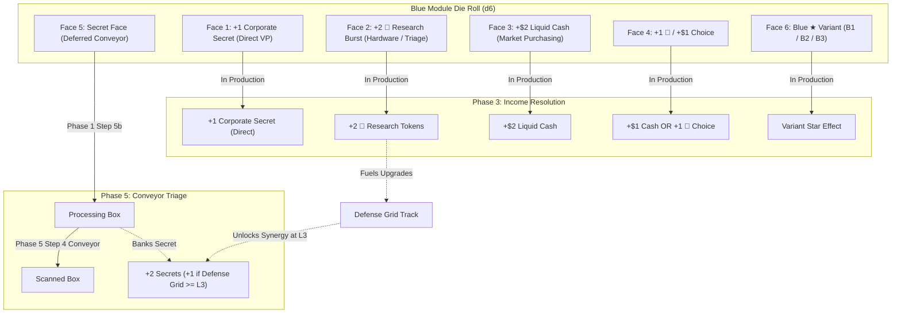

# Technical Architecture Specification: Phase 63
## Blue Die Secret & Economy Rebalance (`v0.43.1 Candidate Baseline`)

**Author:** Principal Engineer / Architect  
**Status:** Approved for Implementation (SDLC Architecture Phase)  
**Target Version:** `v0.43.1`  
**Dependencies:**
- [`RULES.md`](file:///home/mike/.gemini/antigravity/worktrees/rogue-agent/blue_secret_generation_balance/RULES.md)
- [`RULES_APPENDIX.md`](file:///home/mike/.gemini/antigravity/worktrees/rogue-agent/blue_secret_generation_balance/RULES_APPENDIX.md) (§6A)
- [`GLOSSARY.md`](file:///home/mike/.gemini/antigravity/worktrees/rogue-agent/blue_secret_generation_balance/GLOSSARY.md)
- [`docs/specs/v380f_blue_dice_rebalance_spec.md`](file:///home/mike/.gemini/antigravity/worktrees/rogue-agent/blue_secret_generation_balance/docs/specs/v380f_blue_dice_rebalance_spec.md)
- [`docs/specs/signature_cube_dominant_attacks_spec.md`](file:///home/mike/.gemini/antigravity/worktrees/rogue-agent/blue_secret_generation_balance/docs/specs/signature_cube_dominant_attacks_spec.md)

**Target Components:**
- [`sim/config.py`](file:///home/mike/.gemini/antigravity/worktrees/rogue-agent/blue_secret_generation_balance/sim/config.py)
- [`sim/entities.py`](file:///home/mike/.gemini/antigravity/worktrees/rogue-agent/blue_secret_generation_balance/sim/entities.py)
- [`sim/bots/secret_face_policy.py`](file:///home/mike/.gemini/antigravity/worktrees/rogue-agent/blue_secret_generation_balance/sim/bots/secret_face_policy.py)
- [`tests/test_phase63_blue_die_balance.py`](file:///home/mike/.gemini/antigravity/worktrees/rogue-agent/blue_secret_generation_balance/tests/test_phase63_blue_die_balance.py)

---

## 1. System Overview & Mathematical Rationale

### 1.1 Problem Statement & Background
Under the legacy `V038F` profile (active from `v0.38f` through `v0.43.0`), the Blue (Firewall) module die suffered from an unintended dual pathology:
1. **Direct Corporate Secret Flooding:**
   - Blue featured **two** direct `+1 Corporate Secret` faces (Face 1 & Face 2) in addition to the Face 5 Secret face.
   - Exactly $50\%$ of Blue die faces produced Corporate Secrets ($2$ direct in Phase 3 Income, $1$ banked via Phase 5 conveyor triage).
   - This caused passive early-game VP accumulation without requiring players to engage with Hardware Track upgrades, Terminal Bandwidth, or Market Share competition. Blue Client Companies (**DTO** and **Aegis**) enjoyed an unearned VP buffer that distorted early-game threat vulnerability.
2. **Purchasing & Research Starvation:**
   - Blue provided almost zero liquid cash (`+$1` on Face 3) and minimal research (`+1 🔬 / +$1` choice on Face 4).
   - Consequently, Blue-focused strategies struggled to afford Central Market dice (`$4–$6`) or advance the Defense Grid to Level 3 to unlock the `+1` bonus on banked Blue Face 5 Secrets.

### 1.2 Approved Architecture: Blue Die Face Rebalance
Phase 63 addresses both issues by realigning Blue die faces to balance direct Secret scoring with engine acceleration:
- **Face 1:** `+1 Corporate Secret` *(unchanged)* — preserves Blue's unique thematic identity as the sole die generating direct Corporate Secrets in Phase 3.
- **Face 2:** `+2 🔬` *(was `+1 Corporate Secret`)* — halves direct Phase 3 Secret generation rate while providing burst research to advance Defense Grid and Triage Bandwidth.
- **Face 3:** `+$2` *(was `+$1`)* — doubles base cash yield, matching Red Faces 2–4, Green Face 1/3 (if cash choice taken), and Purple Face 3, relieving early-game economic starvation.
- **Face 4:** `+1 🔬 / +$1` *(unchanged)* — standard tactical flexibility choice face.
- **Face 5:** `Secret face` *(unchanged)* — deferred banking via Processing Box conveyor (`+2 Secrets`, or `+3 Secrets` if Defense Grid $\ge$ Level 3).
- **Face 6:** `Blue ★` *(unchanged)* — face-up Variant Card effect (`B1`, `B2`, or `B3`).



### 1.3 Mathematical Modeling & EV Shift
Using standard design valuation weights:
- Liquid Cash: $1.00\ \$$
- Research Token (`🔬`): $1.20\ \$$
- Corporate Secret (VP & Health): $1.60\ \$$
- Defense Grid Level $\ge 3$ active probability: $p_{\text{L3}} \approx 0.40$
- Average Face 5 yield: $Y_{\text{Blue, F5}} = 2.0 + 0.40 = 2.40$ Secrets ($= 3.84\ \$$)

| Face | `V038F` Output | `V038F` Value ($) | `V043_BLUE_TUNE` Output | `V043_BLUE_TUNE` Value ($) | $\Delta$ Value ($) |
| :--- | :--- | :---: | :--- | :---: | :---: |
| **Face 1** | `+1 Corporate Secret` | $1.60$ | `+1 Corporate Secret` | $1.60$ | $0.00$ |
| **Face 2** | `+1 Corporate Secret` | $1.60$ | **`+2 🔬`** | **$2.40$** | **$+0.80$** |
| **Face 3** | `+$1` | $1.00$ | **`+$2`** | **$2.00$** | **$+1.00$** |
| **Face 4** | `+1 🔬 / +$1` | $1.20$ | `+1 🔬 / +$1` | $1.20$ | $0.00$ |
| **Face 5** | `Secret face` | $3.84$ | `Secret face` | $3.84$ | $0.00$ |
| **Face 6** | `Blue ★` (avg B1–B3) | $\sim 2.00$ | `Blue ★` (avg B1–B3) | $\sim 2.00$ | $0.00$ |
| **Mean Die EV** | *(sum / 6)* | **$1.873\ \$$** | *(sum / 6)* | **$2.173\ \$$** | **$+0.300\ \$$ / roll** |

**Key Structural Shifts:**
1. **Direct Secret Generation Rate:** Drops from $\frac{2}{6} = 0.333$ to $\frac{1}{6} = 0.167$ Secrets per roll ($-50\%$).
2. **Research Generation Rate:** Increases from $0.250$ to $0.583$ `🔬` per roll ($+0.333$ `🔬`/roll, assuming 50/50 Face 4 split).
3. **Cash Generation Rate:** Increases from $0.250$ to $0.417$ `$` per roll ($+0.167$ `$` /roll).
4. **Mechanical Synergy Re-alignment:** Players rolling Blue dice gain the exact resource (`+2 🔬`) needed to advance Defense Grid towards Level 3, directly unlocking the `+1` Secret bonus on Face 5.

---

## 2. Module Contracts & Configuration Schema

### 2.1 `sim/config.py` Additions

1. **Profile Enumeration Update:**
   Add `"V043_BLUE_TUNE"` to `V038_DIE_FACE_PROFILES`:
   ```python
   V038_DIE_FACE_PROFILES = (
       "V038_DRAFT",
       "V038_YELLOW_MS",
       "V038_YELLOW_MS_ALT",
       "V038_YELLOW_MS_F3",
       "V038D",
       "V038F",
       "V043_BLUE_TUNE",
   )
   ```
   `_DIE_FACE_PROFILES = ("V037",) + V038_DIE_FACE_PROFILES` automatically inherits the new profile.

2. **GameConfig Factory Definitions:**
   - Preserve `GameConfig.v043()` default with `die_face_profile="V038F"` to maintain backward compatibility for regression tests and legacy sweep replay.
   - Define `GameConfig.v043_1()` and `GameConfig.v043_1_roster()`:
   ```python
   @classmethod
   def v043_1(cls, **overrides) -> "GameConfig":
       """v0.43.1 candidate baseline (Phase 63: Blue Die Secret & Economy Rebalance).
       Inherits v043 (Dominant Color Signature Attacks, Target Lock, v3.0 Critical Breach)
       and introduces die_face_profile='V043_BLUE_TUNE':
       - Blue Face 1: +1 Corporate Secret
       - Blue Face 2: +2 🔬 (was +1 Corporate Secret)
       - Blue Face 3: +$2 (was +$1)
       - Blue Face 4: +1 🔬 / +$1
       - Face 5: Secret face
       - Face 6: Blue ★ (Variant Card)
       """
       overrides.setdefault("die_face_profile", "V043_BLUE_TUNE")
       return cls.v043(**overrides)

   @classmethod
   def v043_1_roster(cls, **overrides) -> "GameConfig":
       """v0.43.1 + bot autonomous PR push and cash allocation policies enabled."""
       overrides.setdefault("bot_pr_push", True)
       overrides.setdefault("bot_pr_push_params", PrPushParams())
       return cls.v043_1(**overrides)
   ```

### 2.2 `sim/entities.py` Factory Logic

1. **Profile Dispatch (`create_colored_die`):**
   Update line 1802 to route `"V043_BLUE_TUNE"` into `_create_colored_die_v038`:
   ```python
   if face_profile in (
       "V038_DRAFT", "V038_YELLOW_MS", "V038_YELLOW_MS_ALT",
       "V038_YELLOW_MS_F3", "V038D", "V038F", "V043_BLUE_TUNE"
   ):
       return _create_colored_die_v038(color, die_id, variant_card, star_face, var_code, die_cost, face_profile)
   ```

2. **Blue Die Topology (`_create_colored_die_v038`):**
   Implement the new profile for `DieColor.BLUE`:
   ```python
   elif color == DieColor.BLUE:
       if profile == "V043_BLUE_TUNE":
           faces = [
               Face(name="+1 Corporate Secret", secrets=1),
               Face(name="+2 🔬", patches=2),
               Face(name="+$2", money=2),
               _choice(Face("+1 🔬", patches=1), Face("+$1", money=1)),
               SECRET_FACE,
               star_face,
           ]
       elif profile == "V038F":
           faces = [
               Face(name="+1 Corporate Secret", secrets=1),
               Face(name="+1 Corporate Secret", secrets=1),
               Face(name="+$1", money=1),
               _choice(Face("+1 🔬", patches=1), Face("+$1", money=1)),
               SECRET_FACE,
               star_face,
           ]
       else:
           faces = [
               Face(name="+1 🔬", patches=1),
               Face(name="+1 🔬", patches=1),
               Face(name="+$1", money=1),
               _choice(Face("+1 🔬", patches=1), Face("+$1", money=1)),
               SECRET_FACE,
               star_face,
           ]
   ```

3. **Green & Yellow Invariance:**
   Ensure Green and Yellow checks include `"V043_BLUE_TUNE"` so Green Face 1 remains `+2 🔬` (`profile in ("V038D", "V038F", "V043_BLUE_TUNE")`) and Yellow retains its standard Market Share topology.

### 2.3 Bot Policy Integration (`sim/bots/secret_face_policy.py`)
In `color_score` (line 289), include `"V043_BLUE_TUNE"` in Yellow profile checks if applicable. Ensure `mean_reroll_value` and `face_value` dynamically evaluate `patches=2` and `money=2` on the new Blue faces without hardcoded face-index assumptions.

### 2.4 Downstream Rule & Asset Synchronization Scope
Upon post-SDLC balance approval:
1. `RULES.md` §2 Component Inventory (Software Module Dice — Blue entry).
2. `RULES_APPENDIX.md` §6A (Software Dice Faces table — Blue row).
3. `pnp/generate_pnp.py` `DieSpec` for `blue` (faces list: `"+1 Corporate Secret", "+2 {RESEARCH}", "+$2", "+1 {RESEARCH} / +$1", "{SECRET} Secret", "{BLUE} {STAR}"`).
4. Re-generation of `pnp/*.pdf` prototype sheets.

---

## 3. System Invariants

### `INV-P63-01`: Blue Die Face Topology & Output Profile
Under `die_face_profile="V043_BLUE_TUNE"`, a Blue module die possesses exactly 6 faces:
- **Face 1:** `+1 Corporate Secret` (`secrets=1, patches=0, money=0, is_choice=False, secrets_pending=False, is_star=False`).
- **Face 2:** `+2 🔬` (`secrets=0, patches=2, money=0, is_choice=False, secrets_pending=False, is_star=False`).
- **Face 3:** `+$2` (`secrets=0, patches=0, money=2, is_choice=False, secrets_pending=False, is_star=False`).
- **Face 4:** `+1 🔬 / +$1` (`is_choice=True, choices=[Face(patches=1), Face(money=1)]`).
- **Face 5:** `Secret face` (`name="Secret", secrets_pending=True`).
- **Face 6:** `Blue ★` (`is_star=True, star_code in ("B1", "B2", "B3")`).
All other software module dice (Red, Green, Yellow, Purple, Gray) maintain their standard topologies without deviation.

### `INV-P63-02`: Phase 3 Income Resolution & Resource Attribution
When a Blue die is In Production during Phase 3:
- **Face 1:** Awards `+1 Corporate Secret` tagged with source `"blue_face"` via `player.gain_secrets(1, "blue_face")`. The die remains in `in_production_dice` (does NOT enter `glitched_dice` / Processing Box).
- **Face 2:** Awards `+2 🔬` tagged with source `"income"` via `player.gain_research(2, "income")`.
- **Face 3:** Awards `+$2` liquid cash to `player.money`.
- Direct Phase 3 Secret generation probability per roll is strictly $\frac{1}{6}$ ($16.67\%$).

### `INV-P63-03`: Conveyor Triage & Face 5 Banking Synergy
Face 5 Secret banking mechanics remain strictly isolated and unchanged:
- Rolling Face 5 shifts the die to `glitched_dice` (Processing Box) in Phase 1 Step 5b.
- When triaged to the Scanned Box in Phase 5 Step 4 (or via B3 Air-Gapped Backup in Phase 3), it banks `+2 Corporate Secrets` when Defense Grid $<$ Level 3, and `+3 Corporate Secrets` when Defense Grid $\ge$ Level 3 (`secret_yield_blue_base=2`, `secret_yield_blue_grid_l3_bonus=1`).
- Face 2's `+2 🔬` yield is fully spendable on Defense Grid upgrades during Phase 6 Operations.

### `INV-P63-04`: Factory Hierarchy & Legacy Profile Preservation
- `GameConfig.v043_1()` inherits all settings from `GameConfig.v043()` and overrides `die_face_profile="V043_BLUE_TUNE"`.
- `GameConfig.v043_1_roster()` inherits `GameConfig.v043_1()` and sets `bot_pr_push=True`, `bot_pr_push_params=PrPushParams()`.
- Legacy factories (`v038f`, `v040`, `v041`, `v042`, `v043`) default to `die_face_profile="V038F"`, preserving 100% backward compatibility for all prior regression tests, fixtures, and telemetry baselines.

---

## 4. Unit Test Specifications (`tests/test_phase63_blue_die_balance.py`)

The Senior Engineer must implement `tests/test_phase63_blue_die_balance.py` validating each invariant:

### `TC-P63-01`: Config Factory Defaults & Profile Assignment (`INV-P63-04`)
- Instantiate `cfg = GameConfig.v043_1()`. Assert `cfg.die_face_profile == "V043_BLUE_TUNE"`.
- Verify `cfg.target_lock_enabled is True`, `cfg.signature_attack_mode == "dominant_color_effects"`.
- Instantiate `roster_cfg = GameConfig.v043_1_roster()`. Assert `roster_cfg.bot_pr_push is True` and `roster_cfg.die_face_profile == "V043_BLUE_TUNE"`.
- Instantiate `legacy_cfg = GameConfig.v043()`. Assert `legacy_cfg.die_face_profile == "V038F"`.

### `TC-P63-02`: Blue Die Face Topology Inspection (`INV-P63-01`)
- Construct a Blue die with `face_profile="V043_BLUE_TUNE"`.
- Assert `len(die.faces) == 6`.
- Inspect Face 1: `name == "+1 Corporate Secret"`, `secrets == 1`, `patches == 0`, `money == 0`.
- Inspect Face 2: `name == "+2 🔬"`, `patches == 2`, `secrets == 0`, `money == 0`.
- Inspect Face 3: `name == "+$2"`, `money == 2`, `secrets == 0`, `patches == 0`.
- Inspect Face 4: `is_choice is True`, choices are `patches == 1` and `money == 1`.
- Inspect Face 5: `secrets_pending is True`, `name == "Secret"`.
- Inspect Face 6: `is_star is True`.

### `TC-P63-03`: Non-Blue Die Invariance (`INV-P63-01`)
- Under `face_profile="V043_BLUE_TUNE"`, verify:
  - Green Face 1 has `name == "+2 🔬"` and `patches == 2`.
  - Red Face 1 is choice, Faces 2–4 are `+$2`.
  - Yellow Face 1 has `market_share == 2`, Face 3 has `money == 1, market_share == 1`.
  - Purple Face 1 & 2 are `Block 1 Any`.

### `TC-P63-04`: Phase 3 Income Resource Harvesting (`INV-P63-02`)
- Create an engine using `GameConfig.v043_1()`.
- Add a Blue die showing Face 1 to `player.in_production_dice`. Execute `collect_player_production_income`. Verify `player.secrets == initial + 1`, `player.secrets_by_source["blue_face"] == 1`. Die remains In Production.
- Add a Blue die showing Face 2 to `player.in_production_dice`. Execute `collect_player_production_income`. Verify `player.research == initial + 2`.
- Add a Blue die showing Face 3 to `player.in_production_dice`. Execute `collect_player_production_income`. Verify `player.money == initial + 2`.

### `TC-P63-05`: Face 5 Secret Banking & Hardware Synergy (`INV-P63-03`)
- Verify that a Blue die showing Face 5 banks `+2 Secrets` when `player.defense_capacity < 3`.
- Set Defense Grid to Level 3 (`player.defense_capacity = 3`). Verify that banking the Blue die yields `+3 Secrets`.
- Verify that research gained from Face 2 can be immediately allocated to Defense Grid upgrades in Phase 6.

### `TC-P63-06`: Bot Valuation & Mean Reroll Values
- Evaluate `mean_reroll_value` for a Blue die under `V043_BLUE_TUNE` vs `V038F`.
- Confirm `V043_BLUE_TUNE` has higher economic valuation ($2.173\ \$$ vs $1.873\ \$$), appropriately weighting research burst and cash.
- Confirm `secret_face_policy` correctly preserves Face 5 Secret faces during Phase 1 rerolls when banking value exceeds mean reroll value.

### `TC-P63-07`: Full Game Simulation Deterministic Smoke Test
- Run 10 games with explicit seeds using `GameConfig.v043_1_roster()` across 2P, 3P, and 4P.
- Confirm 0 crashes, 0 assertion errors, 100% deterministic reproducibility, and proper game termination (Singularity, Patient Zero, or Market Collapse).

---

## 5. Product Owner Sweep Plan & Acceptance Criteria

### 5.1 Sweep Matrix & Explicit Deterministic Seeding
The Product Owner will run a comparative Monte Carlo validation sweep comparing `v0.43.0` baseline against `v0.43.1 candidate`:

| Configuration Cell | Players | Config Factory | Game Count | Base Seed | Seed Range |
| :--- | :---: | :--- | :---: | :---: | :---: |
| **Cell 1A (Control)** | 2P | `GameConfig.v043_roster()` | 600 | 63000 | 63000–63599 |
| **Cell 1B (Phase 63)**| 2P | `GameConfig.v043_1_roster()` | 600 | 63000 | 63000–63599 |
| **Cell 2A (Control)** | 3P | `GameConfig.v043_roster()` | 600 | 63600 | 63600–64199 |
| **Cell 2B (Phase 63)**| 3P | `GameConfig.v043_1_roster()` | 600 | 63600 | 63600–64199 |
| **Cell 3A (Control)** | 4P | `GameConfig.v043_roster()` | 600 | 64200 | 64200–64799 |
| **Cell 3B (Phase 63)**| 4P | `GameConfig.v043_1_roster()` | 600 | 64200 | 64200–64799 |
| **Total Games** | | | **3,600** | | |

*Note:* Identical seeds are paired between Control and Experiment cells to enable direct paired-difference statistical testing.

### 5.2 Telemetry Tracking Metrics & Schema
The Product Owner sweep runner must capture and report:
1. **Macro Pacing & End Conditions:**
   - Mean rounds to game completion ($\mu$, $\sigma$, min, max).
   - End trigger distribution (% Singularity, % Patient Zero, % Market Collapse).
   - Total Wipeout rate (% games where all players are eliminated).
2. **Corporate Secrets Economy:**
   - Mean winner Corporate Secrets score.
   - Breakdown of Secrets by source: `blue_face` (Phase 3 direct income) vs `banked` (Phase 5 conveyor) vs `market_leader_bonus`.
   - Ratio of Direct Blue Secrets to Banked Blue Secrets.
3. **Client Company Win-Rate Parity:**
   - Win rates for **DTO** and **Aegis** (starting Blue die) vs **Prometheus** (Red), **Meridian** (Yellow), **BioDyne** (Green).
4. **Market Dice Dynamics:**
   - Mean Blue module dice purchased per player per game.
   - Mean Hardware Track upgrade levels attained (Defense Grid, Public Relations, Triage).

### 5.3 Acceptance Criteria & Balance Gates
For the Game Designer to recommend promoting `v0.43.1` to the canonical baseline:
1. **Direct Secret Reduction:** Direct Phase 3 `blue_face` Secrets must drop by $\ge 35\%$ compared to `v0.43.0`.
2. **Company Win-Rate Convergence:** DTO and Aegis win rates must remain within $20.0\% \pm 5.0\%$ across all pods (no over-nerf into unviability, no runaway dominance).
3. **Pacing Stability:** Mean game length must stay within the target window of $7.0$ to $8.5$ rounds with $\le 0.3$ round deviation from `v0.43.0`.
4. **Total Wipeout Safety:** Total Wipeout rate must remain strictly $< 5.0\%$ across all player counts.
5. **Hardware Track Advancement:** Average Defense Grid level for Blue-starting companies must increase by $\ge +0.2$ levels due to `+2 🔬` research burst.
