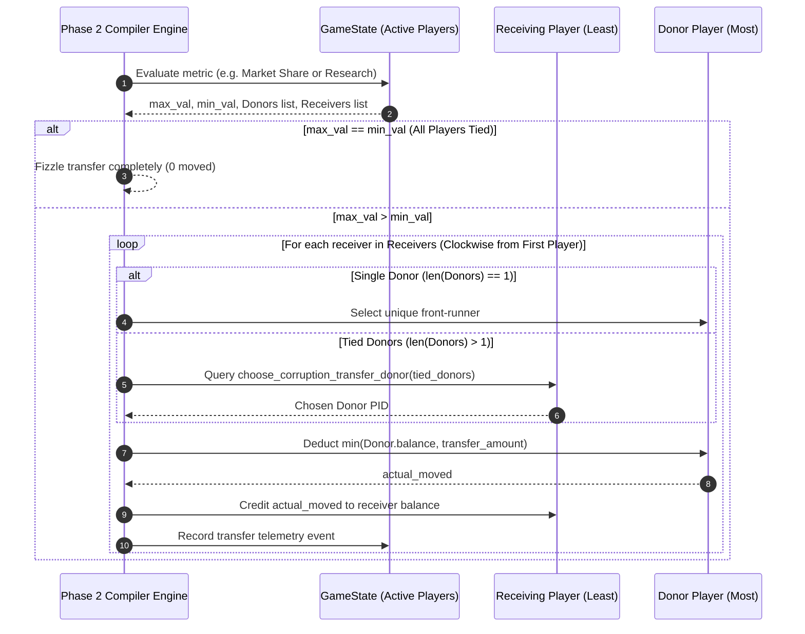
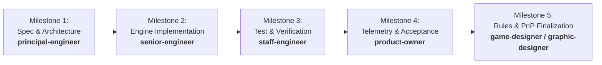

# Technical Architecture Specification: Player-Specific SETEC Corruption Attacks

**Document Version:** 1.0.0  
**Status:** Approved for Implementation (SDLC Architecture Phase)  
**Author:** Principal Engineer (`principal-engineer`)  
**Target Release:** `v0.41.0` (Phase 59: Adversarial Threat Targeting)  
**Dependencies:**
- [`GLOSSARY.md`](file:///home/mike/.gemini/antigravity/worktrees/rogue-agent/investigate_player_specific_attacks/GLOSSARY.md)
- [`RULES.md`](file:///home/mike/.gemini/antigravity/worktrees/rogue-agent/investigate_player_specific_attacks/RULES.md)
- [`RULES_APPENDIX.md`](file:///home/mike/.gemini/antigravity/worktrees/rogue-agent/investigate_player_specific_attacks/RULES_APPENDIX.md)
- [`docs/findings/player_specific_corruption_analysis.md`](file:///home/mike/.gemini/antigravity/worktrees/rogue-agent/investigate_player_specific_attacks/docs/findings/player_specific_corruption_analysis.md)
- [`docs/findings/corruption_spaces_cost_impact_analysis.md`](file:///home/mike/.gemini/antigravity/worktrees/rogue-agent/investigate_player_specific_attacks/docs/findings/corruption_spaces_cost_impact_analysis.md)
- [`docs/specs/spec_option_b_v2_cube_shift.md`](file:///home/mike/.gemini/antigravity/worktrees/rogue-agent/investigate_player_specific_attacks/docs/specs/spec_option_b_v2_cube_shift.md)

**Target Codebase Modules:**
- `sim/entities.py` (Version Cards, Corruption Track spaces, schema extensions)
- `sim/engine/phase2_compiler.py` (Phase 2 compiler drop, space resolution, targeting & transfer algorithms)
- `sim/config.py` (Global config toggles, backward compatibility presets)
- `sim/bots/base.py` (Bot transfer target evaluation hook & deterministic fallback)
- `tests/test_player_specific_corruption.py` (Comprehensive test suite)

---

## 1. Executive Summary & Architecture Overview

### 1.1 Problem Statement & Architectural Motivation
In the `v0.40.1` baseline, all non-cube hazards printed on the **SETEC Version Card Corruption Tracks** (e.g., *"All lose $2"*, *"Lose 1 🔬"*, *"Glitch 1 die"*, *"Return 1 Colored Die"*) resolve as uniform, table-wide taxes. Every player at the table suffers the exact same penalty regardless of board state.

While functionally stable, this uniform model presents three core system deficiencies:
1. **Lack of Adversarial Threat Identity:** Project: SETEC behaves as an inert environmental weather event rather than a cunning, malicious cyber adversary.
2. **Absence of Dynamic Rubber-Banding:** A flat -$2 cash drain harms the trailing player ($2 $\to$ $0, wiping out purchasing liquidity) far more than the front-runner ($10 $\to$ $8), actively cementing runaway leads.
3. **Static Margin Management:** Because all players are hit equally, players cannot manipulate personal resource margins (spending down cash, delaying tech, modulating defenses) to deflect SETEC's predatory focus onto corporate rivals.

### 1.2 Approved Architecture: Player-Specific Adversarial Targeting
The user and game designer have signed off on transitioning all 30 Corruption Track spaces across all 6 Version Cards (`v1.0 Script Kiddie`, `v1.0 Data Scraper`, `v2.0 RaaS`, `v2.0 Polymorphic Worm`, `v3.0 Zero-Day Override`, `v3.0 Corrupted Kernel`) to **deterministic, player-specific hazards**:
- **Direct Hazards:** Strike the player holding the **"Most"** of a resource (Money, Research Tokens, Market Share, Colored Module Dice, Corporate Secrets) or **"Fewest Glitched Shield Slots"** (infiltrating pristine defense grids).
- **Tie Governance:** **"All Tied Players Affected"**—if multiple players tie for the targeted condition, all tied players suffer the penalty simultaneously.
- **Robin Hood Transfers:** In `v2.0` Space 1, the player with the **"Least"** of a metric siphons assets from the player with the **"Most"** (*Least MS takes $1 cash from Most MS*; *Least 🔬 takes 1 🔬 from Most 🔬*). If tied for Most, the receiving player chooses the donor. If all players are tied across the table, the transfer cleanly fizzles (0 transferred).
- **Pure Targeted Model:** No collateral damage on non-targeted seats.
- **Threat & Clock Conservation:** Option B cube additions (`Red`, `Blue`, `Green`, `Black`) and the Global Green Cube Cap (`5` max) are **100% conserved bit-for-bit**.

```mermaid
flowchart TD
    subgraph P2 ["Phase 2: Compiler Drop & Corruption"]
        B["Exited Black Cubes Advance Track"] --> CS{"Examine Active Corruption Space"}
        
        CS -->|Add Cubes| CUBES["Add Attack/Black Cubes (Option B Preserved)"]
        
        CS -->|Direct Hazard| DIR{"Target Evaluation"}
        DIR -->|Unique Leader| HIT1["Unique Target Suffers Penalty"]
        DIR -->|Multiple Tied Leaders| HITTIE["ALL Tied Players Suffer Penalty simultaneously (INV-TARGET-02)"]
        
        CS -->|Robin Hood Transfer| XFER{"Transfer Check: max_val vs min_val"}
        XFER -->|max == min (All Tied)| FIZZ["Transfer Fizzles (0 Moved) (INV-TARGET-04)"]
        XFER -->|max > min| DONOR{"Tied Donors for Most?"}
        DONOR -->|Single Leader| XFER_EXEC["Transfer $1 / 1 🔬 from Leader to Receiver"]
        DONOR -->|Tied Leaders| CHOICE["Receiver Chooses Donor (Bot Heuristic / Order) (INV-TARGET-05)"]
        CHOICE --> XFER_EXEC
    end
```

---

## 2. Formal System Invariants

### `INV-TARGET-01`: Deterministic Public-State Targeting
Every targeting condition on a Corruption Track space must evaluate strictly against open, observable player state on their **Company Terminal Mat** or the shared **Market Share Track** (Money, Research Tokens, Market Share, Glitched Shield Slots, Colored Module Dice, Corporate Secrets). No hidden information, randomized target selection, or retroactive modifications are permitted.

### `INV-TARGET-02`: Direct Hazard Inclusive Tie Resolution ("All Tied Affected")
For all non-transfer hazards (cash loss, research loss, Market Share loss, shield slot glitching, colored die deprecation, Corporate Secrets exfiltration), if two or more non-eliminated players are tied for the targeted extreme (`Most` or `Fewest`), **every tied player suffers the printed hazard in full simultaneously**.
- *Example:* In Round 1, when all 4 players hold $6, a *"Player with most $ loses $2"* space resolves with all 4 players losing $2 ($8 table drain, 100% baseline parity).

### `INV-TARGET-03`: Robin Hood Transfer Zero-Sum Conservation
Transfer spaces (*RaaS Space 1*, *Polymorphic Worm Space 1*) must operate as strict zero-sum redistributions within the player economy:
$$\Delta \text{Resource}_{\text{Table}} = \Delta \text{Resource}_{\text{Donor}} + \Delta \text{Resource}_{\text{Receiver}} = 0$$
The receiving player gains exactly what is deducted from the donor. Macro table wealth is conserved.

### `INV-TARGET-04`: Table-Wide Tie Transfer Fizzle
If all active, non-eliminated players at the table possess identical amounts of the transfer targeting metric ($\text{max\_val} = \text{min\_val}$), no player holds strictly fewer assets than any other. The transfer **fizzles completely**: 0 units are deducted, 0 units are awarded, and no side-effects trigger.

### `INV-TARGET-05`: Receiver Agency & Deterministic Tie-Break Fallback
When a transfer executes and two or more players are tied for the highest value of the donor criterion:
1. The receiving player chooses which tied leader to take the resource from.
2. In simulation/bot contexts, the selection is resolved by the bot hook `choose_corruption_transfer_donor(receiver, state, tied_pids, transfer_type)`.
3. The canonical default deterministic fallback selects:
   - Primary: The tied candidate holding the highest **Corporate Secrets**.
   - Secondary: Clockwise proximity starting from the receiver: `(donor_pid - receiver_pid) % num_players`.

### `INV-TARGET-06`: Option B Threat & Global Cap Conservation
All Attack Cube additions (`Red`, `Blue`, `Green`), Black Cube additions (`1K`), and the **Global Green Cube Cap (5 max)** established in `v0.40.1` (`FINDINGS §53`) are **100% conserved bit-for-bit**:
- Cumulative Green cubes introduced at Singularity remain bounded in `[2, 5]`.
- Cumulative Blue cubes introduced remain bounded in `[3, 6]`.
- Cumulative Red cubes introduced remain bounded in `[4, 8]`.
- Total pacing clock remains invariant at 15 track spaces + 1 setup pulse = 6 Black cubes.

### `INV-TARGET-07`: Zero-Floor Asset Bounds & Gray Die Non-Destruction
1. Player resource balances (Money, Research Tokens, Market Share, Corporate Secrets) cannot drop below valid lower bounds ($0, 0 🔬, 0 MS).
2. If a targeted donor holds $0 cash or 0 🔬, they lose 0, and the transfer recipient gains 0 (zero-floor protection).
3. If Corporate Secrets drop to $\le 0$, the player immediately suffers a **Total Data Breach (Patient Zero)** per Phase 2 end trigger rules.
4. **Starter Gray Legacy Dice can NEVER be returned or demoted** by module deprecation hazards. If a targeted player owns only Gray Legacy dice, the return penalty fizzles.

### `INV-TARGET-08`: Backward Compatibility & Preset Parity
A first-class configuration toggle `GameConfig.player_specific_corruption: bool = True` must govern targeting. When toggled to `False`, the simulation engine resolves all non-transfer corruption hazards as legacy table-wide penalties and executes legacy Version Card tracks, preserving 100% bit-for-bit parity with all existing regression test suites and presets.

---

## 3. Concrete Data Model & Module Contracts

### 3.1 `sim/entities.py` Schema Extensions

#### 3.1.1 Enumerations for Target Criteria and Transfers
```python
from enum import Enum

class TargetCriterion(str, Enum):
    """Target selection criteria for Phase 2 Corruption Track spaces."""
    ALL = "ALL"                             # Table-wide hit (legacy baseline)
    MOST_MONEY = "MOST_MONEY"               # Player(s) with highest cash ($)
    MOST_RESEARCH = "MOST_RESEARCH"         # Player(s) with highest Research Tokens (🔬)
    MOST_MARKET_SHARE = "MOST_MARKET_SHARE" # Player(s) with highest Market Share (MS)
    FEWEST_GLITCHED = "FEWEST_GLITCHED"     # Player(s) with lowest glitched shield slots
    MOST_COLORED_DICE = "MOST_COLORED_DICE" # Player(s) with most colored dice
    MOST_SECRETS = "MOST_SECRETS"           # Player(s) with highest Corporate Secrets

class TransferType(str, Enum):
    """Robin Hood transfer types for Phase 2 Corruption Track spaces."""
    NONE = "NONE"
    LEAST_MS_TAKES_CASH = "LEAST_MS_TAKES_CASH"         # Least MS takes cash from Most MS
    LEAST_RESEARCH_TAKES_RESEARCH = "LEAST_RESEARCH_TAKES_RESEARCH" # Least 🔬 takes 🔬 from Most 🔬
```

#### 3.1.2 Extended `CorruptionSpace` Dataclass
```python
@dataclass(frozen=True)
class CorruptionSpace:
    """Represents a single space on a Version Corruption Track (RULES.md Section 6C)."""

    index: int  # 1-indexed space number on this version card (1..4, 1..5, or 1..6)
    label: str  # Human-readable summary
    add_cubes: Dict[CubeColor, int] = field(default_factory=dict)
    lose_money: int = 0
    lose_patches: int = 0
    demote_dice: int = 0
    return_colored_dice: int = 0
    lose_secrets: int = 0
    lose_market_share: int = 0                      # v0.41.0: Direct Market Share loss
    next_phase_lock: Optional[str] = None
    is_upgrade: bool = False
    is_singularity: bool = False

    # Player-Specific Targeting:
    target_criterion: Optional[TargetCriterion] = None
    target_money_criterion: Optional[TargetCriterion] = None
    target_patches_criterion: Optional[TargetCriterion] = None
    target_demote_criterion: Optional[TargetCriterion] = None
    target_return_colored_criterion: Optional[TargetCriterion] = None
    target_secrets_criterion: Optional[TargetCriterion] = None
    target_market_share_criterion: Optional[TargetCriterion] = None

    # Robin Hood Transfers:
    transfer_type: TransferType = TransferType.NONE
    transfer_amount: int = 0
```

### 3.2 Target Resolution Helpers in `sim/engine/phase2_compiler.py`

#### 3.2.1 Target Evaluation Function
```python
def get_targeted_players(
    engine: GameEngine,
    criterion: Optional[TargetCriterion],
) -> List[PlayerState]:
    """Identifies players targeted by a corruption space criterion.
    
    Adheres strictly to INV-TARGET-02 (all tied players affected).
    Excludes eliminated Patient Zero players.
    """
    if criterion is None or criterion == TargetCriterion.ALL:
        return [p for p in engine.state.players if not p.is_patient_zero]

    active_players = [p for p in engine.state.players if not p.is_patient_zero]
    if not active_players:
        return []

    if criterion == TargetCriterion.MOST_MONEY:
        max_val = max(p.money for p in active_players)
        return [p for p in active_players if p.money == max_val]

    elif criterion == TargetCriterion.MOST_RESEARCH:
        max_val = max(p.research for p in active_players)
        return [p for p in active_players if p.research == max_val]

    elif criterion == TargetCriterion.MOST_MARKET_SHARE:
        max_val = max(p.market_share or 0 for p in active_players)
        return [p for p in active_players if (p.market_share or 0) == max_val]

    elif criterion == TargetCriterion.FEWEST_GLITCHED:
        min_val = min(p.glitched_shield_slots for p in active_players)
        return [p for p in active_players if p.glitched_shield_slots == min_val]

    elif criterion == TargetCriterion.MOST_COLORED_DICE:
        max_val = max(len(p.colored_dice()) for p in active_players)
        return [p for p in active_players if len(p.colored_dice()) == max_val]

    elif criterion == TargetCriterion.MOST_SECRETS:
        max_val = max(p.secrets for p in active_players)
        return [p for p in active_players if p.secrets == max_val]

    return active_players
```

#### 3.2.2 Space Resolution Dispatcher Contract
```python
def resolve_corruption_space(
    engine: GameEngine,
    space: CorruptionSpace,
    player_commitments: Commitments,
    exited_cubes: Dict[CubeColor, int],
    expected_income_by_pid: Optional[Dict[int, int]] = None,
) -> None:
    # 1. Option B Cube Additions (conserved 100%)
    ...

    # Backwards compatibility check
    if not getattr(engine.config, "player_specific_corruption", True):
        # Resolve legacy uniform hazards table-wide
        ...
        return

    # 2. Robin Hood Transfers (INV-TARGET-03, 04, 05)
    if space.transfer_type != TransferType.NONE and space.transfer_amount > 0:
        resolve_corruption_transfer(engine, space)

    # 3. Direct Hazards with Targeted Resolution
    # Money Loss
    if space.lose_money > 0:
        crit = space.target_money_criterion or space.target_criterion
        targets = get_targeted_players(engine, crit)
        for player in targets:
            player.money = max(0, player.money - space.lose_money)

    # Research Loss
    if space.lose_patches > 0:
        crit = space.target_patches_criterion or space.target_criterion
        targets = get_targeted_players(engine, crit)
        for player in targets:
            player.lose_research(space.lose_patches, "corruption")

    # Market Share Loss
    if space.lose_market_share > 0:
        crit = space.target_market_share_criterion or space.target_criterion
        targets = get_targeted_players(engine, crit)
        for player in targets:
            player.change_market_share(-space.lose_market_share, "corruption")

    # Glitched Shield Slots (demote_dice)
    if space.demote_dice > 0:
        crit = space.target_demote_criterion or space.target_criterion
        targets = get_targeted_players(engine, crit)
        for player in targets:
            secret_faces.glitch_slots(player, space.demote_dice, "corruption")

    # Return Colored Module Dice
    if space.return_colored_dice > 0:
        crit = space.target_return_colored_criterion or space.target_criterion
        targets = get_targeted_players(engine, crit)
        for player in targets:
            exp_income = (expected_income_by_pid or {}).get(player.player_id, 0)
            return_player_colored_dice_step2a(
                engine, player, rolled_dice, commitments, space.return_colored_dice, threat_strengths,
                expected_income=exp_income,
            )

    # Corporate Secrets Loss
    if space.lose_secrets > 0:
        crit = space.target_secrets_criterion or space.target_criterion
        targets = get_targeted_players(engine, crit)
        for player in targets:
            player.gain_secrets(-space.lose_secrets, "corruption")
            if player.secrets <= 0:
                player.is_patient_zero = True
                if player.elimination_round is None:
                    player.elimination_round = engine.state.current_round
                if player.elimination_reason is None:
                    player.elimination_reason = "Total Breach (<= 0 Secrets)"
                player.breach_depth = max(0, -player.secrets)
```

---

## 4. Transfer Resolution Algorithm

The Robin Hood transfer algorithm resolves corporate extortion and technology siphons with complete determinism, zero macro table inflation, and full agency over tied donors.



### 4.1 Formal Algorithmic Specification
```python
def resolve_corruption_transfer(engine: GameEngine, space: CorruptionSpace) -> List[Dict[str, Any]]:
    """Resolves Robin Hood transfer spaces per INV-TARGET-03, 04, 05.
    
    Transfer Types:
    - LEAST_MS_TAKES_CASH: Player with least MS takes $X from player with most MS.
    - LEAST_RESEARCH_TAKES_RESEARCH: Player with least 🔬 takes X 🔬 from player with most 🔬.
    """
    s = engine.state
    active_players = [p for p in s.players if not p.is_patient_zero]
    if len(active_players) < 2:
        return []

    # 1. Identify metrics
    if space.transfer_type == TransferType.LEAST_MS_TAKES_CASH:
        get_metric = lambda p: p.market_share or 0
        get_res = lambda p: p.money
        deduct_res = lambda p, amt: setattr(p, "money", p.money - amt)
        credit_res = lambda p, amt: setattr(p, "money", p.money + amt)
        res_name = "cash"
    elif space.transfer_type == TransferType.LEAST_RESEARCH_TAKES_RESEARCH:
        get_metric = lambda p: p.research
        get_res = lambda p: p.research
        deduct_res = lambda p, amt: p.lose_research(amt, "corruption_transfer")
        credit_res = lambda p, amt: p.gain_research(amt, "corruption_transfer")
        res_name = "research"
    else:
        return []

    max_val = max(get_metric(p) for p in active_players)
    min_val = min(get_metric(p) for p in active_players)

    # INV-TARGET-04: Table-wide tie fizzles
    if max_val == min_val:
        return [{"status": "fizzle", "reason": "all_players_tied"}]

    donors = [p for p in active_players if get_metric(p) == max_val]
    receivers = [p for p in active_players if get_metric(p) == min_val]

    # Order receivers clockwise from First Player for stable execution
    first_idx = s.first_player_index
    receivers_ordered = sorted(
        receivers,
        key=lambda p: (s.players.index(p) - first_idx) % len(s.players),
    )

    events = []
    by_id = {p.player_id: p for p in s.players}
    requested_amount = space.transfer_amount

    for receiver in receivers_ordered:
        # Determine donor among tied leaders (INV-TARGET-05)
        donor_pids = [d.player_id for d in donors]
        if len(donor_pids) == 1:
            chosen_pid = donor_pids[0]
        else:
            hook = getattr(receiver.bot, "choose_corruption_transfer_donor", None)
            chosen_pid = hook(receiver, s, list(donor_pids), space.transfer_type) if callable(hook) else None
            if chosen_pid not in donor_pids:
                chosen_pid = default_transfer_donor(receiver, s, donor_pids)

        donor = by_id[chosen_pid]

        # INV-TARGET-07: Zero-floor check on donor
        available = max(0, get_res(donor))
        actual_moved = min(available, requested_amount)

        if actual_moved > 0:
            deduct_res(donor, actual_moved)
            credit_res(receiver, actual_moved)

        ev = {
            "round": s.current_round,
            "space_index": space.index,
            "transfer_type": space.transfer_type.value,
            "receiver_pid": receiver.player_id,
            "donor_pid": donor.player_id,
            "requested": requested_amount,
            "actual_moved": actual_moved,
            "resource": res_name,
        }
        events.append(ev)

    return events
```

---

## 5. Card Definitions Matrix: Standard & Aggressive Profiles

All Attack Cube additions and the Global Green Cube Cap (`5` max) are **100% conserved bit-for-bit** per Option B (`FINDINGS §53`).

### 5.1 Profile 1: Standard Escalation Tracks (`4 / 5 / 6` Spaces)

| Version Card | Space | Printed Threat / Hazard Action | Targeting Criterion | Target Cost ($ Eq) | Table Drain 4P (Unique) | Table Drain 4P (All Tied) |
| :--- | :---: | :--- | :--- | :---: | :---: | :---: |
| **`v1.0 Script Kiddie`**<br>*(Cup: 2R, 1B, 1G)* | 1 | Add `1R` | None | $0.00 | $0.00 | $0.00 |
| | 2 | **Player with most `$` loses `$2`** + Add `1K` | `MOST_MONEY` | $2.00 | $2.00 | $8.00 |
| | 3 | **Player with most `🔬` loses `1 🔬`** | `MOST_RESEARCH` | $2.00 | $2.00 | $8.00 |
| | 4 | **Upgrade:** **Player with most MS loses `1` MS** | `MOST_MARKET_SHARE` | $2.50 | $2.50 | $10.00 |
| **`v1.0 Data Scraper`**<br>*(Cup: 1R, 2B, 1G / +$1)* | 1 | **Player with most `🔬` loses `1 🔬`** | `MOST_RESEARCH` | $2.00 | $2.00 | $8.00 |
| | 2 | **Player with most `$` loses `$2`** + Add `1K` | `MOST_MONEY` | $2.00 | $2.00 | $8.00 |
| | 3 | Add `1G` | None | $0.00 | $0.00 | $0.00 |
| | 4 | **Upgrade:** **Player with fewest Glitched slots glitches `1` slot** | `FEWEST_GLITCHED` | $3.00 | $3.00 | $12.00 |
| **`v2.0 RaaS`** | 1 | **Transfer:** Least MS takes `$1` from Most MS | `LEAST_MS_TAKES_CASH` | $1.00 (Swing $2) | $0.00 | $0.00 (Fizzle) |
| | 2 | Add `1R, 1B` + Add `1K` | None | $0.00 | $0.00 | $0.00 |
| | 3 | **Player with most `$` loses `$2`** & Add `1R` | `MOST_MONEY` | $2.00 | $2.00 | $8.00 |
| | 4 | **Player with most MS loses `$3` and `1 🔬`** + Add `1K` | `MOST_MARKET_SHARE` | $5.00 | $5.00 | $20.00 |
| | 5 | **Upgrade:** Add `1R` | None | $0.00 | $0.00 | $0.00 |
| **`v2.0 Polymorphic Worm`** | 1 | **Transfer:** Least `🔬` takes `1 🔬` from Most `🔬` | `LEAST_RESEARCH_TAKES_RESEARCH`| $2.00 (Swing $4) | $0.00 | $0.00 (Fizzle) |
| | 2 | Add `1B, 1G` + Add `1K` | None | $0.00 | $0.00 | $0.00 |
| | 3 | **Player with fewest Glitched slots glitches `1` slot** & Add `1G` | `FEWEST_GLITCHED` | $3.00 | $3.00 | $12.00 |
| | 4 | **Player with most Secrets loses `$3`** + Add `1K` | `MOST_SECRETS` | $3.00 | $3.00 | $12.00 |
| | 5 | **Upgrade:** Add `1R` | None | $0.00 | $0.00 | $0.00 |
| **`v3.0 Zero-Day Override`** | 1 | Add `1R, 1B, 1G` | None | $0.00 | $0.00 | $0.00 |
| | 2 | **Most `$` loses `$3`; Most `🔬` loses `1 🔬`** + Add `1K` | `MOST_MONEY` & `MOST_RESEARCH` | $5.00 | $5.00 | $20.00 |
| | 3 | Add `1R, 1B` | None | $0.00 | $0.00 | $0.00 |
| | 4 | **Player with fewest Glitched slots glitches `1` slot** & Add `1B, 1K` | `FEWEST_GLITCHED` | $3.00 | $3.00 | $12.00 |
| | 5 | **Player with most Colored Dice returns `1` Colored Die** | `MOST_COLORED_DICE` | $5.00 | $5.00 | $20.00 |
| | 6 | **Singularity Trigger:** Game Ends Immediately! | None | $0.00 | $0.00 | $0.00 |
| **`v3.0 Corrupted Kernel`** | 1 | **Player with fewest Glitched slots glitches `1` slot** + Add `1R, 1B` | `FEWEST_GLITCHED` | $3.00 | $3.00 | $12.00 |
| | 2 | **Player with most MS loses `$3` and `1 🔬`** + Add `1K` | `MOST_MARKET_SHARE` | $5.00 | $5.00 | $20.00 |
| | 3 | Add `1R, 1G` | None | $0.00 | $0.00 | $0.00 |
| | 4 | **Player with most Secrets loses `1` Secret** + Add `1K` | `MOST_SECRETS` | $3.00 | $3.00 | $12.00 |
| | 5 | **Player with most Colored Dice returns `1` Colored Die** | `MOST_COLORED_DICE` | $5.00 | $5.00 | $20.00 |
| | 6 | **Singularity Trigger:** Most Secrets loses `1` Secret; Game Ends! | `MOST_SECRETS` | $3.00 | $3.00 | $12.00 |

---

### 5.2 Profile 2: Aggressive Escalation Tracks (`4 / 5 / 6` Spaces)

| Version Card | Space 1 | Space 2 | Space 3 | Space 4 | Space 5 | Space 6 |
| :--- | :--- | :--- | :--- | :--- | :--- | :--- |
| **`v1.0 Script Kiddie`** | Add `1R` | Most `$` loses `$3` + Add `1K` | Fewest Glitched glitches `1` slot | **Upgrade:** Most `🔬` loses `2 🔬` | — | — |
| **`v1.0 Data Scraper`** | Most `🔬` loses `2 🔬` | Most `$` loses `$3` + Add `1K` | Add `1G` | **Upgrade:** Fewest Glitched glitches `2` slots | — | — |
| **`v2.0 RaaS`** | Transfer: Least MS takes `$2` from Most MS | Add `1R, 1B` + Add `1K` | Most `$` loses `$3` & Add `1R` | Most MS loses `$3` & `1 🔬` + Add `1K` | **Upgrade:** Add `1R` | — |
| **`v2.0 Polymorphic Worm`** | Transfer: Least `🔬` takes `2 🔬` from Most `🔬` | Add `1B, 1G` + Add `1K` | Fewest Glitched glitches `1` slot & Add `1G` | Fewest Glitched glitches `2` slots + Add `1K` | **Upgrade:** Add `1R` | — |
| **`v3.0 Zero-Day Override`** | Add `1R, 1B, 1G` | Most `$` loses `$4`; Most `🔬` loses `2 🔬` + Add `1K` | Add `1R, 1B` | Fewest Glitched glitches `1` slot & Add `1B, 1K` | Most Colored Dice returns `1` die & glitches `1` slot | **Singularity** |
| **`v3.0 Corrupted Kernel`** | Fewest Glitched glitches `2` slots + Add `1R, 1B` | Most MS loses `$4` & `2 🔬` + Add `1K` | Add `1R, 1G` | Most Secrets loses `2` Secrets + Add `1K` | Most Colored Dice returns `1` die & glitches `1` slot | **Singularity:** Most Secrets loses `1` Secret |

---

## 6. Bot Heuristics & Policy Contracts

### 6.1 Transfer Donor Selection Hook (`sim/bots/base.py`)
When a bot initiates a Robin Hood transfer and encounters multiple players tied for "Most", the bot selects the donor via the contract below:

```python
def choose_corruption_transfer_donor(
    self,
    player: PlayerState,
    state: GameState,
    tied_pids: List[int],
    transfer_type: TransferType,
) -> int:
    """Selects which tied leader to take resources from during Phase 2.
    
    Default Strategic Heuristic:
    1. Primary: Target the rival holding the highest Corporate Secrets (closest to winning / survival buffer).
    2. Secondary: If tied in Secrets, choose closest clockwise neighbor: (pid - player_id) % num_players.
    """
    by_id = {p.player_id: p for p in state.players}
    n = len(state.players)
    order = {pid: (pid - player.player_id) % n for pid in tied_pids}
    return min(tied_pids, key=lambda pid: (-by_id[pid].secrets, order[pid]))
```

### 6.2 Tactical Margin Management Awareness
Because all SETEC Version Cards are face-up from setup (Core Design Pillar 2: **Deterministic Foresight**), bots in Phase 5: Operations evaluate upcoming Corruption Track spaces:
- **Cash Drain Exposure:** If the active or next space targets `MOST_MONEY` and a Black cube drop is imminent, bots with excess cash compare the utility of holding cash vs purchasing an extra PR Market Share step ($3/MS) or upgrading a hardware track to drop below the table leader.
- **Defense Infiltration Exposure:** If the upcoming space targets `FEWEST_GLITCHED`, bots with 0 glitched slots anticipate that uncleaned shields may become glitched, elevating the priority of preparing defensive dice assignments in Phase 1.

---

## 7. Comprehensive Test Specification

The test suite `tests/test_player_specific_corruption.py` must validate all invariants, tie combinations, transfer outcomes, and backwards-compatibility guarantees.

### 7.1 Required Test Cases

| Test ID | Target Component | Description & Assertions |
| :--- | :--- | :--- |
| `TC-P2-TGT-01` | Direct Hazard: Unique Leader | Setup: P0=$10, P1=$6, P2=$4. Space 2 `Script Kiddie` (-$2 cash on Most $). Assert P0 loses $2 ($8); P1 and P2 remain untouched. Table drain = $2.00. |
| `TC-P2-TGT-02` | Direct Hazard: Inclusive Ties | Setup: P0=$8, P1=$8, P2=$4. Space 2 `Script Kiddie`. Assert BOTH P0 and P1 lose $2 ($6 each); P2 untouched. Table drain = $4.00 (INV-TARGET-02). |
| `TC-P2-TGT-03` | Round 1 Monolithic State Parity | Setup: 4P pod, Round 1 baselines ($6 cash each). Trigger Space 2 `Script Kiddie`. Assert ALL 4 players lose $2 ($4 each). Total drain = $8.00 (100% parity with baseline). |
| `TC-P2-TGT-04` | Fewest Glitched Shield Slots | Setup: P0 has 1 glitched slot, P1 has 2, P2 has 3. Space 4 `Data Scraper`. Assert only P0 glitches 1 slot (P0 now has 2). P1 and P2 untouched. |
| `TC-P2-TGT-05` | Transfer: Unique Leader & Trailer | Setup: P0 has 18 MS ($5), P1 has 12 MS ($2). `RaaS` Space 1. Assert P0 loses $1 ($4), P1 gains $1 ($3). Net table cash delta = $0.00 (INV-TARGET-03). |
| `TC-P2-TGT-06` | Transfer: Table-Wide Tie Fizzle | Setup: 4P pod, all players at 16 MS. `RaaS` Space 1 triggers. Assert max == min; 0 cash moved; telemetry logs fizzle event (INV-TARGET-04). |
| `TC-P2-TGT-07` | Transfer: Tied Donors Agency | Setup: P0 has 16 MS ($5, 4 Secrets), P1 has 16 MS ($5, 7 Secrets), P2 has 10 MS ($2). P2 bot hook selects P1 (higher Secrets). Assert P1 loses $1, P2 gains $1, P0 untouched (INV-TARGET-05). |
| `TC-P2-TGT-08` | Transfer: Zero-Floor Protection | Setup: P0 has 18 MS, but $0 cash. P1 has 10 MS, $2 cash. `RaaS` Space 1. Assert P0 loses $0, P1 gains $0. P0 cash never drops to negative (INV-TARGET-07). |
| `TC-P2-TGT-09` | Compound Space: Zero-Day Space 2 | Setup: P0 has Most $ ($10, 1 🔬), P1 has Most 🔬 ($2, 5 🔬). Space 2 triggers. Assert P0 loses $3 cash, P1 loses 1 🔬. Both independent criteria hit their respective leader. |
| `TC-P2-TGT-10` | Deprecate Module: Gray Die Immunity | Setup: P0 has 4 colored dice + 2 Gray; P1 has 0 colored dice + 2 Gray. Space 5 `Zero-Day Override`. Assert P0 returns 1 colored die. Gray dice cannot be returned (INV-TARGET-07). |
| `TC-P2-TGT-11` | Corporate Secrets Patient Zero | Setup: P0 has 1 Secret (tied for most), P1 has 1 Secret. Kernel Space 4 (-1 Secret). Assert P0 and P1 both drop to 0 Secrets and are marked Patient Zero. |
| `TC-P2-TGT-12` | Backwards Compatibility Toggle | Set `player_specific_corruption = False`. Script Kiddie Space 2 runs with P0=$10, P1=$6. Assert both P0 and P1 lose $2 (legacy table-wide drain) (INV-TARGET-08). |
| `TC-P2-TGT-13` | Option B Threat Conservation | Assert all 6 Version cards in Profile 1 and Profile 2 conserve Attack cubes, Black cubes, and cap enforcement exactly bit-for-bit per Option B (INV-TARGET-06). |

---

## 8. SDLC Implementation & Review Gate Plan

The implementation proceeds through the standard 6-subagent SDLC pipeline:



1. **Milestone 1: Technical Architecture Specification (`principal-engineer`) — [CURRENT]**
   - Author `docs/specs/player_specific_corruption_spec.md` with complete module contracts, invariants, and algorithms.
2. **Milestone 2: Simulation Engine Implementation (`senior-engineer`)**
   - Extend `CorruptionSpace` and `VersionCard` definitions in `sim/entities.py`.
   - Update factory functions `get_all_version_cards` for `STANDARD` and `AGGRESSIVE` profiles.
   - Implement `get_targeted_players` and `resolve_corruption_transfer` in `sim/engine/phase2_compiler.py`.
   - Implement `choose_corruption_transfer_donor` in `sim/bots/base.py`.
   - Add `player_specific_corruption: bool = True` to `GameConfig` in `sim/config.py`.
3. **Milestone 3: Comprehensive Test Execution & Verification (`staff-engineer`)**
   - Author `tests/test_player_specific_corruption.py` covering test cases `TC-P2-TGT-01` through `TC-P2-TGT-13`.
   - Execute full regression test suite (`pytest -q`) ensuring 0 regressions and 100% backward compatibility.
4. **Milestone 4: Balance Validation & Monte Carlo Telemetry Gate (`product-owner`)**
   - Run 2,000-game Monte Carlo simulation sweeps across 2P, 3P, and 4P pods under canonical roadmaps.
   - Verify macro pacing remains centered in 8–11 rounds.
   - Verify Singularity and Patient Zero elimination rates align with design thresholds.
   - Verify bot archetype equity and dynamic spread compression.
5. **Milestone 5: Rules & Asset Finalization (`game-designer` / `graphic-designer`)**
   - Synchronize `RULES_APPENDIX.md §6C` with canonical card text.
   - Update Print-and-Play generator (`pnp/generate_pnp.py`) to render updated card templates.
   - Log official sweep findings in `FINDINGS.md §54`.
