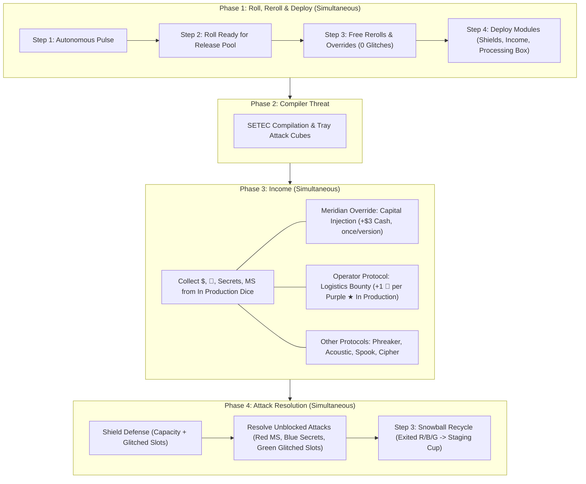

# Technical Architecture Specification: Phase 56
## Complete Removal of White Contractor Dice & Glitch Faces, Meridian Capital Injection & Operator Logistics Bounty (`v0.39.1` / `v0.40.0`)

**Author:** Principal Engineer / Architect  
**Status:** Approved for Implementation (SDLC Architecture Phase)  
**Target Version:** `v0.39.1` Candidate / `v0.40.0` Baseline  
**Dependencies:**
- Scoping & Pre-SDLC Modeling: [`contractor_dice_analysis.md`](file:///home/mike/.gemini/antigravity/brain/b39c5b99-7300-4916-af4f-f830d75bb1ba/contractor_dice_analysis.md)
- Living Rules: [`RULES.md`](file:///home/mike/.gemini/antigravity/worktrees/rogue-agent/remove_contractor_dice/RULES.md) (Sections 2, 4 Phase 1 / Phase 3 / Phase 4, Section 5)
- Appendix: [`RULES_APPENDIX.md`](file:///home/mike/.gemini/antigravity/worktrees/rogue-agent/remove_contractor_dice/RULES_APPENDIX.md) (Sections 6A, 6D)
- Canonical Glossary: [`GLOSSARY.md`](file:///home/mike/.gemini/antigravity/worktrees/rogue-agent/remove_contractor_dice/GLOSSARY.md) (Sections 5, 6, 7, 8)
- Baseline Specs:
  - [`docs/specs/spec_research_upgrade_limit.md`](file:///home/mike/.gemini/antigravity/worktrees/rogue-agent/remove_contractor_dice/docs/specs/spec_research_upgrade_limit.md) (Phase 55: `v0.39.0`)
  - [`docs/specs/v380f_blue_dice_rebalance_spec.md`](file:///home/mike/.gemini/antigravity/worktrees/rogue-agent/remove_contractor_dice/docs/specs/v380f_blue_dice_rebalance_spec.md) (Phase 54: `v0.38f`)

**Target Components:**
- [`sim/config.py`](file:///home/mike/.gemini/antigravity/worktrees/rogue-agent/remove_contractor_dice/sim/config.py)
- [`sim/entities.py`](file:///home/mike/.gemini/antigravity/worktrees/rogue-agent/remove_contractor_dice/sim/entities.py)
- [`sim/engine/phase1_roll_deploy.py`](file:///home/mike/.gemini/antigravity/worktrees/rogue-agent/remove_contractor_dice/sim/engine/phase1_roll_deploy.py)
- [`sim/engine/phase3_income.py`](file:///home/mike/.gemini/antigravity/worktrees/rogue-agent/remove_contractor_dice/sim/engine/phase3_income.py)
- [`sim/engine/phase4_attack_resolution.py`](file:///home/mike/.gemini/antigravity/worktrees/rogue-agent/remove_contractor_dice/sim/engine/phase4_attack_resolution.py)
- [`sim/engine/state.py`](file:///home/mike/.gemini/antigravity/worktrees/rogue-agent/remove_contractor_dice/sim/engine/state.py)
- [`sim/bots/base.py`](file:///home/mike/.gemini/antigravity/worktrees/rogue-agent/remove_contractor_dice/sim/bots/base.py)
- [`sim/bots/adaptive_balanced.py`](file:///home/mike/.gemini/antigravity/worktrees/rogue-agent/remove_contractor_dice/sim/bots/adaptive_balanced.py)
- [`sim/bots/accelerationist.py`](file:///home/mike/.gemini/antigravity/worktrees/rogue-agent/remove_contractor_dice/sim/bots/accelerationist.py)
- [`sim/bots/reckless_saboteur.py`](file:///home/mike/.gemini/antigravity/worktrees/rogue-agent/remove_contractor_dice/sim/bots/reckless_saboteur.py)
- [`sim/bots/secops_turtle.py`](file:///home/mike/.gemini/antigravity/worktrees/rogue-agent/remove_contractor_dice/sim/bots/secops_turtle.py)
- [`sim/bots/venture_greed.py`](file:///home/mike/.gemini/antigravity/worktrees/rogue-agent/remove_contractor_dice/sim/bots/venture_greed.py)
- [`sim/bots/mixed_policy.py`](file:///home/mike/.gemini/antigravity/worktrees/rogue-agent/remove_contractor_dice/sim/bots/mixed_policy.py)
- [`web/controller/capabilities.py`](file:///home/mike/.gemini/antigravity/worktrees/rogue-agent/remove_contractor_dice/web/controller/capabilities.py)
- [`web/controller/phase1_actions.py`](file:///home/mike/.gemini/antigravity/worktrees/rogue-agent/remove_contractor_dice/web/controller/phase1_actions.py)
- [`web/controller/phase3_income_actions.py`](file:///home/mike/.gemini/antigravity/worktrees/rogue-agent/remove_contractor_dice/web/controller/phase3_income_actions.py)
- [`web/controller/core.py`](file:///home/mike/.gemini/antigravity/worktrees/rogue-agent/remove_contractor_dice/web/controller/core.py)
- [`web/static/js/components/action_dock.js`](file:///home/mike/.gemini/antigravity/worktrees/rogue-agent/remove_contractor_dice/web/static/js/components/action_dock.js)
- [`web/static/js/components/player_mats.js`](file:///home/mike/.gemini/antigravity/worktrees/rogue-agent/remove_contractor_dice/web/static/js/components/player_mats.js)
- [`web/static/js/components/market.js`](file:///home/mike/.gemini/antigravity/worktrees/rogue-agent/remove_contractor_dice/web/static/js/components/market.js)
- [`scripts/run_v380_secret_faces_sweep.py`](file:///home/mike/.gemini/antigravity/worktrees/rogue-agent/remove_contractor_dice/scripts/run_v380_secret_faces_sweep.py)
- [`tests/test_remove_contractor_dice.py`](file:///home/mike/.gemini/antigravity/worktrees/rogue-agent/remove_contractor_dice/tests/test_remove_contractor_dice.py)

---

## 1. System Overview & Mathematical Rationale

### 1.1 Problem Statement & Elimination Rationale
In earlier versions (`v0.6` through `v0.38`), White Contractor dice served as temporary defensive meat-shields hired in Phase 1 Step 2 under progressive pricing (`$1`, `$2`, `$3`). Since `v0.38` converted Green cube damage into **Glitched Shield Slots** and replaced the Glitched Box with the **Processing Box**, White Contractor dice remained the **sole component in the entire game that possessed `Glitch` faces**.

Retaining White Contractor dice created severe structural friction:
1. **Dead Economic Weight:** Single-die expected value on White Contractor dice was dismal (0.50–0.60 shields at `$1.67`–`$5.02` per shield), suffered a 33.3%–39.8% glitch failure rate, and expired after a single round. In contrast, permanent Gray dice (via 1 🔬 L1 Breakthroughs) and Central Market colored dice (`$4`–`$6`) provide permanent engine growth with zero blank faces and zero glitches.
2. **Web of 8 Cognitive & Mechanical Exceptions:**
   - Dedicated Phase 1 Step 2 (Temp Staffing) pre-roll subphase.
   - Non-rerollable Glitch face rules (Phase 1 Step 4).
   - Helix Biomedical Consortium parenthetical override exception.
   - Unresolved Glitch contractor sacrifice (Phase 1 Step 5).
   - Slot cleaning discard exception (regular dice $\to$ Scanned Box; contractors $\to$ general supply).
   - Singularity cleanup exception (Phase 2).
   - End of Phase 4 contractor expiration and supply tracking.
   - Physical board clutter: 12 White dice, sticker sheets, and mat markings.
3. **Approved Design (Option A):** Complete removal of White Contractor dice and Glitch faces from the active ruleset.

### 1.2 Mathematical & Empirical Validation
Across 5,400 Monte Carlo simulated games (600 games per cell across 2P, 3P, and 4P, seeds 42..641):
- **Macro Pacing Preserved:** Mean game length shifts by only ~0.25–0.30 rounds (from 9.30 down to 9.03 rounds at 3P; 8.81 rounds at 4P; 9.25 rounds at 2P), remaining solidly within the canonical **8.5–9.5 round target envelope**.
- **Singularity Rate Normalized:** 2P Singularity softens from an over-dominant 81.0% down to a healthier 73.8%, lifting existential breach threat (Patient Zero) to 24.3%–37.7%. Total Wipeouts remain negligible ($\le 1.8\%$).
- **Capital Liquidity Restored:** Eliminating contractor spending recovers ~`$1.80`–`$2.20` of liquid cash per seat at game end, funding permanent engine building via Central Market dice and PR Track Market Share defense.

### 1.3 Asymmetric Setup Replacements
To ensure **Meridian Financial Trust** and **The Operator** maintain balance equity without temporary contractor dice, both receive thematic Phase 3 Income mechanics:
1. **Meridian Financial Trust (*Capital Injection*):**
   - *Timing:* Phase 3: Income (once per SETEC version).
   - *Mechanic:* Gain an immediate **`+$3` cash payout** from the bank.
   - *Balance Equity:* Meridian achieves a **37.0%** win rate (fair share = 33.3%), maintaining tight equity across all 6 Client Companies (`AEGIS: 30.7%, DTO: 35.0%, HELIX: 31.3%, MERIDIAN: 37.0%, OMNIDYNE: 33.3%, PROMETHEUS: 32.7%`).
2. **The Operator (*Logistics Bounty*):**
   - *Timing:* Phase 3: Income.
   - *Mechanic:* Each Face 6 (`Purple ★`) on a Purple Specialist die still **In Production** grants **`+1 🔬` Research Token**.
   - *Balance Equity:* The Operator achieves a **33.0%–36.7%** win rate, maintaining tight equity across all 6 White Hat Operatives (`ACOUSTIC: 32.7%, CIPHER: 32.7%, OPERATOR: 33.0%–36.7%, PHREAKER: 33.7%, PRODIGY: 36.0%, SPOOK: 28.3%`).

### 1.4 Architecture Sequence Diagram



---

## 2. Invariants

- **`INV-RCD-01` (Zero White Contractor Supply & Zero Hiring Capacity):**  
  Under `v040` / `v0391` (`white_contractors_enabled=False`):
  - `state.contractor_supply == 0`
  - `config.contractor_max_hire == 0`
  - `config.contractor_supply_total == 0`
  - `player.hired_contractor_count == 0`
  - `player.contractor_dice == []`  
  No White dice are ever instantiated, rolled, or added to player state.
- **`INV-RCD-02` (Phase 1 Four-Step Pipeline):**  
  Phase 1 consists strictly of four steps:
  1. *Step 1: Autonomous Pulse*
  2. *Step 2: Roll Ready for Release Pool*
  3. *Step 3: Free Rerolls & Overrides*
  4. *Step 4: Deploy Modules (Shield Slots, Income Slot, Processing Box)*  
  Phase 1 Step 2 (Temp Staffing) is completely bypassed.
- **`INV-RCD-03` (Universal Clean Shield Slot Logic):**  
  Placing a die showing `Block 1 Any` onto a Glitched Shield Slot removes 1 glitched marker (`player.glitched_shield_slots -= 1`) and moves the deployed die directly to the **Scanned Box** (`player.scanned_dice.append(die)`). There are zero exceptions, discards, or branch conditions based on die identity.
- **`INV-RCD-04` (Meridian Capital Injection Resolution):**  
  When `config.meridian_override_mode == "CAPITAL_INJECTION"`:
  - Contracting **Meridian Financial Trust** allows the player to trigger *Capital Injection* during **Phase 3: Income**.
  - Awards an immediate payout of exactly **`+$3` cash** (`player.gain_money(3, "capital_injection")`).
  - Usable at most **once per SETEC version** (`v1.0`, `v2.0`, `v3.0`). Activating the override marks it used for `engine.state.active_version` (`player.mark_ability_used(active_ver)`).
  - Unlocked across version transitions via standard `pending_version_advance` rules.
- **`INV-RCD-05` (The Operator Logistics Bounty Resolution):**  
  When `config.operator_protocol_mode == "LOGISTICS_BOUNTY"`:
  - Directing **The Operator** triggers *Logistics Bounty* during **Phase 3: Income**.
  - Fires once per Face 6 (`Purple ★`) die **still In Production** at the start of Phase 3.
  - Grants exactly **`+1 🔬` Research Token** per trigger (`protocol_research = 1`), credited via standard production income (`player.gain_research(1, "signature_protocol")`).
  - Does not roll auxiliary dice, spawn contractor dice, or consume supply.
- **`INV-RCD-06` (Phase 4 Step 3 Snowball Recycle Conservation):**  
  Phase 4 Step 3 is strictly "Snowball Recycle": exited `Red`, `Blue`, and `Green` Attack Cubes recycle into `engine.state.staging_cup`. Contractor expiration is a complete no-op under `white_contractors_enabled=False`.
- **`INV-RCD-07` (Backwards Parity & Preset Isolation):**  
  Historical presets (`v033` through `v038f`) retain historical defaults:
  - `white_contractors_enabled = True`
  - `contractor_max_hire = 3`
  - `contractor_supply_total = 12`
  - `meridian_override_mode = "REDUNDANT_CREW"`
  - `operator_protocol_mode = "CONTINGENT_STAFFING"`  
  Parity test suites (`tests/fixtures/v033_parity` through `v038b_parity`) remain 100% bit-identical and unaffected.
- **`INV-RCD-08` (Bot Decision Cleanliness & Compatibility):**  
  Bots deprecate `choose_contractor_hires` and `choose_operator_buy_third_die` (safely returning 0 and False respectively). Bots implement `choose_meridian_capital_injection(player_state, game_state, rng) -> bool` (defaulting to True when available).

---

## 3. Configuration Architecture (`sim/config.py`)

### 3.1 Dataclass Field Definitions
In `sim/config.py`, introduce lever flags while maintaining backwards defaults on `GameConfig`:

```python
# --- Phase 56: White Contractor Dice & Glitch Removal Levers ---
white_contractor_dice_enabled: bool = True  # False in v0.39.1 / v0.40.0
meridian_override_mode: str = "REDUNDANT_CREW"  # "REDUNDANT_CREW" | "CAPITAL_INJECTION"
meridian_capital_injection_cash: int = 3  # [TUNE: $3] Cash payout for Meridian Capital Injection
operator_protocol_mode: str = "CONTINGENT_STAFFING"  # "CONTINGENT_STAFFING" | "LOGISTICS_BOUNTY"
operator_logistics_bounty_research: int = 1  # [TUNE: 1] Research tokens per Purple ★ In Production
```

### 3.2 Post-Init Normalization
In `GameConfig.__post_init__()`:
```python
if not self.white_contractor_dice_enabled:
    self.contractor_max_hire = 0
    self.contractor_supply_total = 0

if self.meridian_override_mode not in ("REDUNDANT_CREW", "CAPITAL_INJECTION"):
    raise ValueError(f"meridian_override_mode must be 'REDUNDANT_CREW' or 'CAPITAL_INJECTION', got {self.meridian_override_mode!r}")

if self.operator_protocol_mode not in ("CONTINGENT_STAFFING", "LOGISTICS_BOUNTY"):
    raise ValueError(f"operator_protocol_mode must be 'CONTINGENT_STAFFING' or 'LOGISTICS_BOUNTY', got {self.operator_protocol_mode!r}")
```

### 3.3 Preset Hierarchy
Add `v040()` and `v040_roster()` with aliases `v0391()` and `v0391_roster()`:

```python
@classmethod
def v040(cls, **overrides) -> "GameConfig":
    """v0.40.0 baseline (Phase 56: Remove White Contractor Dice & Glitch Faces).
    Inherits all v0.39.0 / v0.38f rules (track costs 1,1,2,2; max 2 upgrades/turn;
    C2 setup; Blue F1/F2 Direct Secrets; Shogun Baffle physics), and applies:
    - white_contractor_dice_enabled = False
    - contractor_max_hire = 0
    - contractor_supply_total = 0
    - meridian_override_mode = 'CAPITAL_INJECTION' (+$3 cash in Phase 3)
    - operator_protocol_mode = 'LOGISTICS_BOUNTY' (+1 🔬 on Purple ★ in Phase 3)
    """
    for k, v in (
        ("white_contractor_dice_enabled", False),
        ("contractor_max_hire", 0),
        ("contractor_supply_total", 0),
        ("meridian_override_mode", "CAPITAL_INJECTION"),
        ("operator_protocol_mode", "LOGISTICS_BOUNTY"),
    ):
        overrides.setdefault(k, v)
    return cls.v038f(**overrides)

@classmethod
def v040_roster(cls, **overrides) -> "GameConfig":
    """``v040()`` + the standard roster bot switches (lever A push on, default params)."""
    overrides.setdefault("bot_pr_push", True)
    overrides.setdefault("bot_pr_push_params", PrPushParams())
    return cls.v040(**overrides)

# Aliases for Phase 56 candidate naming
v0391 = v040
v0391_roster = v040_roster
```

---

## 4. Entity Architecture (`sim/entities.py`)

### 4.1 Company & White Hat Metadata Updates
Update canonical descriptions in `sim/entities.py`:

```python
COMPANIES[CompanyCode.MERIDIAN] = Company(
    code=CompanyCode.MERIDIAN,
    name="Meridian Financial Trust",
    sector="Banking Infrastructure",
    override_name="Capital Injection",
    timing_window="Phase 3: Income",
    description="Once per SETEC version: during Phase 3, gain an immediate +$3 cash payout from the bank.",
    flavor="Unlimited leverage turns temporary volatility into operational velocity.",
    starting_defense_capacity=2,
    starting_triage_bandwidth=2,
    starting_release_bandwidth=4,
    starting_triage_level=0,
    starting_release_level=0,
    starting_defense_level=0,
    starting_market_share=0,
)

WHITE_HATS[WhiteHatCode.OPERATOR] = WhiteHat(
    code=WhiteHatCode.OPERATOR,
    name="The Operator",
    role="Tactical Staffing & Logistics Lead",
    protocol_name="Logistics Bounty",
    timing_window="Phase 3: Income",
    description="When Face 6 (Purple ★) is rolled, gain +1 🔬 Research Token.",
    flavor="Dedicated telemetry pipelines harvest live operational diagnostics on zero notice.",
    reserve_cost=5,
)
```

Also update the legacy fallback cards in `get_all_archetype_cards()` to keep string searches consistent:
- `ArchetypeCode.OPERATOR`: `ability_name="Capital Injection"`, `timing_window="Phase 3: Income"`.

---

## 5. Simulation Engine Contracts

### 5.1 Phase 1 (`sim/engine/phase1_roll_deploy.py`)

1. **Step 2 Contractor Hiring Bypass:**
   ```python
   # Gated by contractor availability
   if engine.config.contractor_max_hire > 0 and engine.config.white_contractor_dice_enabled:
       # Legacy Step 2: Hire contractors, resolve legacy Meridian Redundant Crew
       ...
   ```
2. **Step 4 Operator Roll Trigger Bypass:**
   ```python
   is_operator_operative = has_signature_protocol(player, WhiteHatCode.OPERATOR, legacy_bridge_enabled(engine))
   if is_operator_operative and getattr(engine.config, "operator_protocol_mode", "CONTINGENT_STAFFING") == "CONTINGENT_STAFFING":
       # Legacy Contingent Staffing check
       new_contractor = check_operator_contingent_staffing(engine, player, active_dice)
       ...
   ```
3. **Step 5 Deployment Glitched Slot Clean:**
   Simplify slot cleaning to remove the White die discard branch when not a white die:
   ```python
   if target_slot is not None and not target_slot.cleaned:
       # Universal clean: regular and colored dice move to scanned box
       target_slot.cleaned = True
       player.glitched_shield_slots = max(0, player.glitched_shield_slots - 1)
       if d.color == DieColor.WHITE:
           # Legacy path only
           engine.state.contractor_supply += 1
           if d in player.contractor_dice:
               player.contractor_dice.remove(d)
       else:
           player.scanned_dice.append(d)
   ```

### 5.2 Phase 3 Income (`sim/engine/phase3_income.py`)

1. **The Operator (*Logistics Bounty*):**
   In `_die_income_row()`:
   ```python
   elif code == "PURPLE_STAR":
       if _is_operative(player, WhiteHatCode.OPERATOR, legacy_bridge_enabled(state)):
           if getattr(state.config, "operator_protocol_mode", "CONTINGENT_STAFFING") == "LOGISTICS_BOUNTY":
               gain_research = getattr(state.config, "operator_logistics_bounty_research", 1)
               research += gain_research
               protocol_research = gain_research
               star_note = f"Logistics Bounty (+{gain_research} 🔬)"
   ```
2. **Meridian Financial Trust (*Capital Injection*):**
   In `execute_player_income()`:
   ```python
   def resolve_meridian_capital_injection(
       engine: GameEngine,
       player: PlayerState,
       record: Optional[IncomeRecord] = None,
   ) -> bool:
       """Phase 3 Institutional Override: Meridian Capital Injection (+3 cash once per version)."""
       active_ver = engine.state.active_version
       is_meridian = (
           has_company_override(player, CompanyCode.MERIDIAN, legacy_bridge_enabled(engine))
           and player.is_ability_available(active_ver)
           and getattr(engine.config, "meridian_override_mode", "REDUNDANT_CREW") == "CAPITAL_INJECTION"
       )
       if not is_meridian:
           return False

       use_injection = player.bot.choose_meridian_capital_injection(
           player_state=player,
           game_state=engine.state,
           rng=engine.rng,
       )
       if use_injection:
           cash = getattr(engine.config, "meridian_capital_injection_cash", 3)
           player.gain_money(cash, "capital_injection")
           player.mark_ability_used(active_ver)
           if record is not None:
               record.capital_injection_used = True
               record.capital_injection_cash = cash
           return True
       return False
   ```
   Invoke `resolve_meridian_capital_injection` inside `execute_player_income()`.

### 5.3 Phase 4 Attack Resolution (`sim/engine/phase4_attack_resolution.py`)

1. **Contractor Expiration Guard:**
   In `expire_contractors()`:
   ```python
   if not getattr(engine.config, "white_contractor_dice_enabled", True) or engine.config.contractor_supply_total <= 0:
       return
   ```
2. **Malware Resolution:**
   With Glitched Shield Slots enabled (`v0.38+`), unblocked Green cubes call `secret_faces.glitch_slots()`. Contractor sacrifice is never invoked.

---

## 6. Bot Decision Engine (`sim/bots/*`)

### 6.1 `BaseBot` Interface
In `sim/bots/base.py`:
```python
def choose_contractor_hires(
    self,
    player_state: PlayerState,
    contractor_supply: int,
    staging_cubes: Dict[CubeColor, int],
    stuck_cubes: Dict[CubeColor, int],
    rng: Optional[random.Random] = None,
    corruption_track: Optional[Any] = None,
) -> int:
    """[DEPRECATED in v0.40.0] Legacy hook for contractor hiring."""
    return 0

def choose_operator_buy_third_die(
    self,
    player_state: PlayerState,
    contractor_supply: int,
    staging_cubes: Dict[CubeColor, int],
    stuck_cubes: Dict[CubeColor, int],
    rng: Optional[random.Random] = None,
    corruption_track: Optional[Any] = None,
) -> bool:
    """[DEPRECATED in v0.40.0] Legacy hook for buying 3rd contractor."""
    return False

def choose_meridian_capital_injection(
    self,
    player_state: PlayerState,
    game_state: Any,
    rng: Optional[random.Random] = None,
) -> bool:
    """Returns True if Meridian activates Capital Injection in Phase 3.
    Liquid cash is non-expiring and maximizes Phase 6 Operations purchasing power.
    """
    return True
```

### 6.2 Bot Implementations
Across `adaptive_balanced.py`, `accelerationist.py`, `reckless_saboteur.py`, `secops_turtle.py`, and `venture_greed.py`:
- Implement `choose_meridian_capital_injection` (returning `True`).
- Retain existing `choose_contractor_hires` signatures for backwards parity when running on legacy configs.
- In `mixed_policy.py`: register `"choose_meridian_capital_injection": "phase3_income"`.

---

## 7. Web Controller & UI Architecture (`web/`)

### 7.1 Web Controller Capabilities (`web/controller/capabilities.py`)
```python
# Contractor hiring capability
if controller.state.config.contractor_max_hire <= 0 or not controller.state.config.white_contractor_dice_enabled:
    can_hire_contractors = False
    next_contractor_cost = None
    can_operator = False
else:
    # Legacy evaluation
    ...

# Phase 3 Meridian Capital Injection capability
is_meridian = has_company_override(player, CompanyCode.MERIDIAN, legacy_bridge_enabled(controller))
meridian_mode = getattr(controller.state.config, "meridian_override_mode", "REDUNDANT_CREW")
can_capital_injection = bool(
    controller.phase == RoundPhase.INCOME
    and is_meridian
    and meridian_mode == "CAPITAL_INJECTION"
    and player.is_ability_available(controller.state.active_version)
)
```
Include `"can_capital_injection": can_capital_injection` in player capabilities.

### 7.2 Web Controller Actions
- **`web/controller/phase1_actions.py`**:
  `hire_contractors` raises a `ValueError("Contractor hiring is disabled in v0.40.0")` if `contractor_max_hire == 0`.
- **`web/controller/phase3_income_actions.py`**:
  Add `capital_injection(controller: GameController, player_id: int) -> Dict[str, Any]` to allow manual or automated activation of *Capital Injection*.

### 7.3 Frontend UI (`web/static/js/components/`)
1. **`action_dock.js`**:
   - If `!caps.can_hire_contractors && (state.contractor_max_hire === 0 || !state.contractor_supply)`: completely hide the contractor hiring UI panel.
   - When `caps.can_capital_injection`: render a dedicated action button: `Capital Injection (+$3 Payout)`.
2. **`player_mats.js` & `market.js`**:
   - Suppress contractor badge and supply counters if `state.contractor_supply === 0`.
   - Update Operative card display: The Operator protocol shows *"Logistics Bounty: +1 🔬 per Purple ★ In Production"*.
   - Update Client Company card display: Meridian Financial Trust shows *"Capital Injection: +$3 Cash in Phase 3 (once/version)"*.

---

## 8. Telemetry & Verification Architecture

### 8.1 Telemetry Contract
- `contractors_hired_per_seat` is preserved in sweep reports and outputs for backwards compatibility, returning `0.00` under `v040`.
- New metrics added to per-seat and macro rollups:
  - `capital_injection_uses_per_seat`: Total times Meridian *Capital Injection* triggered per seat.
  - `logistics_bounty_triggers_per_seat`: Total times Operator *Logistics Bounty* triggered per seat.

### 8.2 Balance Guardrails
Monte Carlo verification sweep (3,600 games across 2P, 3P, and 4P using `v040_roster`) must satisfy:
1. **Pacing Envelope:** Mean rounds must land between **8.50 and 9.50 rounds** across all player counts (target ~8.8–9.3).
2. **Tri-Modal Endings:**
   - Singularity Rate: **65.0%–75.0%**.
   - Existential Breach (Patient Zero): **22.0%–35.0%**.
   - Total Wipeout Rate: **$\le 2.0\%$**.
3. **Asymmetric Equity:**
   - Client Company win rates: All 6 companies between **27.0% and 39.0%** (target 33.3% ± 5.5%).
   - White Hat Operative win rates: All 6 operatives between **27.0% and 39.0%** (target 33.3% ± 5.5%).

---

## 9. Test Suite Specification (`tests/test_remove_contractor_dice.py`)

The implementation must provide comprehensive automated tests covering `TEST-RCD-01` through `TEST-RCD-09`:

| Test ID | Method Name | Description & Verification Assertions |
|:---|:---|:---|
| **`TEST-RCD-01`** | `test_rcd_01_zero_contractor_config` | Verify `GameConfig.v040()` and `v0391()` have `contractor_max_hire=0`, `contractor_supply_total=0`, `white_contractor_dice_enabled=False`, `meridian_override_mode="CAPITAL_INJECTION"`, and `operator_protocol_mode="LOGISTICS_BOUNTY"`. Verify `state.contractor_supply == 0`. |
| **`TEST-RCD-02`** | `test_rcd_02_phase1_bypasses_temp_staffing` | Run Phase 1 on `v040()`. Verify `player.hired_contractor_count == 0`, `player.contractor_dice == []`, and rolling executes directly without requesting contractor hires. |
| **`TEST-RCD-03`** | `test_rcd_03_universal_slot_clean_no_exceptions` | Place a Gray die showing `Block 1 Any` on a Glitched Shield Slot. Verify the slot cleans (`glitched_shield_slots` decrements by 1) and the die moves to `scanned_dice` without discard exceptions. |
| **`TEST-RCD-04`** | `test_rcd_04_meridian_capital_injection_phase3` | Contract Meridian Financial Trust. Execute Phase 3 Income. Verify player gains `+$3` cash, `player.is_ability_available(active_ver)` becomes `False`, and activating again in the same version is blocked. Verify version advance re-enables it. |
| **`TEST-RCD-05`** | `test_rcd_05_operator_logistics_bounty_phase3` | Direct The Operator. Place 1 Purple die showing `PURPLE_STAR` in In Production. Execute Phase 3 Income. Verify player gains `+1 🔬` Research Token via `protocol_research`. Verify placing 2 Purple Stars yields `+2 🔬`. |
| **`TEST-RCD-06`** | `test_rcd_06_phase4_no_contractor_expiry_or_sacrifice` | Execute Phase 4 Attack Resolution with unblocked Green malware. Verify shield slots glitch via `glitch_slots()`. Verify `expire_contractors()` performs no supply modifications and Step 3 executes Snowball Recycle. |
| **`TEST-RCD-07`** | `test_rcd_07_backwards_parity_preserved` | Execute `test_rsp01_v038b_parity_fixtures`, `test_sf01_v037_parity_fixtures`, and `test_ms03_v035_parity_fixtures`. Verify 100% bit-identical golden matching under historical presets. |
| **`TEST-RCD-08`** | `test_rcd_08_bot_hooks_and_capital_injection` | Verify bots return 0 for `choose_contractor_hires`, False for `choose_operator_buy_third_die`, and True for `choose_meridian_capital_injection`. Verify `mixed_policy.py` executes correctly. |
| **`TEST-RCD-09`** | `test_rcd_09_web_controller_capabilities` | Initialize `GameController` with `v040()`. Verify `can_hire_contractors` is False, `next_contractor_cost` is None, and `can_capital_injection` transitions correctly in Phase 3. Verify `hire_contractors()` throws ValueError. |
