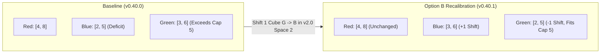
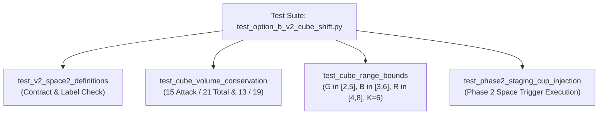

# Technical Architecture Specification: Milestone 1 (v0.40.1)
## SETEC Corruption Track Cube Distribution Recalibration (Option B)

**Author:** Principal Engineer / Architect  
**Status:** Approved for Implementation (SDLC Architecture Phase)  
**Target Version:** `v0.40.1` / Phase 58 Balance Refinement  
**Dependencies:**
- [`RULES.md`](file:///home/mike/.gemini/antigravity/worktrees/rogue-agent/setec_cube_recalibration/RULES.md)
- [`RULES_APPENDIX.md`](file:///home/mike/.gemini/antigravity/worktrees/rogue-agent/setec_cube_recalibration/RULES_APPENDIX.md)
- [`GLOSSARY.md`](file:///home/mike/.gemini/antigravity/worktrees/rogue-agent/setec_cube_recalibration/GLOSSARY.md)
- [`PLAN.md`](file:///home/mike/.gemini/antigravity/worktrees/rogue-agent/setec_cube_recalibration/PLAN.md)
- [`FINDINGS.md`](file:///home/mike/.gemini/antigravity/worktrees/rogue-agent/setec_cube_recalibration/FINDINGS.md)
- [`v400_gameplay_balance_spec.md`](file:///home/mike/.gemini/antigravity/worktrees/rogue-agent/setec_cube_recalibration/docs/specs/v400_gameplay_balance_spec.md)

**Target Components:**
- [`sim/entities.py`](file:///home/mike/.gemini/antigravity/worktrees/rogue-agent/setec_cube_recalibration/sim/entities.py)
- [`RULES_APPENDIX.md`](file:///home/mike/.gemini/antigravity/worktrees/rogue-agent/setec_cube_recalibration/RULES_APPENDIX.md)
- [`pnp/generate_pnp.py`](file:///home/mike/.gemini/antigravity/worktrees/rogue-agent/setec_cube_recalibration/pnp/generate_pnp.py)
- [`tests/test_option_b_v2_cube_shift.py`](file:///home/mike/.gemini/antigravity/worktrees/rogue-agent/setec_cube_recalibration/tests/test_option_b_v2_cube_shift.py)

---

## 1. Executive Summary & Design Rationale

### 1.1 Architectural Background & Motivation
In `v0.40.0` (Phase 57), extensive Monte Carlo stress testing identified an asymmetry in SETEC compiler threat scaling:
1. **The Green Cube Defense Blackout Risk:**
   - On roads featuring *Data Scraper (`v1.0`)*, *Polymorphic Worm (`v2.0`)*, and *Zero-Day Override (`v3.0`)*, cumulative Green cube injections reached **6 Green cubes** at Singularity.
   - However, a player's maximum Defense Grid capacity is strictly capped at **4 shield slots** (Defense Grid Level 4).
   - When 6 Green cubes exited the tower in a late-game compile, even a player with a completely maxed Defense Grid and 4 active shields suffered an unavoidable **2 unblocked Green cubes** (infiltrating 2 Glitched Shield Slots).
   - While Phase 57 introduced `global_green_cube_cap = 5` as an engine guardrail, it relied on artificial runtime clamping to suppress the 6th cube in 25%–27% of games.
2. **The Blue Cube Threat Deficit:**
   - In contrast, baseline Blue cube injections across the 8 canonical roadmaps spanned only **[2, 5] cubes**, frequently lagging behind player defense scaling and leaving acute Corporate Secrets exfiltration pressure weaker than intended.
   - Red cubes correctly scaled to **[4, 8] cubes**, providing robust existential pressure on Market Share.

### 1.2 Approved Design Decision: Option B Recalibration
Under **Option B**, exactly **1 cube is shifted from Green to Blue** on Space 2 of both `v2.0` Version Cards (*Ransomware-as-a-Service* and *Polymorphic Worm*):
- **Green Cube Circulation Recalibrates to `[2, 5]`:**
  - The maximum Green cubes in circulation drops from 6 to **5**, naturally matching both the 4-slot Defense Grid capacity (4 slots + 1 transient baffle buffer) and the engine guardrail `global_green_cube_cap = 5`.
  - Artificial clamping of the 6th Green cube is eliminated under standard gameplay.
- **Blue Cube Circulation Recalibrates to `[3, 6]`:**
  - Acute Corporate Secrets exfiltration pressure increases modestly without destabilizing player survival.
  - Blue cube volume remains strictly below Red's **[4, 8]** ceiling, maintaining the hierarchical primacy of Market Manipulation threat.
- **Zero Volume Delta & Total Conservation:**
  - Net attack cube volume across all 8 decks is strictly preserved: **15 Attack Cubes** for Zero-Day Override roadmaps and **13 Attack Cubes** for Corrupted Kernel roadmaps.
  - The pacing clock (15 Black track spaces + 1 starting pulse = 6 Black cubes) is completely untouched.



---

## 2. Invariant Specifications & Technical Contracts

### `INV-RANGE-RECALIB-01`: Compiler Cube Range Bounds
Across all 8 canonical roadmap decks ($2 \times 2 \times 2$), total compiler cubes introduced into the game at cryptographic Singularity must strictly conform to:
$$\text{Green Cubes} \in [2, 5]$$
$$\text{Blue Cubes} \in [3, 6]$$
$$\text{Red Cubes} \in [4, 8]$$
$$\text{Black Cubes} = 6$$

### `INV-CUBE-VOLUME-01`: Total Cube Volume Conservation
The total number of compiler cubes (Attack Cubes + Black Cubes) at Singularity is strictly conserved with zero net delta compared to the `v0.40.0` baseline:
- For all roadmaps compiling into **`v3.0 Zero-Day Override`**:
  $$\text{Total Attack Cubes} = 15 \quad (\text{Red} + \text{Blue} + \text{Green})$$
  $$\text{Total Compiler Cubes} = 21 \quad (\text{Attack} + 6 \text{ Black})$$
- For all roadmaps compiling into **`v3.0 Corrupted Kernel`**:
  $$\text{Total Attack Cubes} = 13 \quad (\text{Red} + \text{Blue} + \text{Green})$$
  $$\text{Total Compiler Cubes} = 19 \quad (\text{Attack} + 6 \text{ Black})$$
- Net volume delta across every deck: $\Delta_{\text{Attack}} = 0, \Delta_{\text{Black}} = 0, \Delta_{\text{Total}} = 0$.

### `INV-PACING-CLOCK-01`: Pacing Clock Invariance
The pacing clock governing game progression to cryptographic Singularity remains strictly immutable:
- Exactly **15 Black track spaces** across all three active Version Cards (`4` spaces on `v1.0`, `5` spaces on `v2.0`, `6` spaces on `v3.0`).
- Exactly **1 starting Black cube** injected during Round 1 Phase 1's Autonomous Protocol Pulse.
- Exactly **5 additional Black cubes** injected across Corruption Track Space 2 and Space 4 milestones:
  - `v1.0` Space 2: `+1 Black`
  - `v2.0` Space 2: `+1 Black`
  - `v2.0` Space 4: `+1 Black`
  - `v3.0` Space 2: `+1 Black`
  - `v3.0` Space 4: `+1 Black`
- Total Black cubes in circulation at Singularity equals exactly **6 Black cubes**.

### `INV-PROFILE-PARITY-01`: Space 2 Profile Parity
The cube payload of Space 2 on both *Ransomware-as-a-Service* and *Polymorphic Worm* must be 100% bit-identical between **Profile 1 (Standard)** and **Profile 2 (Aggressive)**:
- `RAAS` Space 2 in both profiles injects `{CubeColor.RED: 1, CubeColor.BLUE: 1, CubeColor.BLACK: 1}`.
- `POLYMORPHIC_WORM` Space 2 in both profiles injects `{CubeColor.BLUE: 1, CubeColor.GREEN: 1, CubeColor.BLACK: 1}`.
- Economic friction differences between profiles (e.g., higher cash or patch deductions on non-cube spaces) remain intact.

---

## 3. Concrete Module Contracts (`sim/entities.py`)

### 3.1 `v2.0 Ransomware-as-a-Service (RaaS)` Contract
Space 2 (`index=2`) of `RAAS` shifts from adding `1R, 1G + 1K` to adding `1R, 1B + 1K`.

#### Profile 1 (Standard):
```python
# sim/entities.py (Lines 804 & 932)
CorruptionSpace(
    index=2,
    label="Add 1R, 1B + Add 1K",
    add_cubes={CubeColor.RED: 1, CubeColor.BLUE: 1, CubeColor.BLACK: 1},
)
```

#### Profile 2 (Aggressive):
```python
# sim/entities.py (Line 804)
CorruptionSpace(
    index=2,
    label="Add 1R, 1B + Add 1K",
    add_cubes={CubeColor.RED: 1, CubeColor.BLUE: 1, CubeColor.BLACK: 1},
)
```

### 3.2 `v2.0 Polymorphic Worm` Contract
Space 2 (`index=2`) of `POLYMORPHIC_WORM` shifts from adding `2G + 1K` to adding `1B, 1G + 1K`.

#### Profile 1 (Standard):
```python
# sim/entities.py (Lines 825 & 953)
CorruptionSpace(
    index=2,
    label="Add 1B, 1G + Add 1K",
    add_cubes={CubeColor.BLUE: 1, CubeColor.GREEN: 1, CubeColor.BLACK: 1},
)
```

#### Profile 2 (Aggressive):
```python
# sim/entities.py (Line 825)
CorruptionSpace(
    index=2,
    label="Add 1B, 1G + Add 1K",
    add_cubes={CubeColor.BLUE: 1, CubeColor.GREEN: 1, CubeColor.BLACK: 1},
)
```

### 3.3 Static Card Summary Table
All non-cube fields (penalties, directives, upgrades, track lengths) remain completely untouched:

| Version Card | Space Index | Prior Label (Baseline) | Prior Payload | New Label (Option B) | New Payload (`add_cubes`) |
| :--- | :---: | :--- | :--- | :--- | :--- |
| **`v2.0 RaaS`** | `2` | `"Add 1R, 1G + Add 1K"` | `{RED: 1, GREEN: 1, BLACK: 1}` | **`"Add 1R, 1B + Add 1K"`** | **`{RED: 1, BLUE: 1, BLACK: 1}`** |
| **`v2.0 Polymorphic Worm`** | `2` | `"Add 2G + Add 1K"` | `{GREEN: 2, BLACK: 1}` | **`"Add 1B, 1G + Add 1K"`** | **`{BLUE: 1, GREEN: 1, BLACK: 1}`** |

---

## 4. Full 8-Roadmap Buildup Matrix Analysis

### 4.1 Per-Card Cube Buildup Breakdown
Each canonical card contributes the following cumulative cubes across initial setup payload and corruption track spaces:

| Card Code & Name | Stage | Red | Blue | Green | Black | Total Attack | Total Cubes |
| :--- | :--- | :---: | :---: | :---: | :---: | :---: | :---: |
| **`SCRIPT_KIDDIE`** | Setup (`2R, 1B, 1G`) + Track (`+1R, +1K`) | 3 | 1 | 1 | 1 | 5 | 6 |
| **`DATA_SCRAPER`** | Setup (`1R, 2B, 1G`) + Track (`+1G, +1K`) | 1 | 2 | 2 | 1 | 5 | 6 |
| **`RAAS` (Option B)** | Setup (`0`) + Track (`+3R, +1B, +2K`) | 3 | 1 | 0 | 2 | 4 | 6 |
| **`POLYMORPHIC_WORM` (Option B)** | Setup (`0`) + Track (`+1R, +1B, +2G, +2K`) | 1 | 1 | 2 | 2 | 4 | 6 |
| **`ZERO_DAY_OVERRIDE`** | Setup (`0`) + Track (`+2R, +3B, +1G, +2K`) | 2 | 3 | 1 | 2 | 6 | 8 |
| **`CORRUPTED_KERNEL`** | Setup (`0`) + Track (`+2R, +1B, +1G, +2K`) | 2 | 1 | 1 | 2 | 4 | 6 |
| **Autonomous Protocol Pulse** | Round 1 Phase 1 Pulse | 0 | 0 | 0 | 1 | 0 | 1 |

### 4.2 Comprehensive 8-Roadmap Matrix Table
The table below details all 8 deterministic roadmap decks ($2 \text{ v1} \times 2 \text{ v2} \times 2 \text{ v3}$) from match setup through Singularity under Option B:

| Roadmap ID | Path Name / Deck Composition | Red | Blue | Green | Black | Total Attack | Total Cubes |
| :---: | :--- | :---: | :---: | :---: | :---: | :---: | :---: |
| **Deck 1** | *Script Kiddie* + *RaaS* + *Zero-Day Override* (Mixed A) | **8** | **5** | **2** | **6** | **15** | **21** |
| **Deck 2** | *Script Kiddie* + *RaaS* + *Corrupted Kernel* (Kinetic) | **8** | **3** | **2** | **6** | **13** | **19** |
| **Deck 3** | *Script Kiddie* + *Polymorphic Worm* + *Zero-Day Override* (Contagion) | **6** | **5** | **4** | **6** | **15** | **21** |
| **Deck 4** | *Script Kiddie* + *Polymorphic Worm* + *Corrupted Kernel* (Mixed B) | **6** | **3** | **4** | **6** | **13** | **19** |
| **Deck 5** | *Data Scraper* + *RaaS* + *Zero-Day Override* | **6** | **6** | **3** | **6** | **15** | **21** |
| **Deck 6** | *Data Scraper* + *RaaS* + *Corrupted Kernel* | **6** | **4** | **3** | **6** | **13** | **19** |
| **Deck 7** | *Data Scraper* + *Polymorphic Worm* + *Zero-Day Override* | **4** | **6** | **5** | **6** | **15** | **21** |
| **Deck 8** | *Data Scraper* + *Polymorphic Worm* + *Corrupted Kernel* | **4** | **4** | **5** | **6** | **13** | **19** |
| **MIN** | **Global Floor Across All Roadmaps** | **4** | **3** | **2** | **6** | **13** | **19** |
| **MAX** | **Global Ceiling Across All Roadmaps** | **8** | **6** | **5** | **6** | **15** | **21** |

### 4.3 Delta Comparison: Baseline (`v0.40.0`) vs Option B (`v0.40.1`)

| Metric / Dimension | Baseline (`v0.40.0`) | Option B (`v0.40.1`) | Net Delta | Architectural Impact |
| :--- | :---: | :---: | :---: | :--- |
| **Green Cube Range** | `[3, 6]` | **`[2, 5]`** | **-1** | Peak 5 matches Defense Grid Capacity (4) + guardrail; eliminates forced overflow clamping. |
| **Blue Cube Range** | `[2, 5]` | **`[3, 6]`** | **+1** | Sharpens late-game Corporate Secrets threat while staying strictly below Red ceiling. |
| **Red Cube Range** | `[4, 8]` | **`[4, 8]`** | **0** | Unaltered; preserves Market Share economic tension. |
| **Black Cubes** | `6` | **`6`** | **0** | Unaltered; 15 track spaces + 1 pulse perfectly preserved. |
| **Zero-Day Total Attack** | `15` | **`15`** | **0** | Volume conservation invariant satisfied. |
| **Corrupted Kernel Attack**| `13` | **`13`** | **0** | Volume conservation invariant satisfied. |

---

## 5. Downstream Component Synchronization

### 5.1 `RULES_APPENDIX.md` Synchronization
Section 6C tables must be updated to reflect the new Space 2 labels and payloads:
- **Profile 1: Standard Escalation Tracks (`v2.0` rows):**
  - *RaaS* Space 2: `Add 1R, 1B + Add 1K`
  - *Polymorphic Worm* Space 2: `Add 1B, 1G + Add 1K`
- **Profile 2: Aggressive Escalation Tracks (`v2.0` rows):**
  - *RaaS* Space 2: `Add 1R, 1B + Add 1K`
  - *Polymorphic Worm* Space 2: `Add 1B, 1G + Add 1K`

### 5.2 Print-and-Play Assets (`pnp/generate_pnp.py`)
Update `VersionTileSpec` space text definitions:
- `v2.0 RaaS` Space 2:
  ```python
  VersionTrackSpaceSpec(2, "+1 {RED} +1 {BLUE}\n+1 {BLACK}")
  ```
- `v2.0 Polymorphic Worm` Space 2:
  ```python
  VersionTrackSpaceSpec(2, "+1 {BLUE} +1 {GREEN}\n+1 {BLACK}")
  ```

### 5.3 Web UI Engine (`web/`)
Because [`web/schemas.py`](file:///home/mike/.gemini/antigravity/worktrees/rogue-agent/setec_cube_recalibration/web/schemas.py) reads directly from `card.corruption_track[i].label` and `card.corruption_track[i].add_cubes`, changes to [`sim/entities.py`](file:///home/mike/.gemini/antigravity/worktrees/rogue-agent/setec_cube_recalibration/sim/entities.py) propagate automatically into modal displays and compiler badges with zero client-side JavaScript schema changes.

---

## 6. Test Specification (`tests/test_option_b_v2_cube_shift.py`)

A dedicated unit and integration test suite must be implemented in [`tests/test_option_b_v2_cube_shift.py`](file:///home/mike/.gemini/antigravity/worktrees/rogue-agent/setec_cube_recalibration/tests/test_option_b_v2_cube_shift.py) covering the four core testing pillars:



### 6.1 `test_v2_space2_definitions`
- **Objective:** Verify `sim/entities.py` definitions across both `STANDARD` and `AGGRESSIVE` profiles.
- **Assertions:**
  1. For `profile in ("STANDARD", "AGGRESSIVE")`:
     - Retrieve cards dictionary via `get_all_version_cards(profile=profile)`.
     - `raas = cards["RAAS"]`:
       - `raas.corruption_track[1].index == 2`
       - `raas.corruption_track[1].label == "Add 1R, 1B + Add 1K"`
       - `raas.corruption_track[1].add_cubes == {CubeColor.RED: 1, CubeColor.BLUE: 1, CubeColor.BLACK: 1}`
     - `worm = cards["POLYMORPHIC_WORM"]`:
       - `worm.corruption_track[1].index == 2`
       - `worm.corruption_track[1].label == "Add 1B, 1G + Add 1K"`
       - `worm.corruption_track[1].add_cubes == {CubeColor.BLUE: 1, CubeColor.GREEN: 1, CubeColor.BLACK: 1}`

### 6.2 `test_cube_volume_conservation`
- **Objective:** Verify `INV-CUBE-VOLUME-01` across all 8 canonical decks.
- **Methodology:**
  1. Iterate across all 8 decks from `itertools.product(v1_cards, v2_cards, v3_cards)`.
  2. For each deck, sum setup payload (`V038D_V1_STAGING_PAYLOAD`) and all `add_cubes` across tracks, plus 1 Black cube for Round 1 Autonomous Pulse.
  3. If `v3.directive_code == "ZERO_DAY_OVERRIDE"`:
     - Assert `attack_cubes == 15`
     - Assert `total_cubes == 21`
  4. If `v3.directive_code == "CORRUPTED_KERNEL"`:
     - Assert `attack_cubes == 13`
     - Assert `total_cubes == 19`
  5. Assert net volume change against baseline is exactly `0`.

### 6.3 `test_cube_range_bounds`
- **Objective:** Verify `INV-RANGE-RECALIB-01` across all 8 decks.
- **Assertions:**
  1. Compute total cubes by color for each of the 8 canonical decks.
  2. Calculate `(min_color, max_color)` across all 8 decks:
     - `green_range == (2, 5)`
     - `blue_range == (3, 6)`
     - `red_range == (4, 8)`
     - `black_count == 6` (for all 8 decks)
  3. Explicitly verify Deck 7 (*Data Scraper* + *Polymorphic Worm* + *Zero-Day Override*) has Green exactly equal to `5` (previously `6`).

### 6.4 `test_phase2_staging_cup_injection`
- **Objective:** Verify operational execution of Space 2 cube injection during Phase 2 compiler resolution.
- **Methodology:**
  1. Instantiate a `GameEngine` with `GameConfig.v040()` (Mode A: `corruption_cubes_resolve_immediately = False`).
  2. Execute `resolve_corruption_space()` targeting `RAAS` Space 2:
     - Assert `staging_cup[CubeColor.RED]` increments by exactly 1.
     - Assert `staging_cup[CubeColor.BLUE]` increments by exactly 1.
     - Assert `staging_cup[CubeColor.BLACK]` increments by exactly 1.
     - Assert `staging_cup[CubeColor.GREEN]` does not increment.
  3. Execute `resolve_corruption_space()` targeting `POLYMORPHIC_WORM` Space 2:
     - Assert `staging_cup[CubeColor.BLUE]` increments by exactly 1.
     - Assert `staging_cup[CubeColor.GREEN]` increments by exactly 1.
     - Assert `staging_cup[CubeColor.BLACK]` increments by exactly 1.
     - Assert `staging_cup[CubeColor.RED]` does not increment.
  4. Verify Mode B (`corruption_cubes_resolve_immediately = True`) routing:
     - Exited cubes dict receives `{RED: 1, BLUE: 1}` for RaaS, while `{BLACK: 1}` enters staging cup.

---

## 7. Implementation & Verification Gate Plan

### 7.1 SDLC Task Breakdown
1. **`senior-engineer` Implementation:**
   - Update `sim/entities.py` (both Standard and Aggressive profiles for RaaS and Polymorphic Worm).
   - Implement `tests/test_option_b_v2_cube_shift.py` with tests covering all 4 specifications.
   - Run full regression suite (`pytest tests/`) via WSL.
2. **`staff-engineer` Code Review Gate:**
   - Audit `sim/entities.py` line-by-line against `INV-RANGE-RECALIB-01`, `INV-CUBE-VOLUME-01`, `INV-PACING-CLOCK-01`, and `INV-PROFILE-PARITY-01`.
   - Verify backwards parity for older version presets if applicable.
3. **`graphic-designer` & Main Session Documentation Sync:**
   - Update Section 6C of `RULES_APPENDIX.md`.
   - Update `pnp/generate_pnp.py` and regenerate physical card asset PDFs.
4. **`product-owner` & `game-designer` Validation Sweep:**
   - Execute 3,600-match validation sweep across 2P, 3P, and 4P pods.
   - Verify green cube clamping frequency drops to near 0%.
   - Validate tri-modal end conditions remain inside healthy target corridors.

### 7.2 Acceptance Criteria Checklist
- [ ] `sim/entities.py` Space 2 on RaaS and Polymorphic Worm updated for both Standard and Aggressive profiles.
- [ ] `tests/test_option_b_v2_cube_shift.py` passes 100% (4/4 tests).
- [ ] Full existing test suite passes 100% with zero regressions.
- [ ] Invariants `INV-RANGE-RECALIB-01` through `INV-PROFILE-PARITY-01` formally satisfied.
- [ ] `RULES_APPENDIX.md` and `pnp/generate_pnp.py` synchronized.
