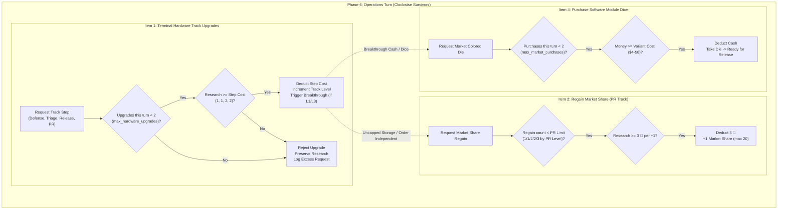

# Technical Architecture Specification: Research Upgrade Limit & Track Rebalance Package
## Terminal Hardware Track Step Costs `(1, 1, 2, 2) 🔬`, Per-Turn Upgrade Limit (`max = 2`), and Telemetry Architecture

**Author:** Principal Engineer / Architect  
**Status:** Approved for Implementation (SDLC Architecture Phase)  
**Target Version:** `v0.39.0` Baseline  
**Source of Truth:** Approved Package Requirements (User Sign-off 2026-11-12)  
**Dependencies:**
- [`RULES.md`](file:///home/mike/.gemini/antigravity/worktrees/rogue-agent/research_upgrade_limit/RULES.md) (Sections 2, 3, 4)
- [`GLOSSARY.md`](file:///home/mike/.gemini/antigravity/worktrees/rogue-agent/research_upgrade_limit/GLOSSARY.md) (Sections 4, 6)
- [`docs/specs/v350_research_track_rebalance_spec.md`](file:///home/mike/.gemini/antigravity/worktrees/rogue-agent/research_upgrade_limit/docs/specs/v350_research_track_rebalance_spec.md)
- [`docs/specs/v360_market_share_red_rework_spec.md`](file:///home/mike/.gemini/antigravity/worktrees/rogue-agent/research_upgrade_limit/docs/specs/v360_market_share_red_rework_spec.md)

**Target Components:**
- [`sim/config.py`](file:///home/mike/.gemini/antigravity/worktrees/rogue-agent/research_upgrade_limit/sim/config.py)
- [`sim/engine/state.py`](file:///home/mike/.gemini/antigravity/worktrees/rogue-agent/research_upgrade_limit/sim/engine/state.py)
- [`sim/engine/core.py`](file:///home/mike/.gemini/antigravity/worktrees/rogue-agent/research_upgrade_limit/sim/engine/core.py)
- [`sim/engine/phase6_operations.py`](file:///home/mike/.gemini/antigravity/worktrees/rogue-agent/research_upgrade_limit/sim/engine/phase6_operations.py)
- [`sim/engine/research_tracks.py`](file:///home/mike/.gemini/antigravity/worktrees/rogue-agent/research_upgrade_limit/sim/engine/research_tracks.py)
- [`sim/engine/end_game.py`](file:///home/mike/.gemini/antigravity/worktrees/rogue-agent/research_upgrade_limit/sim/engine/end_game.py)
- [`sim/bots/research_policy.py`](file:///home/mike/.gemini/antigravity/worktrees/rogue-agent/research_upgrade_limit/sim/bots/research_policy.py)
- [`sim/bots/pr_push_policy.py`](file:///home/mike/.gemini/antigravity/worktrees/rogue-agent/research_upgrade_limit/sim/bots/pr_push_policy.py)
- [`web/controller/phase6_operations_actions.py`](file:///home/mike/.gemini/antigravity/worktrees/rogue-agent/research_upgrade_limit/web/controller/phase6_operations_actions.py)
- [`web/controller/capabilities.py`](file:///home/mike/.gemini/antigravity/worktrees/rogue-agent/research_upgrade_limit/web/controller/capabilities.py)
- [`pnp/generate_pnp.py`](file:///home/mike/.gemini/antigravity/worktrees/rogue-agent/research_upgrade_limit/pnp/generate_pnp.py)
- New: [`tests/test_research_upgrade_limit.py`](file:///home/mike/.gemini/antigravity/worktrees/rogue-agent/research_upgrade_limit/tests/test_research_upgrade_limit.py)
- Regression updates: [`tests/test_v350_research_tracks.py`](file:///home/mike/.gemini/antigravity/worktrees/rogue-agent/research_upgrade_limit/tests/test_v350_research_tracks.py), [`tests/test_v360_market_share.py`](file:///home/mike/.gemini/antigravity/worktrees/rogue-agent/research_upgrade_limit/tests/test_v360_market_share.py), [`tests/test_lever_a_pr_push.py`](file:///home/mike/.gemini/antigravity/worktrees/rogue-agent/research_upgrade_limit/tests/test_lever_a_pr_push.py)

---

## 1. System Overview & Mathematical Rationale

### 1.1 Problem Statement & Historical Context
Under the `v0.35.0` baseline, the four **Terminal Hardware Tracks** (**Defense Grid**, **Triage**, **Release**, and **Public Relations**) implemented a 5-level structure (`L0` through `L4`) with step costs of `(1, 2, 2, 3) 🔬` (total `8 🔬` per track).

Extensive Monte Carlo sweeps and gameplay analysis identified two distinct structural flaws:
1. **Pacing Bottleneck at Level 2:**
   - Advancing from `L0` to `L2` required `3 🔬` (`1 + 2`). Because early-game research income is typically `1` to `2 🔬` per round, players frequently stalled at `L1` for multiple rounds before reaching functional capacity upgrades (`Defense Capacity 3`, `Triage Bandwidth 3`, `Release Bandwidth 5`, or `PR Regain Cap 2`).
   - This sluggish progression disincentivized diversified infrastructure investment, funneling players into narrow single-track hyper-specialization.
2. **Uncapped Burst Upgrades Distorting Late-Game Tempo:**
   - In `Phase 6: Operations`, while module dice purchases are strictly constrained by `max_market_purchases_per_turn = 2` `[TUNE: 2]`, hardware track upgrades were previously **unlimited** per turn provided a player held sufficient research tokens.
   - When players accumulated large reserves of research (e.g. from Green module rolls, Gray `+$1 & +1 🔬` faces, or long mid-game saving), they could dump `5–8 🔬` in a single Operations Turn to leapfrog multiple levels simultaneously (e.g. `L0 → L3` or `L1 → L4`).
   - This explosive single-turn acceleration bypassed the intended pacing tension of the CI/CD pipeline, triggered rapid cascading **Breakthroughs** in a single turn, and destabilized threat-defense parity.

### 1.2 Approved Architecture & Design Synthesis
The approved package resolves both issues symmetrically with two coupled mechanics:

1. **Recalibrated Track Step Costs `(1, 1, 2, 2) 🔬` `[TUNE]`:**
   - Advancing to `L1` costs `1 🔬` (Breakthrough).
   - Advancing to `L2` costs **`1 🔬`** (down from `2 🔬`), allowing players to unlock `L2` capacity bumps early and reliably.
   - Advancing to `L3` costs `2 🔬` (Breakthrough).
   - Advancing to `L4` costs **`2 🔬`** (down from `3 🔬`).
   - Total track cost from `L0` to `L4` drops from `8 🔬` to **`6 🔬`** (a 25% cost reduction).
2. **Per-Round Hardware Upgrade Limit of 2 `[TUNE]`:**
   - In `Phase 6: Operations` (Item 1), each surviving player may execute at most **`2` hardware track upgrades** during their Operations Turn (`max_hardware_upgrades_per_turn = 2`).
   - This directly mirrors the existing limit on dice purchases (`max_market_purchases_per_turn = 2`).
   - Advancing any of the 4 Terminal Hardware Tracks counts as 1 upgrade against this cap.
3. **Public Relations Market Share Regain Exemption:**
   - Spending research on the **Public Relations Track** to **Regain Market Share** (Phase 6 Item 2) is an operational resource conversion (`3 🔬` per `+1` Market Share `[TUNE]`), **not a hardware track upgrade**.
   - PR regain continues to be governed exclusively by its own per-turn limit derived from the PR track level (`1` at `L0–L1`, `2` at `L2–L3`, `3` at `L4`) and the track maximum (`20`). It does **not** count toward, nor is it constrained by, the 2 hardware upgrade limit.
4. **Starting Research Invariant:**
   - Starting research tokens remain strictly **`0 🔬`** for all players.



### 1.3 Mathematical Modeling & Pacing Impact
Under the combined changes:
- **Round 1 Tempo:** With `0 🔬` starting research, a player earning `2 🔬` in Round 1 can now achieve `L2` on a single track (`1 + 1 = 2 🔬`), or `L1` on two distinct tracks (`1 + 1 = 2 🔬`). Both scenarios consume exactly the `2` upgrade allotment.
- **Single-Track Rush Bound:** A player seeking `L4` on a focus track (e.g. Defense Grid) cannot achieve it in fewer than **`2` distinct Operations Turns** (Turn A: `L0 → L2` for `2 🔬`, 2 upgrades; Turn B: `L2 → L4` for `4 🔬`, 2 upgrades).
- **Research Sinks & PR Synergies:** Previously, surplus research had nowhere to go except bursting tracks to `L4`. With the `2` upgrade cap, players holding `5+ 🔬` can execute `2` hardware upgrades (e.g. `2 🔬`), leaving `3+ 🔬` to immediately leverage the **Public Relations Track** to regain Market Share, maintaining health against Red cube threat pressure.

| Level Transition | Previous Step Cost | New Step Cost `[TUNE]` | Previous Cumulative | New Cumulative | Effect / Perk |
| :---: | :---: | :---: | :---: | :---: | :--- |
| **L0 $\to$ L1** | `1 🔬` | **`1 🔬`** | `1 🔬` | **`1 🔬`** | **Breakthrough** (Def/Rel: +1 Gray die, Tri: +2 Contractors, PR: +$3) |
| **L1 $\to$ L2** | `2 🔬` | **`1 🔬`** | `3 🔬` | **`2 🔬`** | Capacity Bump (Def 3, Tri 3, Rel 5, PR Regain Cap 2) |
| **L2 $\to$ L3** | `2 🔬` | **`2 🔬`** | `5 🔬` | **`4 🔬`** | **Breakthrough** (Def/Rel: +1 Secret, Tri: swap Gray for Colored die, PR: 2nd Purple die) |
| **L3 $\to$ L4** | `3 🔬` | **`2 🔬`** | `8 🔬` | **`6 🔬`** | Final Perk (Def 4 + $1/cube, Tri 4 + 1 🔬/>2, Rel 6 + reroll, PR Regain Cap 3) |
| **Total Track** | `8 🔬` | **`6 🔬`** | `8 🔬` | **`6 🔬`** | Full Mastery ($-25\%$ cost) |

---

## 2. Module Contracts & Implementation Specifications

### 2.1 Configuration Contract (`sim/config.py`)

#### Fields to Modify & Add
In [`GameConfig`](file:///home/mike/.gemini/antigravity/worktrees/rogue-agent/research_upgrade_limit/sim/config.py):

```python
# Terminal Hardware Track step costs: L0->L1, L1->L2, L2->L3, L3->L4
track_step_costs: Tuple[int, int, int, int] = (1, 1, 2, 2)  # [TUNE] cost to reach L1..L4 (total 6 🔬 per track)

# Per-round hardware upgrade limit in Phase 6: Operations (Item 1)
max_hardware_upgrades_per_turn: int = 2  # [TUNE: 2] max hardware track upgrades per Operations Turn
```

#### Validation & Coercion Rules
In `GameConfig.__post_init__`:
- Validate `track_step_costs`: Must be a 4-tuple of non-negative integers (`all(c >= 0 for c in self.track_step_costs)` and `len(self.track_step_costs) == 4`).
- Validate `max_hardware_upgrades_per_turn`: Must be an integer `> 0`.
- Verify legacy presets (`legacy_v034`, `legacy_v035`):
  - Legacy `v0.34` uses legacy 3-level tracks (`_v034_*`).
  - If a fixture requires `v0.35` historical parity, `track_step_costs` may be explicitly set to `(1, 2, 2, 3)` and `max_hardware_upgrades_per_turn` to `999` (unbounded). Canonical `v0.38+` and forward default to `(1, 1, 2, 2)` and `2`.

---

### 2.2 Operations Engine Contract (`sim/engine/phase6_operations.py`)

#### Track Upgrade Execution Contract
The function `execute_track_upgrades` in [`sim/engine/phase6_operations.py`](file:///home/mike/.gemini/antigravity/worktrees/rogue-agent/research_upgrade_limit/sim/engine/phase6_operations.py) must enforce `max_hardware_upgrades_per_turn`:

```python
def execute_track_upgrades(engine: GameEngine, player: PlayerState, plan: Any) -> list:
    """Phase 6 Item 1: Pay and raise tracks step by step up to max_hardware_upgrades_per_turn.
    Each Breakthrough resolves immediately before the next step is paid (INV-RT-BT-IMMEDIATE-01).
    Excess requested upgrades beyond the per-turn limit are rejected and recorded in telemetry.
    """
    from sim.engine import research_tracks

    choices = getattr(plan, "breakthrough_choices", None) or {}
    done = []
    max_upgrades = getattr(engine.config, "max_hardware_upgrades_per_turn", 2)
    requested = list(getattr(plan, "track_upgrades", []) or [])

    for track in requested:
        # Check per-turn upgrade cap
        if len(done) >= max_upgrades:
            break

        t = research_tracks.normalize_track(track)
        if t not in research_tracks.LEVEL_ATTR:
            continue

        if not player.upgrade_track(t, round_number=engine.state.current_round):
            break

        lvl = research_tracks.level_of(player, t)
        done.append((t, lvl))

        if lvl in research_tracks.BREAKTHROUGH_LEVELS:
            choice = research_tracks.ask_breakthrough_choice(engine, player, t, lvl, choices)
            research_tracks.resolve_breakthrough(engine, player, t, lvl, choice)

    # Telemetry & error handling: record excess requested upgrades
    if len(requested) > max_upgrades:
        excess = len(requested) - max_upgrades
        player.excess_hardware_upgrades_requested = getattr(player, "excess_hardware_upgrades_requested", 0) + excess

    player.track_upgrades_this_round = getattr(player, "track_upgrades_this_round", []) + done
    return done
```

#### Regain Market Share Independence
In [`sim/engine/phase6_operations.py`](file:///home/mike/.gemini/antigravity/worktrees/rogue-agent/research_upgrade_limit/sim/engine/phase6_operations.py), `execute_share_regain`:
- Operates independently from `done` track upgrades.
- Only checks `share_regain_cap_by_level` at the player's post-upgrade Public Relations level, the player's remaining research tokens, and `market_share_max`.
- Does not increment or consult `len(done)` or `max_hardware_upgrades_per_turn`.

---

### 2.3 Bot Policy Contract (`sim/bots/research_policy.py` & `sim/bots/pr_push_policy.py`)

#### `sim/bots/research_policy.py`
In `plan_research3` and `_plan_research_share_regain`:
1. Retrieve `max_ups = getattr(config, "max_hardware_upgrades_per_turn", 2)`.
2. When iterating over `_want_list(policy, lv)`:
   - Terminate the upgrade accumulation loop when `len(upgrades) >= max_ups`.
3. In `_plan_research_share_regain`:
   - After reserving urgent regain (if aware), allocate research to at most `max_ups` track upgrades.
   - Any remaining research tokens are eligible for leftover Market Share regain (up to the PR level cap) or held in uncapped reserve.

```python
    # Example logic in _plan_research_share_regain:
    upgrades: List[str] = []
    max_ups = getattr(config, "max_hardware_upgrades_per_turn", 2)
    late = is_late_game(policy, state) or (aware and msp.any_survivor_critical(state, pol))
    leftovers_ok = late
    if not late:
        focus = list(policy.focus_order)[0]
        for t in _want_list(policy, lv):
            if len(upgrades) >= max_ups:
                break
            if sim_lv[t] >= 4:
                continue
            c = int(costs[sim_lv[t]])
            if res >= c:
                upgrades.append(t)
                res -= c
                sim_lv[t] += 1
            else:
                break  # save toward this step
        leftovers_ok = sim_lv[focus] >= 4 and res >= policy.reserve_floor
```

#### `sim/bots/pr_push_policy.py`
In `_ordered_research`:
- Enforce `len(upgrades) < max_ups` inside the `buy(t)` closure.
- When `pr_first` is `True`, PR track advancements stop at `min(pr_cap, max_ups)`.
- Other focus tracks may only be purchased if `len(upgrades) < max_ups`.

---

### 2.4 State, Core & Telemetry Contracts (`sim/engine/state.py`, `core.py`, `end_game.py`)

#### `PlayerState` Fields (`sim/engine/state.py`)
Add tracking fields:
- `excess_hardware_upgrades_requested: int = 0`: Total excess hardware track upgrade requests submitted across all Operations Turns in the match that were rejected due to the per-turn limit.

#### `RoundTelemetry` Fields (`sim/engine/state.py`)
Add to `RoundTelemetry`:
- `excess_hardware_upgrades_by_player: Dict[int, int] = field(default_factory=dict)`: Per-round count of rejected excess upgrade requests by player ID.

#### Lifecycle Integration (`sim/engine/core.py`)
In `_begin_research_telemetry`:
- Snapshot `getattr(p, "excess_hardware_upgrades_requested", 0)` for each player.
In `_record_research_telemetry`:
- Compute `tel.excess_hardware_upgrades_by_player[p.player_id] = getattr(p, "excess_hardware_upgrades_requested", 0) - start_excess`.

#### Game Summary Serialization (`sim/engine/end_game.py`)
In `_build_game_summary` / `players` summary rows:
- Include `"excess_hardware_upgrades_requested": getattr(p, "excess_hardware_upgrades_requested", 0)`.

---

### 2.5 Web Controller Contract (`web/controller/phase6_operations_actions.py` & `capabilities.py`)

#### `web/controller/phase6_operations_actions.py`
In `upgrade_hardware_track`:
1. Check turn limit:
   ```python
   max_upgrades = getattr(controller.state.config, "max_hardware_upgrades_per_turn", 2)
   if meta.get("upgrades_this_turn", 0) >= max_upgrades:
       raise ValueError(f"Hardware upgrade limit reached ({max_upgrades} upgrades per Operations Turn)")
   ```
2. On successful execution:
   ```python
   meta["upgrades_this_turn"] = meta.get("upgrades_this_turn", 0) + 1
   ```
3. In `advance_operations_turns` and `_init_turn`:
   - Initialize / reset `meta["upgrades_this_turn"] = 0` when passing the turn to the next player.

#### `web/controller/capabilities.py`
In `compute_player_capabilities`:
- Check `meta.get("upgrades_this_turn", 0) < max_upgrades`.
- If `upgrades_this_turn >= max_upgrades`, set `can_upgrade_track[t] = False` for all tracks `t` in `("defense", "triage", "release", "patent")`.

---

### 2.6 Print-and-Play Contract (`pnp/generate_pnp.py`)

In [`pnp/generate_pnp.py`](file:///home/mike/.gemini/antigravity/worktrees/rogue-agent/research_upgrade_limit/pnp/generate_pnp.py):
- Update `TRACK_STEP_COSTS`:
  ```python
  TRACK_STEP_COSTS = (None, 1, 1, 2, 2)  # {RESEARCH} to reach L1..L4
  ```
- Update Company Terminal Mat quick-reference card / track text:
  - Phase 6 Operations summary:
    `"Upgrade Tracks (<= 2 upgrades/turn [1/1/2/2 {RESEARCH}]; L1 & L3 Breakthroughs resolve at once) | Regain Market Share (3 {RESEARCH} each, up to PR limit 1/1/2/2/3) | Paid {STAR} incl. Ad Campaign | Buy <= 2 dice -> Ready."`

---

## 3. Explicit System Invariants

| ID | Title | Statement | Enforcement Point |
| :--- | :--- | :--- | :--- |
| **INV-TRACK-COSTS-01** | Track Step Costs Schedule | Under canonical `v0.35+` rules, advancing any Terminal Hardware Track requires exactly `1, 1, 2, 2 🔬` `[TUNE]` to reach Levels 1, 2, 3, and 4 respectively. Cumulative track costs are strictly `1, 2, 4, 6 🔬`. | `sim/config.py`, `research_tracks.step_cost` |
| **INV-UPGRADE-LIMIT-01** | Per-Turn Hardware Upgrade Limit | A player may execute at most `max_hardware_upgrades_per_turn = 2` `[TUNE]` hardware track upgrades during their `Phase 6: Operations Turn`, summed across all 4 tracks combined. | `phase6_operations.execute_track_upgrades`, `web/controller/phase6_operations_actions.py` |
| **INV-UPGRADE-LIMIT-SCOPE-02** | PR Market Share Regain Exemption | Regaining Market Share via the Public Relations Track (`3 🔬` per `+1`) is an operational action, NOT a hardware track upgrade. It is bounded solely by the PR level regain cap (`1/1/2/2/3`) and does not count toward or consume the hardware upgrade limit. | `phase6_operations.execute_share_regain`, `web/controller/phase6_operations_actions.py` |
| **INV-UPGRADE-LIMIT-ORDER-03** | Step Resolution & Breakthrough Immediate Effect | Track upgrades execute in strict sequential order. When Level 1 or Level 3 is reached, its Breakthrough resolves immediately before any subsequent operation. Completing the 2nd upgrade resolves its Breakthrough fully (e.g. PR L1 yields `$3`, which can immediately fund dice purchases in the same turn). | `phase6_operations.execute_track_upgrades`, `research_tracks.resolve_breakthrough` |
| **INV-UPGRADE-LIMIT-ENFORCE-04** | Telemetry & Rejection Logging | If an operations plan or action requests more than `max_hardware_upgrades_per_turn` upgrades in a turn, excess requests are rejected without deducting research, and logged via `player.excess_hardware_upgrades_requested` and `RoundTelemetry.excess_hardware_upgrades_by_player`. | `phase6_operations.py`, `sim/engine/core.py` |
| **INV-START-RESEARCH-01** | Zero Starting Research Invariant | All players start the match with strictly `0 🔬` (`research_tokens == 0`). Starting research is unaugmented by setup or company bonuses in canonical play. | `sim/engine/core.py`, `sim/config.py` |

---

## 4. Telemetry, Error Handling & Logging

### 4.1 Excess Request Accounting
When a bot or test submits an operations plan with `N > 2` track upgrades:
1. Upgrades `1` and `2` are evaluated and executed (if affordable).
2. Upgrades `3` through `N` are skipped.
3. `player.excess_hardware_upgrades_requested` is incremented by `N - 2`.
4. In `sim/engine/core.py`, the delta is recorded in `tel.excess_hardware_upgrades_by_player[player_id]`.

### 4.2 Error Handling in Web Controller
- If a human player attempts to trigger `upgrade_hardware_track` when `meta["upgrades_this_turn"] >= 2`:
  - Controller raises `ValueError("Hardware upgrade limit reached (2 upgrades per Operations Turn)")`.
  - HTTP layer converts this to status `400 Bad Request`.
  - State and research balances remain completely unchanged.
- If a player attempts an upgrade with insufficient research:
  - Controller raises `ValueError(f"Insufficient research tokens: need {cost} 🔬, have {player.research_tokens} 🔬")`.

---

## 5. Test Specifications & Verification Matrix

### 5.1 Senior Engineer Test Specifications (`tests/test_research_upgrade_limit.py`)

Create a dedicated test suite [`tests/test_research_upgrade_limit.py`](file:///home/mike/.gemini/antigravity/worktrees/rogue-agent/research_upgrade_limit/tests/test_research_upgrade_limit.py) covering the following test cases:

- **TEST-RUL-01: Track Step Cost Sequence `(1, 1, 2, 2)`**
  - Verify `player.get_track_upgrade_cost(t)` returns `1, 1, 2, 2` for `L0->L1, L1->L2, L2->L3, L3->L4` on all 4 tracks (`DEFENSE`, `TRIAGE`, `RELEASE`, `PATENT`/`PR`).
  - Total research required for `L0 -> L4` is exactly `6 🔬`. Verify `get_track_upgrade_cost` returns `None` at `L4`.
- **TEST-RUL-02: Per-Turn Hardware Upgrade Limit Enforcement (Engine)**
  - Player with `6 🔬` plans `["DEFENSE", "DEFENSE", "DEFENSE"]`.
  - Run `execute_track_upgrades`:
    - Exactly 2 upgrades execute (`defense_level == 2`).
    - Research spent is `1 + 1 = 2 🔬`, remaining research is `4 🔬`.
    - `player.excess_hardware_upgrades_requested == 1`.
- **TEST-RUL-03: Multi-Track Upgrades Obey Combined Limit**
  - Player with `4 🔬` plans `["DEFENSE", "RELEASE", "TRIAGE"]`.
  - Verify `DEFENSE` reaches `L1` (cost 1), `RELEASE` reaches `L1` (cost 1), and `TRIAGE` is not executed.
  - Exactly 2 upgrades executed, remaining research is `2 🔬`.
- **TEST-RUL-04: PR Market Share Regain Does Not Count Toward Upgrade Limit**
  - Player with `6 🔬` at `patent_level == 0`, `market_share == 10`.
  - Plan requests: `track_upgrades=["DEFENSE", "DEFENSE"]`, `share_regain=1`.
  - Run operations:
    - 2 Defense upgrades execute (costs `1 + 1 = 2 🔬`).
    - PR regain executes (cost `3 🔬`).
    - Total research spent: `5 🔬`, remaining: `1 🔬`.
    - `player.defense_level == 2`, `player.market_share == 11`.
    - No excess upgrades logged.
- **TEST-RUL-05: Breakthrough Cash Funds Same-Turn Market Purchase at Turn Cap**
  - Player with `$1`, `2 🔬`. Red die cost `$4`.
  - Plan requests: `track_upgrades=["PATENT", "DEFENSE"]`, `market_purchases=[DieColor.RED]`.
  - `PATENT L1` costs `1 🔬`, awards `$3` cash (player now has `$4`).
  - `DEFENSE L1` costs `1 🔬`, awards `1 Gray die`.
  - Turn upgrade limit (2) is reached.
  - Market purchase executes successfully using the `$4` cash.
- **TEST-RUL-06: Telemetry Records Excess Requested Upgrades**
  - Run a full round where a player plans 4 upgrades.
  - Verify `tel.excess_hardware_upgrades_by_player[player_id] == 2`.
  - Verify `player.excess_hardware_upgrades_requested == 2`.
- **TEST-RUL-07: Web Controller Rejects 3rd Upgrade**
  - In web controller harness, execute `upgrade_hardware_track` twice in Phase 6.
  - Attempt a 3rd call to `upgrade_hardware_track`:
    - Asserts `ValueError` raised.
    - Asserts `can_upgrade_track` capabilities are all `False`.
- **TEST-RUL-08: Bot Research Policy Honors Upgrade Limit**
  - Bot with `10 🔬` runs `apply_research_policy`.
  - Assert `len(plan.track_upgrades) <= 2`.
  - Under `SHARE_REGAIN`, assert surplus research is directed to `share_regain` (up to PR cap).

### 5.2 Existing Test Suite Updates (Regression Parity)

The Senior Engineer must update assertions in the following legacy test files that assumed `(1, 2, 2, 3)` or unlimited upgrades:
1. [`tests/test_v350_research_tracks.py`](file:///home/mike/.gemini/antigravity/worktrees/rogue-agent/research_upgrade_limit/tests/test_v350_research_tracks.py):
   - `test_r01_cost_sequence_and_max`: update expected cost array from `[1, 2, 2, 3]` to `[1, 1, 2, 2]`. Total tokens spent is `6 🔬`.
   - `test_r03_level_effects_apply_next_round`: update research setup for `L0->L2` from `3 🔬` to `2 🔬` (`1 + 1`).
   - `test_r05_defense_l0_to_l3_in_order`: previously executed `["DEFENSE"] * 3` in one turn. Split across two turns or set `max_hardware_upgrades_per_turn = 4` locally for that specific test helper.
2. [`tests/test_v360_market_share.py`](file:///home/mike/.gemini/antigravity/worktrees/rogue-agent/research_upgrade_limit/tests/test_v360_market_share.py):
   - `test_ms33_public_relations_breakthroughs`: previously executed `track_upgrades=["PATENT", "PATENT", "PATENT"]` in one turn. Update to test 2 upgrades in Round 1 and the 3rd upgrade in Round 2, or configure local test override.
3. [`tests/test_lever_a_pr_push.py`](file:///home/mike/.gemini/antigravity/worktrees/rogue-agent/research_upgrade_limit/tests/test_lever_a_pr_push.py):
   - Verify `_ordered_research` respects `max_hardware_upgrades_per_turn`.

---

## 6. Rules & Canonical Terminology Updates

### 6.1 Changes to `RULES.md`
- **Section 2 (CI/CD Company Terminal Mat Components):**
  - Line 43:
    - *Before:* `Each step costs 1 / 2 / 2 / 3 🔬 to reach Level 1 / 2 / 3 / 4 [TUNE] (8 🔬 per track).`
    - *After:* `Each step costs 1 / 1 / 2 / 2 🔬 to reach Level 1 / 2 / 3 / 4 [TUNE] (6 🔬 per track).`
  - Wireframe bridge (lines 68–70):
    - Update step cost notations to `L1 (1 🔬)`, `L2 (1 🔬)`, `L3 (2 🔬)`, `L4 (2 🔬)`.
- **Section 3 (Phase 6: Operations):**
  - Item 1 (Terminal Hardware Track Upgrades):
    - *Before:* `(no discounts; unlimited upgrades per turn as long as tokens are available).`
    - *After:* `(no discounts; limit 2 hardware upgrades per turn [TUNE], across all tracks combined). See the track table in Section 2.`
  - Item 2 (Regain Market Share):
    - Clarify that Market Share regain does not count toward the 2 hardware upgrades per turn limit.

### 6.2 Changes to `GLOSSARY.md`
- **Section 4 (Terminal Hardware Tracks, Capabilities & Resources):**
  - Update definitions for **Triage Track**, **Release Track**, **Defense Grid Track**, and **Public Relations Track**:
    - Change step costs from `1 / 2 / 2 / 3 🔬` to `1 / 1 / 2 / 2 🔬`.
- **Section 6 (Phase Mechanics):**
  - Update definition of **Phase 6: Operations**:
    - Add explicit note on the limit: `(upgrade hardware tracks up to 2 times per turn and resolve Breakthroughs, regain Market Share through the Public Relations Track, paid ★ actions, buy up to 2 dice into the Ready for Release Zone)`.

---

## 7. Open Questions & Architectural Clarifications

1. **Resolution of Unused Hardware Upgrade Allowance:**
   - *Question:* Does an unspent hardware upgrade allowance carry over to future rounds?
   - *Resolution:* **No.** The limit is strictly up to `2` upgrades per Operations Turn. Unused allowances expire at the end of the Operations Turn, mirroring dice purchases. Unspent research tokens (`🔬`), however, are completely uncapped and retain in player storage across rounds.
2. **Breakthrough Resolution Counting:**
   - *Question:* Does claiming a Breakthrough (such as replacing a die at Triage L3 or releasing the Purple die at PR L3) count as an upgrade against the turn limit?
   - *Resolution:* **No.** Breakthroughs are one-time milestone rewards triggered immediately when the level is reached. The upgrade step that reached the level consumed 1 of the 2 upgrade allotments; resolving the resulting Breakthrough is an immediate automatic reward effect, not a separate upgrade.
3. **Legacy Parity / Test Flags:**
   - *Question:* Should `max_hardware_upgrades_per_turn` be configurable in `GameConfig`?
   - *Resolution:* **Yes.** Setting `max_hardware_upgrades_per_turn = 2` as a `[TUNE]` field on `GameConfig` ensures full flexibility for balance sweeps and allows legacy fixtures to test unbounded upgrades when verifying historical parity.
