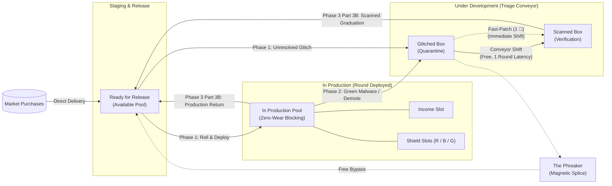
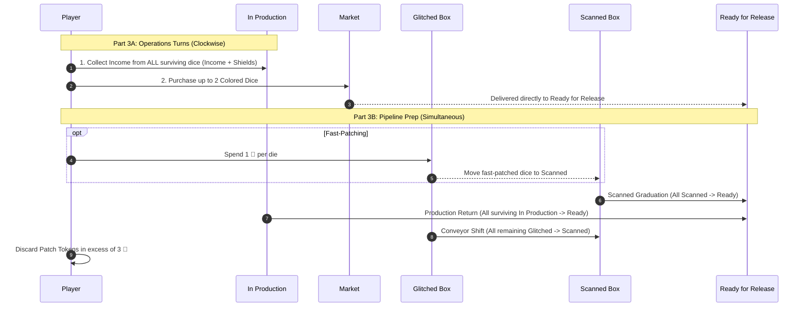
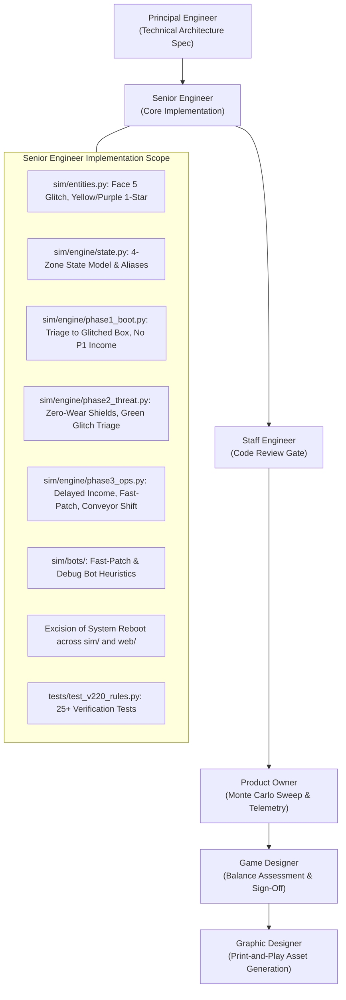

# Technical Architecture Specification: Phase 29 (v0.22.0)
## Streamlined CI/CD Player Board & Universal Glitch/Patch Overhaul

**Author:** Principal Engineer  
**Status:** Approved for Implementation  
**Target Version:** `v0.22.0`  
**Dependencies:** [RULES.md](../../RULES.md), [PLAN.md](../../PLAN.md)  
**Target Components:** `sim/`, `tests/`, `web/`, `pnp/`

---

## 1. Executive Summary & Architectural Motivation

Rogue Agent version `v0.22.0` introduces a foundational reimagining of player state and the dice maintenance loop. In earlier iterations (`v0.1`–`v0.21.0`), players managed a bifurcated dice pool: an **Active/Ready Zone** and an **Unpatched Zone**. When dice wore down or glitched, they were dumped into the Unpatched Zone and required cash or patch tokens to recover, creating potential soft-locks (which necessitated the patch-gap "System Reboot" band-aid) and heavy economic friction.

The `v0.22.0` architecture introduces the **Streamlined CI/CD Terminal Pipeline**:
1. **Ready for Release Zone**: Fully verified code modules staged and ready to deploy at round start.
2. **In Production Area**: Deployed modules fulfilling active operational contracts during the round:
   - **Income Slot**: Modules generating revenue (`$`), patch kits (`🔧`), and proprietary research (`Secrets`).
   - **Shield Slots** (`Red`, `Blue`, `Green`): Modules defending client infrastructure.
   - **Zero Dice Wear**: Successful defensive blocking incurs **zero wear**—shields remain safely deployed in In Production.
   - **Delayed Income Timing**: Income is collected in **Phase 3 Part 3A** from *all* surviving In Production dice (both Income and Shield slots). If a module is corrupted or glitched before Phase 3, its revenue is forfeited.
3. **Under Development Pipeline** (Two-Stage Conveyor):
   - **Glitched Box**: Corrupted modules quarantined for remediation.
   - **Scanned Box**: Remediated modules completing automated linting and verification.
   - **Natural Conveyor Progression**: Dice in Glitched naturally shift to Scanned at round end, graduating to Ready for Release at the end of the subsequent round at **zero patch cost**.
   - **Fast-Patching**: Players may spend **1 🔧** per die in Phase 3 Part 3B to accelerate a die from Glitched directly to Scanned (which immediately graduates to Ready for Release in the same phase).
4. **Universal Face 5 Glitch Template**:
   - All 5 colored module dice (Red, Blue, Green, Yellow, Purple) standardize on a uniform `d6` profile: 4 core faces, 1 Face 5 `Glitch (Locked)`, and 1 Face 6 `Star (★)`.
   - Commercial Exposure for Yellow is completely abolished.
5. **System Reboot Deprecation**:
   - Because dice naturally graduate via the CI/CD conveyor without cash requirements, the 0-Ready soft-lock is mathematically eliminated, allowing complete excision of System Reboot.



---

## 2. State Machine & Zone Migration

### 2.1 Entity Model: `sim/engine/state.py`

The core player container `PlayerState` is migrated from the legacy two-zone model (`ready_dice` + `unpatched_dice`) to the 3-zone, 4-container CI/CD pipeline.

#### Container Specifications

```python
from enum import Enum
from typing import List, Optional
from dataclasses import dataclass, field
from sim.entities import Die

class ProductionRole(str, Enum):
    """Assignment role of a die deployed In Production."""
    INCOME = "INCOME"
    RED_SHIELD = "RED_SHIELD"
    BLUE_SHIELD = "BLUE_SHIELD"
    GREEN_SHIELD = "GREEN_SHIELD"

@dataclass
class PlayerState:
    player_id: int
    bot: Any
    money: int
    secrets: int
    patches: int

    # --- CI/CD Pipeline Zones (v0.22.0 Canonical) ---
    ready_for_release_dice: List[Die] = field(default_factory=list)
    in_production_dice: List[Die] = field(default_factory=list)
    glitched_dice: List[Die] = field(default_factory=list)
    scanned_dice: List[Die] = field(default_factory=list)
    contractor_dice: List[Die] = field(default_factory=list)
    hired_contractor_count: int = 0

    # Resource and Telemetry Metrics
    is_patient_zero: bool = False
    elimination_round: Optional[int] = None
    elimination_reason: Optional[str] = None
    debt: int = 0
    breach_depth: int = 0
    unfulfilled_destructions: int = 0
    total_dirty_income_taken: int = 0
    total_contractors_hired: int = 0
    total_rerolls_used: int = 0
    hash_matches_secrets: int = 0

    # Star Special Eligibility Flags (Reset each round)
    b2_available: bool = False
    y1_available: bool = False
    p1_available: bool = False
    p3_available: Optional[ShieldColor] = None

    # Archetype State
    archetype: Optional[ArchetypeCard] = None
    ability_v1_status: AbilityStatus = AbilityStatus.AVAILABLE
    ability_v2_status: AbilityStatus = AbilityStatus.LOCKED
    ability_v3_status: AbilityStatus = AbilityStatus.LOCKED
```

### 2.2 In Production Sub-Slot Accessors

Every die entering `in_production_dice` receives a `production_role: Optional[ProductionRole]`. Sub-slot convenience properties provide deterministic, filtered views without list desynchronization:

```python
    @property
    def income_dice(self) -> List[Die]:
        """Modules in In Production producing cash, patches, or special abilities."""
        return [d for d in self.in_production_dice if getattr(d, "production_role", None) == ProductionRole.INCOME]

    @property
    def red_shield_dice(self) -> List[Die]:
        """Modules in In Production actively assigned to Red defense."""
        return [d for d in self.in_production_dice if getattr(d, "production_role", None) == ProductionRole.RED_SHIELD]

    @property
    def blue_shield_dice(self) -> List[Die]:
        """Modules in In Production actively assigned to Blue defense."""
        return [d for d in self.in_production_dice if getattr(d, "production_role", None) == ProductionRole.BLUE_SHIELD]

    @property
    def green_shield_dice(self) -> List[Die]:
        """Modules in In Production actively assigned to Green defense."""
        return [d for d in self.in_production_dice if getattr(d, "production_role", None) == ProductionRole.GREEN_SHIELD]

    @property
    def shield_dice(self) -> List[Die]:
        """All modules actively assigned to defense across Red, Blue, and Green."""
        return [d for d in self.in_production_dice if getattr(d, "production_role", None) in (
            ProductionRole.RED_SHIELD, ProductionRole.BLUE_SHIELD, ProductionRole.GREEN_SHIELD
        )]

    @property
    def under_development_dice(self) -> List[Die]:
        """All modules currently in the Under Development pipeline (Glitched + Scanned)."""
        return self.glitched_dice + self.scanned_dice
```

### 2.3 Backward Compatibility Invariants & Aliases

To preserve existing simulation benchmarks and tests during the migration window, `PlayerState` implements properties with bidirectional mutation synchronization:

```python
    @property
    def ready_dice(self) -> List[Die]:
        """Backward compatibility alias for ready_for_release_dice."""
        return self.ready_for_release_dice

    @ready_dice.setter
    def ready_dice(self, value: List[Die]) -> None:
        self.ready_for_release_dice = list(value)

    @property
    def unpatched_dice(self) -> List[Die]:
        """Backward compatibility alias mapping to under_development_dice (glitched + scanned)."""
        return self.glitched_dice + self.scanned_dice

    @unpatched_dice.setter
    def unpatched_dice(self, value: List[Die]) -> None:
        # Legacy tests setting unpatched_dice directly populate glitched_dice and clear scanned_dice
        self.glitched_dice = list(value)
        self.scanned_dice.clear()

    @property
    def total_dice(self) -> List[Die]:
        """All owned dice across all terminal zones (excludes temporary White contractors)."""
        return (
            self.ready_for_release_dice
            + self.in_production_dice
            + self.glitched_dice
            + self.scanned_dice
        )

    @property
    def colored_dice(self) -> List[Die]:
        """All owned non-Gray software module dice across all terminal zones."""
        return [d for d in self.total_dice if d.color != DieColor.GRAY and d.color != DieColor.WHITE]
```

---

## 3. Dice Face & Entity Updates in `sim/entities.py`

### 3.1 Universal 5-Color `d6` Profile

RULES.md Section 6A standardizes the 5 purchasable colored dice on a uniform template:
- **Faces 1–4:** 4 core thematic utility faces (Shields, Cash, Patches, Choice faces).
- **Face 5:** `Face(name="Glitch (Locked)", is_glitch=True)` — Hardware software anomaly that locks on roll.
- **Face 6:** `star_face` — 1 bespoke Special (`★`) face defined by the game's active Variant Card.

```
+---------------------------------------------------------------------------------------------------+
| Die Type        | Cost | Face 1       | Face 2  | Face 3  | Face 4               | Face 5  | Face 6   |
+---------------------------------------------------------------------------------------------------+
| Gray (Legacy)   | Start| Block 1 Any  | Blk 1Any| +$1     | +$1                  | +$1/+1🔧| +1 🔧    |
| White (Contract)| $1-3 | Block 1 Any  | Blk 1Any| Blk 1Any| +$1                  | GLITCH  | GLITCH   |
| Red (FinSec)    | $4   | Block 1 Red  | +$2     | +$2     | +$2                  | GLITCH  | Red ★    |
| Blue (Firewall) | $5   | Block 1 Blue | +1 🔧   | +$1     | Block 1 Blue / +1 🔧 | GLITCH  | Blue ★   |
| Green (Antivirus| $4   | Block 1 Green| +1 🔧   | +2 🔧   | +1 🔧 / +$1          | GLITCH  | Green ★  |
| Yellow (Commer.)| $5   | +$3          | +$2     | +$2     | +$1 & +1 🔧          | GLITCH  | Yellow ★ |
| Purple (BlackHat| $4   | Block 1 Any  | Blk 1Any| +$2     | +$1 & +1 🔧          | GLITCH  | Purple ★ |
+---------------------------------------------------------------------------------------------------+
```

### 3.2 Specific Die Factory Modifications

In `sim/entities.py:create_colored_die`:

1. **Red, Blue, Green**: Verify Face 5 is `Face(name="Glitch (Locked)", is_glitch=True)` and Face 6 is `star_face`.
2. **Yellow (Commercial AI)**:
   - *Previous:* Faces 5 and 6 were both duplicate `star_face` objects.
   - *New:* Face 5 is replaced with `Face(name="Glitch (Locked)", is_glitch=True)`. Face 6 retains a single `star_face`.
3. **Purple (Black-Hat AI)**:
   - *Previous:* Faces 5 and 6 were both duplicate `star_face` objects.
   - *New:* Face 5 is replaced with `Face(name="Glitch (Locked)", is_glitch=True)`. Face 6 retains a single `star_face`.
4. **White Contractor**: Retains 2 Glitches on Faces 5 and 6.
5. **Gray Starter**: Retains 0 Glitches (Face 5 is `+$1 / +1 🔧`, Face 6 is `+1 🔧`).

### 3.3 Deletion of Commercial Exposure Exception

The "Commercial Exposure" vulnerability (which forced Ready Yellow dice to be demoted first by Green malware before contractor sacrifice or other dice) is **completely removed** from all engine methods and bot decision routines. Yellow dice in `in_production_dice` follow standard triage rules without penalty.

---

## 4. Turn Flow & Engine Hooks (`sim/engine/`)

### 4.1 Phase 1: Roll & Deploy (`sim/engine/phase1_boot.py`)

#### Step-by-Step Flow:
1. **Autonomous Protocol Pulse:** SETEC generates 1 Black Cube placed into the `staging_cup`.
2. **Temp Staffing (Contractor Hiring):**
   - Players purchase White Contractor dice using progressive pricing ($1, $2, $3; max 3 dice).
   - *The Operator* may activate *Redundant Crew* to recruit up to 2 contractors for free.
   - Hired contractors are added to `player.contractor_dice`.
3. **Roll Ready Pool:**
   - Active pool for rolling = `player.ready_for_release_dice + player.contractor_dice`.
   - Dice currently in `glitched_dice` and `scanned_dice` are offline and **not** rolled.
4. **Yahtzee Rerolls & Debug Actions:**
   - Players have up to 2 free rerolls (3 rolls total).
   - Any die that rolls a `Glitch` face has `is_locked = True` immediately.
   - Active Corruption Track lock effects (`CASH`, `PATCH`, `SHIELD`) lock corresponding faces.
   - **Debug Action (`🔧` Utility):** Spend **1 🔧 token** to unlock 1 locked die (including Glitches), returning it to eligible rerolls.
   - *The Prodigy* (*Brute-Force Bypass*): May reroll locked dice freely without spending `🔧`, and turns 1 rolled die to any legal non-Star face.
5. **Post-Reroll Triage & Production Assignment:**
   - **Unresolved Glitches:**
     - Permanent module dice showing an unresolved `Glitch` face move **immediately** to `player.glitched_dice` in Under Development.
     - White Contractor dice showing an unresolved `Glitch` face are **immediately discarded to the supply** (Contractor Sacrifice).
     - Glitches do not produce outputs and do not affect other dice.
   - **Cryptographic Hash Matches:**
     - Inspect all remaining active non-glitched dice. Every triplet (3-of-a-kind exact output signature) awards **+1 Corporate Secret** (uncapped).
   - **Assignment to In Production:**
     - All remaining active dice move into `player.in_production_dice`.
     - Assign `production_role`:
       - `RED_SHIELD`, `BLUE_SHIELD`, `GREEN_SHIELD` for shield faces.
       - `INCOME` for money, patch, or non-shield star outputs.
       - Choice faces (`/`) are committed to either a Shield slot or the Income slot.
       - Generic (`ANY`) shields must be committed to Red, Blue, or Green before Phase 2 begins.
   - **INCOME DELAY INVARIANT:** No money, patch, or secret income is collected in Phase 1! All dice remain deployed in `in_production_dice` awaiting Phase 3 Part 3A.

### 4.2 Phase 2: Threat & Defense Resolution (`sim/engine/phase2_threat.py`)

#### Step 2A: Black Cubes & Corruption Track
- Exited Black cubes advance the active Version Corruption Track.
- **Demote / Glitch Dice Spaces:** When a corruption space specifies `demote_dice = X`:
  - Each player moves `X` dice from `player.in_production_dice` to `player.glitched_dice`.
  - Player prioritizes Income dice; if a Shield die is moved, its defensive shield block is revoked.

#### Step 2B: Attack Resolution (Zero Dice Wear & Green Malware)
1. **Defensive Shield Blocking (Zero Dice Wear):**
   - Each die assigned to a Shield slot in `in_production_dice` blocks 1 cube of its color (or 2 cubes if displaying a `Block 2` ability).
   - **CRITICAL INVARIANT:** Dice assigned to shields **DO NOT wear down or move to Under Development** when blocking! They absorb attacks cleanly and remain safely deployed in `in_production_dice`.
2. **Unblocked Attacks:**
   - **Red (Ransomware):** Lose $1 per unblocked Red cube (strictly cash-only ransom). Unpaid ransom leaks directly to Corporate Secrets: lose **1 Secret per unpaid $1**.
   - **Blue (Spyware):** Lose **1 Corporate Secret** per unblocked Blue cube. (*The Spook* can absorb up to 2 Secret loss via *Slush Fund*).
   - **Green (Malware):**
     - For each unblocked Green cube, move **1 active die from `in_production_dice` to `glitched_dice`**!
     - **Income Forfeiture:** Because this occurs before Phase 3, any die glitched by Green malware is removed from In Production and forfeits its Phase 3 income collection.
     - **Defensive Shield Sacrifice:** Players may choose to glitch a die in a Shield slot (which already completed its block) to protect a valuable Income die.
     - **Contractor Sacrifice:** Players may discard 1 active White contractor die to supply instead of glitching a permanent module die.
     - **Destruction Fallback:** If `in_production_dice` is empty, the player must **destroy (return to box) 1 die** from Under Development (`glitched_dice` or `scanned_dice`). If all zones are empty, record `unfulfilled_destructions += 1`.
   - **Patient Zero Check:** If Corporate Secrets reach `<= 0`, the player suffers a Total Data Breach, becomes Patient Zero, and is eliminated.
3. **Contractor Expiration & Recycle:**
   - Exited Red, Blue, Green cubes recycle to `staging_cup`.
   - All White contractor dice return to the general supply.

#### Step 2C: Final Round Check
- Triggered if Singularity is reached or 1+ players hit Patient Zero.
- Surviving players proceed to Phase 3 for one final operations turn.

### 4.3 Phase 3: Operations & Pipeline Prep (`sim/engine/phase3_ops.py`)

Phase 3 is divided into two sequential sub-phases:



#### Part 3A: Operations Turns (Clockwise)
1. **Collect Income & Special Outputs:**
   - Collect `$`, `🔧`, and immediate `★` outputs from **ALL dice remaining in `in_production_dice`** (both the Income slot and the Shield slots).
   - Modules glitched in Phase 1 or by Phase 2 Green malware/corruption are in `glitched_dice` and produce **0 outputs**.
   - Dual-output stars (e.g., Red Star R1 `Block 1 Red` + `+$2`, Green Star G1 `Block 2 Green` + `+1 🔧`) collect their secondary income outputs here.
   - Variant Y3 (*Proprietary Training*): Awards +1 Corporate Secret, then immediately moves this die to `player.glitched_dice`.
2. **Purchase Software Module Dice:**
   - Buy up to 2 colored dice from Market (paying $4 or $5).
   - Purchased dice enter `player.ready_for_release_dice` directly.
   - *The Cipher* (*Algorithmic Arbitrage*): $2 discount on 1 colored die purchase OR +$2 cash arbitrage.

#### Part 3B: Pipeline Prep & End-of-Round Staging (Simultaneous)
1. **Fast-Patching:**
   - Any player may spend **1 🔧 token** per die to move a die from `glitched_dice` to `scanned_dice`.
   - *The Phreaker* (*Magnetic Splice*): Moves 1 die from `glitched_dice` directly to `ready_for_release_dice` for free.
2. **Scanned Graduation:**
   - Move **all dice** in `player.scanned_dice` to `player.ready_for_release_dice`.
   - *(Note: Dice fast-patched in Step 1 graduate immediately to Ready for Release in the same phase!)*
3. **Production Return:**
   - Move **all surviving dice** in `player.in_production_dice` to `player.ready_for_release_dice`.
4. **Conveyor Shift:**
   - Move **all remaining dice** in `player.glitched_dice` into `player.scanned_dice`.
   - *(These dice sit offline during the next round, graduating naturally at the end of next round at zero patch cost).*
5. **Patch Token Cap:**
   - Discard any held Patch tokens in excess of **3 🔧** back to supply.
6. **Pass Lead Consultant Marker.**

---

## 5. Consultancy Archetypes Recalibration

| Archetype | Timing Window | Ability Name | Implementation Hook & Logic |
| :--- | :--- | :--- | :--- |
| **The Acoustic** | Phase 2 Step 2B | *Baffle Echo* | Ignore 1 Attack Cube (Red, Blue, Green) for yourself when resolving compiler damage. Exited cubes remain in tray and recycle normally. |
| **The Phreaker** | Phase 3 Part 3B | *Magnetic Splice* | Move **1 die** from `player.glitched_dice` directly to `player.ready_for_release_dice` for **free** (bypasses Scanned and saves 1 🔧). |
| **The Prodigy** | Phase 1 Step 4 | *Brute-Force Bypass* | During rerolls, include any number of Locked/Glitch dice in free rerolls without spending `🔧`. In addition, turn 1 rolled die to any legal non-Star face of choice. |
| **The Spook** | Phase 2 Step 2B | *Slush Fund* | Absorb up to 2 Corporate Secret loss (from Blue Spyware or unpaid Red Ransom) for free without paying cash. May spend cash at $1/Secret for additional absorption. |
| **The Cipher** | Phase 3 Part 3A | *Algorithmic Arbitrage* | Purchase 1 Colored Die at a **$2 discount**, OR collect an immediate **+$2 cash payout**. |
| **The Operator** | Phase 1 Step 2 | *Redundant Crew* | Hire up to **2 White Contractor Dice for free** (bypassing progressive contractor costs). |

---

## 6. Deprecation & Cleanup: Excision of System Reboot

### 6.1 Rationale
In earlier versions, when dice wore down into Unpatched, repairing them required cash ($2) or patch tokens. If a player had $0, 0 patches, and 0 ready dice, they were soft-locked. The "Once-per-Game System Reboot" was added as an emergency escape hatch.

In `v0.22.0`, the CI/CD Conveyor ensures that any die in the Glitched Box shifts to Scanned at the end of round $N$, and graduates to Ready for Release at the end of round $N+1$ with **zero monetary or patch cost**. Therefore, soft-locks are mathematically impossible.

### 6.2 Codebase Excision Plan
The following artifacts must be completely removed:
1. `PlayerState.system_reboot_used`, `PlayerState.can_system_reboot`, `PlayerState.execute_system_reboot()`.
2. `Phase3ActionPlan.use_system_reboot`, `BaseBot.should_trigger_system_reboot()`.
3. Engine hooks calling `execute_system_reboot()` in `sim/engine/phase3_ops.py`.
4. API schemas and endpoints: `/api/game/action/system_reboot` in `web/server.py`, `web/schemas.py`, `web/controller/game_controller.py`.
5. Frontend UI controls: `#btnSystemReboot` in `web/static/index.html` and Action Dock handlers in `web/static/js/components/action_dock.js`.

---

## 7. Bot Heuristics (`sim/bots/`)

### 7.1 Phase 3 Part 3B Fast-Patching Heuristic

Bots must decide how many Patch tokens (`🔧`) to spend moving dice from `glitched_dice` to `scanned_dice`:

```python
def choose_fast_patches(
    self,
    player_state: PlayerState,
    game_state: GameState,
    rng: random.Random,
) -> List[int]:
    """Returns indices in player_state.glitched_dice to fast-patch to scanned_dice.
    
    Heuristic Priorities:
    1. Patch Cap Avoidance: If player_state.patches > 3, ALWAYS spend down to <= 3
       to avoid discarding unspent patches at end-of-round cleanup.
    2. Infrastructure Need: If ready_for_release pool < 4 dice and incoming threat > 5,
       spend patches aggressively.
    3. Die Quality Sorting: Fast-patch colored dice first (higher output/defense value),
       leaving Gray starter dice to shift naturally along the conveyor.
    4. Final Round Valuation: In the final round, fast-patch colored dice into Ready
       to maximize Tiebreaker #2 (Active Colored Module Dice).
    """
```

### 7.2 Phase 1 Debug Action Heuristic

Bots evaluate whether to spend 1 `🔧` during Phase 1 rerolls to unlock a locked/glitched die:
- If a colored die showing a Glitch was rolled on Roll 1 or Roll 2, and the player has `patches >= 2` (or incoming threat demands immediate defense), spend 1 `🔧` to unlock and reroll.
- White contractor glitches are ignored (cannot be repaired; better to let them be sacrificed).
- Gray starter dice with locks/glitches are low priority for Phase 1 debug unlocking.

---

## 8. Web API & Serialization Schema Updates (`web/schemas.py`)

### 8.1 Serialization Schema Updates

`GameStateSerializer.serialize_player` must be updated to output the canonical CI/CD zones while preserving backward-compatible fields:

```json
{
  "player_id": 0,
  "name": "Consultancy Alpha",
  "is_human": true,
  "money": 7,
  "secrets": 8,
  "patches": 2,
  
  "ready_for_release_dice": [ ... ],
  "in_production_dice": [ ... ],
  "glitched_dice": [ ... ],
  "scanned_dice": [ ... ],
  "contractor_dice": [ ... ],
  
  "ready_dice": [ ... ],
  "unpatched_dice": [ ... ],
  
  "production_slots": {
    "income": [ ... ],
    "red_shield": [ ... ],
    "blue_shield": [ ... ],
    "green_shield": [ ... ]
  },
  
  "under_development_count": 0,
  "glitched_count": 0,
  "scanned_count": 0
}
```

### 8.2 Endpoint Migrations
- `POST /api/game/action/fast_patch`: Accepts `{"die_ids": [1, 4]}` to fast-patch selected dice from Glitched to Scanned.
- `POST /api/game/action/phreaker`: Accepts `{"die_id": 2}` to execute *Magnetic Splice* directly to Ready for Release.
- Deprecate `POST /api/game/action/system_reboot` (returns 410 Gone / 400 Bad Request with deprecation notice).

---

## 9. Verification & Unit Test Specification (`tests/test_v220_rules.py`)

A comprehensive test suite containing at least 25 targeted test cases across 6 distinct categories must be implemented in `tests/test_v220_rules.py`:

### Category 1: Universal Face 5 Glitch & Die Profiles
- `test_colored_dice_face5_glitch`: Assert Face 5 is `is_glitch=True` for Red, Blue, Green, Yellow, and Purple.
- `test_yellow_and_purple_single_star`: Assert Yellow and Purple have exactly 1 Star on Face 6 and 0 Stars on Face 5.
- `test_white_contractor_two_glitches`: Assert White Contractor has 2 Glitches (Faces 5 & 6).
- `test_gray_starter_zero_glitches`: Assert Gray Starter has 0 Glitches.
- `test_commercial_exposure_deleted`: Verify that an unblocked Green cube does NOT force Yellow dice to be glitched first.

### Category 2: State Machine & Zone Transitions
- `test_initial_state_ready_for_release`: Verify 4 Gray dice start in `ready_for_release_dice` and Under Development is empty.
- `test_zone_properties_and_aliases`: Verify `ready_dice` and `unpatched_dice` accessors mirror `ready_for_release_dice` and `glitched_dice + scanned_dice`.
- `test_in_production_role_accessors`: Verify `income_dice`, `red_shield_dice`, etc. correctly filter `in_production_dice`.

### Category 3: Phase 1 Roll, Reroll, Debug, & Glitch Triage
- `test_phase1_glitch_locking`: Assert rolling a Glitch face sets `is_locked = True`.
- `test_phase1_debug_action_unlock`: Verify spending 1 `🔧` unlocks a glitched die for subsequent rerolls.
- `test_phase1_unresolved_glitch_moves_to_glitched_box`: Verify permanent dice with unresolved glitches move to `glitched_dice`.
- `test_phase1_unresolved_contractor_glitch_discarded`: Verify White contractor with unresolved glitch returns to supply, not Under Development.
- `test_hash_matches_ignore_glitches`: Verify 3 of a kind yields +1 Secret, but Glitch faces never form matches.
- `test_no_income_collected_in_phase1`: Verify money/patches/secrets do not increase during Phase 1 deployment.

### Category 4: Phase 2 Zero-Wear Defense & Threat Resolution
- `test_defensive_shields_zero_dice_wear`: Assert shields that block attack cubes remain safely in `in_production_dice`.
- `test_red_ransom_cash_only_leak`: Assert unblocked Red drains cash, and unpaid cash leaks 1:1 to Corporate Secrets.
- `test_green_malware_glitches_in_production_die`: Verify unblocked Green moves 1 die from `in_production_dice` to `glitched_dice`.
- `test_green_malware_contractor_sacrifice`: Verify player can sacrifice 1 active White contractor instead of glitching a die.
- `test_green_malware_destruction_fallback`: Verify when `in_production_dice` is empty, unblocked Green destroys 1 die from Under Development.
- `test_green_glitched_die_forfeits_income`: Verify a die glitched by Green malware in Phase 2 yields 0 income in Phase 3.

### Category 5: Phase 3 Operations & Pipeline Prep
- `test_phase3_income_collected_from_all_production_dice`: Verify surviving Income and Shield dice yield their printed resources.
- `test_phase3_fast_patching`: Verify spending 1 `🔧` moves a die from `glitched_dice` to `scanned_dice`.
- `test_phase3_scanned_graduation`: Verify all dice in `scanned_dice` graduate to `ready_for_release_dice`.
- `test_phase3_production_return`: Verify all surviving `in_production_dice` return to `ready_for_release_dice`.
- `test_phase3_conveyor_shift`: Verify all remaining `glitched_dice` shift to `scanned_dice`.
- `test_natural_pipeline_graduation_lifecycle`: Trace a die through Glitched -> Scanned -> Ready over 2 rounds with 0 patch spent.
- `test_patch_token_cap_cleanup`: Verify patch tokens in excess of 3 `🔧` are discarded at round end.

### Category 6: Archetypes & System Reboot Excision
- `test_phreaker_magnetic_splice`: Verify Phreaker moves 1 die from `glitched_dice` directly to `ready_for_release_dice` for free.
- `test_prodigy_brute_force_bypass`: Verify Prodigy rerolls locked dice freely and overrides 1 face to a legal non-Star face.
- `test_system_reboot_excised`: Verify `can_system_reboot` and `execute_system_reboot` are completely removed.

---

## 10. Implementation Sequence & Agent Work Breakdown



1. **Phase 29 Step 1 (`principal-engineer`):** Deliver and ratify this Technical Architecture Specification.
2. **Phase 29 Step 2 (`senior-engineer`):**
   - Implement entity updates in `sim/entities.py`.
   - Implement zone state machine in `sim/engine/state.py`.
   - Update `sim/engine/phase1_boot.py`, `phase2_threat.py`, `phase3_ops.py`, `core.py`, and `end_game.py`.
   - Update bot decision heuristics in `sim/bots/`.
   - Excise System Reboot across engine, bots, and web schemas.
   - Author full test suite in `tests/test_v220_rules.py`. Verify 100% test pass via WSL.
3. **Phase 29 Step 3 (`staff-engineer`):** Perform line-by-line code review, verify state invariants and test coverage.
4. **Phase 29 Step 4 (`product-owner`):** Execute 3,000-match Monte Carlo sweep across 2P, 3P, and 4P pods (`scripts/run_v220_telemetry_sweep.py`).
5. **Phase 29 Step 5 (`game-designer`):** Review telemetry against target corridors (8–11 round pacing, 55–65% v3.0 reach, balanced patch economy), sign off in `FINDINGS.md`.
6. **Phase 29 Step 6 (`graphic-designer`):** Update `pnp/generate_pnp.py` board layouts to reflect the CI/CD player mat wireframe, remove System Reboot, and regenerate all 5 PnP PDFs.
