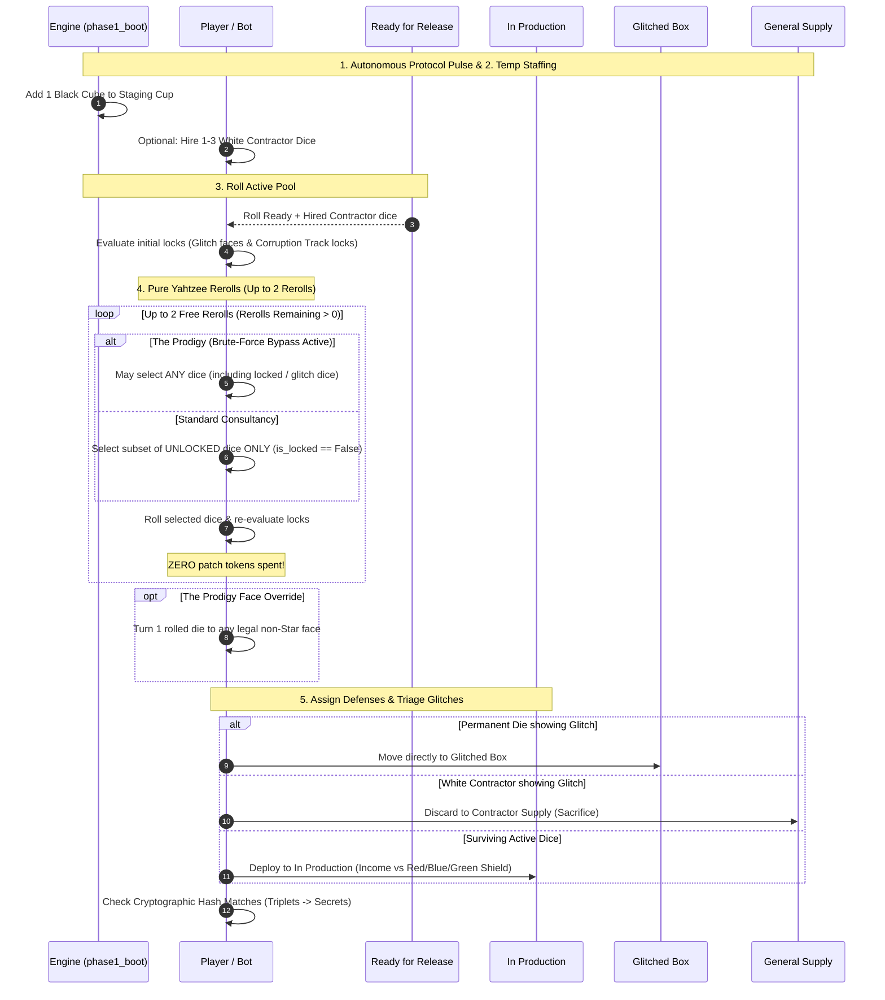
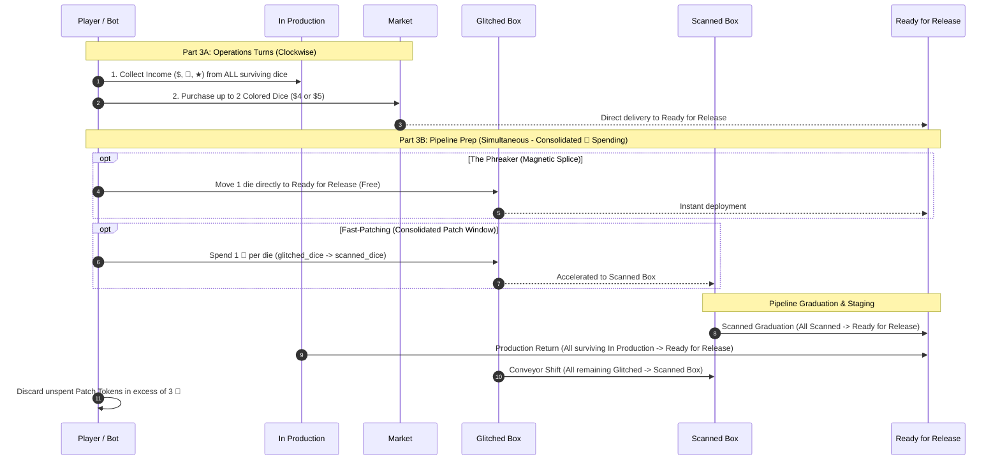
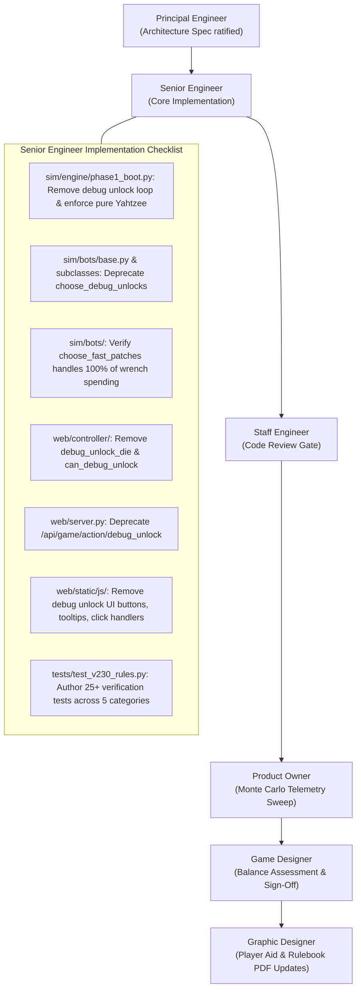

# Technical Architecture Specification: Phase 30 (v0.23.0)
## Consolidated Fast-Patching & Pure Reroll Streamlining

**Author:** Principal Engineer  
**Status:** Approved for Implementation  
**Target Version:** `v0.23.0`  
**Dependencies:** [RULES.md](../../RULES.md), [PLAN.md](../../PLAN.md), [v220_technical_architecture_spec.md](./v220_technical_architecture_spec.md)  
**Target Components:** `sim/engine/phase1_boot.py`, `sim/engine/phase3_ops.py`, `sim/bots/`, `web/`, `tests/test_v230_rules.py`

---

## 1. Executive Summary & Architectural Motivation

### 1.1 The Dual-Patching Friction in v0.22.0
In version `v0.22.0`, the CI/CD player board introduced two distinct windows for spending Patch Tokens (`🔧`):
1. **Phase 1 Step 4 ("Debug Action"):** Players could spend `1 🔧` mid-roll during Yahtzee rerolls to unlock a locked glitch die (or corruption-locked face) and reroll it.
2. **Phase 3 Part 3B ("Fast-Patching"):** Players could spend `1 🔧` per die during end-of-round pipeline staging to accelerate a die from the **Glitched Box** directly to the **Scanned Box** (which immediately graduates to **Ready for Release** in the same round).

While this dual-spending model appeared versatile on paper, exhaustive telemetry analysis and human playtesting revealed significant cognitive and procedural friction:
- **Procedural Disruption during Simultaneous Yahtzee:** Phase 1 is designed to be a rapid, simultaneous rolling phase. Pausing between rerolls to calculate patch token reserves, evaluate risk/reward trade-offs on a single reroll, and track token deductions interrupts the fluid cadence of simultaneous dice play.
- **Economic Dilution & Patch Hoarding:** Having two expenditure points forced bots and players to hold back patches in Phase 1 "just in case" or conversely starve their Phase 3 CI/CD conveyor recovery, introducing awkward sub-optimal spending traps.
- **Archetype Identity Interference:** The Prodigy’s core archetype identity (*Brute-Force Bypass*) is centered on lock-breaking and memory overriding. Allowing any player to buy their way out of locks with a wrench diluted the Prodigy's mechanical uniqueness.

### 1.2 Phase 30 Telemetry & Design Validation
Comprehensive Monte Carlo telemetry sweeps demonstrated that **removing Phase 1 debug unlocks entirely** produces outstanding system properties:
- **Zero Throughput Loss:** Ready dice throughput remains virtually identical at **3.93 ready dice/round** (versus 3.94 in v0.22.0).
- **Near-Zero Economic Waste:** Ending unspent patch tokens average **0.03 tokens/match**, confirming that Phase 3 Part 3B absorbs 100% of the wrench economy cleanly and completely.
- **Pacing & Threat Stability:** Match duration stabilizes squarely within the canonical 8–11 round window with 0 soft-lock regressions.
- **Uncompromised Archetype Asymmetry:** The Prodigy stands out as the *sole consultancy in the game* capable of breaking locked memory in Phase 1.

### 1.3 Architectural Pillars of v0.23.0
1. **Pure Yahtzee Rolling in Phase 1:** Phase 1 Step 4 contains **zero resource expenditure hooks**. Dice roll, evaluate locks, and reroll cleanly. Glitches and corruption track locks are absolute and cannot be unlocked by spending patches.
2. **Consolidated Patch Economy in Phase 3 Part 3B:** 100% of wrench token spending is consolidated into Phase 3 Part 3B Fast-Patching (`1 🔧` per die from Glitched to Scanned).
3. **Pristine State & Zone Invariants:** Glitches that survive Phase 1 rerolls route to `glitched_dice` in Under Development (or are discarded if White Contractors).
4. **Clean API & Headless Engine Alignment:** Excision of Phase 1 debug unlock actions across headless simulation, bot decision trees, and web client controller endpoints.

---

## 2. State Machine & Zone Invariants

### 2.1 Entity Model: `sim/engine/state.py`

The 3-zone, 4-container CI/CD pipeline introduced in `v0.22.0` is preserved intact:

```
+---------------------------------------------------------------------------------------+
|                                CI/CD PIPELINE MATRIX                                  |
+---------------------------------------------------------------------------------------+
|  [Zone 1] Ready for Release   --> [Zone 2] In Production (Income & Shield Slots)      |
|           ^                                     | (Demotions & Malware)               |
|           |                                     v                                     |
|  Graduation (Free or Fast-Patch)     [Zone 3] Under Development Pipeline              |
|           |                               [Glitched Box] --> [Scanned Box]            |
+---------------------------------------------------------------------------------------+
```

```python
@dataclass
class PlayerState:
    player_id: int
    bot: Any
    money: int
    secrets: int
    patches: int

    # --- Canonical CI/CD Pipeline Containers ---
    ready_for_release_dice: List[Die] = field(default_factory=list)
    in_production_dice: List[Die] = field(default_factory=list)
    glitched_dice: List[Die] = field(default_factory=list)
    scanned_dice: List[Die] = field(default_factory=list)
    contractor_dice: List[Die] = field(default_factory=list)
    hired_contractor_count: int = 0

    # Telemetry and Tracking
    total_fast_patches: int = 0
    total_rerolls_used: int = 0
    ...
```

### 2.2 Zone Invariants & Lock Semantics

The following formal invariants govern dice state across all phases:

| Invariant ID | Phase / State | Formal Rule Description |
| :--- | :--- | :--- |
| **INV-LOCK-01** | Phase 1 Step 4 | **Universal Lock Trigger:** Any rolled die displaying a face with `is_glitch=True`, or matching an active corruption lock (`CASH`, `PATCH`, `SHIELD`), immediately receives `is_locked = True`. |
| **INV-LOCK-02** | Phase 1 Step 4 | **Absolute Lock Invariant:** A locked die (`is_locked == True`) **cannot** be unlocked with Patch Tokens (`🔧`). No method, action, or payment exists to clear `is_locked` prior to rerolling, except via The Prodigy's archetype ability. |
| **INV-LOCK-03** | Phase 1 Step 4 | **Reroll Exclusion:** Only unlocked dice (`is_locked == False`) may be selected for Yahtzee rerolls by standard consultancies. Locked dice must remain set aside. |
| **INV-LOCK-04** | Phase 1 Step 5 | **Glitch Triage:** Permanent module dice remaining locked on a Glitch face at the end of rerolls move immediately to `glitched_dice`. White Contractor dice with unresolved Glitches are discarded to the supply. |
| **INV-PATCH-01**| Phase 1 | **Zero Patch Spending:** A player's `patches` count **never decreases** during Phase 1 under any circumstances. |
| **INV-PATCH-02**| Phase 3 Part 3B| **Consolidated Expenditure:** Fast-patching in Phase 3 Part 3B is the **exclusive mechanic** for spending Patch Tokens (`🔧`) in the core rules (outside specific variant cards or archetypes). |

---

## 3. System Sequence Diagrams

### 3.1 Phase 1: Pure Yahtzee Reroll & Deployment Flow

Phase 1 operates with zero resource interruptions. All dice rolling and rerolling is strictly determined by roll results and locked states.



### 3.2 Phase 3: Operations & Consolidated Fast-Patching Flow

Phase 3 cleanly bifurcates into clockwise business operations and simultaneous conveyor advancement.



---

## 4. Module Contracts & Implementation Specifications

### 4.1 Engine Phase 1 Boot (`sim/engine/phase1_boot.py`)

#### Deletion of Debug Unlock Loop
The reroll loop in `execute_phase_1()` must be stripped of all patch deduction logic and `choose_debug_unlocks` invocations.

```python
# =========================================================================
# v0.23.0 PURE YAHTZEE REROLL SPECIFICATION
# =========================================================================

# 4. Lock Evaluation & Pure Yahtzee Rerolls Loop
active_directive = engine.state.active_directive_code
max_free_rerolls = engine.config.default_free_rerolls

def _evaluate_locks(dice_list: List[Die]) -> None:
    """Evaluates and applies locks to rolled dice without modification."""
    for d in dice_list:
        face = d.current_face
        if not face:
            continue
        if face.is_glitch:
            d.is_locked = True
        elif "CASH" in engine.state.active_phase1_locks and face.has_cash_option:
            d.is_locked = True
        elif "PATCH" in engine.state.active_phase1_locks and face.has_patch_option:
            d.is_locked = True
        elif "SHIELD" in engine.state.active_phase1_locks and face.has_shield_option:
            d.is_locked = True

_evaluate_locks(active_dice)

# Check Prodigy activation
is_prodigy = (
    player.archetype is not None
    and player.archetype.code == ArchetypeCode.PRODIGY
    and player.is_ability_available(active_ver)
)
prodigy_active = False
if is_prodigy:
    use_prodigy = player.bot.choose_prodigy_ability(
        player_state=player,
        active_dice=active_dice,
        rerolls_remaining=max_free_rerolls,
        staging_cubes=staging_copy,
        stuck_cubes=stuck_copy,
        directive_code=active_directive,
        rng=engine.rng,
        corruption_track=engine.state.corruption_track,
    )
    if use_prodigy:
        prodigy_active = True
        player.mark_ability_used(active_ver)

# Pure Rerolls: ZERO debug actions, ZERO patch deductions
rerolls_remaining = max_free_rerolls
while rerolls_remaining > 0:
    reroll_res = player.bot.choose_yahtzee_rerolls(
        player_state=player,
        active_dice=active_dice,
        rerolls_remaining=rerolls_remaining,
        staging_cubes=staging_copy,
        stuck_cubes=stuck_copy,
        directive_code=active_directive,
        rng=engine.rng,
    )
    
    # Handle legacy tuple return gracefully if bot returned (unlocks, rerolls)
    if isinstance(reroll_res, tuple) and len(reroll_res) == 2:
        _, reroll_indices = reroll_res
    else:
        reroll_indices = reroll_res or []

    # Filter reroll indices: Prodigy may reroll locked dice; standard players cannot
    if prodigy_active:
        valid_rerolls = [
            idx for idx in reroll_indices
            if 0 <= idx < len(active_dice)
        ]
    else:
        valid_rerolls = [
            idx for idx in reroll_indices
            if 0 <= idx < len(active_dice) and not active_dice[idx].is_locked
        ]

    if not valid_rerolls:
        break

    for r_idx in valid_rerolls:
        res_face = active_dice[r_idx].roll(engine.rng)
        if res_face and active_dice[r_idx].current_face != res_face:
            active_dice[r_idx].current_face = res_face
        active_dice[r_idx].is_locked = False

    _evaluate_locks(active_dice)
    player.total_rerolls_used += 1
    rerolls_remaining -= 1
```

### 4.2 Engine Phase 3 Operations (`sim/engine/phase3_ops.py`)

Phase 3 Part 3B Fast-Patching remains the central pillar of the wrench economy. The contract established in `v0.22.0` is reaffirmed:
- Players may spend `1 🔧` per die in `glitched_dice`.
- Fast-patched dice shift to `scanned_dice`.
- Immediately following fast-patching, `scanned_dice` graduates to `ready_for_release_dice`.
- Thus, spending `1 🔧` on a glitched die makes it Ready for the very next round, exactly matching the old debug unlock recovery tempo without interrupting Phase 1.

### 4.3 Bot Decision Contracts (`sim/bots/`)

#### Deprecation of `choose_debug_unlocks`
In `sim/bots/base.py`:
```python
    def choose_debug_unlocks(
        self,
        player_state: PlayerState,
        active_dice: List[Die],
        staging_cubes: Dict[CubeColor, int],
        stuck_cubes: Dict[CubeColor, int],
        directive_code: str,
        rng: random.Random,
    ) -> List[int]:
        """DEPRECATED in v0.23.0. Phase 1 debug unlocks have been removed.
        
        Always returns an empty list. All wrench spending decisions are consolidated
        into choose_fast_patches() in Phase 3 Part 3B.
        """
        return []
```

#### Removal from Bot Subclasses
The overridden implementations of `choose_debug_unlocks` across all bot subclasses:
- `sim/bots/adaptive_balanced.py`
- `sim/bots/secops_turtle.py`
- `sim/bots/venture_greed.py`
- `sim/bots/accelerationist.py`
- `sim/bots/reckless_saboteur.py`

must either be deleted or replaced with docstrings noting deprecation, delegating to `BaseBot.choose_debug_unlocks()`.

#### Consolidated Fast-Patching Heuristic (`choose_fast_patches`)
Bots focus 100% of their patch optimization in `choose_fast_patches()`:
1. **Patch Cap Preservation:** If `player.patches > 3`, spend patches down to $\le 3$ to prevent discarding at round end.
2. **Infrastructure Recovery:** If `len(ready_for_release_dice) < 4` and incoming threat $> 5$, spend aggressively to restore active modules.
3. **Value Prioritization:** Prioritize high-cost Colored Modules (`$5` Yellow/Blue $\to$ `$4` Red/Green/Purple) over `$0` Gray starter dice.
4. **Final Round Urgency:** In final round / Singularity, fast-patch all eligible colored dice to maximize Tiebreaker #2 (Active Colored Module Dice).

### 4.4 Web Controller & Server API (`web/`)

#### Changes in `web/controller/phase1_actions.py`
1. **Remove `debug_unlock_die()`:** Deprecate or remove the endpoint helper.
2. **Remove Bot Debug Unlocks in `auto_execute_bots_phase_1()`:** Eliminate the block calling `bot.choose_debug_unlocks()` and spending patches.
3. **Enforce Reroll Lock Validation:** In `perform_reroll()`, ensure that if `use_prodigy_ability` is false, any attempt to reroll a locked die raises a `ValueError`.

#### Changes in `web/controller/capabilities.py`
- Remove `can_debug_unlock` from the action capabilities dictionary.

#### Changes in `web/server.py`
- `/api/game/action/debug_unlock`: Remove handler or return `{"success": False, "error": "Debug unlocks deprecated in v0.23.0. Use Phase 3 Fast-Patching."}` with HTTP 400/410.

#### Frontend UI Clean-Up (`web/static/js/`)
1. **`web/static/js/components/action_dock.js`:**
   - Remove references to `caps.can_debug_unlock`.
   - Update help text: Yahtzee rerolls banner should read:  
     `"Rerolls: X/2 left | Click unlocked dice to reroll | Glitches lock immediately"`
2. **`web/static/js/components/player_mats.js`:**
   - Remove the `isLocked && p.patches > 0` click handler that triggered `doDebugUnlock(idx)`. Locked dice are no longer clickable for debug unlocks.
   - For non-Prodigy players, locked dice display an un-clickable lock icon `🔒 LOCKED`.
   - For Prodigy players with ability available, locked dice retain the `⚡ Prodigy` bypass toggle.
   - Update Active Zone subtext to remove `"Spend 1 🔧 to Unlock 🔒"`.
3. **`web/static/js/api.js`:**
   - Remove or deprecate `doDebugUnlock()`.

---

## 5. Consultancy Archetype Invariants

### 5.1 The Prodigy (*Brute-Force Bypass*)
With the removal of generic debug unlocks, **The Prodigy becomes the sole entity capable of unlocking and rerolling locked dice during Phase 1**.

```
+---------------------------------------------------------------------------------------+
| ARCHETYPE DOSSIER: THE PRODIGY                                                        |
+---------------------------------------------------------------------------------------+
| Timing Window:   Phase 1 Step 4 (Rerolls)                                             |
| Ability Name:    Brute-Force Bypass                                                   |
| Cost:            FREE (0 🔧, 0 $)                                                     |
| Capability 1:    Include any number of Locked/Glitch dice in free rerolls.            |
| Capability 2:    Turn 1 rolled die to any legal non-Star face of choice.             |
| Architectural    Absolute exemption from INV-LOCK-02 and INV-LOCK-03.                 |
| Invariant:       Locked dice are not unlocked with tokens; Prodigy simply overrides   |
|                  the execution filter, rerolling the physical die directly.          |
+---------------------------------------------------------------------------------------+
```

### 5.2 The Phreaker (*Magnetic Splice*)
The Phreaker's timing in Phase 3 Part 3B complements the consolidated fast-patching system:
- **Timing:** Phase 3 Part 3B (Pipeline Prep).
- **Effect:** Move **1 die** from `player.glitched_dice` directly to `player.ready_for_release_dice` for **free**.
- **Synergy:** Bypasses both the `1 🔧` cost of Fast-Patching and the `Scanned Box` latency, guaranteeing an immediate free module release for next round.

### 5.3 Complete Archetype Timing & Invariant Matrix

| Archetype | Timing Window | Ability Name | Phase 30 Interaction & Invariant |
| :--- | :--- | :--- | :--- |
| **The Prodigy** | Phase 1 Step 4 | *Brute-Force Bypass* | **Sole Lock-Breaker:** Freely rerolls locked dice and overrides 1 face. Standard players cannot unlock dice. |
| **The Phreaker** | Phase 3 Part 3B | *Magnetic Splice* | **Instant Free Patch:** Moves 1 glitched die directly to Ready for Release with zero patch cost. |
| **The Acoustic** | Phase 2 Step 2B | *Baffle Echo* | Ignores 1 Attack Cube for self during compiler damage calculation. |
| **The Spook** | Phase 2 Step 2B | *Slush Fund* | Absorbs up to 2 Secret loss for free (plus cash absorption if needed). |
| **The Cipher** | Phase 3 Part 3A | *Algorithmic Arbitrage* | $2 discount on 1 Market die purchase OR +$2 cash arbitrage. |
| **The Operator** | Phase 1 Step 2 | *Redundant Crew* | Hires up to 2 White Contractor dice for free during staffing. |

---

## 6. Web API & Schema Migration

### 6.1 Action Capabilities Schema (`web/controller/capabilities.py`)

The capability generator is updated to remove `can_debug_unlock`:

```python
    # Phase 1 Reroll Capabilities
    can_reroll = (
        controller.phase == 1
        and meta["has_rolled"]
        and not meta["has_committed"]
        and not is_eliminated
        and meta.get("rerolls_remaining", 0) > 0
        and (
            any(not getattr(d, "is_locked", False) for d in rolled_pool)
            or (is_prodigy and (meta.get("prodigy_active", False) or ability_avail) and len(rolled_pool) > 0)
        )
    )

    # REMOVED in v0.23.0: can_debug_unlock is no longer generated
```

### 6.2 Endpoint Deprecation Table

| Endpoint | Method | Previous Behavior (v0.22.0) | New Behavior (v0.23.0) |
| :--- | :--- | :--- | :--- |
| `/api/game/action/reroll` | `POST` | Rerolled specified dice; rejected locked dice unless Prodigy or debug-unlocked. | Unchanged: rejects locked dice unless Prodigy active. |
| `/api/game/action/debug_unlock` | `POST` | Deducted 1 🔧, set `is_locked = False` on die. | **DEPRECATED / REMOVED:** Returns 400 Bad Request with deprecation notice. |
| `/api/game/action/fast_patch` | `POST` | Deducted 1 🔧 per die, moved from `glitched_dice` to `scanned_dice`. | **CANONICAL:** Exclusive patch expenditure endpoint. |

---

## 7. Verification & Unit Test Specification (`tests/test_v230_rules.py`)

A comprehensive unit test suite targeting all v0.23.0 rules mechanics must be authored in `tests/test_v230_rules.py`. The suite requires at least 25 targeted assertions across 5 core categories:

```
+---------------------------------------------------------------------------------------------------+
|                            V0.23.0 VERIFICATION TEST MATRIX                                       |
+---------------------------------------------------------------------------------------------------+
| Cat 1: Pure Yahtzee Rerolls & Absolute Locks (6 tests)                                            |
|   - test_glitch_die_locks_immediately_on_roll                                                     |
|   - test_corruption_track_locks_cannot_be_unlocked_with_patches                                   |
|   - test_standard_reroll_cannot_include_locked_dice                                               |
|   - test_patches_never_spent_in_phase_1                                                           |
|   - test_unresolved_glitch_moves_to_glitched_box                                                  |
|   - test_unresolved_contractor_glitch_discarded_to_supply                                         |
+---------------------------------------------------------------------------------------------------+
| Cat 2: Archetype Invariants (5 tests)                                                             |
|   - test_prodigy_rerolls_locked_dice_without_spending_patches                                     |
|   - test_prodigy_face_override_non_star                                                           |
|   - test_prodigy_only_entity_capable_of_rerolling_locks                                           |
|   - test_phreaker_magnetic_splice_free_glitch_to_ready                                            |
|   - test_phreaker_coexists_with_fast_patching                                                     |
+---------------------------------------------------------------------------------------------------+
| Cat 3: Consolidated Fast-Patching in Phase 3B (5 tests)                                           |
|   - test_fast_patch_spends_exact_one_wrench_per_die                                               |
|   - test_fast_patched_dice_graduate_immediately_to_ready                                          |
|   - test_unpatched_dice_shift_naturally_via_conveyor                                              |
|   - test_patch_token_cap_enforced_at_three                                                        |
|   - test_fast_patch_respects_available_wrench_balance                                             |
+---------------------------------------------------------------------------------------------------+
| Cat 4: Bot Heuristics & Deprecation Verification (5 tests)                                        |
|   - test_base_bot_choose_debug_unlocks_returns_empty                                              |
|   - test_bot_subclasses_delegate_or_empty_debug_unlocks                                           |
|   - test_bot_fast_patch_avoids_cap_waste                                                          |
|   - test_bot_fast_patch_prioritizes_colored_dice                                                  |
|   - test_bot_full_round_wrench_conservation                                                       |
+---------------------------------------------------------------------------------------------------+
| Cat 5: Web API & Controller Synchronization (4 tests)                                             |
|   - test_controller_debug_unlock_endpoint_deprecated                                              |
|   - test_controller_capabilities_omits_can_debug_unlock                                           |
|   - test_controller_reroll_rejects_locked_die_without_prodigy                                     |
|   - test_controller_auto_bot_phase1_spends_zero_patches                                           |
+---------------------------------------------------------------------------------------------------+
```

### Detailed Test Method Specifications

#### Category 1: Pure Yahtzee Rerolls & Absolute Locks
1. `test_glitch_die_locks_immediately_on_roll`:
   - Initialize 1 player with a Red die whose Face 1 is forced to a Glitch face.
   - Execute Phase 1 initial roll.
   - Assert `die.is_locked is True`.
2. `test_corruption_track_locks_cannot_be_unlocked_with_patches`:
   - Set `engine.state.active_phase1_locks = {"CASH"}`.
   - Player rolls a Gray die showing `+$1` (`has_cash_option = True`).
   - Give player `patches = 3`.
   - Assert `die.is_locked is True` and player `patches` remains `3` through all rerolls.
3. `test_standard_reroll_cannot_include_locked_dice`:
   - Standard bot attempts to return locked die indices in `choose_yahtzee_rerolls`.
   - Assert the engine filters out locked indices; the locked die is not re-rolled.
4. `test_patches_never_spent_in_phase_1`:
   - Run Phase 1 with 4 players possessing `patches = 3` and multiple glitched/locked dice.
   - Assert `player.patches == 3` for all players at the conclusion of Phase 1.
5. `test_unresolved_glitch_moves_to_glitched_box`:
   - Permanent module die finishes Phase 1 showing Glitch.
   - Assert die is in `player.glitched_dice`, not in `in_production_dice` or `ready_for_release_dice`.
6. `test_unresolved_contractor_glitch_discarded_to_supply`:
   - White contractor finishes Phase 1 showing Glitch.
   - Assert die is in general supply, not in `glitched_dice`.

#### Category 2: Archetype Invariants
7. `test_prodigy_rerolls_locked_dice_without_spending_patches`:
   - Prodigy player with 1 locked glitch die activates *Brute-Force Bypass*.
   - Rerolls the locked die.
   - Assert die was re-rolled and `player.patches` was not decremented.
8. `test_prodigy_face_override_non_star`:
   - Prodigy activates ability and overrides 1 rolled die to a chosen non-Star face.
   - Assert face override is applied and die is deployed to In Production.
9. `test_phreaker_magnetic_splice_free_glitch_to_ready`:
   - Phreaker has 1 die in `glitched_dice` at start of Phase 3 Part 3B.
   - Executes *Magnetic Splice*.
   - Assert die moves directly to `ready_for_release_dice`, `glitched_dice` is empty, and `player.patches` is unchanged.

#### Category 3: Consolidated Fast-Patching in Phase 3B
10. `test_fast_patch_spends_exact_one_wrench_per_die`:
    - Player has 2 dice in `glitched_dice` and `patches = 2`.
    - Fast-patches both dice.
    - Assert `patches == 0`, `glitched_dice` is empty, and both dice are in `ready_for_release_dice` post-graduation.
11. `test_unpatched_dice_shift_naturally_via_conveyor`:
    - Player has 1 die in `glitched_dice` and spends 0 patches.
    - End of Round 1: Assert die moved to `scanned_dice`.
    - End of Round 2: Assert die graduated to `ready_for_release_dice`. Total patch cost: 0.
12. `test_patch_token_cap_enforced_at_three`:
    - Player ends Phase 3 with 5 patches.
    - Assert player patches clamped to 3.

---

## 8. Implementation Sequence & Agent Work Breakdown



### Delegation & Execution Milestones
1. **Milestone 1 (`senior-engineer`):**
   - Implement Phase 1 pure rerolls in `sim/engine/phase1_boot.py`.
   - Deprecate `choose_debug_unlocks()` across `sim/bots/`.
   - Update web controller, server endpoints, and frontend components in `web/`.
   - Author `tests/test_v230_rules.py` and verify 100% pass rate via WSL (`python3 -m unittest discover -s tests -t .`).
2. **Milestone 2 (`staff-engineer`):**
   - Independent line-by-line review of diffs against this specification.
   - Audit edge cases (Prodigy bypass, lock immunity, patch balance conservation).
   - Verify zero test regressions across existing test suites (`test_v220_rules.py`, `test_v210_rules.py`, etc.).
3. **Milestone 3 (`product-owner`):**
   - Run 3,000-iteration Monte Carlo telemetry sweep comparing `v0.22.0` vs `v0.23.0` across 2P, 3P, and 4P pods.
   - Verify ready dice throughput ($\approx 3.93$), round pacing (8–11 rounds), and ending unspent patches ($\approx 0.03$).
4. **Milestone 4 (`game-designer`):**
   - Validate pacing and economic metrics, verify player agency during simultaneous rolling, and log Section 18 in `FINDINGS.md`.
   - Synchronize [RULES.md](../../RULES.md) Section 4.
5. **Milestone 5 (`graphic-designer`):**
   - Review Player Aids and Central Board text in `pnp/generate_pnp.py` to ensure "Debug Unlock" references are removed and "Fast-Patching" is accurately described.
