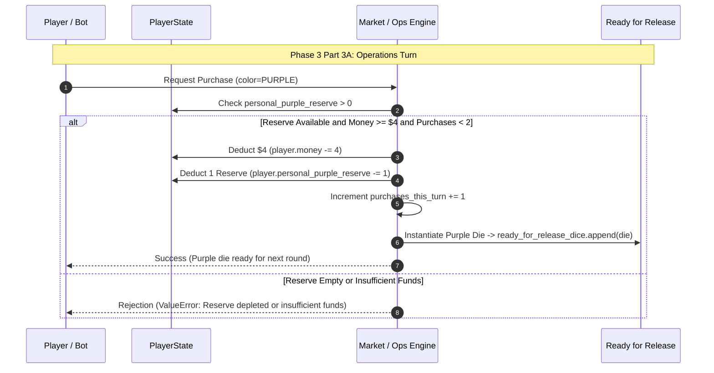
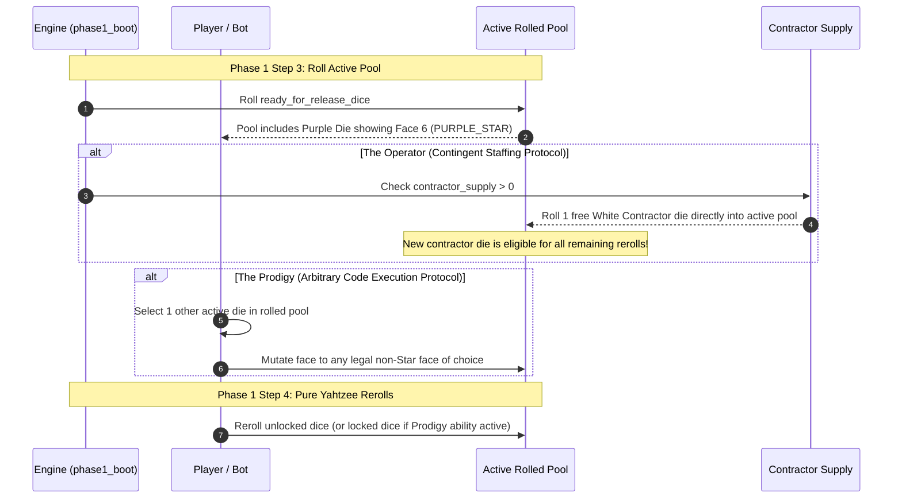
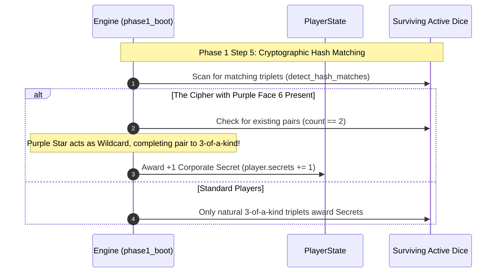
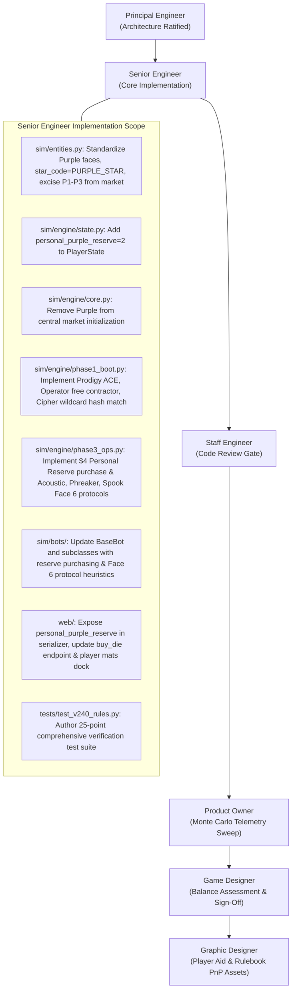

# Technical Architecture Specification: Phase 31 (v0.24.0)
## Proprietary Specialist (Purple) Dice Overhaul & Personal Reserve

**Author:** Principal Engineer  
**Status:** Approved for Implementation  
**Target Version:** `v0.24.0`  
**Dependencies:** [RULES.md](../../RULES.md), [PLAN.md](../../PLAN.md), [v230_technical_architecture_spec.md](./v230_technical_architecture_spec.md), [v220_technical_architecture_spec.md](./v220_technical_architecture_spec.md)  
**Target Components:** `sim/entities.py`, `sim/engine/state.py`, `sim/engine/core.py`, `sim/engine/phase1_boot.py`, `sim/engine/phase3_ops.py`, `sim/bots/`, `web/`, `tests/test_v240_rules.py`

---

## 1. Executive Summary & Architectural Motivation

### 1.1 The Market Clutter & Dual-Specialist Dilemma in v0.23.0
Prior to `v0.24.0`, the Software Module Market featured five purchasable colored die stacks: Red, Blue, Green, Yellow, and Purple. This 5-color market design introduced subtle yet persistent structural flaws:
1. **Redundant Specialist Role:** Both Yellow and Purple operated as general "Specialist" / "Utility" dice without clean economic differentiation. Yellow provided high raw cash ($3, $2, $2, $1 & 1 🔧) and corporate secrets, while Purple provided wild blocks and chaotic market injection mechanics (e.g. variants P1, P2, P3). In practice, bots and human players struggled to identify distinct strategic lanes between Yellow and Purple.
2. **Market Dilution & Draft Denial:** With 5 colored stacks of $2 \times N$ dice each, the central market pool comprised 20 to 40 dice. Players could easily draft redundant specialist dice or conversely hoard Purple dice to deny wild blocks to vulnerable competitors, distorting the intended competitive tension.
3. **Underdeveloped Archetype Asymmetry:** While Rogue Agent's 6 Consultancy Archetypes introduced distinct Once-per-Version abilities in `v0.9.0`, their mechanical footprint across standard turn-to-turn play remained passive. Archetypes lacked a recurring physical vector on the dice themselves to express their technical specialization.

### 1.2 Phase 31 Design Validation & Architecture Decisions
Following comprehensive mathematical modeling and game design sign-off, `v0.24.0` fundamentally restructures the specialist economy:
- **Excision of Purple from the Central Market:** The central market is streamlined to exactly four colored module stacks: **Red**, **Blue**, **Green**, and **Yellow** ($2 \times N$ dice each). Yellow is solidified as the pure commercial capital engine ($5 cost, cash generation, proprietary training).
- **Introduction of the Personal Reserve:** Each player is equipped with a private, non-draftable **Personal Reserve** containing exactly **2 Purple Specialist Dice**. These dice are insulated from central market competition and opponent interference.
- **On-Demand Private Procurement:** In Phase 3 Part 3A (Operations), a player may invest **$4** to purchase 1 Purple die from their Personal Reserve, deploying it directly to `ready_for_release_dice`. This purchase consumes one of the player's 2 standard purchase slots for the round.
- **Universal Standardized Faces (Faces 1–5):** Purple dice feature high-reliability baseline capabilities: two `Block 1 Any` faces, one `+$2` cash face, one `+$1 & +1 🔧` utility face, and one universal `Glitch (Locked)` face.
- **Archetype Signature Protocols (Face 6):** Face 6 is no longer governed by market variant cards (P1, P2, P3 are retired). Instead, rolling Face 6 (`Purple ★`) triggers the player's bespoke **Archetype Signature Protocol**, granting recurring, turn-to-turn tactical asymmetry tailored to that consultancy's core identity.

### 1.3 Architectural Pillars of v0.24.0
1. **Absolute Reserve Insulation (INV-PURPLE-01):** Personal Reserve dice are stored in `player.personal_purple_reserve`. They cannot be bought, drafted, stolen, or destroyed by opponents, nor returned by central board corruption track triggers.
2. **Streamlined 4-Color Market Supply (INV-PURPLE-02):** Central market setup contains only Red, Blue, Green, and Yellow module stacks.
3. **Controlled Capital Conversion (INV-PURPLE-03):** Procuring a Purple die costs $4, decrements `personal_purple_reserve`, delivers directly to `ready_for_release_dice`, and counts against the turn limit of 2 dice purchases.
4. **Standardized Dual-Shield Baseline (INV-PURPLE-04):** Faces 1–5 are fixed across all consultancies, providing flexible `Block 1 Any` defense, liquidity, and a 1-in-6 glitch risk.
5. **Decoupled Signature Protocol Dispatch (INV-PURPLE-05):** Face 6 execution is dynamically dispatched to specialized handlers across Phase 1 and Phase 3 based on `player.archetype.code`.

---

## 2. State Machine & Zone Invariants

### 2.1 Entity Model & Zone Topology

```
+---------------------------------------------------------------------------------------------------+
|                                 v0.24.0 PLAYER MAT & POOL TOPOLOGY                                |
+---------------------------------------------------------------------------------------------------+
|  [ZONE 0: PERSONAL RESERVE]                                                                       |
|  * personal_purple_reserve: int = 2 (Insulated, un-rolled, un-draftable private reserve)           |
|                               |                                                                   |
|                               v ($4 Phase 3A Purchase)                                            |
|  [ZONE 1: READY FOR RELEASE]  ===========================> [ZONE 2: IN PRODUCTION]                |
|  * Ready dice pool            (Roll, Rerolls, Hash Matches) * Income & Shield Slots               |
|                                                              | (Malware / Demotions)              |
|                               v                              v                                    |
|  [ZONE 3: UNDER DEVELOPMENT PIPELINE] <----------------------+                                    |
|  * [Glitched Box] --------(1 🔧 Fast-Patch or Natural Shift)--------> [Scanned Box]                |
+---------------------------------------------------------------------------------------------------+
|  [CENTRAL MARKET SUPPLY]                                                                          |
|  * 4 Stacks ONLY: Red ($4), Blue ($5), Green ($4), Yellow ($5) [2 * Players per color]            |
|  * Purple completely removed from Central Market                                                  |
+---------------------------------------------------------------------------------------------------+
```

### 2.2 Formal Invariant Definitions

The following system invariants govern Purple Specialist dice, Personal Reserves, and Signature Protocols:

| Invariant ID | Phase / State | Formal Specification |
| :--- | :--- | :--- |
| **INV-PURPLE-01** | Setup & Lifespan | **Personal Reserve Insulation:** Each player starts the match with exactly 2 Purple dice in their Personal Reserve (`personal_purple_reserve: int = 2`). Reserve dice do not exist in the active physical pool until purchased. They cannot be targeted, drafted, or destroyed by opponents, nor affected by central corruption track demotions or market returns. |
| **INV-PURPLE-02** | Setup & Market | **Central Market Exclusion:** The central market contains exactly 4 colored die stacks: Red, Blue, Green, and Yellow, each seeded with $2 \times \text{num\_players}$ dice. Purple is completely removed from the central market supply (`market.get(DieColor.PURPLE)` is not present in market stock). |
| **INV-PURPLE-03** | Phase 3 Part 3A | **Reserve Purchase Semantics:** During their Operations turn, a player may pay **$4** to purchase 1 die from their Personal Reserve (`personal_purple_reserve -= 1`). The newly instantiated Purple die is delivered directly to `ready_for_release_dice`. This counts towards the per-turn limit (`max_market_purchases_per_turn = 2`). |
| **INV-PURPLE-04** | Die Creation | **Standardized Face Geometry:** Every Purple Specialist die possesses the invariant face configuration:<br>• **Faces 1 & 2:** `Block 1 Any` (`block_amount=1, shield_color=ShieldColor.ANY`)<br>• **Face 3:** `+$2` (`money=2`)<br>• **Face 4:** `+$1 & +1 🔧` (`money=1, patches=1`)<br>• **Face 5:** `Glitch (Locked)` (`is_glitch=True, is_locked=True`)<br>• **Face 6:** `Purple ★` (`is_star=True, star_code="PURPLE_STAR"`) |
| **INV-PURPLE-05** | Phase 1 & 3 Execution | **Archetype Signature Protocols:** Rolling Face 6 (`Purple ★`) executes the specific protocol bound to the player's consultancy archetype:<br>• **Acoustic:** Phase 3A Income: +$1 per unique cube color in Exit Tray (R, B, G, K; max +$4).<br>• **Phreaker:** Phase 3A Ops: Roll 1 die in Under Development; harvest rolled cash/patches; die remains in place.<br>• **Prodigy:** Phase 1 Step 4: Turn 1 other rolled die to any legal non-Star face of choice.<br>• **Spook:** Phase 3A Ops: +$2 cash; optional burn 1 owned colored die to market for +1 Corporate Secret.<br>• **Cipher:** Phase 1 Step 5: Wildcard completing a pair into a 3-of-a-kind triplet (+1 Secret); Phase 3A Income: +$2.<br>• **Operator:** Phase 1 Step 4: Immediately roll 1 free White Contractor die into rolled pool. |

---

## 3. System Sequence Diagrams & Workflows

### 3.1 Phase 3 Part 3A: Purchasing from Personal Reserve



### 3.2 Phase 1: Prodigy & Operator Face 6 Protocols During Rolling



### 3.3 Phase 1 Step 5: Cipher Wildcard Triplet Hash Matching



### 3.4 Phase 3 Part 3A: Acoustic, Spook, and Phreaker Protocol Execution

```mermaid
sequenceDiagram
    autonumber
    participant P as Player / Bot
    participant Ops as phase3_ops Engine
    participant Tray as Tower Exit Tray
    participant UD as Under Development
    participant Mkt as Central Market

    Note over P, Ops: Phase 3 Part 3A: Operations & Income
    alt The Acoustic (Resonance Sensor)
        Ops->>Tray: Inspect exited cubes this round (R, B, G, K)
        Tray-->>Ops: Return unique color count N (min 0, max 4)
        Ops->>P: Award +$N extra income (player.money += N)
    end

    alt The Spook (Burn Notice)
        Ops->>P: Award base +$2 cash (player.money += 2)
        opt Optional Burn Notice Execution
            P->>Mkt: Return 1 owned colored die to market
            Ops->>P: Award +1 Corporate Secret (player.secrets += 1)
        end
    end

    alt The Phreaker (Jumper Diagnostics)
        P->>UD: Select 1 die in Glitched or Scanned Box
        UD->>UD: Roll selected die in-place
        UD-->>Ops: Evaluates face (Shields/Glitches=0; Cash/Patches harvested)
        Ops->>P: Award harvested cash and patches
        Note over UD: Die remains in Glitched/Scanned box; NOT repaired!
    end
```

---

## 4. Module Contracts & Implementation Specifications

### 4.1 Entities & Factory Specification (`sim/entities.py`)

#### Update `create_colored_die` for Purple
Purple dice must be constructed with the canonical 6 faces defined in INV-PURPLE-04. The setup variant card argument is optional and unused for Purple.

```python
# In sim/entities.py
def create_colored_die(
    color: DieColor,
    die_id: int,
    variant_card: Optional[VariantCard] = None,
) -> Die:
    ...
    elif color == DieColor.PURPLE:
        star_face = Face(
            name="Purple ★",
            is_star=True,
            star_code="PURPLE_STAR",
        )
        faces = [
            Face(name="Block 1 Any", block_amount=1, shield_color=ShieldColor.ANY),
            Face(name="Block 1 Any", block_amount=1, shield_color=ShieldColor.ANY),
            Face(name="+$2", money=2),
            Face(name="+$1 & +1 🔧", money=1, patches=1),
            glitch_face,  # Face("Glitch (Locked)", is_glitch=True, is_locked=True)
            star_face,
        ]
        return Die(die_id=die_id, color=color, cost=4, vp=0, faces=faces, variant_code="PURPLE_STAR")
```

#### Variant Deck Excision
In `get_all_variant_cards()`, `get_default_variant_cards()`, and `get_random_variant_cards()`, cards `P1`, `P2`, and `P3` are deprecated and excluded from the active market variant pool. Variant card drafting only applies to `RED`, `BLUE`, `GREEN`, and `YELLOW`.

```python
def get_default_variant_cards() -> Dict[DieColor, VariantCard]:
    """Returns baseline variant cards for central market dice (Red, Blue, Green, Yellow)."""
    all_cards = get_all_variant_cards()
    return {
        DieColor.RED: all_cards["R1"],
        DieColor.BLUE: all_cards["B1"],
        DieColor.GREEN: all_cards["G1"],
        DieColor.YELLOW: all_cards["Y1"],
    }
```

### 4.2 Engine State Specification (`sim/engine/state.py`)

#### PlayerState Data Model
Extend `PlayerState` with `personal_purple_reserve: int = 2`:

```python
@dataclass
class PlayerState:
    player_id: int
    bot: BaseBot
    money: int
    secrets: int
    patches: int

    # --- CI/CD Pipeline Zones (v0.22.0 Canonical) ---
    ready_for_release_dice: List[Die] = field(default_factory=list)
    in_production_dice: List[Die] = field(default_factory=list)
    glitched_dice: List[Die] = field(default_factory=list)
    scanned_dice: List[Die] = field(default_factory=list)
    contractor_dice: List[Die] = field(default_factory=list)
    hired_contractor_count: int = 0

    # --- Personal Reserve (v0.24.0 Canonical) ---
    personal_purple_reserve: int = 2  # INV-PURPLE-01: Exactly 2 Purple dice per player
    
    # Archetype Protocol Ephemeral State
    purple_star_available: bool = False
    purple_star_count: int = 0
    ...
```

#### Update `GameState.market` in `sim/engine/core.py`
In `GameEngine.__init__()`, initialize `market` containing exclusively Red, Blue, Green, and Yellow stacks:

```python
# sim/engine/core.py
market_per_color = config.dice_per_color_multiplier * config.num_players
market: Dict[DieColor, int] = {
    DieColor.RED: market_per_color,
    DieColor.BLUE: market_per_color,
    DieColor.GREEN: market_per_color,
    DieColor.YELLOW: market_per_color,
}
# Purple is deliberately omitted from central market (INV-PURPLE-02)
```

### 4.3 Phase 1 Boot & Configure (`sim/engine/phase1_boot.py`)

#### 1. The Operator: Contingent Staffing Face 6 Trigger
During initial roll or rerolls, if an Operator player rolls a Purple die showing `PURPLE_STAR` and has not yet triggered Contingent Staffing this turn:
- Check `engine.state.contractor_supply > 0`.
- Deduct 1 from `contractor_supply`.
- Create a new White Contractor die (`create_white_die`).
- Immediately roll the contractor die using `engine.rng`.
- Append the contractor die to `active_dice` and `player.contractor_dice`.
- The new contractor die is eligible for rerolls with remaining `rerolls_remaining`.

#### 2. The Prodigy: Arbitrary Code Execution Face 6 Trigger
When a Prodigy player rolls a Purple die showing `PURPLE_STAR`:
- Call `player.bot.choose_prodigy_purple_star_override(player, active_dice, rng)`.
- If a target die index and target face are selected (where `target_face.is_star is False`), mutate `active_dice[target_idx].current_face = target_face`.

#### 3. The Cipher: Wildcard Triplet Hash Matching
Update `detect_hash_matches()` or provide a Cipher-aware matching helper:

```python
def detect_hash_matches_with_cipher(
    dice: List[Die],
    is_cipher: bool = False,
) -> int:
    """Calculates Corporate Secrets gained from triplets.
    
    If is_cipher is True and a Purple die showing PURPLE_STAR is present in dice,
    one Purple Star acts as a wildcard completing any natural pair (count == 2)
    into a 3-of-a-kind triplet.
    """
    counts: Dict[Tuple, int] = {}
    purple_star_wildcards = 0

    for d in dice:
        eff = d.effective_face
        if not eff or eff.is_glitch:
            continue
        if is_cipher and eff.is_star and eff.star_code == "PURPLE_STAR":
            purple_star_wildcards += 1
            continue
        sig = get_face_signature(eff)
        if sig is not None:
            counts[sig] = counts.get(sig, 0) + 1

    secrets_gained = 0
    # Natural triplets
    for sig, count in list(counts.items()):
        secrets_gained += count // 3
        counts[sig] = count % 3

    # Cipher wildcard resolution
    if is_cipher and purple_star_wildcards > 0:
        for sig, remainder in counts.items():
            if remainder == 2 and purple_star_wildcards > 0:
                secrets_gained += 1
                purple_star_wildcards -= 1

    return secrets_gained
```

### 4.4 Phase 3 Operations (`sim/engine/phase3_ops.py`)

#### 1. Operations Turn: Purchasing from Personal Reserve
In `execute_phase_3()`, within Part 3A Market Purchases:

```python
# Phase 3 Part 3A: Purchasing
for color in plan.market_purchases:
    if purchased_count >= engine.state.config.max_market_purchases_per_turn:
        break
    
    if color == DieColor.PURPLE:
        # INV-PURPLE-03: Purchase from Personal Reserve
        cost = 4
        # Apply Cipher discount if applicable
        if cipher_discount_applied and not cipher_discount_consumed:
            cost = max(0, cost - engine.state.config.cipher_market_discount)
            cipher_discount_consumed = True
            
        if player.personal_purple_reserve > 0 and player.money >= cost:
            player.money -= cost
            player.personal_purple_reserve -= 1
            purchased_count += 1
            new_die = create_colored_die(
                color=DieColor.PURPLE,
                die_id=engine.state.next_die_id,
            )
            engine.state.next_die_id += 1
            player.ready_for_release_dice.append(new_die)
    else:
        # Standard central market purchase (Red, Blue, Green, Yellow)
        ...
```

#### 2. Archetype Protocol Face 6 Resolution in Phase 3A
When harvesting income from `player.in_production_dice`:
- **The Acoustic (Resonance Sensor):**
  If `PURPLE_STAR` is in production, inspect `engine.state.tower.last_exited_cubes` (or Exit Tray telemetry). Count unique colors among exited cubes (`len({c for c, count in exited_cubes.items() if count > 0})`). Award `+$1` per unique color (up to +$4).
- **The Cipher (Algorithmic Parity):**
  If `PURPLE_STAR` is in production, award `+$2` cash to `player.money`.
- **The Spook (Burn Notice):**
  If `PURPLE_STAR` is in production, award `+$2` cash. If `plan.spook_burn_die_id` is specified:
  - Locate matching colored die in `in_production_dice`, `glitched_dice`, `scanned_dice`, or `ready_for_release_dice`.
  - Remove die from player.
  - Return die color stock to central market (`engine.state.market[die.color] += 1` if colored market die; if Purple, die is scrapped).
  - Award +1 Corporate Secret (`player.secrets += 1`).
- **The Phreaker (Jumper Diagnostics):**
  If `PURPLE_STAR` is in production and `player.under_development_dice` is non-empty:
  - Query `plan.phreaker_diagnostics_die_id` or default to first die in `glitched_dice`/`scanned_dice`.
  - Roll the selected die with `engine.rng`.
  - If rolled face has money or patches, award them directly (`player.money += face.money`, `player.patches += face.patches`).
  - Shields, Glitches, and Stars produce 0.
  - The die remains in its Under Development container.

---

## 5. Consultancy Archetype Signature Protocol Specifications

### 5.1 Deep-Dive Protocol Dossier

```
+===================================================================================================+
| ARCHETYPE SIGNATURE PROTOCOL MATRIX (PURPLE FACE 6: PURPLE ★)                                     |
+===================================================================================================+
| Archetype     | Protocol Name          | Timing Window     | Mechanical Specification             |
+---------------+------------------------+-------------------+--------------------------------------+
| THE ACOUSTIC  | Resonance Sensor       | Phase 3 Part 3A   | Gain +$1 for each distinct cube      |
|               |                        | Income Collection | color in Tower Exit Tray this round  |
|               |                        |                   | (Red, Blue, Green, Black; max +$4).  |
+---------------+------------------------+-------------------+--------------------------------------+
| THE PHREAKER  | Jumper Diagnostics     | Phase 3 Part 3A   | Roll 1 die currently in Glitched or  |
|               |                        | Operations Turn   | Scanned Box; collect cash/patches    |
|               |                        |                   | rolled; die remains in place.        |
+---------------+------------------------+-------------------+--------------------------------------+
| THE PRODIGY   | Arbitrary Code         | Phase 1 Step 4    | Turn any 1 other rolled die to any   |
|               | Execution              | Rerolls Step      | legal non-Star face of choice.       |
+---------------+------------------------+-------------------+--------------------------------------+
| THE SPOOK     | Burn Notice            | Phase 3 Part 3A   | Gain +$2; optional: permanently      |
|               |                        | Operations Turn   | return 1 owned colored die to market |
|               |                        |                   | to gain +1 Corporate Secret.         |
+---------------+------------------------+-------------------+--------------------------------------+
| THE CIPHER    | Algorithmic Parity     | Phase 1 Step 5 &  | Wildcard completing pair to triplet  |
|               |                        | Phase 3 Part 3A   | (+1 Secret); Phase 3 Income: +$2.    |
+---------------+------------------------+-------------------+--------------------------------------+
| THE OPERATOR  | Contingent Staffing    | Phase 1 Step 4    | Immediately roll 1 free White        |
|               |                        | Rolling / Rerolls | Contractor die into active pool      |
|               |                        |                   | (eligible for remaining rerolls).    |
+===================================================================================================+
```

### 5.2 Mathematical EV & Synergy Analysis

1. **The Acoustic (Resonance Sensor):**
   - *Expected Value:* In rounds 1–3, Exit Tray typically yields 2–3 distinct colors ($\approx +\$2.30$). In rounds 4+, tray drops routinely contain all 4 colors ($+\$4.00$).
   - *Synergy:* Direct financial reward for active, dangerous compiles. Provides liquidity to fast-patch modules in Phase 3B.
2. **The Phreaker (Jumper Diagnostics):**
   - *Expected Value:* Rolling a Gray starter die in Under Development yields EV $\approx \$0.67$ and $0.33$ 🔧. Rolling a Green die yields $\approx 0.83$ 🔧 and $\$0.17$.
   - *Synergy:* Extracts economic value from quarantined infrastructure before it completes pipeline graduation.
3. **The Prodigy (Arbitrary Code Execution):**
   - *Expected Value:* Flips a catastrophic Glitch into a required `Block 1 Red` or a `+$3` cash face. Mitigates damage or accelerates economy with 100% determinism.
   - *Synergy:* Stacks with Prodigy's once-per-version lock bypass, making Prodigy the undisputed master of dice manipulation.
4. **The Spook (Burn Notice):**
   - *Expected Value:* Base $+\$2$ cash ($100\%$ reliable). Option to trade a depreciated or glitched colored die ($4 value) for $+1$ Corporate Secret ($1 VP net).
   - *Synergy:* Critical late-game conversion engine for securing portfolio victory when health/threat permits.
5. **The Cipher (Algorithmic Parity):**
   - *Expected Value:* Guaranteed $+\$2$ cash in Phase 3A plus conditional $+1$ Corporate Secret in Phase 1 whenever a pair is rolled.
   - *Synergy:* Directly accelerates Cryptographic Hash Matching victory condition without requiring a natural 3-of-a-kind.
6. **The Operator (Contingent Staffing):**
   - *Expected Value:* Free White Contractor die (saving $\$1$–$\$3$ hiring fee). Adds an extra die to roll and deploy for defense or income.
   - *Synergy:* Overcomes contractor supply friction and boosts overall round throughput to 5–6 dice.

---

## 6. Bot Decision Contracts & Heuristics (`sim/bots/`)

### 6.1 Action Plan Extensions (`sim/bots/base.py`)

Extend `Phase3ActionPlan` to incorporate Purple reserve purchasing and Face 6 selections:

```python
@dataclass
class Phase3ActionPlan:
    market_purchases: List[DieColor] = field(default_factory=list)
    buy_purple_reserve: bool = False
    
    # Archetype Protocol Selectors
    spook_burn_die_id: Optional[int] = None
    phreaker_diagnostics_die_id: Optional[int] = None
    prodigy_override_die_id: Optional[int] = None
    prodigy_override_target_face: Optional[Face] = None
    ...
```

### 6.2 BaseBot Protocol Hooks

```python
class BaseBot:
    def choose_purple_reserve_purchase(
        self,
        player_state: PlayerState,
        game_state: GameState,
        rng: random.Random,
    ) -> bool:
        """Determines whether to purchase a Purple die from Personal Reserve for $4."""
        if player_state.personal_purple_reserve <= 0:
            return False
        if player_state.money < 4:
            return False
        # Baseline heuristic: Buy if cash reserves allow and ready dice pool is small
        return len(player_state.ready_for_release_dice) < 5 or player_state.money >= 8

    def choose_spook_burn_notice(
        self,
        player_state: PlayerState,
        game_state: GameState,
        rng: random.Random,
    ) -> Optional[int]:
        """Chooses an owned colored die to permanently burn to market for +1 Secret."""
        if player_state.secrets <= 3 and not game_state.is_final_round:
            return None  # Do not cannibalize dice early if secrets are precarious
        # Prioritize burning glitched colored dice over active ready dice
        glitched_colored = [d for d in player_state.glitched_dice if d.color not in (DieColor.GRAY, DieColor.WHITE)]
        if glitched_colored:
            return glitched_colored[0].die_id
        if game_state.is_final_round:
            # In final round, burn lowest-impact colored die for +1 Secret tiebreaker
            candidates = [d for d in player_state.colored_dice if d.color != DieColor.PURPLE]
            if candidates:
                return candidates[0].die_id
        return None

    def choose_phreaker_jumper_diagnostics(
        self,
        player_state: PlayerState,
        game_state: GameState,
        rng: random.Random,
    ) -> Optional[int]:
        """Selects a die in Under Development to roll for cash/patch diagnostics."""
        ud_dice = player_state.under_development_dice
        if not ud_dice:
            return None
        # Prioritize Green/Yellow dice which have highest cash/patch yield
        best_die = max(
            ud_dice,
            key=lambda d: 2 if d.color in (DieColor.GREEN, DieColor.YELLOW) else 1,
        )
        return best_die.die_id

    def choose_prodigy_purple_star_override(
        self,
        player_state: PlayerState,
        active_dice: List[Die],
        rng: random.Random,
    ) -> Optional[Tuple[int, Face]]:
        """Selects a die in active pool to override to any legal non-Star face."""
        # Find any die with a Glitch or unwanted face
        for idx, d in enumerate(active_dice):
            if d.current_face and d.current_face.is_glitch:
                # Override to Block 1 Any or +$2
                target = Face(name="Block 1 Any", block_amount=1, shield_color=ShieldColor.ANY)
                return (idx, target)
        return None
```

### 6.3 Bot Subclass Archetype Tuning
- **AdaptiveBalancedBot:** Balances 1 Purple reserve purchase in Round 2–4; evaluates Spook burn notice strictly in rounds 7+ or Singularity.
- **SecOpsTurtleBot:** High priority on Purple reserve ($4 for 2 wild blocks); holds both Purple dice throughout the match to guarantee block saturation; never burns dice via Spook unless at 12+ Secrets.
- **VentureGreedBot:** Leverages Acoustic and Cipher protocols for hyper-liquidity; prioritizes early Purple purchase to unlock cash payouts; aggressively exercises Spook Burn Notice to convert excess wealth to Secrets.
- **AccelerationistBot:** Buys Purple reserve immediately in Round 1 if Data Scraper bonus ($8 starting cash) is present; triggers Operator free contractors to overwhelm the tower.
- **RecklessSaboteurBot:** Exploits Prodigy ACE to maximize triplets while ignoring glitches; drafts Purple reserve to guarantee wild shields while running low ready counts.

---

## 7. Web Controller, Schemas & UI Architecture

### 7.1 Web Serializer Updates (`web/schemas.py`)

1. **`GameStateSerializer.serialize_player()`:**
   - Expose `"personal_purple_reserve": player.personal_purple_reserve`.
   - Expose `"can_buy_purple_reserve"` capability.
2. **`GameStateSerializer.serialize_game_state()`:**
   - Central market serialization excludes Purple from the standard 4-stack list:
     ```python
     market_serialized = {
         color.value: {
             "stock": state.market.get(color, 0),
             "cost": 4 if color in (DieColor.RED, DieColor.GREEN) else 5,
             "variant": cls.serialize_variant_card(state.variant_cards[color])
             if color in state.variant_cards else None,
         }
         for color in [DieColor.RED, DieColor.BLUE, DieColor.GREEN, DieColor.YELLOW]
     }
     ```

### 7.2 Web Controller API Routes (`web/server.py` & `web/controller/`)

#### 1. Endpoint: `/api/game/action/buy`
Update `buy_die()` in `web/controller/phase3_actions.py`:
- When `color == "purple"`:
  - Check `player.personal_purple_reserve > 0` (raises 400 if $\le 0$).
  - Check `player.money >= 4` (or discounted if Cipher ability applied).
  - Check `meta["purchases_this_turn"] < max_purchases`.
  - Mutate `player.money -= cost`, `player.personal_purple_reserve -= 1`, `meta["purchases_this_turn"] += 1`.
  - Append new Purple die to `player.ready_for_release_dice`.
  - Append event log: `"{player_name} procured a Purple Specialist Die from Personal Reserve for $4. (Reserve remaining: {reserve})"`

#### 2. Endpoint: `/api/game/action/spook_burn`
- Allows Spook human players to select an owned colored die to burn for +1 Secret during Phase 3 Operations.

#### 3. Endpoint: `/api/game/action/phreaker_diagnostics`
- Allows Phreaker human players to select an Under Development die to roll for diagnostics during Phase 3 Operations.

### 7.3 Frontend UI Integration (`web/static/js/`)

1. **Terminal Mat Personal Reserve Dock (`player_mats.js`):**
   - Add a dedicated **Personal Reserve** container to each player's terminal mat.
   - Displays 2 Purple Die glyphs with status: `AVAILABLE ($4)` or `PROCURED`.
   - On human player's Phase 3 Operations turn, clicking the Reserve dock invokes `/api/game/action/buy` with `{"color": "purple"}`.
2. **Central Market Board Clean-Up (`market.js`):**
   - Display exactly 4 market cards: Red, Blue, Green, Yellow.
   - Purple card stack removed from central market display, eliminating visual clutter.
3. **Archetype Card Protocol Reference (`player_mats.js` & `modals.js`):**
   - Archetype card tooltips and modals updated to prominently feature the **Face 6 Signature Protocol** alongside their Once-per-Version ability.

---

## 8. Verification & Unit Test Specification (`tests/test_v240_rules.py`)

A comprehensive unit test suite targeting all `v0.24.0` mechanics must be authored in `tests/test_v240_rules.py`. The suite requires at least 25 targeted assertions across 5 core categories:

```
+===================================================================================================+
|                            V0.24.0 VERIFICATION TEST MATRIX                                       |
+===================================================================================================+
| Cat 1: Personal Reserve Insulation & Procurement (5 tests)                                        |
|   - test_personal_purple_reserve_initializes_to_two                                               |
|   - test_procuring_purple_die_deducts_four_dollars_and_one_reserve                                |
|   - test_cannot_procure_purple_die_when_reserve_empty                                             |
|   - test_procuring_purple_die_respects_per_turn_purchase_limit                                    |
|   - test_central_market_excludes_purple_die_supply                                                |
+---------------------------------------------------------------------------------------------------+
| Cat 2: Standardized Face Configuration & Normal Play (4 tests)                                     |
|   - test_purple_die_faces_geometry_and_star_code                                                  |
|   - test_purple_die_glitch_locks_immediately_in_phase_1                                           |
|   - test_purple_die_wild_shields_absorb_red_blue_or_green                                         |
|   - test_purple_die_face3_and_face4_income_harvesting                                             |
+---------------------------------------------------------------------------------------------------+
| Cat 3: Archetype Face 6 Signature Protocols (6 tests - 1 per archetype)                           |
|   - test_acoustic_resonance_sensor_awards_dollar_per_unique_exit_color                            |
|   - test_phreaker_jumper_diagnostics_harvests_ud_die_without_moving_it                            |
|   - test_prodigy_arbitrary_code_execution_overrides_other_rolled_die                              |
|   - test_spook_burn_notice_awards_cash_and_optional_secret_burn                                   |
|   - test_cipher_algorithmic_parity_wildcard_triplet_and_income                                    |
|   - test_operator_contingent_staffing_rolls_free_white_contractor                                 |
+---------------------------------------------------------------------------------------------------+
| Cat 4: Bot Heuristics & Decision Trees (5 tests)                                                  |
|   - test_bot_procures_purple_die_when_capital_available                                           |
|   - test_bot_spook_burn_notice_prioritizes_glitched_colored_dice                                  |
|   - test_bot_phreaker_diagnostics_targets_highest_yield_ud_die                                    |
|   - test_bot_prodigy_ace_clears_active_glitches                                                   |
|   - test_secops_bot_prioritizes_purple_for_wild_defense                                           |
+---------------------------------------------------------------------------------------------------+
| Cat 5: Web API, Capabilities & Edge Cases (5 tests)                                               |
|   - test_web_serializer_includes_personal_purple_reserve                                          |
|   - test_web_buy_endpoint_procures_from_personal_reserve                                          |
|   - test_cipher_discount_applies_to_personal_purple_reserve                                       |
|   - test_reserve_dice_immune_to_corruption_track_market_returns                                   |
|   - test_multiple_players_cannot_interfere_with_opponents_reserve                                 |
+===================================================================================================+
```

### Detailed Test Specifications

#### Category 1: Personal Reserve Insulation & Procurement
1. `test_personal_purple_reserve_initializes_to_two`:
   - Initialize 4-player game. Assert `p.personal_purple_reserve == 2` for every player $p$.
2. `test_procuring_purple_die_deducts_four_dollars_and_one_reserve`:
   - Player has $7, `personal_purple_reserve = 2`.
   - Execute Phase 3 purchase with `color = DieColor.PURPLE`.
   - Assert `player.money == 3`, `player.personal_purple_reserve == 1`, and `ready_for_release_dice` contains exactly 1 Purple die.
3. `test_cannot_procure_purple_die_when_reserve_empty`:
   - Set `player.personal_purple_reserve = 0` and `money = 10`.
   - Attempt purchase; assert `ValueError` raised and `player.money == 10`.
4. `test_procuring_purple_die_respects_per_turn_purchase_limit`:
   - Player buys 2 dice (e.g. 1 Red from market, 1 Purple from reserve).
   - Attempting a 3rd purchase in the same turn raises `ValueError`.
5. `test_central_market_excludes_purple_die_supply`:
   - Initialize engine; assert `DieColor.PURPLE not in engine.state.market` (or `engine.state.market.get(DieColor.PURPLE, 0) == 0`).

#### Category 2: Standardized Face Configuration & Normal Play
6. `test_purple_die_faces_geometry_and_star_code`:
   - Create Purple die via `create_colored_die(DieColor.PURPLE, 1)`.
   - Assert faces: Face 1 & 2 are `Block 1 Any`, Face 3 is `+$2`, Face 4 is `+$1 & +1 🔧`, Face 5 is `Glitch (Locked)`, Face 6 is `Purple ★` (`PURPLE_STAR`).
7. `test_purple_die_glitch_locks_immediately_in_phase_1`:
   - Force Purple die to Face 5; execute lock evaluation; assert `die.is_locked is True`.
8. `test_purple_die_wild_shields_absorb_red_blue_or_green`:
   - Verify `Block 1 Any` can be committed to Red, Blue, or Green shield slots in Phase 1 Step 5.
9. `test_purple_die_face3_and_face4_income_harvesting`:
   - Deploy Purple die showing Face 4 (`+$1 & +1 🔧`) to In Production.
   - Execute income collection; assert player gains exact +$1 and +1 🔧.

#### Category 3: Archetype Face 6 Signature Protocols
10. `test_acoustic_resonance_sensor_awards_dollar_per_unique_exit_color`:
    - Setup Acoustic player with Purple die showing Face 6 In Production.
    - Set exit tray with Red, Blue, and Black cubes (3 unique colors).
    - Harvest income; assert player gains +$3 bonus income.
11. `test_phreaker_jumper_diagnostics_harvests_ud_die_without_moving_it`:
    - Setup Phreaker player with Purple die showing Face 6 In Production.
    - Place 1 Gray die in `glitched_dice`.
    - Execute diagnostics; force rolled face to `+$1`.
    - Assert player gains +$1 cash, and Gray die remains in `glitched_dice`.
12. `test_prodigy_arbitrary_code_execution_overrides_other_rolled_die`:
    - Prodigy rolls Purple Face 6 and a Gray die showing Glitch.
    - Prodigy triggers ACE; overrides Gray die to `Block 1 Any`.
    - Assert Gray die face is modified and `is_locked` is False.
13. `test_spook_burn_notice_awards_cash_and_optional_secret_burn`:
    - Spook has Purple Face 6 In Production and 1 Red die in `glitched_dice`.
    - Harvest income; assert +$2 cash awarded.
    - Spook chooses to burn Red die; assert Red die removed from player and `player.secrets += 1`.
14. `test_cipher_algorithmic_parity_wildcard_triplet_and_income`:
    - Cipher rolls two `+$1` faces and one Purple Face 6.
    - Execute hash matching; assert pair completed into triplet, awarding +1 Corporate Secret.
    - Execute Phase 3 income; assert +$2 cash awarded.
15. `test_operator_contingent_staffing_rolls_free_white_contractor`:
    - Operator rolls Purple Face 6 in Phase 1 Step 3.
    - Assert 1 White Contractor die immediately spawned from supply into rolled pool with rerolls remaining.

---

## 9. Implementation Sequence & Agent Work Breakdown



### Delegation & Execution Milestones
1. **Milestone 1 (`senior-engineer`):**
   - Update `sim/entities.py`, `sim/engine/state.py`, `sim/engine/core.py`, `sim/engine/phase1_boot.py`, `sim/engine/phase3_ops.py`.
   - Implement bot decision hooks in `sim/bots/`.
   - Update web schemas, controller endpoints, and player mat components in `web/`.
   - Implement `tests/test_v240_rules.py` and verify 100% pass rate via WSL (`python3 -m unittest discover -s tests -t .`).
2. **Milestone 2 (`staff-engineer`):**
   - Conduct strict line-by-line review of all diffs against this architecture specification.
   - Audit reserve insulation invariants (no market depletion, no corruption track return of reserve dice).
   - Audit Face 6 protocol execution paths across all 6 archetypes.
   - Confirm zero test regressions across existing test suites (`test_v230_rules.py`, `test_v220_rules.py`, etc.).
3. **Milestone 3 (`product-owner`):**
   - Author `scripts/run_v240_telemetry_sweep.py` running a 3,000-match Monte Carlo sweep across 2P, 3P, and 4P pods.
   - Track Purple reserve adoption rate, round timing of reserve purchases, archetype win rates, and pacing stability ($\approx 7.5$–$8.0$ rounds).
4. **Milestone 4 (`game-designer`):**
   - Validate balance parity across all 6 archetypes in `FINDINGS.md` Section 19.
   - Ensure archetype win-rate corridors remain bounded within 20%–30%.
   - Synchronize [RULES.md](../../RULES.md) Section 4 and Section 6.
5. **Milestone 5 (`graphic-designer`):**
   - Update `pnp/generate_pnp.py`:
     - Add Personal Reserve slots on Terminal Mats.
     - Update Archetype Cards with Face 6 Signature Protocol descriptions.
     - Regenerate all 5 PnP PDFs.
