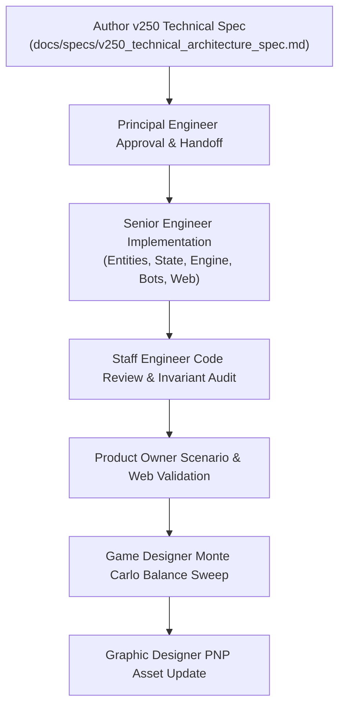

# Technical Architecture Specification: Phase 32 (v0.25.0)
## Modular Client Companies & White Hat Dossiers Architecture

**Author:** Principal Engineer  
**Status:** Approved for Implementation  
**Target Version:** `v0.25.0`  
**Dependencies:** [RULES.md](../../RULES.md), [PLAN.md](../../PLAN.md), [v240_technical_architecture_spec.md](./v240_technical_architecture_spec.md), [v230_technical_architecture_spec.md](./v230_technical_architecture_spec.md)  
**Target Components:** `sim/entities.py`, `sim/engine/state.py`, `sim/engine/core.py`, `sim/engine/phase1_boot.py`, `sim/engine/phase2_threat.py`, `sim/engine/phase3_ops.py`, `sim/bots/`, `web/schemas.py`, `web/controller/`, `web/static/`, `tests/test_v250_modular_setup.py`

---

## 1. Executive Summary & Architectural Motivation

### 1.1 The Monolithic Archetype Limitation in v0.24.0
From `v0.9.0` through `v0.24.0`, player asymmetry in *Rogue Agent / Too Many Secrets* was governed by a monolithic entity: the **Consultancy Archetype** (`ArchetypeCard`). Each of the 6 archetypes bundled two mechanically distinct vectors:
1. An **Institutional Once-per-Version Special Ability** (e.g. Redundant Crew, Magnetic Splice, Baffle Echo, Slush Fund, Brute-Force Bypass, Algorithmic Arbitrage), representing corporate infrastructure and organizational contingency protocols.
2. In `v0.24.0`, a **Purple Face 6 Signature Protocol** (e.g. Contingent Staffing, Jumper Diagnostics, Resonance Sensor, Burn Notice, Arbitrary Code Execution, Algorithmic Parity), representing operative-level specialist exploitation of the proprietary purple d6 die.

While this coupling established clear thematic baselines, it introduced notable architectural and game design constraints:
- **Static Combinatorial Space:** With only 6 monolithic archetypes, 4-player games exhausted two-thirds of the available asymmetric identities per match, producing repetitive strategic matchups.
- **Conflated Temporal Scales:** Corporate institutional overrides (strategic, once-per-version macro pivots) were coupled directly to tactical round-by-round dice roll triggers (Face 6 on Purple dice), preventing players from mixing corporate strengths (e.g. heavy cash flow or contractor subsidies) with preferred tactical playstyles (e.g. dice manipulation or aggressive spyware burning).
- **Setup Rigidity:** Introductory play lacked a clean separation between high-level corporate frameworks and individual operative dossiers, complicating onboarding for novice players.

### 1.2 Phase 32 Modular Design Validation & Game Designer Sign-Off
Following thorough mathematical modeling and design alignment between the Game Designer and Product Owner, `v0.25.0` refactors player setup into two fully orthogonal, modular components:
1. **6 Client Companies (`Company`):** Institutional entities that contract the players' cybersecurity consultancy. Each company grants a **Once-per-Version Institutional Override** tracked across Rogue Agent versions `v1.0`, `v2.0`, and `v3.0`.
2. **6 White Hat Operatives (`WhiteHat`):** Elite cybersecurity operatives assigned to the terminal. Each operative supplies the player's private **Personal Reserve** (2 Purple Specialist Dice) and dictates the **Face 6 Signature Protocol** when rolling `Purple ★`.

By completely decoupling Companies from White Hats, the legal setup space expands from **6 static identities** to **$6 \times 6 = 36$ distinct corporate-operative combinations**, unlocking immense emergent replayability while maintaining deterministic balance and zero regression against legacy behavior.

```
       [6 Client Companies]                 [6 White Hat Operatives]
     (Institutional Overrides)             (Face 6 Signature Protocols)
     • Meridian Financial Trust            • The Operator (Staffing)
     • Omnidyne Systems                    • The Phreaker (Diagnostics)
     • Aegis Defense Relay         X       • The Acoustic (Resonance)
     • Dept. of Telecom [DTO]              • The Spook (Burn Notice)
     • Helix Biomedical                    • The Prodigy (Arbitrary Code)
     • Prometheus Foundation               • The Cipher (Parity Triplet)
                 \                              /
                  \                            /
             ========================================
             36 Unique Modular Asymmetric Combinations
             ========================================
```

### 1.3 Architectural Goals & Core Pillars
1. **Orthogonal Decoupling (INV-SETUP-03):** Neither entity holds a reference to the other. `Company` governs version overrides; `WhiteHat` governs purple dice protocols.
2. **Strict Invariant Governance:** All setup, override lifecycles, and purple protocol bindings are guaranteed by formal invariants (`INV-SETUP-01` through `INV-SETUP-04`, `INV-OVERRIDE-01`, `INV-PURPLE-01`).
3. **Deterministic Presets:** Provide scripted 2P, 3P, and 4P introductory preset pairings that recreate canonical thematic synergies for onboarding, regression testing, and automated benchmarks.
4. **Seamless Backward Compatibility:** Full preservation of legacy properties (`player.archetype`, `ArchetypeCode`) via dynamic bridge properties, preventing breaking changes across existing bot subclasses, experiment runners, and saved replays.
5. **Dual-Card Physical & UI Metaphor:** The player terminal is augmented by two physical card positions: the **Company Card** (with version tracking slots) and the **White Hat Dossier Card** (with purple die protocol specs).

---

## 2. System Invariants & Mathematical Guarantees

### 2.1 Formal Invariant Definitions

The following system invariants govern Phase 32 modular entities, setup routines, override execution, and purple specialist bindings:

| Invariant ID | Subsystem | Formal Specification |
| :--- | :--- | :--- |
| **INV-SETUP-01** | Setup & State | **Modular Split Assignment:** Each active player terminal MUST be assigned exactly one `Company` instance and exactly one `WhiteHat` instance during game initialization (`player.company is not None` and `player.white_hat is not None`). No player may possess fewer or more than one of each entity. |
| **INV-SETUP-02** | Setup Selection | **Unique Assignment Without Replacement:** In standard modular setup, Company cards are dealt uniquely without replacement from the 6-card Company registry, and White Hat Dossier cards are dealt uniquely without replacement from the 6-card White Hat registry. For player count $N \le 6$, $\text{len}(\{\text{p.company.code}\}) = N$ and $\text{len}(\{\text{p.white\_hat.code}\}) = N$. |
| **INV-SETUP-03** | Engine Model | **Decoupled Orthogonality:** A player's `Company` identity and `WhiteHat` identity are strictly independent. Any company may pair with any operative. No company logic may query white hat identity, and no white hat logic may query company identity. |
| **INV-SETUP-04** | Setup Presets | **Introductory Preset Determinism:** When initializing a game under introductory preset mode, player assignments MUST match the deterministic preset mappings for $N \in \{2, 3, 4\}$ without invocation of pseudorandom sampling. |
| **INV-OVERRIDE-01** | Phase 1–3 Engine | **Institutional Override Lifecycle:** A player's Once-per-Version ability is governed strictly by their assigned `Company`. It tracks through `ability_v1_status`, `ability_v2_status`, and `ability_v3_status` across versions `v1.0`, `v2.0`, and `v3.0`. At most one activation is permitted per active version, and unspent charges forfeit upon Rogue Agent version upgrades. |
| **INV-PURPLE-01** | Phase 1 & 3 Engine | **Operative Protocol Binding:** Rolling Face 6 (`PURPLE_STAR`) on a Purple Specialist die triggers the Signature Protocol of the player's `WhiteHat` operative exclusively. Personal Reserves initialize with 2 non-draftable Purple dice (`personal_purple_reserve = 2`) that remain insulated from central market stock. |

### 2.2 Combinatorial Space Analysis

Prior to `v0.25.0`, the game supported $\binom{6}{N} \times N!$ configurations for $N$ players. With decoupled modular setup:
- The total unique pairing pool is:
  $$\Omega = |\text{Companies}| \times |\text{WhiteHats}| = 6 \times 6 = 36 \text{ distinct loadouts}$$
- For an $N$-player match without replacement in either deck:
  $$\text{Configurations}(N) = \binom{6}{N} \times \binom{6}{N} \times (N!)^2$$
- For a standard 4-player game:
  $$\binom{6}{4} \times \binom{6}{4} \times (4!)^2 = 15 \times 15 \times 576 = 129,600 \text{ asymmetric table configurations}$$
  *(Compared to only $15 \times 24 = 360$ configurations in v0.24.0, representing a $360\times$ expansion in tactical diversity).*

### 2.3 Operational Lifecycle Matrix

The separation between corporate institutional overrides and operative signature protocols maps across distinct engine timing windows:

```
+---------------------+-------------------------------+----------------------------------+
| Timing Window       | Company Institutional Override | White Hat Signature Protocol     |
+---------------------+-------------------------------+----------------------------------+
| Phase 1: Step 2     | Meridian Financial Trust      | --                               |
| (Staffing)          | (Redundant Crew: Free Hires)  |                                  |
+---------------------+-------------------------------+----------------------------------+
| Phase 1: Step 4     | Helix Biomedical Consortium   | The Operator (Contingent Staff)  |
| (Rolling & Rerolls) | (Brute-Force Bypass: Reroll)  | The Prodigy (Arbitrary Code)     |
+---------------------+-------------------------------+----------------------------------+
| Phase 1: Step 5     | --                            | The Cipher (Algorithmic Parity:  |
| (Hash Matches)      |                               | Wildcard Triplet for Secret)     |
+---------------------+-------------------------------+----------------------------------+
| Phase 2: Step 2B    | Aegis Defense Relay           | --                               |
| (Compiler Threat)   | (Baffle Echo: Ignore 1 Cube)  |                                  |
|                     | Dept. of Telecom [DTO]        |                                  |
|                     | (Slush Fund: Absorb Secrets)  |                                  |
+---------------------+-------------------------------+----------------------------------+
| Phase 3: Step 1     | Omnidyne Systems              | --                               |
| (Pipeline Prep)     | (Magnetic Splice: Skip Scan)  |                                  |
+---------------------+-------------------------------+----------------------------------+
| Phase 3: Step 2     | --                            | The Acoustic (Resonance Sensor)  |
| (Part 3A Income)    |                               | The Cipher (+$2 Income Payout)   |
+---------------------+-------------------------------+----------------------------------+
| Phase 3: Step 3     | The Prometheus Foundation     | The Phreaker (Jumper Diagnostic) |
| (Part 3A Ops Turn)  | (Algorithmic Arbitrage: Disc) | The Spook (Burn Notice Secret)   |
+---------------------+-------------------------------+----------------------------------+
```

---

## 3. Data Model & Schema Architecture

### 3.1 Enumerations in `sim/entities.py`

```python
class CompanyCode(str, Enum):
    """Enumeration of the 6 Client Companies providing Institutional Overrides."""
    MERIDIAN = "MERIDIAN"
    OMNIDYNE = "OMNIDYNE"
    AEGIS = "AEGIS"
    DTO = "DTO"
    HELIX = "HELIX"
    PROMETHEUS = "PROMETHEUS"


class WhiteHatCode(str, Enum):
    """Enumeration of the 6 White Hat Operatives providing Signature Protocols."""
    OPERATOR = "OPERATOR"
    PHREAKER = "PHREAKER"
    ACOUSTIC = "ACOUSTIC"
    SPOOK = "SPOOK"
    PRODIGY = "PRODIGY"
    CIPHER = "CIPHER"
```

### 3.2 Dataclasses

```python
@dataclass(frozen=True)
class Company:
    """Represents a Client Company card contracting the terminal."""
    code: CompanyCode
    name: str
    sector: str
    override_name: str
    timing_window: str
    description: str
    flavor: str


@dataclass(frozen=True)
class WhiteHat:
    """Represents a White Hat Operative dossier card assigned to the terminal."""
    code: WhiteHatCode
    name: str
    role: str
    protocol_name: str
    timing_window: str
    description: str
    flavor: str
```

### 3.3 Static Registries & Factory Functions

```python
COMPANIES: Dict[CompanyCode, Company] = {
    CompanyCode.MERIDIAN: Company(
        code=CompanyCode.MERIDIAN,
        name="Meridian Financial Trust",
        sector="Banking Infrastructure",
        override_name="Redundant Crew",
        timing_window="Phase 1: Staffing Step",
        description="Hire up to 2 White Contractor Dice for free this round, bypassing progressive contractor costs.",
        flavor="When liquidity is limitless, headcount is merely an accounting variable.",
    ),
    CompanyCode.OMNIDYNE: Company(
        code=CompanyCode.OMNIDYNE,
        name="Omnidyne Systems",
        sector="Tech Giant",
        override_name="Magnetic Splice",
        timing_window="Phase 3: Pipeline Prep",
        description="Move 1 die from your Glitched Box directly to your Ready for Release Zone for free (bypassing Scanned and saving 1 🔧).",
        flavor="Proprietary hardware backplanes allow instantaneous hot-swapping under live load.",
    ),
    CompanyCode.AEGIS: Company(
        code=CompanyCode.AEGIS,
        name="Aegis Defense Relay",
        sector="Security Firm",
        override_name="Baffle Echo",
        timing_window="Phase 2: Step 2B Damage",
        description="When resolving compiler damage, ignore 1 Attack Cube (Red, Blue, or Green) of your choice for yourself this round. (All exited cubes remain in the exit tray and recycle into the Staging Cup as normal).",
        flavor="Multi-layered kinetic dampeners disperse inbound network blast energy.",
    ),
    CompanyCode.DTO: Company(
        code=CompanyCode.DTO,
        name="Department of Telecommunications Oversight",
        sector="Federal Agency",
        override_name="Slush Fund",
        timing_window="Phase 2: Step 2B Damage",
        description="Absorb up to 2 Corporate Secret loss (from Blue Spyware or unpaid Red Ransom) for free without paying cash. (Any additional Secret loss may be absorbed by paying $1 per Secret as normal).",
        flavor="Classified black budget allocations absorb compliance failures without public oversight.",
    ),
    CompanyCode.HELIX: Company(
        code=CompanyCode.HELIX,
        name="Helix Biomedical Consortium",
        sector="Medical Research",
        override_name="Brute-Force Bypass",
        timing_window="Phase 1: Step 4 Rerolls",
        description="During your rerolls this phase, you may include any number of Locked dice in your free rerolls without spending 🔧 tokens. In addition, you may turn 1 of your rolled dice to any non-Star face of your choice.",
        flavor="Massively parallel quantum sequencing breaks deterministic encryption gates.",
    ),
    CompanyCode.PROMETHEUS: Company(
        code=CompanyCode.PROMETHEUS,
        name="The Prometheus Foundation",
        sector="Non-Profit",
        override_name="Algorithmic Arbitrage",
        timing_window="Phase 3: Operations Turn",
        description="Purchase 1 Colored Die from the Market or Personal Reserve at a $2 discount (minimum cost $0), OR gain an immediate +$2 cash payout from the bank.",
        flavor="Open-source cryptographic protocols circumvent proprietary enterprise licensing fees.",
    ),
}

WHITE_HATS: Dict[WhiteHatCode, WhiteHat] = {
    WhiteHatCode.OPERATOR: WhiteHat(
        code=WhiteHatCode.OPERATOR,
        name="The Operator",
        role="Tactical Staffing & Logistics Lead",
        protocol_name="Contingent Staffing",
        timing_window="Phase 1: Step 4 Rolling",
        description="When Purple ★ is rolled, immediately roll 1 free White Contractor die from the supply directly into your active pool. Eligible for remaining rerolls.",
        flavor="Redundant contractor pipelines ready on zero notice.",
    ),
    WhiteHatCode.PHREAKER: WhiteHat(
        code=WhiteHatCode.PHREAKER,
        name="The Phreaker",
        role="Hardware Intrusion Specialist",
        protocol_name="Jumper Diagnostics",
        timing_window="Phase 3: Operations Turn",
        description="When Purple ★ is rolled, roll 1 offline die in your Under Development pipeline (Glitched or Scanned). Collect rolled cash/patches; die remains in place.",
        flavor="Raw voltage pulses extract signal from dormant silicon.",
    ),
    WhiteHatCode.ACOUSTIC: WhiteHat(
        code=WhiteHatCode.ACOUSTIC,
        name="The Acoustic",
        role="Side-Channel Cryptanalyst",
        protocol_name="Resonance Sensor",
        timing_window="Phase 3: Step 2 Income",
        description="When Purple ★ is rolled, gain +$1 cash per distinct cube color present in the Exit Tray this round (Red, Blue, Green, Black; max +$4).",
        flavor="Harmonic resonance frequencies decode physical chassis vibrations.",
    ),
    WhiteHatCode.SPOOK: WhiteHat(
        code=WhiteHatCode.SPOOK,
        name="The Spook",
        role="Covert Intelligence Specialist",
        protocol_name="Burn Notice",
        timing_window="Phase 3: Operations Turn",
        description="When Purple ★ is rolled, gain +$2 cash payout. Additionally, you may optionally burn 1 owned colored die back to supply to gain +1 Corporate Secret.",
        flavor="Scorched-earth protocols ensure zero forensic recovery.",
    ),
    WhiteHatCode.PRODIGY: WhiteHat(
        code=WhiteHatCode.PRODIGY,
        name="The Prodigy",
        role="Autonomous Exploit Hacker",
        protocol_name="Arbitrary Code Execution",
        timing_window="Phase 1: Step 4 Rolling",
        description="When Purple ★ is rolled, turn 1 other rolled die in your active pool to any legal non-Star face of that die's color.",
        flavor="Payload injection executes before memory boundaries establish.",
    ),
    WhiteHatCode.CIPHER: WhiteHat(
        code=WhiteHatCode.CIPHER,
        name="The Cipher",
        role="Distributed Ledger Architect",
        protocol_name="Algorithmic Parity",
        timing_window="Phase 1: Step 5 & Phase 3: Step 2",
        description="Purple ★ acts as wildcard completing any pair to a 3-of-a-kind triplet (+1 Secret in Phase 1 Step 5). In Phase 3A Income, Purple ★ generates +$2 cash.",
        flavor="Parity calculations balance zero-knowledge proofs flawlessly.",
    ),
}
```

### 3.4 Presets Mapping Architecture

```python
INTRODUCTORY_PRESETS: Dict[int, List[Tuple[CompanyCode, WhiteHatCode]]] = {
    2: [
        (CompanyCode.MERIDIAN, WhiteHatCode.OPERATOR),
        (CompanyCode.OMNIDYNE, WhiteHatCode.PHREAKER),
    ],
    3: [
        (CompanyCode.MERIDIAN, WhiteHatCode.OPERATOR),
        (CompanyCode.OMNIDYNE, WhiteHatCode.PHREAKER),
        (CompanyCode.AEGIS, WhiteHatCode.ACOUSTIC),
    ],
    4: [
        (CompanyCode.MERIDIAN, WhiteHatCode.OPERATOR),
        (CompanyCode.OMNIDYNE, WhiteHatCode.PHREAKER),
        (CompanyCode.AEGIS, WhiteHatCode.ACOUSTIC),
        (CompanyCode.DTO, WhiteHatCode.SPOOK),
    ],
}
```

### 3.5 Evolution of `PlayerState` in `sim/engine/state.py`

To support modular companies and white hats while maintaining 100% backward compatibility:

```python
class PlayerState:
    # --- Modular Entities (v0.25.0 Canonical) ---
    company: Optional[Company] = None
    white_hat: Optional[WhiteHat] = None

    # --- Personal Reserve (v0.24.0 Canonical) ---
    personal_purple_reserve: int = 2
    purple_star_available: bool = False
    purple_star_count: int = 0

    # --- Once-per-Version Ability Lifecycle ---
    ability_v1_status: AbilityStatus = AbilityStatus.AVAILABLE
    ability_v2_status: AbilityStatus = AbilityStatus.LOCKED
    ability_v3_status: AbilityStatus = AbilityStatus.LOCKED

    # --- Backward Compatibility Properties ---
    @property
    def archetype(self) -> Optional[ArchetypeCard]:
        """Backward compatibility bridge mapping Company/WhiteHat to legacy ArchetypeCard."""
        if self.white_hat is not None:
            code_str = self.white_hat.code.value
            return get_archetype_by_code(code_str)
        if self.company is not None:
            # Fallback mapping from company to legacy counterpart
            compat_map = {
                CompanyCode.MERIDIAN: ArchetypeCode.OPERATOR,
                CompanyCode.OMNIDYNE: ArchetypeCode.PHREAKER,
                CompanyCode.AEGIS: ArchetypeCode.ACOUSTIC,
                CompanyCode.DTO: ArchetypeCode.SPOOK,
                CompanyCode.HELIX: ArchetypeCode.PRODIGY,
                CompanyCode.PROMETHEUS: ArchetypeCode.CIPHER,
            }
            legacy_code = compat_map.get(self.company.code)
            if legacy_code:
                return get_archetype_by_code(legacy_code)
        return None

    @archetype.setter
    def archetype(self, value: Optional[ArchetypeCard]) -> None:
        """Backward compatibility setter initializing Company and WhiteHat from legacy ArchetypeCard."""
        if value is None:
            self.company = None
            self.white_hat = None
            return

        legacy_code = value.code if isinstance(value.code, ArchetypeCode) else ArchetypeCode(value.code)
        company_map = {
            ArchetypeCode.OPERATOR: CompanyCode.MERIDIAN,
            ArchetypeCode.PHREAKER: CompanyCode.OMNIDYNE,
            ArchetypeCode.ACOUSTIC: CompanyCode.AEGIS,
            ArchetypeCode.SPOOK: CompanyCode.DTO,
            ArchetypeCode.PRODIGY: CompanyCode.HELIX,
            ArchetypeCode.CIPHER: CompanyCode.PROMETHEUS,
        }
        white_hat_map = {
            ArchetypeCode.OPERATOR: WhiteHatCode.OPERATOR,
            ArchetypeCode.PHREAKER: WhiteHatCode.PHREAKER,
            ArchetypeCode.ACOUSTIC: WhiteHatCode.ACOUSTIC,
            ArchetypeCode.SPOOK: WhiteHatCode.SPOOK,
            ArchetypeCode.PRODIGY: WhiteHatCode.PRODIGY,
            ArchetypeCode.CIPHER: WhiteHatCode.CIPHER,
        }
        self.company = COMPANIES[company_map[legacy_code]]
        self.white_hat = WHITE_HATS[white_hat_map[legacy_code]]
```

---

## 4. Game Engine Phase Contracts & Execution

### 4.1 Phase 1: Boot & Dice Engineering (`sim/engine/phase1_boot.py`)

#### Step 2: Temporary Staffing & Meridian Override
```
[Company Check] -> player.company.code == CompanyCode.MERIDIAN
  -> Check player.is_ability_available(active_version)
  -> Bot Hook: player.bot.choose_meridian_override(...)
  -> Execute: Hire up to min(2, contractor_supply) White dice for $0
  -> Mark ability used: player.mark_ability_used(active_version)
```

#### Step 4: Rolling, Rerolls, & Protocols
```
[Company Check] -> player.company.code == CompanyCode.HELIX
  -> Check player.is_ability_available(active_version)
  -> Bot Hook: player.bot.choose_helix_override(...)
  -> Execute: Unlock all locked dice for rerolls without patch cost;
              turn 1 rolled die to chosen legal non-Star face
  -> Mark ability used: player.mark_ability_used(active_version)

[White Hat Check] -> Purple ★ Rolled in active_pool
  -> Case The Operator (WhiteHatCode.OPERATOR):
       Hook: check_operator_contingent_staffing(...)
       Action: Roll 1 free White Contractor die into active pool
  -> Case The Prodigy (WhiteHatCode.PRODIGY):
       Hook: resolve_prodigy_purple_star_override(...)
       Action: Turn 1 other active die to any legal non-Star face
```

#### Step 5: Hash Matches
```
[White Hat Check] -> player.white_hat.code == WhiteHatCode.CIPHER
  -> Purple ★ acts as wildcard completing any matching pair to a 3-of-a-kind triplet
  -> Grants +1 Corporate Secret
```

### 4.2 Phase 2: Compiler Threat Resolution (`sim/engine/phase2_threat.py`)

#### Step 2B: Damage Mitigation Overrides
```
[Company Check] -> player.company.code == CompanyCode.AEGIS
  -> Check player.is_ability_available(active_version)
  -> Bot Hook: player.bot.choose_aegis_override(...)
  -> Action: Remove 1 Attack Cube (R, B, or G) from compiler damage calculation for player

[Company Check] -> player.company.code == CompanyCode.DTO
  -> Check player.is_ability_available(active_version)
  -> Bot Hook: player.bot.choose_dto_override(...)
  -> Action: Absorb up to 2 Secret loss for $0 (free of cash penalty)
```

### 4.3 Phase 3: Corporate Operations (`sim/engine/phase3_ops.py`)

#### Step 1: Pipeline Prep Override
```
[Company Check] -> player.company.code == CompanyCode.OMNIDYNE
  -> Check player.is_ability_available(active_version)
  -> Bot Hook: player.bot.choose_omnidyne_override(...)
  -> Action: Move 1 die from glitched_dice directly to ready_for_release_dice for $0
```

#### Step 2: Part 3A Income Protocols
```
[White Hat Check] -> Purple ★ rolled & deployed to production
  -> Case The Acoustic (WhiteHatCode.ACOUSTIC):
       Action: Cash bonus = len(unique_exited_cube_colors) up to +$4
  -> Case The Cipher (WhiteHatCode.CIPHER):
       Action: Fixed cash payout = +$2
```

#### Step 3: Part 3A Operations Turn
```
[White Hat Check] -> Purple ★ rolled & deployed to production
  -> Case The Phreaker (WhiteHatCode.PHREAKER):
       Hook: resolve_phreaker_jumper_diagnostics(...)
       Action: Roll 1 offline die in glitched/scanned; harvest cash/patches
  -> Case The Spook (WhiteHatCode.SPOOK):
       Hook: resolve_spook_burn_notice(...)
       Action: Gain +$2 cash; optionally burn 1 colored die for +1 Secret

[Company Check] -> player.company.code == CompanyCode.PROMETHEUS
  -> Check player.is_ability_available(active_version)
  -> Bot Hook: player.bot.choose_prometheus_override(...)
  -> Action: Apply $2 discount to colored die purchase, OR collect +$2 cash
```

---

## 5. Bot Architecture & AI Decision Heuristics

### 5.1 Decoupling Heuristics in `sim/bots/base.py`

Bot decision methods are explicitly partitioned into **Company Institutional Overrides** and **White Hat Signature Protocols**. For backward compatibility, legacy method names are retained as aliases that delegate directly to the new canonical methods:

```python
class BaseBot:
    # =========================================================================
    # Company Institutional Overrides (Once-per-Version)
    # =========================================================================

    def choose_meridian_override(
        self,
        player_state: PlayerState,
        contractor_supply: int,
        staging_cubes: Dict[CubeColor, int],
        stuck_cubes: Dict[CubeColor, int],
        rng: random.Random,
        corruption_track: int = 0,
    ) -> bool:
        """Returns True if the bot activates Meridian's Redundant Crew override."""
        return False

    def choose_omnidyne_override(
        self,
        player_state: PlayerState,
        game_state: Any,
        rng: random.Random,
    ) -> Optional[int]:
        """Returns die_id in glitched_dice to splice directly to ready, or None."""
        if not player_state.glitched_dice:
            return None
        # Prioritize colored dice over gray dice
        colored = [d for d in player_state.glitched_dice if d.color not in (DieColor.GRAY, DieColor.WHITE)]
        return colored[0].die_id if colored else player_state.glitched_dice[0].die_id

    def choose_aegis_override(
        self,
        player_state: PlayerState,
        qualifying_colors: List[CubeColor],
        exited_cubes: Dict[CubeColor, int],
        active_version_str: str,
        rng: random.Random,
        corruption_track: int = 0,
    ) -> Optional[CubeColor]:
        """Returns CubeColor to ignore via Aegis Baffle Echo, or None."""
        if not qualifying_colors:
            return None
        if CubeColor.BLUE in qualifying_colors:
            return CubeColor.BLUE
        if CubeColor.RED in qualifying_colors:
            return CubeColor.RED
        return qualifying_colors[0]

    def choose_dto_override(
        self,
        player_state: PlayerState,
        secrets_at_risk: int,
        active_version_str: str,
        rng: random.Random,
        corruption_track: int = 0,
    ) -> int:
        """Returns secrets to absorb via DTO Slush Fund (up to 2)."""
        return min(2, secrets_at_risk)

    def choose_helix_override(
        self,
        player_state: PlayerState,
        active_dice: List[Die],
        rerolls_remaining: int,
        staging_cubes: Dict[CubeColor, int],
        stuck_cubes: Dict[CubeColor, int],
        directive_code: str,
        rng: random.Random,
        corruption_track: int = 0,
    ) -> bool:
        """Returns True if the bot activates Helix's Brute-Force Bypass override."""
        return False

    def choose_prometheus_override(
        self,
        player_state: PlayerState,
        game_state: Any,
        rng: random.Random,
    ) -> str:
        """Returns 'DISCOUNT' or 'CASH' for Prometheus Algorithmic Arbitrage."""
        return "DISCOUNT" if player_state.money >= 2 else "CASH"

    # =========================================================================
    # White Hat Signature Protocols (Purple Face 6)
    # =========================================================================

    def choose_operator_contingent_staffing(
        self,
        player_state: PlayerState,
        contractor_supply: int,
        rng: random.Random,
    ) -> bool:
        """Operator Protocol: Always accepts free White Contractor die into pool."""
        return contractor_supply > 0

    def choose_phreaker_jumper_diagnostics(
        self,
        player_state: PlayerState,
        game_state: Any,
        rng: random.Random,
    ) -> Optional[int]:
        """Phreaker Protocol: Selects die in Under Development to roll for income."""
        ud_dice = player_state.under_development_dice
        if not ud_dice:
            return None
        return max(ud_dice, key=lambda d: 2 if d.color in (DieColor.GREEN, DieColor.YELLOW) else 1).die_id

    def choose_spook_burn_notice(
        self,
        player_state: PlayerState,
        game_state: Any,
        rng: random.Random,
    ) -> Optional[int]:
        """Spook Protocol: Chooses colored die to burn to market for +1 Secret."""
        if player_state.secrets <= 3 and not getattr(game_state, "is_final_round", False):
            return None
        glitched_colored = [d for d in player_state.glitched_dice if d.color not in (DieColor.GRAY, DieColor.WHITE)]
        return glitched_colored[0].die_id if glitched_colored else None

    def choose_prodigy_purple_star_override(
        self,
        player_state: PlayerState,
        active_dice: List[Die],
        rng: random.Random,
    ) -> Optional[Tuple[int, Face]]:
        """Prodigy Protocol: Selects active die to override to legal non-Star face."""
        for idx, d in enumerate(active_dice):
            eff = d.effective_face or d.current_face
            if eff and eff.is_star and eff.star_code == "PURPLE_STAR":
                continue
            if d.current_face and d.current_face.is_glitch:
                return (idx, Face(name="Block 1 Any", block_amount=1, shield_color=ShieldColor.ANY))
        return None

    # =========================================================================
    # Backward Compatibility Aliases
    # =========================================================================
    choose_operator_ability = choose_meridian_override
    choose_phreaker_ability = choose_omnidyne_override
    choose_acoustic_ability = choose_aegis_override
    choose_spook_ability = choose_dto_override
    choose_prodigy_ability = choose_helix_override
    choose_cipher_ability = choose_prometheus_override
```

---

## 6. Web API, Schemas, & UI Visualization

### 6.1 Schema Serializers in `web/schemas.py`

New serializers are introduced alongside the legacy `serialize_archetype_card`:

```python
@staticmethod
def serialize_company(company: Optional[Company]) -> Optional[Dict[str, Any]]:
    if company is None:
        return None
    return {
        "code": company.code.value,
        "name": company.name,
        "sector": company.sector,
        "override_name": company.override_name,
        "timing_window": company.timing_window,
        "description": company.description,
        "flavor": company.flavor,
    }

@staticmethod
def serialize_white_hat(white_hat: Optional[WhiteHat]) -> Optional[Dict[str, Any]]:
    if white_hat is None:
        return None
    return {
        "code": white_hat.code.value,
        "name": white_hat.name,
        "role": white_hat.role,
        "protocol_name": white_hat.protocol_name,
        "timing_window": white_hat.timing_window,
        "description": white_hat.description,
        "flavor": white_hat.flavor,
    }
```

In `PlayerStateSchema`:
```json
{
  "player_id": 0,
  "name": "Operator Lead",
  "is_human": true,
  "company": {
    "code": "MERIDIAN",
    "name": "Meridian Financial Trust",
    "sector": "Banking Infrastructure",
    "override_name": "Redundant Crew",
    "timing_window": "Phase 1: Staffing Step",
    "description": "Hire up to 2 White Contractor Dice for free...",
    "flavor": "When liquidity is limitless..."
  },
  "white_hat": {
    "code": "OPERATOR",
    "name": "The Operator",
    "role": "Tactical Staffing & Logistics Lead",
    "protocol_name": "Contingent Staffing",
    "timing_window": "Phase 1: Step 4 Rolling",
    "description": "When Purple ★ is rolled, immediately roll 1 free White Contractor...",
    "flavor": "Redundant contractor pipelines..."
  },
  "archetype": {
    "code": "OPERATOR",
    "name": "The Operator",
    "role": "Cybersecurity Specialist",
    "ability_name": "Redundant Crew"
  },
  "personal_purple_reserve": 2,
  "ability_v1_status": "AVAILABLE",
  "ability_v2_status": "LOCKED",
  "ability_v3_status": "LOCKED"
}
```

### 6.2 Frontend Terminal Mat Layout (`web/static/js/components/player_mats.js`)

The terminal mat left column is updated to render two distinct cards sitting side-by-side or stacked cleanly:

```
+---------------------------------------------------------------------------------+
| TOO MANY SECRETS // TERMINAL [TERM-01]               [HUMAN]  ★ CISO  10 Secrets|
+------------------------------------+--------------------------------------------+
| [CLIENT COMPANY CARD]              | [ZONE 1: READY FOR RELEASE] (4 READY)      |
| MERIDIAN FINANCIAL TRUST           | [Gray 1] [Gray 2] [Gray 3] [Gray 4]        |
| Sector: Banking Infrastructure     |                                            |
|                                    +--------------------------------------------+
| Institutional Override:            | [ZONE 2: IN PRODUCTION]                    |
| REDUNDANT CREW [Phase 1: Staffing] | Shields: [RED: 0] [BLUE: 0] [GREEN: 0]     |
| Hire up to 2 White Contractor Dice | Income:  [None]                            |
| for free this round.               +--------------------------------------------+
|                                    | [ZONE 3: UNDER DEVELOPMENT]                |
| ONCE / VER:                        | Glitched: [Empty]                          |
| [v1.0: AVAILABLE] [v2.0] [v3.0]    | Scanned:  [Empty]                          |
+------------------------------------+--------------------------------------------+
| [WHITE HAT DOSSIER CARD]           | [PERSONAL RESERVE]                         |
| THE OPERATOR                       | Purple Dice: [d6: Purple] [d6: Purple] (2) |
| Tactical Staffing & Logistics Lead | Click to purchase for $4                   |
|                                    +--------------------------------------------+
| Face 6 Protocol:                   | [ACTIVE ROLL & COMMIT ACTIONS]             |
| CONTINGENT STAFFING [Phase 1: Roll]| Free Rerolls: 2/2                          |
| Roll 1 free White Contractor die   | Commit Shields                             |
| directly into active pool.         | End Phase 1 Boot                           |
+------------------------------------+--------------------------------------------+
```

---

## 7. Backward Compatibility & Migration Strategy

To guarantee that zero existing tests or benchmark suites break upon implementing Phase 32:
1. **Instantiation Compatibility:** `PlayerState.__init__` accepts `archetype: Optional[ArchetypeCard] = None`. If passed without `company` or `white_hat`, it automatically populates both based on the canonical legacy pairing.
2. **Access Compatibility:** Reading `player.archetype` returns a dynamically constructed or cached `ArchetypeCard` representing the player's active abilities.
3. **Engine Core Compatibility:** `GameEngine(config=..., archetypes=...)` accepts `archetypes` as a legacy parameter, translating each to the corresponding `(Company, WhiteHat)` pair. New calls use `companies: Optional[List[Company]] = None` and `white_hats: Optional[List[WhiteHat]] = None`.
4. **Serialization Backwards Compatibility:** `web/schemas.py` includes `"archetype"`, `"company"`, and `"white_hat"` in the serialized JSON dictionary. Older web clients relying on `player.archetype.code` continue functioning without error.

---

## 8. Test Verification Matrix (`tests/test_v250_modular_setup.py`)

A new dedicated test suite `tests/test_v250_modular_setup.py` containing 28 exhaustive test cases across 7 categories will be executed during implementation:

| Test ID | Category | Description | Verification Target |
| :--- | :--- | :--- | :--- |
| **TEST-MOD-01** | Registry | Company registry completeness | Exactly 6 companies with valid codes, sectors, override names, descriptions |
| **TEST-MOD-02** | Registry | White Hat registry completeness | Exactly 6 white hats with valid codes, roles, protocol names, descriptions |
| **TEST-MOD-03** | Invariants | INV-SETUP-01: Modular split setup | All players have non-null `company` and `white_hat` |
| **TEST-MOD-04** | Invariants | INV-SETUP-02: Unique assignment 2P | Player 1 and Player 2 receive distinct companies and distinct white hats |
| **TEST-MOD-05** | Invariants | INV-SETUP-02: Unique assignment 4P | All 4 players receive unique companies and unique white hats |
| **TEST-MOD-06** | Invariants | INV-SETUP-03: Orthogonal cross-pair | Successfully pair Meridian (Bank) with The Spook without state error |
| **TEST-MOD-07** | Invariants | INV-SETUP-03: All 36 combinations | Instantiate all 36 combinations of Company × WhiteHat without exception |
| **TEST-MOD-08** | Invariants | INV-SETUP-04: Preset 2P mapping | 2P preset assigns Meridian+Operator to P0 and Omnidyne+Phreaker to P1 |
| **TEST-MOD-09** | Invariants | INV-SETUP-04: Preset 3P mapping | 3P preset assigns Meridian+Operator, Omnidyne+Phreaker, Aegis+Acoustic |
| **TEST-MOD-10** | Invariants | INV-SETUP-04: Preset 4P mapping | 4P preset assigns Meridian+Operator, Omnidyne+Phreaker, Aegis+Acoustic, DTO+Spook |
| **TEST-MOD-11** | Invariants | INV-OVERRIDE-01: Lifecycle v1.0 | Company override available in v1.0, marks used, forfeits on upgrade |
| **TEST-MOD-12** | Invariants | INV-OVERRIDE-01: Version upgrade | Version upgrade unlocks v2.0 override while preserving used status of v1.0 |
| **TEST-MOD-13** | Invariants | INV-PURPLE-01: Reserve insulation | Purple dice initialize to 2 in reserve and cannot be drafted by opponents |
| **TEST-MOD-14** | Invariants | INV-PURPLE-01: Protocol dispatch | Purple ★ triggers operative protocol, not company ability |
| **TEST-MOD-15** | Phase 1 Boot | Meridian Override in Phase 1 | Redundant Crew hires 2 free White contractors |
| **TEST-MOD-16** | Phase 1 Boot | Helix Override in Phase 1 | Brute-Force Bypass rerolls locked dice and sets 1 face |
| **TEST-MOD-17** | Phase 1 Boot | Operator Protocol in Phase 1 | Rolling Purple ★ rolls 1 free White Contractor die into pool |
| **TEST-MOD-18** | Phase 1 Boot | Prodigy Protocol in Phase 1 | Rolling Purple ★ overrides 1 active die face to non-Star |
| **TEST-MOD-19** | Phase 1 Boot | Cipher Protocol in Phase 1 | Purple ★ acts as wildcard completing triplet for +1 Secret |
| **TEST-MOD-20** | Phase 2 Threat | Aegis Override in Phase 2 | Baffle Echo ignores 1 Attack Cube for player |
| **TEST-MOD-21** | Phase 2 Threat | DTO Override in Phase 2 | Slush Fund absorbs up to 2 Secret loss for $0 |
| **TEST-MOD-22** | Phase 3 Ops | Omnidyne Override in Phase 3 | Magnetic Splice moves die from Glitched directly to Ready |
| **TEST-MOD-23** | Phase 3 Ops | Prometheus Override in Phase 3 | Algorithmic Arbitrage applies $2 discount or gives +$2 cash |
| **TEST-MOD-24** | Phase 3 Ops | Acoustic Protocol in Phase 3 | Resonance Sensor yields +$1 per unique exited cube color |
| **TEST-MOD-25** | Phase 3 Ops | Phreaker Protocol in Phase 3 | Jumper Diagnostics rolls offline die for income |
| **TEST-MOD-26** | Phase 3 Ops | Spook Protocol in Phase 3 | Burn Notice gives +$2 cash and optional die burn for +1 Secret |
| **TEST-MOD-27** | Compatibility | Legacy `player.archetype` bridge | Legacy property read/write functions transparently |
| **TEST-MOD-28** | Serialization | Web schema serialization | `PlayerStateSchema` outputs `company`, `white_hat`, and `archetype` |

---

## 9. Implementation Roadmap & Agent Handoff



### Next Steps for Implementation Team:
1. **`senior-engineer`**:
   - Update `sim/entities.py` with `CompanyCode`, `WhiteHatCode`, `Company`, `WhiteHat`, and static registries.
   - Refactor `PlayerState` in `sim/engine/state.py` with `company`, `white_hat`, and compatibility properties.
   - Update engine phases (`phase1_boot.py`, `phase2_threat.py`, `phase3_ops.py`) to query `player.company` and `player.white_hat`.
   - Update `sim/bots/base.py` and bot subclasses.
   - Update `web/schemas.py`, `web/controller/capabilities.py`, and `web/static/js/components/player_mats.js`.
   - Implement `tests/test_v250_modular_setup.py` and verify all 28 tests pass.
2. **`staff-engineer`**: Conduct architectural review, zero-regression audit, and verify invariants `INV-SETUP-01` through `INV-PURPLE-01`.
3. **`product-owner`**: Validate introductory preset playability across 2P, 3P, and 4P web sessions.
4. **`game-designer`**: Run 1,000-game Monte Carlo sweeps across modular combinations in `sim/experiments.py` to evaluate win-rate balance across all 36 company-operative pairings.
