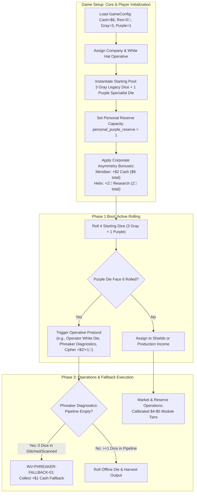
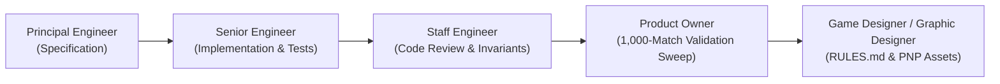

# Technical Architecture Specification: Phase 37 (v0.30.0)
## Starting Resources, Starter Purple Specialist Die, Phreaker Fallback & Market Cost Calibration

**Author:** Principal Engineer / Architect  
**Status:** Approved for Implementation  
**Target Version:** `v0.30.0` Baseline  
**Dependencies:** [RULES.md](../../RULES.md), [PLAN.md](../../PLAN.md), [v290_rules_streamlining_spec.md](./v290_rules_streamlining_spec.md)  
**Target Components:**
- `sim/config.py`
- `sim/entities.py`
- `sim/engine/state.py`
- `sim/engine/core.py`
- `sim/engine/phase3_ops.py`
- `sim/bots/base.py` & all bot subclasses (`sim/bots/*.py`)
- `web/controller/phase3_actions.py`
- `web/controller/capabilities.py`
- `web/static/js/components/player_mats.js`
- `web/static/js/components/market.js`
- `tests/test_v300_starting_resources.py`

---

## 1. Executive Summary & Architectural Motivation

### 1.1 Context & Strategic Objectives
Following the successful deployment and Monte Carlo validation of Phase 36 (`v0.29.0`)—which decoupled the CI/CD hardware pipeline tracks (Triage and Release) and eliminated phase lock spaces—pre-SDLC mathematical modeling and a 1,000-match Monte Carlo diagnostic sweep revealed three critical friction points in the early-to-mid game economy:

1. **Round 1 Action Paralysis & High Stagnation Under $4 Starting Cash:**  
   With baseline starting capital at $4 and all starting dice composed of generic Gray Legacy modules (which average only $0.67 cash and $0.33 research per roll), Round 1 frequently degenerated into passive rolling. Players could not simultaneously hire temporary contractors ($1–$3), absorb unexpected Red Ransomware ($1/cube), and purchase a new software module ($4–$7) to initiate their engine.
2. **Delayed Operative Identity & Asymmetry:**  
   Players selected distinct White Hat Operatives with unique Face 6 signature protocols, but started with zero Purple Specialist dice in their active pool. Because purchasing a Purple die from the Personal Reserve cost $4–$6 and competed directly with market modules, players rarely unlocked their operative's signature protocol before Round 3 or 4, blunting early-game asymmetry and tactical differentiation.
3. **The Phreaker Dead-Turn Dilemma:**  
   The Phreaker's Face 6 protocol (*Jumper Diagnostics*) allows offline dice in the Under Development pipeline (Glitched or Scanned boxes) to be rolled for immediate income. However, in pristine early rounds where zero dice were glitched by malware or when all dice graduated successfully, rolling Face 6 produced exactly 0 output. This created an unacceptable "blank face" feel for a specialist die.
4. **Market Cost Inflation vs Hardware Bottlenecks:**  
   In `v0.29.0`, modules were priced up to $7 (e.g., B2 at $7, Y1 at $7, R1/R2/B1/G1 at $6). Combined with the physical throughput caps of Defense Grid Capacity (2 shields base) and Triage Bandwidth (2 dice base), high prices choked engine growth, causing mid-game stalling where players hoarded cash for multiple rounds rather than actively circulating dice through the CI/CD conveyor.

### 1.2 Approved Architectural Solutions (User-Aligned)
To resolve these systemic bottlenecks without disturbing the physical 8-die component limit for Purple dice, the user approved the following calibrated baselines:

```
+----------------------------------------------------------------------------------------------------+
|                                 v0.30.0 BASELINE CALIBRATION                                       |
+-----------------------------------+----------------------------------+-----------------------------+
| Feature / Invariant               | Legacy Baseline (v0.29.0)        | Calibrated Baseline (v0.30) |
+-----------------------------------+----------------------------------+-----------------------------+
| Starting Active Dice Pool         | 4 Gray Legacy Dice               | 3 Gray + 1 Purple Specialist|
| Personal Reserve Purple Capacity  | 2 Purple Dice in Reserve         | 1 Purple Die in Reserve     |
| Total Purple Footprint per Player | 2 Purple Dice (Both in Reserve)  | 2 Purple Dice (1 Active+1Res)|
| Global Physical Purple Footprint  | 8 Dice (4 players x 2)           | 8 Dice (4 players x 2)      |
| Baseline Starting Cash            | $4 Cash                          | $6 Cash                     |
| Meridian Financial Trust Cash     | $6 Cash ($4 + $2 bonus)          | $8 Cash ($6 + $2 bonus)     |
| Baseline Starting Research        | 2 🔬 Research Tokens             | 0 🔬 Research Tokens        |
| Helix Biomedical Consortium Res.  | 4 🔬 Tokens (2 + 2 bonus)        | 2 🔬 Tokens (0 + 2 bonus)   |
| Phreaker Face 6 Empty Fallback    | None (0 output if pipeline empty)| Immediate +$1 Cash Fallback |
| Module Market Pricing Tiers       | $5 / $6 / $7 Tiers               | Crisp $4 / $5 / $6 Tiers    |
+-----------------------------------+----------------------------------+-----------------------------+
```

### 1.3 Architectural Flow & Setup Sequence



---

## 2. Detailed Invariant Specifications

### `INV-START-POOL-01`: 3 Gray + 1 Purple Starting Pool
- At game initialization, each player's `ready_for_release_dice` pool is populated with:
  - **Three (3) Gray Legacy Dice** (`DieColor.GRAY`, cost $0).
  - **One (1) Purple Proprietary Specialist Die** (`DieColor.PURPLE`, cost $0 starter).
- Total starting active pool size is exactly **4 dice**.
- The starting Purple Specialist Die is customized to the player's contracted White Hat Operative:
  - Faces: 2× `Block 1 Any`, 1× `+$2 Cash`, 1× `+$1 Cash & +1 🔬 Research`, 1× `Glitch (Locked)`, 1× `Purple ★` (Face 6 Signature Protocol).
  - In Phase 1 Step 5, the starting Purple die may be deployed as an `ANY` shield (absorbing Red, Blue, or Green threat within Defense Grid Capacity) or deployed to Income for cash, research, or its Face 6 protocol.

### `INV-START-RES-01`: Baseline 0 🔬 Starting Research Tokens
- The baseline starting research token quantity for all standard players is calibrated to **`0 🔬`** (reduced from 2 🔬).
- **Corporate Asymmetry Preservation:**
  - **Helix Biomedical Consortium (`HELIX`)** maintains its `+2 🔬` starting research bonus.
  - Under `v0.30.0`, Helix begins the game with **`2 🔬`** total (down from 4 🔬).
  - All other corporations (Meridian, Omnidyne, Aegis, DTO, Prometheus) begin with **`0 🔬`**.
- This calibration requires players to earn Research Tokens actively via Gray/Blue/Green/Purple dice before unlocking hardware track upgrades or filing cryptographic patents.

### `INV-START-CASH-01`: Baseline $6 Starting Capital
- The baseline starting liquid cash for all standard players is calibrated to **`$6`** (increased from $4).
- **Corporate Asymmetry Preservation:**
  - **Meridian Financial Trust (`MERIDIAN`)** maintains its `+$2` cash starting bonus.
  - Under `v0.30.0`, Meridian begins the game with **`$8`** total cash (up from $6).
  - All other corporations begin with **`$6`** total cash.
- **Directive Interaction:**
  - If the initial version card's directive grants a starting bonus (e.g., Data Scraper `+$1` bonus), it stacks cumulatively on top of the baseline (e.g., $7 baseline, $9 for Meridian).

### `INV-PURPLE-RES-01`: Calibrated Personal Reserve Capacity (Option A)
- Each player's Personal Reserve capacity is calibrated from 2 Purple dice down to **`1 Purple Die`** (`personal_purple_reserve = 1`).
- **Lifetime Player Die Limit:**
  - 1 starting Purple die in `ready_for_release_dice`.
  - 1 reserve Purple die in `personal_purple_reserve`.
  - Maximum total Purple Specialist dice owned by a single player across the entire match is strictly **`2`**.
- **Physical Component Invariant:**
  - In a standard 4-player match: 4 players × 2 Purple dice = **`8 Purple Dice Total`**.
  - This strictly maintains the physical boxed component footprint of 8 custom purple dice.
- **Procurement Rules:**
  - A player may purchase their 1 reserve Purple die during Phase 3A Operations by paying their White Hat Operative's reserve cost ($4, $5, or $6).
  - Once purchased, `personal_purple_reserve` drops to 0 and cannot be replenished.

### `INV-PHREAKER-FALLBACK-01`: Phreaker Jumper Diagnostics Empty Pipeline Fallback
- When a player contracting with **The Phreaker** rolls Face 6 (`Purple ★`, Jumper Diagnostics) on an active Purple Specialist die:
  - If the player possesses **one or more dice** in their Under Development pipeline (`len(glitched_dice) + len(scanned_dice) > 0`):
    - The player selects and rolls 1 offline die in Under Development.
    - Collects rolled cash and research output; the offline die remains in place without advancing.
  - If the player possesses **zero dice** in their Under Development pipeline (`len(glitched_dice) + len(scanned_dice) == 0`):
    - The player immediately collects an emergency diagnostic yield of **`+$1 Cash`** from the bank.
    - The protocol executes successfully without throwing an error or dead-ending.
- Web API controllers and serialization schemas must accept and resolve the fallback cleanly.

### `INV-VAR-COST-CALIB-01`: Crisp $4–$5 Market Tier Calibration
- All software module dice costs (Central Market Variant Cards and White Hat Personal Reserve costs) are calibrated into clean, predictable $4, $5, and $6 tiers:

```
+----------------------------------------------------------------------------------------------------+
|                                    MODULE & RESERVE PRICING TIERS                                   |
+------+-----------------------+-----------------------------+-------------+-------------------------+
| Tier | Die Color / Category  | Card / Operative Name       | Code        | New Cost (Old Cost)     |
+------+-----------------------+-----------------------------+-------------+-------------------------+
|  $4  | Red (FinSec)          | Short Squeeze               | R3          | $4 ($5)                 |
|  $4  | Blue (Firewall)       | Air-Gapped Backup           | B3          | $4 ($5)                 |
|  $4  | Green (Antivirus)     | Universal Sandbox           | G2          | $4 ($5)                 |
|  $4  | Green (Antivirus)     | Live Reboot                 | G3          | $4 ($5)                 |
|  $4  | Reserve (Hardware)    | The Phreaker                | PHREAKER    | $4 ($4)                 |
|  $4  | Reserve (Acoustic)    | The Acoustic                | ACOUSTIC    | $4 ($4)                 |
+------+-----------------------+-----------------------------+-------------+-------------------------+
|  $5  | Red (FinSec)          | Ransom Insurance            | R1          | $5 ($6)                 |
|  $5  | Red (FinSec)          | Threat Bounty               | R2          | $5 ($6)                 |
|  $5  | Blue (Firewall)       | Honeypot Telemetry          | B1          | $5 ($6)                 |
|  $5  | Green (Antivirus)     | Self-Healing Kernel         | G1          | $5 ($6)                 |
|  $5  | Yellow (Crypto)       | Cloud Monopoly              | Y2          | $5 ($6)                 |
|  $5  | Yellow (Crypto)       | Proprietary Training        | Y3          | $5 ($6)                 |
|  $5  | Reserve (Logistics)   | The Operator                | OPERATOR    | $5 ($5)                 |
|  $5  | Reserve (Exploit)     | The Prodigy                 | PRODIGY     | $5 ($5)                 |
|  $5  | Reserve (Intel)       | The Spook                   | SPOOK       | $5 ($5)                 |
+------+-----------------------+-----------------------------+-------------+-------------------------+
|  $6  | Blue (Firewall)       | Deep R&D Vault              | B2          | $6 ($7)                 |
|  $6  | Yellow (Crypto)       | Algorithmic Trading         | Y1          | $6 ($7)                 |
|  $6  | Reserve (Ledger)      | The Cipher                  | CIPHER      | $6 ($6)                 |
+------+-----------------------+-----------------------------+-------------+-------------------------+
```

- **Default Market Fallbacks:**
  - If a variant card is omitted, the default fallback prices for each color are:
    - `DieColor.RED`: **$5** (was $6)
    - `DieColor.BLUE`: **$5** (was $6)
    - `DieColor.GREEN`: **$5** (was $6)
    - `DieColor.YELLOW`: **$6** (was $7)
    - `DieColor.PURPLE`: **$4** (was $4)

---

## 3. Data Model Changes & Dataclass Schemas

### 3.1 `sim/config.py`
Update `GameConfig` baseline attributes and helper methods:

```python
@dataclass
class GameConfig:
    """Tunable game parameters with baselines from RULES.md."""

    # Player count & setup
    num_players: int = 4
    starting_money: int = 6  # [v0.30.0 Baseline: Calibrated from $4 to $6 (INV-START-CASH-01)]
    starting_secrets_by_player_count: Dict[int, int] = field(
        default_factory=lambda: {2: 8, 3: 8, 4: 12}
    )
    starting_patches_by_player_count: Dict[int, int] = field(
        default_factory=lambda: {2: 0, 3: 0, 4: 0}  # [v0.30.0 Baseline: Calibrated from 2 to 0 (INV-START-RES-01)]
    )
    starting_secrets: Optional[int] = None
    starting_patches: Optional[int] = None
    max_patch_tokens: int = 3
    starting_gray_dice: int = 3   # [v0.30.0 Baseline: Calibrated from 4 to 3 (INV-START-POOL-01)]
    starting_purple_dice: int = 1 # [v0.30.0 Baseline: 1 starter Purple die (INV-START-POOL-01)]
    starting_purple_reserve: int = 1 # [v0.30.0 Baseline: Option A 1 die in reserve (INV-PURPLE-RES-01)]
    dice_per_color_multiplier: int = 2
```

### 3.2 `sim/entities.py`
Update `VariantCard` costs in `get_all_variant_cards()`:

```python
# Red Variants
VariantCard(code="R1", name="Ransom Insurance", die_color=DieColor.RED, cost=5, ...) # was 6
VariantCard(code="R2", name="Threat Bounty", die_color=DieColor.RED, cost=5, ...)    # was 6
VariantCard(code="R3", name="Short Squeeze", die_color=DieColor.RED, cost=4, ...)    # was 5

# Blue Variants
VariantCard(code="B1", name="Honeypot Telemetry", die_color=DieColor.BLUE, cost=5, ...) # was 6
VariantCard(code="B2", name="Deep R&D Vault", die_color=DieColor.BLUE, cost=6, ...)     # was 7
VariantCard(code="B3", name="Air-Gapped Backup", die_color=DieColor.BLUE, cost=4, ...)  # was 5

# Green Variants
VariantCard(code="G1", name="Self-Healing Kernel", die_color=DieColor.GREEN, cost=5, ...) # was 6
VariantCard(code="G2", name="Universal Sandbox", die_color=DieColor.GREEN, cost=4, ...)   # was 5
VariantCard(code="G3", name="Live Reboot", die_color=DieColor.GREEN, cost=4, ...)         # was 5

# Yellow Variants
VariantCard(code="Y1", name="Algorithmic Trading", die_color=DieColor.YELLOW, cost=6, ...) # was 7
VariantCard(code="Y2", name="Cloud Monopoly", die_color=DieColor.YELLOW, cost=5, ...)      # was 6
VariantCard(code="Y3", name="Proprietary Training", die_color=DieColor.YELLOW, cost=5, ...)# was 6
```

Update `create_colored_die` default fallback cost dictionary:
```python
default_costs = {
    DieColor.RED: 5,
    DieColor.BLUE: 5,
    DieColor.GREEN: 5,
    DieColor.YELLOW: 6,
    DieColor.PURPLE: 4,
}
```

### 3.3 `sim/engine/state.py`
Update `PlayerState` defaults and personal reserve capacity:

```python
@dataclass
class PlayerState:
    player_id: int
    bot: BaseBot
    money: int
    secrets: int
    research_tokens: int = 0

    # ... CI/CD Pipeline & Hardware Bottlenecks ...
    defense_capacity: int = 2
    triage_bandwidth: int = 2
    release_bandwidth: int = 4

    # --- Personal Reserve (v0.30.0 Canonical) ---
    personal_purple_reserve: int = 1  # [INV-PURPLE-RES-01: 1 reserve die remaining]
    purple_star_available: bool = False
    purple_star_count: int = 0
```

### 3.4 `sim/engine/core.py`
Update player initialization in `GameEngine.__init__`:

```python
for i, bot in enumerate(bots):
    ready_for_release_dice: List[Die] = []
    # 1. Add 3 Gray Legacy Dice (INV-START-POOL-01)
    for _ in range(config.starting_gray_dice):
        ready_for_release_dice.append(create_gray_die(next_die_id))
        next_die_id += 1

    # 2. Add 1 Purple Proprietary Specialist Die (INV-START-POOL-01)
    wh = self.white_hats[i] if i < len(self.white_hats) else None
    purple_reserve_cost = wh.reserve_cost if wh else 4
    starter_purple = create_colored_die(
        color=DieColor.PURPLE,
        die_id=next_die_id,
        reserve_cost=purple_reserve_cost,
    )
    ready_for_release_dice.append(starter_purple)
    next_die_id += 1

    comp = self.companies[i] if i < len(self.companies) else None
    use_asym = getattr(config, "enable_corporate_asymmetry", False)
    comp_cash = getattr(comp, "starting_cash_bonus", 0) if (comp and use_asym) else 0
    comp_res = getattr(comp, "starting_research_bonus", 0) if (comp and use_asym) else 0
    comp_sec = getattr(comp, "starting_secrets_bonus", 0) if (comp and use_asym) else 0

    player = PlayerState(
        player_id=i,
        bot=bot,
        money=config.starting_money + starting_cash_bonus + comp_cash,
        secrets=self.config.get_starting_secrets(self.config.num_players) + comp_sec,
        patches=self.config.get_starting_patches(self.config.num_players) + comp_res,
        ready_for_release_dice=ready_for_release_dice,
        company=comp,
        white_hat=wh,
        personal_purple_reserve=config.starting_purple_reserve,  # 1 die remaining
        # ... hardware track initializations ...
    )
    players.append(player)
```

### 3.5 `sim/engine/phase3_ops.py`
Update `resolve_phreaker_jumper_diagnostics` for empty pipeline fallback:

```python
def resolve_phreaker_jumper_diagnostics(
    engine: GameEngine,
    player: PlayerState,
    die_id: Optional[int] = None,
    rng: Optional[random.Random] = None,
    forced_face: Optional[Face] = None,
) -> Optional[Face]:
    """Phreaker Face 6 Protocol (Jumper Diagnostics):
    Rolls 1 die currently in Under Development; harvests rolled cash/patches; die remains in place.
    INV-PHREAKER-FALLBACK-01: If Under Development is empty, yields +$1 cash fallback immediately.
    """
    ud_dice = player.under_development_dice
    if not ud_dice:
        # Fallback: grant +$1 cash directly to player
        player.money += 1
        return None

    target_die = None
    if die_id is not None:
        target_die = next((d for d in ud_dice if d.die_id == die_id), None)
    if target_die is None:
        target_die = ud_dice[0]

    if forced_face is not None:
        target_die.current_face = forced_face
        face = forced_face
    else:
        roll_rng = rng or engine.rng
        face = target_die.roll(roll_rng)

    if face and not face.is_glitch and not face.is_star:
        player.money += face.money
        player.patches += face.patches
    return face
```

Update operative protocol trigger in `execute_phase_3`:
```python
if has_purple_star:
    is_phreaker = bool(
        (player.white_hat and player.white_hat.code == WhiteHatCode.PHREAKER)
        or (player.archetype and player.archetype.code == ArchetypeCode.PHREAKER)
    )
    if is_phreaker:
        diag_id = plan.phreaker_diagnostics_die_id
        if diag_id is None and player.under_development_dice:
            diag_id = player.bot.choose_phreaker_jumper_diagnostics(player, engine.state, engine.rng)
        # Always resolve diagnostics even if under_development_dice is empty (triggers fallback)
        resolve_phreaker_jumper_diagnostics(engine, player, diag_id, engine.rng)
```

---

## 4. State Machine & Execution Flow Transitions

### 4.1 Setup & Round 1 Staging
1. Each player receives **3 Gray Legacy Dice + 1 Purple Specialist Die** in `ready_for_release_dice`.
2. Bank sets player starting balances:
   - Base Player: **$6 Cash, 0 🔬 Research**.
   - Meridian Player: **$8 Cash, 0 🔬 Research**.
   - Helix Player: **$6 Cash, 2 🔬 Research**.
3. Market initialized with Colored Dice at calibrated tiers ($4, $5, $6).
4. Personal Reserve displays **1 Purple Die** available for purchase.

### 4.2 Phase 1 Rolling & Deployment
1. Player rolls all 4 ready dice (3 Gray + 1 Purple) plus any hired White Contractors.
2. Purple Die faces behave as follows:
   - `Block 1 Any`: Eligible for assignment to Red, Blue, or Green shield slots (subject to `defense_capacity`).
   - `+$2`: Deployed to In Production (Income).
   - `+$1 & +1 🔬`: Deployed to In Production (Income).
   - `Glitch (Locked)`: Quarantined directly to Glitched Box in Under Development.
   - `Purple ★` (Face 6): Triggers operative protocol. If assigned to Income, produces delayed yield in Phase 3A.

### 4.3 Phase 3 Operations & Diagnostics Resolution
1. **Phreaker Diagnostics:**
   - If player rolled `Purple ★`:
     - Checks `player.under_development_dice`.
     - Case A (Non-empty): Player selects 1 glitched/scanned die, rolls it, gains printed cash/research.
     - Case B (Empty): Player receives an immediate **`+$1 Cash`** fallback from the bank.
2. **Market Purchases:**
   - With $6 baseline cash, players can purchase any $4 or $5 module die on Round 1 while retaining a safety cash cushion ($1–$2) for Red Ransom.
3. **Personal Reserve Purchase:**
   - Player may purchase their final reserve Purple die ($4, $5, or $6 depending on operative). Once bought, reserve drops to 0.

---

## 5. Bot Decision Heuristics & Decision Engine Updates

### 5.1 `sim/bots/base.py`
Update `choose_purple_reserve_purchase` and `choose_phreaker_jumper_diagnostics`:

```python
def choose_purple_reserve_purchase(
    self,
    player_state: PlayerState,
    game_state: GameState,
    rng: random.Random,
) -> bool:
    """Evaluates whether to purchase the single reserve Purple die ($4-$6)."""
    if getattr(player_state, "personal_purple_reserve", 0) <= 0:
        return False
    reserve_cost = player_state.get_purple_reserve_cost() if hasattr(player_state, "get_purple_reserve_cost") else 4
    if player_state.money < reserve_cost:
        return False
    # Since player already starts with 1 Purple die, purchasing the 2nd Purple die
    # is prioritized when cash reserves exceed $8 or when facing heavy threat (>4 cubes).
    return player_state.money >= (reserve_cost + 2)

def choose_phreaker_jumper_diagnostics(
    self,
    player_state: PlayerState,
    game_state: GameState,
    rng: random.Random,
) -> Optional[int]:
    """Selects an offline die to roll for diagnostics. If pipeline empty, returns None (invokes fallback)."""
    ud_dice = player_state.under_development_dice
    if not ud_dice:
        return None  # Triggers +$1 cash fallback cleanly
    # Prioritize Green/Yellow dice for higher expected yield
    best_die = max(
        ud_dice,
        key=lambda d: 2 if d.color in (DieColor.GREEN, DieColor.YELLOW) else 1,
    )
    return best_die.die_id
```

### 5.2 Bot Subclass Archetype Calibrations

#### `AdaptiveBalancedBot` (`sim/bots/adaptive_balanced.py`)
- **Starting Cash Cushion:** Adjusted to account for $6 starting balance. Early Round 1 module purchase threshold set to `current_money >= cost + 1`.
- **Research Allocation:** Evaluates track upgrades starting at Round 2 after research is harvested from production dice (since starting research is 0 🔬).
- **Phreaker Face 6:** Always sets `plan.phreaker_diagnostics_die_id` (either target die ID or None to trigger +$1 fallback).

#### `SecOpsTurtleBot` (`sim/bots/secops_turtle.py`)
- **Reserve Purchase:** High priority on buying the 2nd Purple die once liquid cash reaches $6+, providing two versatile `Block 1 Any` dice for threat mitigation.
- **Calibrated Tiers:** Targets Green G2 ($4) and Blue B3 ($4) in early rounds for rapid defensive coverage.

#### `VentureGreedBot` (`sim/bots/venture_greed.py`)
- **Round 1 Market Aggression:** Exploits $6 starting capital to purchase $4 or $5 economy modules immediately (R3 at $4, G3 at $4, or Y2 at $5).
- **Phreaker Synergy:** Leverages +$1 fallback during pristine early rounds to sustain continuous contractor hiring.

#### `AccelerationistBot` (`sim/bots/accelerationist.py`)
- **Starter Purple Tempo:** Utilizes starting Purple die to generate aggressive cash/threat spikes.
- **Track Rush:** Focuses on upgrading Release Bandwidth to Level 1 once 2 🔬 is harvested, supporting rapid cycling of $4–$5 modules.

---

## 6. Web API Schemas, Serialization & UI Integration

### 6.1 `web/controller/phase3_actions.py`
Update `phreaker_diagnostics` action handler:

```python
def phreaker_diagnostics(
    controller: GameController,
    player_id: int,
    die_id: Optional[int] = None,
) -> Dict[str, Any]:
    """Human action: Phreaker executes Jumper Diagnostics."""
    if controller.subphase == "confirm_income":
        confirm_income(controller, player_id)

    if player_id != controller.active_player_index:
        raise ValueError(f"Not player {player_id}'s turn (current: {controller.active_player_index})")

    player = controller.state.players[player_id]
    meta = controller.player_meta[player_id]

    if player.is_patient_zero:
        raise ValueError("Eliminated players cannot perform operations")
    has_phreaker = bool(
        (player.white_hat and player.white_hat.code == WhiteHatCode.PHREAKER)
        or (player.archetype and player.archetype.code == ArchetypeCode.PHREAKER)
    )
    if not has_phreaker:
        raise ValueError("Player does not have the Phreaker white hat dossier or archetype")

    # INV-PHREAKER-FALLBACK-01: Does not throw ValueError if under_development_dice is empty
    face = resolve_phreaker_jumper_diagnostics(controller.engine or controller, player, die_id, controller.rng)
    if face is None:
        controller.event_log.append(
            f"{meta['name']} executed Phreaker Jumper Diagnostics on an empty pipeline, collecting +$1 Cash emergency fallback."
        )
    else:
        controller.event_log.append(
            f"{meta['name']} executed Phreaker Jumper Diagnostics, rolling face '{face.name}' (money: +${face.money}, patches: +{face.patches} 🔬)."
        )
    return controller.get_full_state()
```

### 6.2 `web/controller/capabilities.py`
Update capability checks for Phreaker and Personal Reserve:

```python
# Phreaker capability: Valid even if under_development_dice is empty due to fallback!
can_phreaker_diagnostics = bool(
    controller.phase == 3
    and is_active
    and not is_eliminated
    and is_phreaker
    and player.purple_star_available
)

# Purple Reserve capability: Valid only if reserve stock > 0 (1 max in v0.30)
can_buy_purple_reserve = bool(
    controller.phase == 3
    and not can_confirm_income
    and is_active
    and not is_eliminated
    and meta["purchases_this_turn"] < controller.state.config.max_market_purchases_per_turn
    and player.personal_purple_reserve > 0
    and player.money >= player.get_purple_reserve_cost()
)
```

### 6.3 `web/static/js/components/player_mats.js` & `market.js`
1. **Player Mats Component:**
   - Update Ready for Release Zone watermark and description:
     `"Start: 3 Gray + 1 Purple Specialist Die | Phase 1: Roll all Ready + hired Contractors"`.
   - Update Personal Reserve badge in White Hat dossier box:
     Displays `[Die 1: $X] (Purchased at Setup)` and `[Die 2: $X] (In Reserve: 1 Available)`.
   - Update White Hat protocol description for The Phreaker:
     `"When Purple ★ is rolled, roll 1 offline die in Under Development (or gain +$1 Cash fallback if pipeline is empty)."`.
2. **Market Component:**
   - Update displayed prices and variant badges to reflect calibrated $4, $5, and $6 tiers.

---

## 7. Comprehensive Unit Test Specifications

A dedicated test suite `tests/test_v300_starting_resources.py` must be authored to verify all six invariants:

| Test ID | Method Name | Invariant Covered | Verification Description |
| :--- | :--- | :--- | :--- |
| **TEST-V300-01** | `test_starting_pool_three_gray_one_purple` | `INV-START-POOL-01` | Verify engine initialization populates exactly 3 Gray dice and 1 Purple die in `ready_for_release_dice` for all players (total 4 dice). |
| **TEST-V300-02** | `test_starter_purple_die_properties` | `INV-START-POOL-01` | Verify starting Purple die has correct faces (2 Any shields, $2, $1+1🔬, Glitch, Purple ★) and 0 starting cost. |
| **TEST-V300-03** | `test_starting_research_baseline_zero` | `INV-START-RES-01` | Verify default corporate players start with 0 🔬 research tokens across 2P, 3P, and 4P configurations. |
| **TEST-V300-04** | `test_helix_starting_research_bonus` | `INV-START-RES-01` | Verify Helix Biomedical Consortium starts with exactly 2 🔬 research tokens (0 baseline + 2 corporate bonus). |
| **TEST-V300-05** | `test_starting_cash_baseline_six` | `INV-START-CASH-01` | Verify default corporate players start with exactly $6 cash. |
| **TEST-V300-06** | `test_meridian_starting_cash_bonus` | `INV-START-CASH-01` | Verify Meridian Financial Trust starts with exactly $8 cash ($6 baseline + $2 corporate bonus). |
| **TEST-V300-07** | `test_personal_purple_reserve_capacity_one` | `INV-PURPLE-RES-01` | Verify `player.personal_purple_reserve` initializes to 1; purchasing drops it to 0; second purchase attempt fails. |
| **TEST-V300-08** | `test_global_purple_die_footprint` | `INV-PURPLE-RES-01` | Verify that across all players, total active Purple dice plus total reserve Purple dice equals `2 * num_players` (8 dice in 4P). |
| **TEST-V300-09** | `test_phreaker_fallback_empty_pipeline` | `INV-PHREAKER-FALLBACK-01` | Trigger Phreaker Jumper Diagnostics with empty Under Development pipeline; verify player receives immediate +$1 cash. |
| **TEST-V300-10** | `test_phreaker_diagnostics_normal_pipeline` | `INV-PHREAKER-FALLBACK-01` | Trigger Phreaker Jumper Diagnostics with 1 die in Glitched; verify glitched die is rolled and offline position is preserved. |
| **TEST-V300-11** | `test_market_variant_card_pricing_tiers` | `INV-VAR-COST-CALIB-01` | Verify all 12 colored variant cards have exact prices: R3/B3/G2/G3 at $4; R1/R2/B1/G1/Y2/Y3 at $5; B2/Y1 at $6. |
| **TEST-V300-12** | `test_white_hat_reserve_costs` | `INV-VAR-COST-CALIB-01` | Verify White Hat reserve costs: Phreaker ($4), Acoustic ($4), Operator ($5), Prodigy ($5), Spook ($5), Cipher ($6). |

---

## 8. Existing Regression Test Update Plan

Because starting resources and pool compositions are foundational engine baselines, existing test suites that explicitly assert legacy values must be updated:

1. **`tests/test_v290_rules_streamlining.py`:**
   - Update tests asserting `p.money == 4` to assert `p.money == 6` (or $8 for Meridian).
   - Update tests asserting `p.patches == 2` to assert `p.patches == 0` (or 2 for Helix).
   - Update tests asserting `len(p.ready_for_release_dice) == 4` to verify 3 Gray + 1 Purple.
2. **`tests/test_v280_terminal_upgrades.py`:**
   - Update starting resource fixtures where players expected 2 starter patch tokens to perform hardware track upgrades without rolling.
3. **`tests/test_v260_*.py` / `tests/test_v250_*.py`:**
   - Update tests checking `personal_purple_reserve == 2` to expect `personal_purple_reserve == 1`.
   - Update variant card cost assertions to match new $4 / $5 / $6 tiers.

---

## 9. Implementation Plan & Phase Handoff Checklist



1. **Phase 37.1 (Senior Engineer):**
   - Implement data models in `sim/config.py`, `sim/entities.py`, `sim/engine/state.py`.
   - Update engine initialization in `sim/engine/core.py`.
   - Implement Phreaker fallback in `sim/engine/phase3_ops.py` and web controllers.
   - Update bot heuristics in `sim/bots/`.
   - Author `tests/test_v300_starting_resources.py` and update regression tests.
2. **Phase 37.2 (Staff Engineer):**
   - Rigorous audit of invariant codes (`INV-START-POOL-01` through `INV-VAR-COST-CALIB-01`).
   - Verify boundary conditions: 0 reserve stock, empty vs non-empty Phreaker pipelines, corporate asymmetry bonuses.
3. **Phase 37.3 (Product Owner):**
   - Execute 1,000-match Monte Carlo sweep verifying win rates, survival pacing, and Round 1 action density.
4. **Phase 37.4 (Game Designer & Graphic Designer):**
   - Document balance takeaways in `FINDINGS.md`.
   - Update `RULES.md` Section 3 (Setup) and Section 6 (Appendix).
   - Regenerate PnP PDF assets in `pnp/`.
