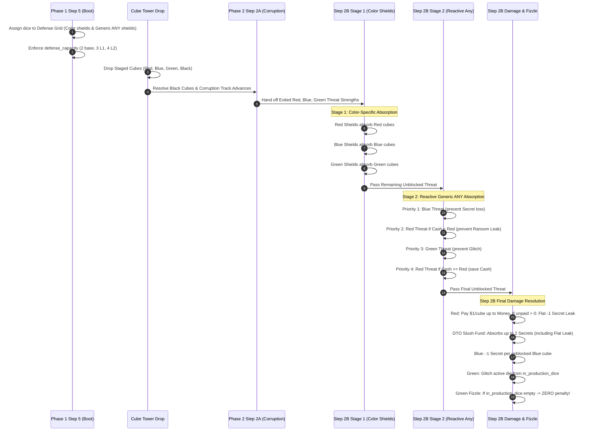

# Technical Architecture Specification: Phase 38 (v0.31.0)
## Flexible Generic Defense, Flat Unpaid Ransom & Malware Fizzle

**Author:** Principal Engineer / Architect  
**Status:** Approved for Implementation  
**Target Version:** `v0.31.0` Baseline  
**Dependencies:** [RULES.md](../../RULES.md), [PLAN.md](../../PLAN.md), [v300_starting_resources_spec.md](./v300_starting_resources_spec.md)  
**Target Components:**
- `sim/config.py`
- `sim/engine/state.py`
- `sim/engine/phase1_boot.py`
- `sim/engine/phase2_threat.py`
- `sim/engine/end_game.py`
- `sim/bots/base.py` & bot subclasses (`sim/bots/*.py`)
- `web/schemas.py`
- `web/controller/phase1_actions.py`
- `web/static/js/components/player_mats.js`
- `tests/test_v310_threat_defense.py`

---

## 1. Executive Summary & Architectural Motivation

### 1.1 Context & Strategic Objectives
Following the successful deployment and Monte Carlo validation of Phase 37 (`v0.30.0`)—which calibrated starting capital ($6 baseline, $8 Meridian), established 0 🔬 baseline research, seeded 1 starter Purple Specialist die into active play, and balanced module costs—pre-SDLC mathematical analysis and game designer modeling identified three structural friction points in Phase 2 threat resolution:

1. **Pre-Commitment Defense Grid Rigidity ("Block 1 Any"):**  
   In `v0.30.0` and earlier, players rolling "Block 1 Any" shields (Gray Legacy faces 1 & 2, White Contractor faces 1–3, Purple Specialist faces 1 & 2, Green G2 Universal Sandbox) were forced in Phase 1 Step 5 to guess and lock into a specific cube color (`RED`, `BLUE`, or `GREEN`) before any cubes exited the Cube Tower. Because Cube Tower drop outputs have high tactical variance and compiler drop physics (ledge avalanches vs stuck retention), players frequently guessed wrong—e.g. committing to Blue shields only to watch 3 Red cubes drop while Blue remained stuck. This negated the core thematic fantasy of flexible generic firewall defenses.
2. **Punitive Linear Unpaid Ransom Escalation:**  
   When unblocked Red ransomware cubes exceeded liquid cash, the engine deducted 1 Corporate Secret per unpaid dollar. In mid-to-late game scenarios where 3–4 Red cubes dropped and a player had $0 cash, losing 3–4 Secrets in a single turn triggered sudden, unrecoverable player elimination ("death spirals") that felt disproportionate compared to Blue spyware. Converting unpaid ransomware to a **flat 1 Corporate Secret dark web leak fine** preserves sharp survival tension while eliminating catastrophic multi-secret death spirals.
3. **Malware Cascading Destruction Fallback:**  
   When unblocked Green malware cubes struck a corporation with no active production dice remaining, legacy rules forced the destruction (permanent removal from the game) of dice from Under Development (Glitched/Scanned) or Ready for Release zones, followed by accumulating `unfulfilled_destructions` penalty points for Total Wipeout tiebreakers. This fallback created rules bloat, punished players already suffering from total production paralysis, and distorted end-game scoring. Replacing the fallback with **Malware Fizzle** (zero penalty if active production is empty) cleanly limits Green malware to its primary role: disrupting active production.

### 1.2 Approved Architectural Baselines (User-Aligned)

```
+---------------------------------------------------------------------------------------------------------+
|                                      v0.31.0 ARCHITECTURAL BASELINE                                     |
+-----------------------------------+-------------------------------------+-------------------------------+
| Feature / Invariant               | Legacy Baseline (v0.30.0)           | Calibrated Baseline (v0.31.0) |
+-----------------------------------+-------------------------------------+-------------------------------+
| "Block 1 Any" Defense Assignment  | Pre-committed to Red/Blue/Green in  | Flexible Generic Shield on    |
|                                   | Phase 1 Step 5 before tower drop    | Defense Grid; absorbs in Ph2  |
| "Block 1 Any" Phase 2 Absorption  | Fixed to pre-committed color        | Reactive: absorbs remaining   |
|                                   |                                     | threat post color-shield drop |
| Reactive Shield Priority Heuristic| N/A (Pre-committed)                 | Blue > Unfunded Red > Green > |
|                                   |                                     | Funded Red                    |
| Unpaid Red Ransomware Penalty     | Linear: -1 Secret per $1 unpaid     | Flat: -1 Secret total leak,   |
|                                   | shortfall ($3 unpaid = -3 Secrets)  | regardless of shortfall size  |
| Red Ransom Cash Satisfaction      | Pays $1/cube; if paid, 0 secrets    | Pays $1/cube; if paid, 0 sec  |
| DTO Slush Fund vs Unpaid Ransom   | Absorbs up to 2 Secrets linear      | Absorbs flat 1 Secret leak    |
| Unblocked Green Malware Fallback  | Destroys dice from Under Dev/Ready; | MALWARE FIZZLE: 0 penalty if  |
|                                   | tracks unfulfilled_destructions     | in_production_dice is empty   |
| Destruction Fallback Rule         | Active across engine and scoring    | Completely excised & deleted  |
| Total Wipeout Scoring             | Breach depth + unfulfilled destr.   | Clean breach depth below 0    |
+-----------------------------------+-------------------------------------+-------------------------------+
```

### 1.3 Architectural Flow & Threat Resolution Pipeline



---

## 2. Detailed Invariant Specifications

### `INV-FLEX-SHIELD-01`: Reactive "Block 1 Any" Allocation & Defense Grid Capacity
1. **Phase 1 Step 5 Defense Grid Assignment:**
   - Any die rolled showing a face with `face.shield_color == ShieldColor.ANY` (or `face.block_amount > 0` and generic defense) may be assigned to the player's Defense Grid.
   - Eligible dice include:
     - Gray Legacy Starter Dice (Faces 1 and 2: "Block 1 Any").
     - White Contractor Temporary Dice (Faces 1, 2, and 3: "Block 1 Any").
     - Purple Specialist Starter/Reserve Dice (Faces 1 and 2: "Block 1 Any").
     - Green Module Variant G2 (*Universal Sandbox*, Face 6: "Block 1 Any + 1 🔧").
   - When assigned to the Defense Grid, the die is assigned `ShieldColor.ANY` and deployed with `ProductionRole.ANY_SHIELD`.
   - Players and bots **do not** specify a cube color (`RED`, `BLUE`, or `GREEN`) during Phase 1. The shield is stored and displayed as a generic flexible shield.
   - **Defense Grid Capacity Enforcement:**
     - The sum of all committed shields (`len(color_shields) + len(any_shields)`) must not exceed the player's `player.defense_capacity` (2 baseline; 3 at Level 1; 4 at Level 2).
     - If excess shields are assigned, priority truncation preserves shields in the order: `ShieldColor.BLUE` > `ShieldColor.ANY` > `ShieldColor.RED` > `ShieldColor.GREEN`. Rejected dice revert to `ProductionRole.INCOME`.
2. **Phase 2 Step 2B Two-Stage Defense Resolution:**
   - Threat resolution executes in two distinct sequential stages:
     - **Stage 1 (Color-Specific Matching Shield Absorption):**
       - Fixed Red shields absorb exited Red threat cubes (1:1).
       - Fixed Blue shields absorb exited Blue threat cubes (1:1).
       - Fixed Green shields absorb exited Green threat cubes (1:1).
       - Exited cubes remaining unblocked become `remaining_red`, `remaining_blue`, `remaining_green`.
     - **Stage 2 (Reactive Generic "Block 1 Any" Shield Absorption):**
       - Total available generic shields: `available_any = sum(face.block_amount for d in player.any_shield_dice)`.
       - While `available_any > 0` and `(remaining_red + remaining_blue + remaining_green) > 0`, allocate 1 `ANY` shield unit according to the strict **4-Tier Strategic Defense Priority**:
         1. **Tier 1 (Critical Secrets):** If `remaining_blue > 0`, absorb 1 Blue threat. (Prevents immediate loss of Corporate Secrets).
         2. **Tier 2 (Unfunded Ransom Shortfall):** If `remaining_red > 0` and `player.money < remaining_red`, absorb 1 Red threat. (Reduces Red threat towards available cash to prevent the catastrophic flat 1 Secret dark web leak fine).
         3. **Tier 3 (Production Integrity):** If `remaining_green > 0`, absorb 1 Green threat. (Prevents active dice in `in_production_dice` from being glitched into Under Development).
         4. **Tier 4 (Cash Preservation):** If `remaining_red > 0` (and `player.money >= remaining_red`), absorb 1 Red threat. (Saves $1 cash per cube rather than letting flexible shields expire unused).
       - Deduct absorbed threat from the respective color and decrement `available_any` by 1.
3. **Zero Dice Wear Invariant (`v0.22.0` Retention):**
   - Modules assigned to Defense Grid (both color-specific and generic ANY shields) absorb threat cubes cleanly. They **do not** wear down or demote to Under Development upon blocking. They remain deployed in `in_production_dice`.

---

### `INV-RANSOM-FLAT-01`: Flat 1 Corporate Secret Unpaid Ransom Leak & Slush Fund Absorption
1. **Cash Ransom Payment:**
   - Following Stage 1 and Stage 2 shield absorption, remaining Red cubes constitute `unblocked_red`.
   - If `unblocked_red > 0`:
     - The defending player pays $1 cash per unblocked Red cube up to available liquid cash:  
       $$\text{cash\_paid} = \min(\text{player.money}, \text{unblocked\_red})$$
     - Deduct cash: `player.money -= cash_paid`.
     - Calculate unpaid shortfall:  
       $$\text{unpaid\_ransom} = \text{unblocked\_red} - \text{cash\_paid}$$
2. **Flat Dark Web Leak Penalty:**
   - If $\text{unpaid\_ransom} == 0$: Zero Corporate Secrets lost from Red ransomware. The attack was fully paid off.
   - If $\text{unpaid\_ransom} > 0$:
     - The corporation suffers a **flat penalty of exactly 1 Corporate Secret** (a single dark web leak fine), regardless of whether the unpaid shortfall is $1, $2, $3, or $10+.
     - Mathematical formalization:  
       $$\text{secret\_loss\_from\_ransom} = \begin{cases} 1 & \text{if } \text{unpaid\_ransom} > 0 \\ 0 & \text{if } \text{unpaid\_ransom} == 0 \end{cases}$$
     - Legacy linear deduction (`player.secrets -= unpaid_ransom`) is completely removed.
3. **DTO / Spook Slush Fund Interaction:**
   - Dept. of Telecom (DTO) Client Company override / Spook White Hat protocol (*Slush Fund*) allows absorbing up to 2 Corporate Secret loss for free.
   - Total secret loss at risk in Phase 2 Step 2B is:  
     $$\text{potential\_secret\_loss} = \text{secret\_loss\_from\_ransom} + \text{unblocked\_blue}$$
   - Slush Fund absorbs up to 2 Secrets from this combined pool:
     - If $\text{unpaid\_ransom} > 0$ and $\text{unblocked\_blue} == 0$: $\text{potential\_secret\_loss} = 1$. Slush Fund absorbs the 1 Secret leak completely, resulting in **0 Secrets lost**.
     - If $\text{unpaid\_ransom} > 0$ and $\text{unblocked\_blue} == 1$: $\text{potential\_secret\_loss} = 2$. Slush Fund absorbs both (1 from flat ransom leak, 1 from Blue spyware), resulting in **0 Secrets lost**.
     - If $\text{unpaid\_ransom} > 0$ and $\text{unblocked\_blue} == 2$: $\text{potential\_secret\_loss} = 3$. Slush Fund absorbs 2 Secrets, resulting in **1 Secret lost**.
     - If Slush Fund is not available or exhausted, deduct net secrets: `player.secrets -= remaining_secret_loss`.

---

### `INV-MALWARE-FIZZLE-01`: Green Malware Fizzle & Destruction Fallback Removal
1. **Active Malware Execution:**
   - Following Stage 1 and Stage 2 shield absorption, remaining Green cubes constitute `unblocked_green`.
   - For each unblocked Green cube:
     - **Contractor Sacrifice:** If the player has active White contractor dice in `player.contractor_dice` and chooses to sacrifice one, pop 1 contractor die and return it to `contractor_supply`.
     - **Production Glitch:** Else, if `len(player.in_production_dice) > 0`:
       - Triage 1 die from `in_production_dice` and move it to `player.glitched_dice`.
       - Selection heuristic prioritizes: Shield dice (already blocked) > Gray Legacy dice > lowest cost module.
2. **Malware Fizzle Execution:**
   - If `len(player.in_production_dice) == 0` (all active dice were already glitched into Under Development, or active pool is offline):
     - Unblocked Green malware **fizzles with ZERO penalty**!
     - **Zero Under Development Impact:** No dice are removed or destroyed from `player.glitched_dice` or `player.scanned_dice`.
     - **Zero Ready Zone Impact:** No dice are removed or destroyed from `player.ready_for_release_dice`.
     - **Zero Telemetry/Scoring Penalty:** `player.unfulfilled_destructions` is never incremented.
3. **Deprecation & Complete Deletion of Destruction Fallback:**
   - The entire legacy destruction fallback cascade—destroying dice and returning them to the game box—is deprecated and deleted across `sim/engine/phase2_threat.py`, `sim/engine/end_game.py`, and `RULES.md`.
   - Permanent dice are never permanently deleted from player ownership during threat resolution.

---

### `INV-WIPEOUT-CLEAN-01`: Clean Breach Depth Total Wipeout Scoring
1. **Total Wipeout Definition:**
   - If all players reach Patient Zero status ($\text{player.secrets} \le 0$) in the same round, the game terminates immediately with `EndGameReason.TOTAL_WIPEOUT`.
2. **Excised Destruction Penalties:**
   - Legacy `unfulfilled_destructions` tracking and `overflow_penalty_per_unfulfilled_destroyed_die` penalties are excised.
   - For wiped-out players, overflow penalty is purely determined by negative breach depth:  
     $$\text{net\_score} = -(\text{player.breach\_depth}) = \text{player.secrets}$$
3. **Cleaned Total Wipeout Tiebreaker Hierarchy:**
   - When all corporations collapse simultaneously, final standings are ranked strictly in descending order:
     1. `net_score` (highest / least negative, equivalent to `player.secrets` below zero).
     2. `money` (highest operational cash buffer).
     3. `ready_colored_dice_count` (highest active software module portfolio).
     4. `research_tokens` / `patches` (highest cryptographic research banked).
     5. `-unpatched_dice_count` (fewest dice glitched/scanned under development).
   - `unfulfilled_destructions` is completely purged from tiebreaker sorting keys.

---

## 3. Data Model Adjustments & Module Contracts

### 3.1 `sim/config.py`
- Retain `ShieldColor.ANY = "any"` enum member.
- Deprecate / remove configuration field `overflow_penalty_per_unfulfilled_destroyed_die: int = -1`.
- Ensure `GameConfig` cleanly maintains `vp_per_secret: int = 1` and `overflow_penalty_per_secret_debt: int = -1`.

```python
class ShieldColor(str, Enum):
    RED = "red"
    BLUE = "blue"
    GREEN = "green"
    ANY = "any"  # Flexible Generic Shield (INV-FLEX-SHIELD-01)
```

### 3.2 `sim/engine/state.py`
- Expand `ProductionRole` enum to include `ANY_SHIELD`:
  ```python
  class ProductionRole(str, Enum):
      INCOME = "INCOME"
      RED_SHIELD = "RED_SHIELD"
      BLUE_SHIELD = "BLUE_SHIELD"
      GREEN_SHIELD = "GREEN_SHIELD"
      ANY_SHIELD = "ANY_SHIELD"  # Added in v0.31.0 (INV-FLEX-SHIELD-01)
  ```
- In `PlayerState`:
  - Add property `any_shield_dice`:
    ```python
    @property
    def any_shield_dice(self) -> List[Die]:
        """Modules in In Production actively assigned to Generic Any defense."""
        return [
            d for d in self.in_production_dice
            if getattr(d, "production_role", None) == ProductionRole.ANY_SHIELD
        ]
    ```
  - Update property `shield_dice` to include `ProductionRole.ANY_SHIELD`:
    ```python
    @property
    def shield_dice(self) -> List[Die]:
        """All modules actively assigned to defense across Red, Blue, Green, and Any."""
        return [
            d for d in self.in_production_dice
            if getattr(d, "production_role", None) in (
                ProductionRole.RED_SHIELD,
                ProductionRole.BLUE_SHIELD,
                ProductionRole.GREEN_SHIELD,
                ProductionRole.ANY_SHIELD,
            )
        ]
    ```
  - Deprecate / excise `unfulfilled_destructions: int = 0` from `PlayerState.__init__` and defaults.

### 3.3 `sim/engine/phase1_boot.py`
- In `execute_phase_1`:
  - Step 5 Commitment Handling:
    - If `face.shield_color == ShieldColor.ANY`, commitments register `ShieldColor.ANY` directly instead of forcing pre-commitment to `ShieldColor.BLUE`.
    - Enforce `defense_capacity`:
      ```python
      total_shields = len(validated_commitments)
      if total_shields > player.defense_capacity:
          # Priority: BLUE > ANY > RED > GREEN
          priority_map = {
              ShieldColor.BLUE: 0,
              ShieldColor.ANY: 1,
              ShieldColor.RED: 2,
              ShieldColor.GREEN: 3,
          }
          sorted_items = sorted(
              validated_commitments.items(),
              key=lambda item: priority_map.get(item[1], 4),
          )
          allowed = dict(sorted_items[:player.defense_capacity])
          rejected_indices = set(validated_commitments.keys()) - set(allowed.keys())
          validated_commitments = allowed
          for r_idx in rejected_indices:
              r_die = active_dice[r_idx]
              if r_die.current_face and r_die.current_face.is_choice and r_die.current_face.has_shield_option:
                  r_die.chosen_choice_index = 1
      ```
  - Production Role Assignment:
    ```python
    if s_color == ShieldColor.RED:
        die.production_role = ProductionRole.RED_SHIELD
    elif s_color == ShieldColor.BLUE:
        die.production_role = ProductionRole.BLUE_SHIELD
    elif s_color == ShieldColor.GREEN:
        die.production_role = ProductionRole.GREEN_SHIELD
    elif s_color == ShieldColor.ANY:
        die.production_role = ProductionRole.ANY_SHIELD
    ```

### 3.4 `sim/engine/phase2_threat.py`
- Refactor `resolve_player_defense_and_wear` to implement the two-stage defense model, flat unpaid ransom leak, and malware fizzle:

```python
def resolve_player_defense_and_wear(
    engine: GameEngine,
    player: PlayerState,
    rolled_dice: List[Die],
    commitments: Dict[int, ShieldColor],
    attack_strengths: Dict[CubeColor, int],
    exited_cubes: Dict[CubeColor, int],
    active_directive: str,
    defer_green_malware: bool = False,
) -> None:
    active_ver = engine.state.active_version.version_str

    # 1. Tally committed shields by color and generic ANY
    color_shields: Dict[ShieldColor, int] = {
        ShieldColor.RED: 0,
        ShieldColor.BLUE: 0,
        ShieldColor.GREEN: 0,
        ShieldColor.ANY: 0,
    }
    for idx, color in commitments.items():
        die = rolled_dice[idx]
        face = die.effective_face or die.current_face
        if face and face.is_shield:
            color_shields[color] += face.block_amount

    player_attacks = dict(attack_strengths)

    # 2. Pre-Defense Overrides: Aegis Defense Relay / Baffle Echo
    is_aegis = bool(
        (player.company and player.company.code == CompanyCode.AEGIS)
        or (player.archetype and player.archetype.code == ArchetypeCode.ACOUSTIC)
    ) and player.is_ability_available(active_ver)
    if is_aegis:
        qualifying = [
            c for c in [CubeColor.RED, CubeColor.BLUE, CubeColor.GREEN]
            if player_attacks.get(c, 0) > 0 and exited_cubes.get(c, 0) > 0
        ]
        if qualifying:
            chosen_color = player.bot.choose_aegis_override(
                player_state=player,
                qualifying_colors=qualifying,
                exited_cubes=exited_cubes,
                active_version_str=active_ver,
                rng=engine.rng,
                corruption_track=engine.state.corruption_track,
            )
            if chosen_color in qualifying:
                player_attacks[chosen_color] = max(0, player_attacks[chosen_color] - 1)
                player.mark_ability_used(active_ver)

    # 3. Passive Firewall (Defense Track Level 2)
    if getattr(player, "has_passive_firewall", False):
        candidates = [c for c in [CubeColor.BLUE, CubeColor.RED, CubeColor.GREEN] if player_attacks.get(c, 0) > 0]
        if candidates:
            best_c = max(candidates, key=lambda c: player_attacks.get(c, 0) - color_shields.get(ShieldColor(c.value), 0))
            player_attacks[best_c] = max(0, player_attacks[best_c] - 1)

    # 4. Stage 1: Color-Specific Shield Absorption
    rem_red = max(0, player_attacks[CubeColor.RED] - color_shields[ShieldColor.RED])
    rem_blue = max(0, player_attacks[CubeColor.BLUE] - color_shields[ShieldColor.BLUE])
    rem_green = max(0, player_attacks[CubeColor.GREEN] - color_shields[ShieldColor.GREEN])

    # 5. Stage 2: Reactive Generic "Block 1 Any" Absorption (INV-FLEX-SHIELD-01)
    avail_any = color_shields[ShieldColor.ANY]
    while avail_any > 0 and (rem_red + rem_blue + rem_green) > 0:
        # Tier 1: Blue Threat (prevent Secret loss)
        if rem_blue > 0:
            rem_blue -= 1
            avail_any -= 1
        # Tier 2: Red Threat if Cash < Red (prevent Unpaid Ransom Flat Leak)
        elif rem_red > 0 and player.money < rem_red:
            rem_red -= 1
            avail_any -= 1
        # Tier 3: Green Threat (prevent Glitch to in_production_dice)
        elif rem_green > 0:
            rem_green -= 1
            avail_any -= 1
        # Tier 4: Red Threat if Cash >= Red (save Cash buffer)
        elif rem_red > 0:
            rem_red -= 1
            avail_any -= 1
        else:
            break

    unblocked_red = rem_red
    unblocked_blue = rem_blue
    unblocked_green = rem_green

    # 6. Star face bonuses dependent on damage (R2, R3, B1)
    for die in rolled_dice:
        face = die.effective_face or die.current_face
        if not face or not face.is_star:
            continue
        if face.star_code == "R2" and unblocked_red == 0:
            player.money += 2
        elif face.star_code == "R3" and exited_cubes.get(CubeColor.RED, 0) >= 3:
            player.money += 1
        elif face.star_code == "B1" and exited_cubes.get(CubeColor.BLUE, 0) >= 1 and unblocked_blue == 0:
            player.money += 3

    # 7. Red Ransomware Resolution (INV-RANSOM-FLAT-01)
    unpaid_ransom = 0
    if unblocked_red > 0:
        cash_paid = min(player.money, unblocked_red)
        player.money -= cash_paid
        unpaid_ransom = unblocked_red - cash_paid

    # Flat Secret Leak: 1 Secret if any shortfall exists, else 0
    ransom_secret_loss = 1 if unpaid_ransom > 0 else 0
    potential_secret_loss = ransom_secret_loss + unblocked_blue

    # DTO Slush Fund Interaction
    is_dto = bool(
        (player.company and player.company.code == CompanyCode.DTO)
        or (player.archetype and player.archetype.code == ArchetypeCode.SPOOK)
    ) and player.is_ability_available(active_ver)
    if potential_secret_loss > 0 and is_dto:
        free_absorb = min(2, potential_secret_loss)
        potential_secret_loss -= free_absorb
        player.mark_ability_used(active_ver)

    if potential_secret_loss > 0:
        player.secrets -= potential_secret_loss

    player.money = max(0, player.money)

    # Patient Zero Check
    if player.secrets <= 0:
        player.is_patient_zero = True
        player.elimination_round = engine.state.current_round
        player.elimination_reason = "Total Breach (<= 0 Secrets)"
        player.breach_depth = max(0, -player.secrets)

    # 8. Green Malware Resolution & Malware Fizzle (INV-MALWARE-FIZZLE-01)
    player.pending_unblocked_green = unblocked_green
    if defer_green_malware:
        return

    for _ in range(unblocked_green):
        sacrifice = player.bot.choose_malware_sacrifice(
            player_state=player,
            unblocked_green=unblocked_green,
            rng=engine.rng,
        )
        if sacrifice and len(player.contractor_dice) > 0:
            player.contractor_dice.pop(0)
            engine.state.contractor_supply += 1
        elif len(player.in_production_dice) > 0:
            def glitch_sort_key(d: Die) -> Tuple[int, int, int]:
                role = getattr(d, "production_role", None)
                is_shield = 0 if role in (
                    ProductionRole.RED_SHIELD,
                    ProductionRole.BLUE_SHIELD,
                    ProductionRole.GREEN_SHIELD,
                    ProductionRole.ANY_SHIELD,
                ) else 1
                is_gray = 0 if d.color == DieColor.GRAY else 1
                return (is_shield, is_gray, getattr(d, "cost", 0))

            target_die = min(player.in_production_dice, key=glitch_sort_key)
            player.in_production_dice.remove(target_die)
            player.glitched_dice.append(target_die)
        else:
            # MALWARE FIZZLE: in_production_dice is empty.
            # ZERO dice destroyed from glitched, scanned, or ready_for_release. Zero penalty!
            break
```

### 3.5 `sim/engine/end_game.py`
- Clean up Total Wipeout evaluation (INV-WIPEOUT-CLEAN-01):
  ```python
  if all_patient_zero:
      secret_penalty = p.breach_depth * cfg.overflow_penalty_per_secret_debt
      overflow_penalties = secret_penalty
      net_score = overflow_penalties
  else:
      net_score = portfolio_value
  ```
- Purge `unfulfilled_destructions` from rankings dictionary and Total Wipeout sorting keys:
  ```python
  rankings.sort(
      key=lambda r: (
          r["net_score"],
          r["secrets"],
          r["money"],
          r["ready_colored_dice_count"],
          r["patches"],
          -r["unpatched_dice_count"],
      ),
      reverse=True,
  )
  ```

---

## 4. Bot Heuristics & Decision Contracts

### 4.1 Base Bot `commit_shields`
In `sim/bots/base.py`, update `commit_shields` so that dice showing generic shields (`face.shield_color == ShieldColor.ANY`) are assigned `ShieldColor.ANY` directly:

```python
def commit_shields(
    self,
    player_state: PlayerState,
    rolled_dice: List[Die],
    staging_cubes: Dict[CubeColor, int],
    stuck_cubes: Dict[CubeColor, int],
    directive_code: str,
    rng: random.Random,
) -> Dict[int, ShieldColor]:
    assignments: Dict[int, ShieldColor] = {}
    staging = staging_cubes or {}
    stuck = stuck_cubes or {}
    blue_threat = staging.get(CubeColor.BLUE, 0) + stuck.get(CubeColor.BLUE, 0)

    for idx, die in enumerate(rolled_dice):
        face = die.current_face
        if not face or face.is_glitch:
            continue
        if face.is_shield:
            if face.shield_color == ShieldColor.ANY:
                # Flexible generic shield (INV-FLEX-SHIELD-01)
                assignments[idx] = ShieldColor.ANY
            else:
                assignments[idx] = face.shield_color
        elif face.has_shield_option and blue_threat > 0:
            assignments[idx] = ShieldColor.BLUE
    return assignments
```

### 4.2 Subclass Bot Alignment
Audit all 5 specialized bot classes:
- `SecOpsTurtleBot` (`sim/bots/secops_turtle.py`): Update overridden `commit_shields` to assign `ShieldColor.ANY` for generic shields instead of hardcoding `ShieldColor.BLUE`.
- `AdaptiveBalancedBot` (`sim/bots/adaptive_balanced.py`): Ensure generic shields assign `ShieldColor.ANY`.
- `VentureGreedBot` (`sim/bots/venture_greed.py`): Ensure generic shields assign `ShieldColor.ANY`.
- `AccelerationistBot` (`sim/bots/accelerationist.py`): Ensure generic shields assign `ShieldColor.ANY`.
- `RecklessSaboteurBot` (`sim/bots/reckless_saboteur.py`): Ensure generic shields assign `ShieldColor.ANY`.

---

## 5. Web API Contracts & UI Synchronization

### 5.1 Endpoint `/api/game/action/commit_defenses`
- **Request Payload:**
  ```json
  {
    "player_id": 0,
    "commitments": {
      "0": "any",
      "1": "red",
      "2": "blue"
    },
    "choice_declarations": {
      "3": 0
    }
  }
  ```
- **Validation Rules (`web/controller/phase1_actions.py`):**
  - Accepted shield target strings: `"red"`, `"blue"`, `"green"`, `"any"`.
  - If a die's face has `face.shield_color == ShieldColor.ANY`, accept `"any"`, `"red"`, `"blue"`, or `"green"`. Default / canonical storage is `ShieldColor.ANY`.
  - Auto-commit fallback: uncommitted `ANY` shields that fit within `defense_capacity` are automatically assigned `ShieldColor.ANY`.
  - Die deployed to `in_production_dice` receives `ProductionRole.ANY_SHIELD`.

### 5.2 Serialization & Schemas (`web/schemas.py`)
- In `GameStateSerializer.serialize_player`:
  - Include `"any_shield"` list in `production_slots`:
    ```python
    "production_slots": {
        "income": [cls.serialize_die(d) for d in player.income_dice],
        "red_shield": [cls.serialize_die(d) for d in player.red_shield_dice],
        "blue_shield": [cls.serialize_die(d) for d in player.blue_shield_dice],
        "green_shield": [cls.serialize_die(d) for d in player.green_shield_dice],
        "any_shield": [cls.serialize_die(d) for d in player.any_shield_dice],
    }
    ```
  - Purge `unfulfilled_destructions` from serialized player telemetry snapshots and end game results.

### 5.3 Web UI Component Synchronization (`player_mats.js`)
- In `web/static/js/components/player_mats.js`:
  - Update Defense Grid CI/CD wireframe slots to render a distinct cyan/purple badge for `ANY` shields:
    ```javascript
    const isAnyShield = die.production_role === 'ANY_SHIELD' || (die.current_face && die.current_face.shield_color === 'any');
    ```
  - Render defense capacity counter: `Defenses: ${committedShields}/${defenseCapacity} (Flexible Firewall Ready)`.

---

## 6. Comprehensive Test Verification Matrix (14 Tests)

A dedicated test suite `tests/test_v310_threat_defense.py` will verify all specifications:

| Test ID | Targeted Invariant | Setup / Scenario Description | Expected Outcome |
| :--- | :--- | :--- | :--- |
| **TEST-01** | `INV-FLEX-SHIELD-01` | Commit Gray and Purple dice showing "Block 1 Any" to Defense Grid in Phase 1 Step 5. | Dice are assigned `ShieldColor.ANY` and `ProductionRole.ANY_SHIELD`; not forced to Red/Blue/Green. |
| **TEST-02** | `INV-FLEX-SHIELD-01` | Assign 3 shields on a player with `defense_capacity = 2` (1 Blue, 1 Any, 1 Green). | Capacity truncates excess: Blue and Any are kept; Green is rejected and moved to Income. |
| **TEST-03** | `INV-FLEX-SHIELD-01` | Drop 2 Red, 2 Blue cubes with 1 Red shield, 1 Blue shield, and 1 Any shield. | Stage 1 absorbs 1 Red and 1 Blue. Stage 2 Any shield prioritizes remaining Blue threat (Tier 1). Final: 0 Blue, 1 Red unblocked. |
| **TEST-04** | `INV-FLEX-SHIELD-01` | Drop 2 Red, 0 Blue, 1 Green cubes. Player has $0 cash and 1 Any shield. | Stage 2 Any shield prioritizes unfunded Red threat (Tier 2) over Green to prevent ransom leak. Final: 1 Red, 1 Green unblocked. |
| **TEST-05** | `INV-FLEX-SHIELD-01` | Drop 2 Red, 0 Blue, 1 Green cubes. Player has $5 cash and 1 Any shield. | Player has enough cash for Red ($5 >= $2). Any shield prioritizes Green threat (Tier 3) over funded Red. Final: 2 Red ($2 paid), 0 Green. |
| **TEST-06** | `INV-FLEX-SHIELD-01` | Drop 2 Red, 0 Blue, 0 Green cubes. Player has $5 cash and 1 Any shield. | Any shield absorbs 1 Red threat (Tier 4 fallback). Player pays $1 cash for remaining Red. Cash preserved ($4 remaining). |
| **TEST-07** | `INV-FLEX-SHIELD-01` | Zero wear verification: Gray and Purple dice assigned to `ANY_SHIELD` absorb threat. | Dice absorb threat cleanly and remain in `in_production_dice`; zero demotions to Under Development. |
| **TEST-08** | `INV-RANSOM-FLAT-01` | Unblocked Red = 2, Player Cash = $1. Shortfall = $1 ($1 unpaid). | Player pays $1 cash ($0 left). Player loses exactly flat 1 Corporate Secret. |
| **TEST-09** | `INV-RANSOM-FLAT-01` | Unblocked Red = 4, Player Cash = $0. Shortfall = $4 ($4 unpaid). | Player pays $0 cash. Player loses exactly flat 1 Corporate Secret (NOT 4 Secrets). |
| **TEST-10** | `INV-RANSOM-FLAT-01` | Unblocked Red = 3, Player Cash = $3. Shortfall = $0 (fully funded). | Player pays $3 cash ($0 left). Exactly 0 Corporate Secrets lost from Red ransomware. |
| **TEST-11** | `INV-RANSOM-FLAT-01` | DTO Slush Fund active: Unblocked Red = 3, Cash = $0 (shortfall $3 -> 1 Secret), Unblocked Blue = 0. | Potential secret loss = 1. Slush Fund absorbs 1 Secret completely. Net secret loss = 0. Ability marked used. |
| **TEST-12** | `INV-MALWARE-FIZZLE-01` | Unblocked Green = 2. Player has 0 dice in `in_production_dice`, 3 dice in `glitched_dice`, 2 dice in `ready_for_release_dice`. | Malware fizzles! Glitched count remains 3, Ready count remains 2. Zero dice destroyed. Zero unfulfilled destructions. |
| **TEST-13** | `INV-MALWARE-FIZZLE-01` | Unblocked Green = 1. Player has 1 White contractor die and 1 Gray die in `in_production_dice`. | Contractor is sacrificed and returned to supply. Gray die in production remains safe. |
| **TEST-14** | `INV-WIPEOUT-CLEAN-01` | All players reach Secrets <= 0 in round. Player A has Secrets -2; Player B has Secrets -4. Both had empty production. | Net score: Player A = -2, Player B = -4. Player A ranked #1. `unfulfilled_destructions` is absent from tiebreakers. |

---

## 7. Implementation Roadmap & Senior Engineer Checklist

1. [ ] **Configuration Updates (`sim/config.py`):**
   - Verify `ShieldColor.ANY` is recognized.
   - Deprecate `overflow_penalty_per_unfulfilled_destroyed_die`.
2. [ ] **Data Model Updates (`sim/engine/state.py`):**
   - Add `ProductionRole.ANY_SHIELD`.
   - Add `PlayerState.any_shield_dice` and update `shield_dice` property.
   - Excise `unfulfilled_destructions` references.
3. [ ] **Phase 1 Boot Updates (`sim/engine/phase1_boot.py`):**
   - Support `ShieldColor.ANY` in `commitments`.
   - Update `defense_capacity` priority map (`BLUE: 0, ANY: 1, RED: 2, GREEN: 3`).
   - Assign `ProductionRole.ANY_SHIELD` to generic shields.
4. [ ] **Phase 2 Threat Resolution (`sim/engine/phase2_threat.py`):**
   - Implement Stage 1 (matching color shields) followed by Stage 2 (reactive generic ANY shields).
   - Implement 4-tier reactive defense priority heuristic.
   - Implement flat 1 Secret dark web leak fine for unpaid Red ransom.
   - Integrate DTO Slush Fund absorption with flat ransom leak.
   - Implement Malware Fizzle when `in_production_dice` is empty; delete destruction fallback cascade.
5. [ ] **End Game Clean Up (`sim/engine/end_game.py`):**
   - Excise `unfulfilled_destructions` from Total Wipeout net score and tiebreaker sorting.
6. [ ] **Bot Subclass Audit (`sim/bots/*.py`):**
   - Update `BaseBot.commit_shields` and all bot subclasses to commit generic shields as `ShieldColor.ANY`.
7. [ ] **Web Controller & Schemas (`web/`):**
   - Update `web/controller/phase1_actions.py` to validate `"any"` shield commitments.
   - Update `web/schemas.py` to serialize `any_shield` in `production_slots`.
   - Update `web/static/js/components/player_mats.js` to render flexible shield badges.
8. [ ] **Test Suite Implementation (`tests/test_v310_threat_defense.py`):**
   - Author and verify all 14 unit and integration tests.
   - Verify 100% test pass rate across entire regression suite (`pytest tests/`).
