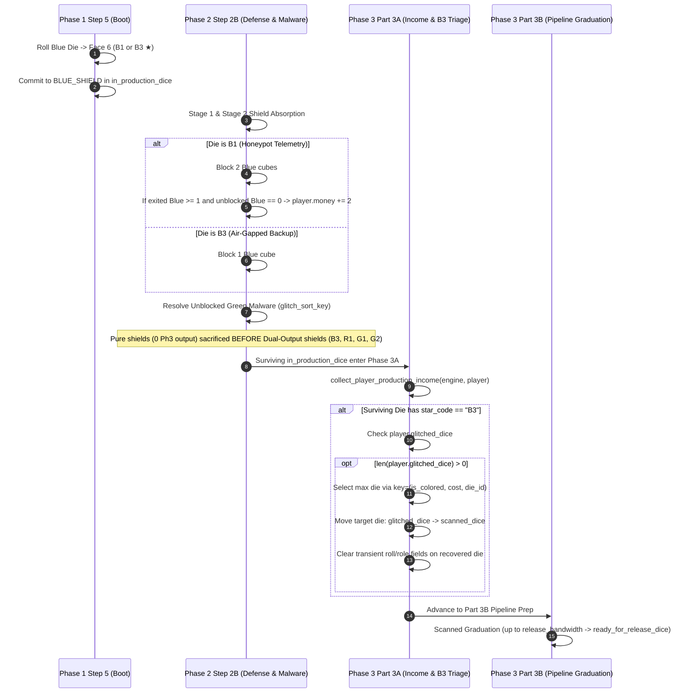

# Technical Architecture Specification: Phase 39 (v0.32.0)
## Blue Variant Rebalance — `B1 — Honeypot Telemetry` & `B3 — Air-Gapped Backup`

**Author:** Principal Engineer / Architect  
**Status:** Approved for Implementation  
**Target Version:** `v0.32.0` Baseline  
**Dependencies:** [RULES.md](../../RULES.md), [PLAN.md](../../PLAN.md), [v310_threat_defense_spec.md](./v310_threat_defense_spec.md)  
**Target Components:**
- [`sim/entities.py`](file:///z:/home/mike/antigravity/rogue-agent/sim/entities.py)
- [`sim/engine/phase2_threat.py`](file:///z:/home/mike/antigravity/rogue-agent/sim/engine/phase2_threat.py)
- [`sim/engine/phase3_ops.py`](file:///z:/home/mike/antigravity/rogue-agent/sim/engine/phase3_ops.py)
- [`web/controller/phase2_actions.py`](file:///z:/home/mike/antigravity/rogue-agent/web/controller/phase2_actions.py)
- [`web/controller/phase3_actions.py`](file:///z:/home/mike/antigravity/rogue-agent/web/controller/phase3_actions.py)
- [`web/static/js/components/action_dock.js`](file:///z:/home/mike/antigravity/rogue-agent/web/static/js/components/action_dock.js)
- [`pnp/generate_pnp.py`](file:///z:/home/mike/antigravity/rogue-agent/pnp/generate_pnp.py)
- [`tests/test_v320_blue_variants.py`](file:///z:/home/mike/antigravity/rogue-agent/tests/test_v320_blue_variants.py)

---

## 1. Executive Summary & Architectural Motivation

### 1.1 Context & Strategic Objectives
Following the deployment of Phase 38 (`v0.31.0` — Flexible Generic Defense, Flat Unpaid Ransom, and Malware Fizzle), pre-SDLC mathematical modeling and Variant Card parity analysis identified two major balance anomalies in the Blue (`BLUE // FIREWALL`) Variant Card suite:

1. **Over-Tuned Cash Bounty on `B1 — Honeypot Telemetry` (`$5`):**  
   At `$5` market cost, `B1` provided `Block 2 Blue` plus a conditional `+$3` cash bounty whenever `1+` Blue cubes exited the tower and the player took `0` unblocked Blue damage. Compared to its Red counterpart `R2 — Threat Bounty` (`$5`, `Block 2 Red` + `+$2` conditional bounty), `B1` protected the most lethal threat axis (Corporate Secrets) while simultaneously paying `+$1` *more* cash than `R2`. Calibrating `B1`'s conditional bounty from `+$3` to **`+$2`** establishes strict mathematical symmetry with `R2` while preserving `B1`'s strong defensive identity.
2. **Obsolete Rules Text & Dead Ability on `B3 — Air-Gapped Backup` (`$4`):**  
   Since the `v0.22.0` CI/CD Pipeline overhaul introduced **Zero-Wear Shield Blocking** (dice assigned to the Defense Grid absorb threat cleanly without wearing down to Under Development), `B3`'s legacy text—*"when this die actively blocks, you may move 1 other Ready die of your choice to Unpatched instead of this die"*—became a complete no-op in the simulation engine (`sim/engine/phase2_threat.py` and `sim/engine/phase3_ops.py`). A player rolling Face 6 (`★`) on a `$4` `B3` Blue die received only `Block 1 Blue`, strictly identical to Face 1 (`Block 1 Blue`).  
   Re-architecting `B3 — Air-Gapped Backup` into a **Dual-Output Defense + Phase 3A Pipeline Recovery** face (**`Block 1 Blue` in Phase 2 AND move `1` die from the `Glitched Box` to the `Scanned Box` in Phase 3A**) restores full functional utility at the `$4` price tier, creates high-agency synergy against Phase 2B Green Malware / Phase 1 Glitches, and mirrors the dual-output design of `R1` (`Block 1 Red` + `+$2`), `G1` (`Block 2 Green` + `+1 🔬`), and `G2` (`Block 1 Any` + `+1 🔬`).
3. **Green Malware Shield Sacrifice Priority (`glitch_sort_key`):**  
   When unblocked Green Malware forces a player to glitch an active die from `in_production_dice` at the end of Phase 2B, the engine prioritizes sacrificing Shield dice (which have already completed their Phase 2B blocking job) before Income dice. However, dual-output Star shields (`B3`, `R1`, `G1`, `G2`) still carry uncollected Phase 3A outputs! Updating `glitch_sort_key` to sacrifice **pure shields (`0` Phase 3A output)** before **dual-output shields (`1+` Phase 3A output)** prevents bots and auto-fallback handlers from needlessly throwing away `B3`'s pipeline recovery or `R1`/`G1`/`G2`'s resource yields.

### 1.2 Approved Architectural Baselines (User-Aligned)

```
+----------------------------------------------------------------------------------------------------------+
|                                      v0.32.0 ARCHITECTURAL BASELINE                                      |
+------------------------------------+------------------------------------+--------------------------------+
| Feature / Invariant                | Legacy Baseline (v0.31.0)          | Calibrated Baseline (v0.32.0)  |
+------------------------------------+------------------------------------+--------------------------------+
| B1 (Honeypot Telemetry, $5)        | Block 2 Blue; if 1+ Blue exit &    | Block 2 Blue; if 1+ Blue exit  |
|                                    | 0 Blue dmg -> gain +$3             | & 0 Blue dmg -> gain +$2       |
| B3 (Air-Gapped Backup, $4)         | Block 1 Blue; obsolete wear        | Block 1 Blue (Ph2) + move 1    |
|                                    | redirect (no-op in engine)         | Glitched die -> Scanned (Ph3A) |
| B3 Target Selection Heuristic      | N/A (unimplemented)                | Highest value in glitched_dice:|
|                                    |                                    | (is_colored, cost, die_id)     |
| Green Malware Shield Sacrifice     | 3-tuple: (is_shield, is_gray,      | 4-tuple: (is_shield,           |
| Priority (glitch_sort_key)         | cost) — treats all shields equally | has_phase3_output, is_gray,    |
|                                    |                                    | cost) — pure shields first!    |
| Web Action Dock B1 Live Cash Calc  | 3 * humanThreat.b1_count           | 2 * humanThreat.b1_count       |
| Web Phase 2 Income Preview Note    | No star_note for B3                | "Air-Gapped Backup (1 Glitched |
|                                    |                                    | → Scanned)"                    |
+------------------------------------+------------------------------------+--------------------------------+
```

### 1.3 Architectural Flow: Phase 2B Defense to Phase 3A `B3` Recovery Pipeline



---

## 2. Detailed Invariant Specifications

### `INV-B1-BOUNTY-01`: `B1 — Honeypot Telemetry` Conditional Bounty Calibration (`+$2`)
1. **Card & Face Definition (`sim/entities.py`):**
   - Variant Code: `"B1"`, Name: `"Honeypot Telemetry"`, Die Color: `DieColor.BLUE`, Cost: `5` (`$5`).
   - Star Face (`Face` index 5):
     - `name="B1: Honeypot Telemetry"`
     - `block_amount=2`
     - `shield_color=ShieldColor.BLUE`
     - `money=0` (conditional bounty resolved in Phase 2 Step 2B)
     - `is_star=True`
     - `star_code="B1"`
   - Description string: `"Block 2 Blue; if 1+ Blue cubes exit the tower and you take 0 Blue damage, gain +$2."`
2. **Phase 2 Step 2B Bounty Resolution (`sim/engine/phase2_threat.py`):**
   - During Step 6 of `resolve_player_defense_and_wear`, after Stage 1 (color-specific shields) and Stage 2 (reactive `ANY` shields) have absorbed incoming attacks and `unblocked_blue` is finalized:
   - For each die in `rolled_dice` whose effective face (`die.effective_face or die.current_face`) has `face.is_star and face.star_code == "B1"`:
     - If `exited_cubes.get(CubeColor.BLUE, 0) >= 1` **AND** `unblocked_blue == 0`:
       - Increment `player.money += 2`.
     - Otherwise (if `0` Blue cubes exited the tower, or if `unblocked_blue >= 1`):
       - Player gains `$0` from `B1`.
3. **Timing Prior to Red Ransomware Payment:**
   - As established in Step 6 of `resolve_player_defense_and_wear`, `B1`'s `+$2` bounty is credited to `player.money` **before** Step 7 (Red Ransomware cash payment), meaning the `+$2` bounty is immediately available to help pay unblocked Red ransomware cubes in the same round.

---

### `INV-B3-BACKUP-01`: `B3 — Air-Gapped Backup` Dual-Output Shield & Phase 3A Pipeline Recovery
1. **Card & Face Definition (`sim/entities.py`):**
   - Variant Code: `"B3"`, Name: `"Air-Gapped Backup"`, Die Color: `DieColor.BLUE`, Cost: `4` (`$4`).
   - Star Face (`Face` index 5):
     - `name="B3: Air-Gapped Backup"`
     - `block_amount=1`
     - `shield_color=ShieldColor.BLUE`
     - `is_star=True`
     - `star_code="B3"`
   - Description string: `"Block 1 Blue; in Phase 3A, move 1 die from your Glitched Box to your Scanned Box."`
2. **Phase 2 Defense Behavior:**
   - When committed to the Defense Grid in Phase 1 Step 5, `B3` is assigned `ProductionRole.BLUE_SHIELD` and provides `1` Blue shield in Phase 2 Step 2B Stage 1.
   - Under the `v0.22.0` Zero-Wear Shield invariant, `B3` remains in `player.in_production_dice` after blocking (unless subsequently glitched by unblocked Green Malware).
   - Even if `B3` was placed in `ProductionRole.INCOME` (e.g., if `defense_capacity` was full during Phase 1 Step 5), it remains in `player.in_production_dice` and still triggers its Phase 3A recovery effect if it survives to Phase 3A.
3. **Phase 3A Step 1 Pipeline Recovery Execution (`sim/engine/phase3_ops.py`):**
   - Inside `collect_player_production_income(engine: GameEngine, player: PlayerState, plan: Any = None) -> None`:
   - While iterating through `for die in list(player.in_production_dice):` where `eff = die.effective_face or die.current_face`:
   - When `eff.is_star and eff.star_code == "B3"`:
     - If `len(player.glitched_dice) > 0`:
       - Select the highest-value target die from `player.glitched_dice` using the strict deterministic key:
         ```python
         target_die = max(
             player.glitched_dice,
             key=lambda d: (1 if d.color != DieColor.GRAY else 0, getattr(d, "cost", 0), d.die_id),
         )
         ```
       - Remove `target_die` from `player.glitched_dice`.
       - Reset all transient roll/production attributes on `target_die`:
         ```python
         target_die.production_role = None
         target_die.is_locked = False
         target_die.chosen_choice_index = None
         target_die.current_face = None
         for attr in ("rolled_face_idx", "rolled_effect", "prod_role", "overclock_face"):
             if hasattr(target_die, attr):
                 setattr(target_die, attr, None)
         ```
       - Append `target_die` to `player.scanned_dice`.
       - Increment optional telemetry counter `player.b3_recoveries = getattr(player, "b3_recoveries", 0) + 1` if tracked.
     - If `len(player.glitched_dice) == 0`:
       - Safely no-op (`0` dice moved; no error raised).
4. **Interaction with `Y3 — Proprietary Training` and Green Malware:**
   - **Green Malware Recovery:** Because Phase 2B unblocked Green Malware moves infected `in_production_dice` into `player.glitched_dice` *before* Phase 3A `collect_player_production_income` runs, a surviving `B3` die can immediately rescue another die that was just glitched by Green Malware in Phase 2B (or a die that glitched in Phase 1), moving it into `player.scanned_dice` so it is eligible to graduate to `ready_for_release_dice` during Phase 3B Step 2 (`release_bandwidth`)!
   - **`Y3` Ordering:** In `collect_player_production_income`, `Y3` appends itself to `dice_to_glitch`, which is processed *after* the `for die in list(player.in_production_dice):` loop completes (lines 71–75). Thus, `B3` only recovers dice that were already in `player.glitched_dice` entering Phase 3A Step 1, and cannot prematurely recover a `Y3` die that glitches at the end of income collection.

---

### `INV-GLITCH-SHIELD-PRIO-01`: Green Malware Sacrifice Priority (Pure Shields Before Dual-Output Shields)
1. **Motivation:**
   - Shield dice in `in_production_dice` have already absorbed threat in Phase 2B before Green Malware resolves. Thus, sacrificing a Shield die to Green Malware is preferred over sacrificing an Income die.
   - However, dual-output Star shields (`B3`, `R1`, `G1`, `G2`) still provide Phase 3A outputs (`1 Glitched -> Scanned`, `+$2`, `+1 🔬`, `+1 🔬` respectively). A pure shield (such as Gray `Block 1 Any`, Blue `Block 1 Blue`, Red `Block 1 Red`, Green `Block 1 Green`, `R2`, `B1`, or `B2` assigned to defense) provides **zero** additional output in Phase 3A because its block or Phase 2 bounty has already resolved.
2. **4-Tuple Sorting Key Contract:**
   - Both [`sim/engine/phase2_threat.py`](file:///z:/home/mike/antigravity/rogue-agent/sim/engine/phase2_threat.py#L465-L475) and [`web/controller/phase3_actions.py`](file:///z:/home/mike/antigravity/rogue-agent/web/controller/phase3_actions.py#L222-L231) must define `glitch_sort_key` as a 4-tuple:
     ```python
     def glitch_sort_key(d: Die) -> Tuple[int, int, int, int]:
         role = getattr(d, "production_role", None)
         is_shield = 0 if role in (
             ProductionRole.RED_SHIELD,
             ProductionRole.BLUE_SHIELD,
             ProductionRole.GREEN_SHIELD,
             ProductionRole.ANY_SHIELD,
         ) else 1
         face = d.effective_face or d.current_face
         has_phase3_output = 1 if (
             face is not None and (
                 face.money > 0
                 or face.patches > 0
                 or face.secrets > 0
                 or getattr(face, "star_code", None) in ("B3", "R1", "G1", "G2")
             )
         ) else 0
         is_gray = 0 if d.color == DieColor.GRAY else 1
         return (is_shield, has_phase3_output, is_gray, getattr(d, "cost", 0))
     ```
3. **Strict Sacrifice Hierarchy (`min(player.in_production_dice, key=glitch_sort_key)`):**
   1. **Tier 1 (`is_shield=0, has_phase3_output=0, is_gray=0`):** Pure Gray Legacy shields (`Block 1 Any`).
   2. **Tier 2 (`is_shield=0, has_phase3_output=0, is_gray=1`):** Pure Colored shields with zero Phase 3A output (basic `Block 1`, `R2`, `B1`, `B2` committed to shield), ordered by lowest `cost`.
   3. **Tier 3 (`is_shield=0, has_phase3_output=1, is_gray=1`):** Dual-output Star shields (`B3`, `G2` at `$4`, then `R1`, `G1` at `$5`).
   4. **Tier 4 (`is_shield=1, ...`):** Active Income dice, ordered by `has_phase3_output`, `is_gray` (Gray first), and lowest `cost`.

---

### `INV-WEB-UI-SYNC-01`: Web Controller, Frontend Action Dock & Print-and-Play Synchronization
1. **Phase 2 Income Preview Note (`web/controller/phase2_actions.py`):**
   - In `compile_drop`, when constructing `details` for `player.in_production_dice` (lines 89–106), add a branch for `eff.star_code == "B3"`:
     ```python
     elif eff.star_code == "B3":
         star_note = "Air-Gapped Backup (1 Glitched → Scanned)"
     ```
   - This ensures that both the Harvested Production Income preview chip and the Green Malware candidate selection card display `B3: Air-Gapped Backup (Air-Gapped Backup (1 Glitched → Scanned))` to the human player.
2. **Phase 3 `confirm_income` Execution Order (`web/controller/phase3_actions.py`):**
   - In `confirm_income(controller, glitch_die_ids, any_shield_allocations)`:
     - Step A (lines 170–250): Resolve `pending_unblocked_green` by moving human-selected `glitch_die_ids` (and any auto-selected fallback dice using the synchronized 4-tuple `glitch_sort_key`) from `player.in_production_dice` to `player.glitched_dice`.
     - Step B (lines 251–258): Return White Contractor dice to `contractor_supply`.
     - Step C (lines 259–266): Call `collect_player_production_income(controller.engine, player, None)` on surviving `player.in_production_dice`. Any surviving `B3` die moves 1 die from `player.glitched_dice` to `player.scanned_dice`.
     - Step D (lines 267–281): Transfer surviving `in_production_dice` to `scanned_dice` for visual pipeline display during Phase 3A operations turns.
     - **Critical Note on Bot Income Timing in `compile_drop`:** In `web/controller/phase2_actions.py` (line 67), `controller.engine._execute_phase_2(player_commitments, defer_green_for_pids=human_pids)` resolves bot Green Malware immediately (during `_execute_phase_2`), *before* `collect_player_production_income` is called for bots at line 184. Thus, both bots and humans resolve Green Malware prior to `collect_player_production_income`.
3. **Frontend Action Dock `b1Bonus` Calculation (`web/static/js/components/action_dock.js`):**
   - At line 494, update `b1Bonus` multiplier from `3` to `2`:
     ```javascript
     const b1Bonus = (humanThreat.b1_count || 0) > 0 && (exited.blue || 0) >= 1 && liveUnblockedBlue === 0 ? 2 * humanThreat.b1_count : 0;
     ```
4. **Print-and-Play Generator (`pnp/generate_pnp.py`) & Living Rules (`RULES.md`):**
   - Synchronize `VARIANT_CARDS` entries for `"B1"` and `"B3"` in `pnp/generate_pnp.py` (lines 340–359) and Section 6B of `RULES.md` (lines 328–330).

---

## 3. Data Model Adjustments & Module Contracts

### 3.1 `sim/entities.py`
Update `B1` and `B3` in [`get_all_variant_cards()`](file:///z:/home/mike/antigravity/rogue-agent/sim/entities.py#L290-L332):

```python
        # Blue ★ Variants
        VariantCard(
            code="B1",
            name="Honeypot Telemetry",
            die_color=DieColor.BLUE,
            description="Block 2 Blue; if 1+ Blue cubes exit the tower and you take 0 Blue damage, gain +$2.",
            cost=5,
            star_face=Face(
                name="B1: Honeypot Telemetry",
                block_amount=2,
                shield_color=ShieldColor.BLUE,
                money=0,  # Bonus (+$2) handled conditionally in Phase 2 (INV-B1-BOUNTY-01)
                is_star=True,
                star_code="B1",
            ),
        ),
        VariantCard(
            code="B2",
            name="Deep R&D Vault",
            die_color=DieColor.BLUE,
            description="Block 1 Blue, OR pay $4 during Phase 3 to gain +1 Corporate Secret.",
            cost=6,
            star_face=Face(
                name="B2: Deep R&D Vault",
                block_amount=1,
                shield_color=ShieldColor.BLUE,
                is_star=True,
                star_code="B2",
            ),
        ),
        VariantCard(
            code="B3",
            name="Air-Gapped Backup",
            die_color=DieColor.BLUE,
            description="Block 1 Blue; in Phase 3A, move 1 die from your Glitched Box to your Scanned Box.",
            cost=4,
            star_face=Face(
                name="B3: Air-Gapped Backup",
                block_amount=1,
                shield_color=ShieldColor.BLUE,
                is_star=True,
                star_code="B3",
            ),
        ),
```

---

### 3.2 `sim/engine/phase2_threat.py`
1. **Update `B1` conditional bounty (`+$3` -> `+$2`) at lines 370–371:**
   ```python
    # 6. Star face bonuses dependent on damage (R2, R3, B1)
    for die in rolled_dice:
        face = die.effective_face or die.current_face
        if not face or not face.is_star:
            continue
        if face.star_code == "R2" and unblocked_red == 0:
            player.money += 2
        elif face.star_code == "R3" and exited_cubes.get(CubeColor.RED, 0) >= 3:
            player.money += 1
        elif face.star_code == "B1" and exited_cubes.get(CubeColor.BLUE, 0) >= 1 and unblocked_blue == 0:
            player.money += 2
   ```
2. **Update `glitch_sort_key` in Step 8 (Green Malware Resolution) at lines 465–475:**
   ```python
        elif len(player.in_production_dice) > 0:
            def glitch_sort_key(d: Die) -> Tuple[int, int, int, int]:
                role = getattr(d, "production_role", None)
                is_shield = 0 if role in (
                    ProductionRole.RED_SHIELD,
                    ProductionRole.BLUE_SHIELD,
                    ProductionRole.GREEN_SHIELD,
                    ProductionRole.ANY_SHIELD,
                ) else 1
                face = d.effective_face or d.current_face
                has_phase3_output = 1 if (
                    face is not None and (
                        face.money > 0
                        or face.patches > 0
                        or face.secrets > 0
                        or getattr(face, "star_code", None) in ("B3", "R1", "G1", "G2")
                    )
                ) else 0
                is_gray = 0 if d.color == DieColor.GRAY else 1
                return (is_shield, has_phase3_output, is_gray, getattr(d, "cost", 0))

            target_die = min(player.in_production_dice, key=glitch_sort_key)
            player.in_production_dice.remove(target_die)
            player.glitched_dice.append(target_die)
   ```

---

### 3.3 `sim/engine/phase3_ops.py`
In [`collect_player_production_income`](file:///z:/home/mike/antigravity/rogue-agent/sim/engine/phase3_ops.py#L18-L76), add `elif eff.star_code == "B3":` inside the `if eff.is_star:` block:

```python
        if eff.is_star:
            if eff.star_code == "Y2":
                # Cloud Monopoly: +$2, plus +$1 per different colored module die owned (max +$5)
                count = len({d.color for d in player.colored_dice})
                total_payout = min(engine.config.y2_max_payout, engine.config.y2_base_payout + count)
                bonus = total_payout - eff.money
                player.money += max(0, bonus)
            elif eff.star_code == "Y3":
                # Proprietary Training: move die to glitched_dice after collecting secret
                dice_to_glitch.append(die)
            elif eff.star_code == "B3":
                # Air-Gapped Backup (INV-B3-BACKUP-01): Move 1 die from glitched_dice to scanned_dice
                if player.glitched_dice:
                    target_die = max(
                        player.glitched_dice,
                        key=lambda d: (1 if d.color != DieColor.GRAY else 0, getattr(d, "cost", 0), d.die_id),
                    )
                    player.glitched_dice.remove(target_die)
                    target_die.production_role = None
                    target_die.is_locked = False
                    target_die.chosen_choice_index = None
                    target_die.current_face = None
                    for attr in ("rolled_face_idx", "rolled_effect", "prod_role", "overclock_face"):
                        if hasattr(target_die, attr):
                            setattr(target_die, attr, None)
                    player.scanned_dice.append(target_die)
            elif eff.star_code == "PURPLE_STAR":
```

---

### 3.4 `web/controller/phase2_actions.py`
In [`compile_drop`](file:///z:/home/mike/antigravity/rogue-agent/web/controller/phase2_actions.py#L89-L106), add `B3` to the `star_note` lookup:

```python
            if eff.is_star:
                if eff.star_code == "Y2":
                    count = len({d.color for d in player.colored_dice})
                    total_payout = min(controller.state.config.y2_max_payout, controller.state.config.y2_base_payout + count)
                    bonus = max(0, total_payout - eff.money)
                    m += bonus
                    star_note = f"Cloud Monopoly (+${bonus} bonus)"
                elif eff.star_code == "Y3":
                    star_note = "Proprietary Training (+1 Secret -> Glitched)"
                elif eff.star_code == "B3":
                    star_note = "Air-Gapped Backup (1 Glitched → Scanned)"
                elif eff.star_code == "R1":
                    star_note = "Ransom Insurance (+$2)"
                elif eff.star_code == "G1":
                    star_note = "Self-Healing Kernel (+1 🔧)"
                elif eff.star_code == "G2":
                    star_note = "Universal Sandbox (+1 🔧)"
                elif eff.star_code == "G3":
                    star_note = "Live Reboot (+$1, +2 🔧)"
```

---

### 3.5 `web/controller/phase3_actions.py`
In [`confirm_income`](file:///z:/home/mike/antigravity/rogue-agent/web/controller/phase3_actions.py#L222-L232), synchronize the fallback `glitch_sort_key` with `sim/engine/phase2_threat.py`:

```python
                elif player.in_production_dice:
                    def glitch_sort_key(d: Die) -> Tuple[int, int, int, int]:
                        role = getattr(d, "production_role", None)
                        is_shield = 0 if role in (
                            ProductionRole.RED_SHIELD,
                            ProductionRole.BLUE_SHIELD,
                            ProductionRole.GREEN_SHIELD,
                            ProductionRole.ANY_SHIELD,
                        ) else 1
                        face = d.effective_face or d.current_face
                        has_phase3_output = 1 if (
                            face is not None and (
                                face.money > 0
                                or face.patches > 0
                                or face.secrets > 0
                                or getattr(face, "star_code", None) in ("B3", "R1", "G1", "G2")
                            )
                        ) else 0
                        is_gray = 0 if d.color == DieColor.GRAY else 1
                        return (is_shield, has_phase3_output, is_gray, getattr(d, "cost", 0))
                    target_die = min(player.in_production_dice, key=glitch_sort_key)
```

---

### 3.6 `web/static/js/components/action_dock.js`
At [line 494](file:///z:/home/mike/antigravity/rogue-agent/web/static/js/components/action_dock.js#L494), update `b1Bonus`:

```javascript
      // Pre-step2b cash + star bonuses to determine live flat leak
      const preMoney = humanThreat.pre_step2b_money !== undefined ? humanThreat.pre_step2b_money : (human.money || 0);
      const r2Bonus = (humanThreat.r2_count || 0) > 0 && liveUnblockedRed === 0 ? 2 * humanThreat.r2_count : 0;
      const r3Bonus = (humanThreat.r3_count || 0) > 0 && (exited.red || 0) >= 3 ? 1 * humanThreat.r3_count : 0;
      const b1Bonus = (humanThreat.b1_count || 0) > 0 && (exited.blue || 0) >= 1 && liveUnblockedBlue === 0 ? 2 * humanThreat.b1_count : 0;
      const availableCashForRansom = preMoney + r2Bonus + r3Bonus + b1Bonus;
```

---

### 3.7 `pnp/generate_pnp.py` & `RULES.md`
1. **Update `VARIANT_CARDS` in [`pnp/generate_pnp.py`](file:///z:/home/mike/antigravity/rogue-agent/pnp/generate_pnp.py#L339-L359):**
   ```python
    # BLUE (B1-B3)
    VariantCardSpec(
        "B1", "blue", "BLUE // FIREWALL", "$5",
        "{PIP1} 1{BLUE} | {PIP2} +1{RESEARCH} | {PIP3} +$1", "{PIP4} 1{BLUE}/1{RESEARCH} | {PIP5} Glitch | {PIP6} {STAR}",
        "Honeypot Telemetry", "P2 DEFENSE + BONUS",
        "**Block 2 {BLUE} Blue**; if **1+ {BLUE} Blue** cubes exit and you take **0 Blue** damage, gain **+$2**.",
        "Honeypot: Blocks 2 Blue; +$2 if 0 unblocked.",
    ),
    VariantCardSpec(
        "B2", "blue", "BLUE // FIREWALL", "$6",
        "{PIP1} 1{BLUE} | {PIP2} +1{RESEARCH} | {PIP3} +$1", "{PIP4} 1{BLUE}/1{RESEARCH} | {PIP5} Glitch | {PIP6} {STAR}",
        "Deep R&D Vault", "P2 DEF -OR- P3 OPS",
        "**Block 1 {BLUE} Blue**, **OR** leave unassigned to pay **$4** in Phase 3 for **+1 Secret**.",
        "R&D Vault: Blocks Blue OR pay $4 in P3 for Secret.",
    ),
    VariantCardSpec(
        "B3", "blue", "BLUE // FIREWALL", "$4",
        "{PIP1} 1{BLUE} | {PIP2} +1{RESEARCH} | {PIP3} +$1", "{PIP4} 1{BLUE}/1{RESEARCH} | {PIP5} Glitch | {PIP6} {STAR}",
        "Air-Gapped Backup", "P2 DEFENSE + P3 TRIAGE",
        "**Block 1 {BLUE} Blue** in Phase 2 **AND** move **1 die from Glitched to Scanned** in Phase 3A.",
        "Air-Gapped: Blocks 1 Blue & triages 1 Glitched die.",
    ),
   ```
2. **Update Section 6B in [`RULES.md`](file:///z:/home/mike/antigravity/rogue-agent/RULES.md#L327-L331):**
   ```markdown
   * **Blue `★` Variants:**
     * *B1 — Honeypot Telemetry (`$5`):* `[In Production — Defense]` `Block 2 Blue`; if 1+ Blue cubes exit the tower and you take `0` Blue damage, gain `+$2`.
     * *B2 — Deep R&D Vault (`$6`):* `[In Production — Defense]` `Block 1 Blue`, **OR** `[Phase 3 — Operations]` pay `$4` during Phase 3 to gain `+1 Corporate Secret` `[TUNE]`.
     * *B3 — Air-Gapped Backup (`$4`):* `[In Production — Defense]` `Block 1 Blue` + `[In Production — Income]` move `1` die from your **Glitched Box** to your **Scanned Box** `[TUNE]`.
   ```

---

## 4. Comprehensive Test Verification Matrix (`tests/test_v320_blue_variants.py`)

A dedicated unit and integration test suite [`tests/test_v320_blue_variants.py`](file:///z:/home/mike/antigravity/rogue-agent/tests/test_v320_blue_variants.py) must be authored to validate all `v0.32.0` invariants:

| Test ID | Targeted Invariant | Setup / Scenario Description | Expected Outcome |
| :--- | :--- | :--- | :--- |
| **TEST-V320-01** | `INV-B1-BOUNTY-01` | Inspect `get_all_variant_cards()["B1"]` metadata, cost, star face, and description. | `cost == 5`, `block_amount == 2`, `shield_color == ShieldColor.BLUE`, `money == 0`, description specifies `+$2`. |
| **TEST-V320-02** | `INV-B1-BOUNTY-01` | Player commits 1 `B1` die (`Block 2 Blue`). Tower drops `2` Blue cubes (`attack_strengths[BLUE] = 2`). Unblocked Blue = `0`. | `B1` blocks both Blue cubes and awards exactly `+$2` cash (`player.money` increases by `2`, not `3`). |
| **TEST-V320-03** | `INV-B1-BOUNTY-01` | Player commits 1 `B1` die (`Block 2 Blue`). Tower drops `0` Blue cubes (`exited_cubes[BLUE] = 0`). | Unblocked Blue is `0`, but because `0` Blue cubes exited the tower, `B1` awards `$0` bonus cash. |
| **TEST-V320-04** | `INV-B1-BOUNTY-01` | Player commits 1 `B1` die (`Block 2 Blue`). Tower drops `3` Blue cubes (`attack_strengths[BLUE] = 3`). Unblocked Blue = `1`. | `B1` blocks 2 Blue cubes, player loses 1 Secret, and because `unblocked_blue > 0`, `B1` awards `$0` bonus cash. |
| **TEST-V320-05** | `INV-B1-BOUNTY-01` | Player has `$0` cash, commits 1 `B1` die, and faces `1` Blue cube + `2` Red cubes. | `B1` blocks the 1 Blue cube, grants `+$2` cash in Step 6, and Step 7 uses that `$2` to fully pay the `2` Red ransomware cubes (`0` Secrets lost). |
| **TEST-V320-06** | `INV-B3-BACKUP-01` | Inspect `get_all_variant_cards()["B3"]` metadata, cost, star face, and description. | `cost == 4`, `block_amount == 1`, `shield_color == ShieldColor.BLUE`, `star_code == "B3"`, description specifies moving 1 die from Glitched Box to Scanned Box in Phase 3A. |
| **TEST-V320-07** | `INV-B3-BACKUP-01` | Player has 1 surviving `B3` die in `in_production_dice` and 3 dice in `glitched_dice`: Gray (`cost=0, id=1`), Red (`cost=4, id=2`), Yellow (`cost=6, id=3`). Call `collect_player_production_income`. | `B3` selects Yellow (`cost=6`, colored), removes it from `glitched_dice`, clears transient roll/role fields, and appends it to `scanned_dice`. Gray and Red remain in `glitched_dice`. |
| **TEST-V320-08** | `INV-B3-BACKUP-01` | Tiebreaker check: Player has 1 surviving `B3` die in `in_production_dice` and 2 Colored dice in `glitched_dice` with equal cost (`cost=5, die_id=10` vs `cost=5, die_id=25`). | `B3` deterministically selects `die_id=25` via `(1, 5, 25) > (1, 5, 10)` and moves it to `scanned_dice`. |
| **TEST-V320-09** | `INV-B3-BACKUP-01` | Empty Glitched Box check: Player has 1 surviving `B3` die in `in_production_dice` and `glitched_dice == []`. Call `collect_player_production_income`. | Clean no-op: `glitched_dice` and `scanned_dice` remain unchanged, no exception raised. |
| **TEST-V320-10** | `INV-B3-BACKUP-01` | Full round pipeline synergy: Player has `B3` (Blue Shield) and a Gray die (`Block 1 Any`) in `in_production_dice`, `glitched_dice` initially empty. Phase 2B drops `1` Blue and `1` Green cube. | `B3` blocks the 1 Blue cube. Unblocked Green glitches the Gray die into `glitched_dice`. In Phase 3A, surviving `B3` recovers the Gray die from `glitched_dice` to `scanned_dice`. In Phase 3B, the Gray die graduates from `scanned_dice` to `ready_for_release_dice`! |
| **TEST-V320-11** | `INV-GLITCH-SHIELD-PRIO-01` | Player has 2 shields in `in_production_dice`: a `$5` Blue die showing Face 1 (`Block 1 Blue`, pure shield) and a `$4` Blue die showing `B3` (`Block 1 Blue` + Phase 3A triage). `1` unblocked Green malware hits. | `glitch_sort_key` sacrifices the `$5` pure shield `(0, 0, 1, 5)` BEFORE the `$4` dual-output `B3` shield `(0, 1, 1, 4)`, preserving `B3` for Phase 3A! |
| **TEST-V320-12** | `INV-GLITCH-SHIELD-PRIO-01` | Verify `glitch_sort_key` across `R1`, `G1`, `G2`, and pure shields: pure Colored shield is sacrificed before `R1`/`G1`/`G2`, and `R1`/`G1`/`G2` shields are sacrificed before non-shield Income dice. | Pure shield glitched first; dual-output shield glitched second; pure Income die preserved last. |
| **TEST-V320-13** | `INV-WEB-UI-SYNC-01` | Web controller integration: Human player rolls `B3`, executes `compile_drop`, and calls `confirm_income` selecting another die to glitch for Green Malware. | `compile_drop` income breakdown includes `star_note == "Air-Gapped Backup (1 Glitched → Scanned)"`. After `confirm_income`, the die glitched by Green Malware is immediately advanced by `B3` from `glitched_dice` to `scanned_dice`. |

---

## 5. Implementation Roadmap & Senior Engineer Checklist

1. [ ] **Entity Definitions (`sim/entities.py`):**
   - Update `B1` description (`+$3` -> `+$2`).
   - Update `B3` description to Phase 2 `Block 1 Blue` + Phase 3A `Glitched -> Scanned` triage.
2. [ ] **Phase 2 Threat Resolution (`sim/engine/phase2_threat.py`):**
   - Update `B1` conditional payout at line 371 (`player.money += 2`).
   - Update `glitch_sort_key` at lines 465–475 to 4-tuple `(is_shield, has_phase3_output, is_gray, cost)`.
3. [ ] **Phase 3 Operations (`sim/engine/phase3_ops.py`):**
   - Add `elif eff.star_code == "B3":` handler in `collect_player_production_income` to move highest-value die from `player.glitched_dice` to `player.scanned_dice` and clear transient fields.
4. [ ] **Web Controller & Frontend UI (`web/`):**
   - Add `B3` `star_note` in `web/controller/phase2_actions.py`.
   - Synchronize 4-tuple `glitch_sort_key` in `web/controller/phase3_actions.py`.
   - Update `b1Bonus` multiplier (`2 * humanThreat.b1_count`) in `web/static/js/components/action_dock.js`.
5. [ ] **Print-and-Play Card Specs (`pnp/generate_pnp.py`):**
   - Update `VARIANT_CARDS` entries for `B1` and `B3`.
6. [ ] **Test Suite Verification (`tests/test_v320_blue_variants.py`):**
   - Author all 13 unit and integration tests in `tests/test_v320_blue_variants.py`.
   - Audit existing regression tests for any hardcoded `B1` `+$3` expectations and run the full test suite via WSL (`pytest`).
