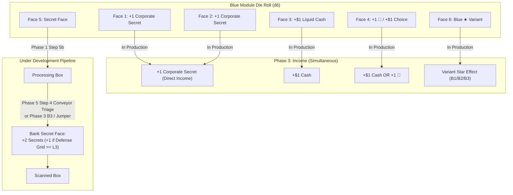

# Technical Architecture Specification: Package `v0.38f`
## Blue Module Die Rebalance: Direct Corporate Secrets on Faces 1 & 2

**Author:** Principal Engineer / Architect  
**Status:** Approved for Implementation (SDLC Architecture Phase)  
**Target Version:** `v0.38f` Baseline  
**Dependencies:**
- [`docs/specs/v380e_secret_simplification_spec.md`](file:///home/mike/antigravity/rogue-agent/docs/specs/v380e_secret_simplification_spec.md)
- [`docs/specs/v380d_c2_green_clean_spec.md`](file:///home/mike/antigravity/rogue-agent/docs/specs/v380d_c2_green_clean_spec.md)
- [`RULES.md`](file:///home/mike/antigravity/rogue-agent/RULES.md)
- [`RULES_APPENDIX.md`](file:///home/mike/antigravity/rogue-agent/RULES_APPENDIX.md)
- [`GLOSSARY.md`](file:///home/mike/antigravity/rogue-agent/GLOSSARY.md)

**Target Components:**
- [`sim/config.py`](file:///home/mike/antigravity/rogue-agent/sim/config.py)
- [`sim/entities.py`](file:///home/mike/antigravity/rogue-agent/sim/entities.py)
- [`sim/engine/phase3_income.py`](file:///home/mike/antigravity/rogue-agent/sim/engine/phase3_income.py)
- [`sim/bots/secret_face_policy.py`](file:///home/mike/antigravity/rogue-agent/sim/bots/secret_face_policy.py)
- [`sim/bots/adaptive_balanced.py`](file:///home/mike/antigravity/rogue-agent/sim/bots/adaptive_balanced.py)
- [`sim/bots/accelerationist.py`](file:///home/mike/antigravity/rogue-agent/sim/bots/accelerationist.py)
- [`sim/bots/reckless_saboteur.py`](file:///home/mike/antigravity/rogue-agent/sim/bots/reckless_saboteur.py)
- [`sim/bots/mixed_policy.py`](file:///home/mike/antigravity/rogue-agent/sim/bots/mixed_policy.py)
- [`scripts/run_v380_secret_faces_sweep.py`](file:///home/mike/antigravity/rogue-agent/scripts/run_v380_secret_faces_sweep.py)
- [`tests/test_v380f_blue_dice_rebalance.py`](file:///home/mike/antigravity/rogue-agent/tests/test_v380f_blue_dice_rebalance.py)

---

## 1. System Overview & Mathematical Rationale

### 1.1 Problem Statement & Historical Context
Across previous iterations (`v0.38` through `v0.38e`), Blue module dice suffered from strategic identity confusion and persistent win-rate suppression:
1. **Redundant Research Overlap with Green:**
   - Under `v0.38e`, Blue dice featured `+1 🔬` on Faces 1 & 2, plus `+1 🔬 / +$1` on Face 4.
   - Green module dice also heavily emphasized research (`+2 🔬`, `+1 🔬`, `+2 🔬`, `+1 🔬 / +$1`).
   - Consequently, Blue functioned as an inferior research engine rather than fulfilling its thematic identity as the **"Firewall / Data Vault"** module.
2. **Asymmetric Secret Banking Latency:**
   - Red produces immediate Market Share / cash in Phase 3 and banks `+2` Secrets + Market Leader Bonus in Phase 5.
   - Blue Secret generation relied exclusively on Face 5 moving into the Processing Box, requiring Triage Bandwidth and taking 1–2 full rounds of conveyor latency before awarding Secrets.
   - Blue Client Companies (**DTO** and **Aegis**) start with a Blue die; despite `v0.38e`'s baseline boost (raising Blue Secret EV from 1.458 to 2.077), Blue companies still lagged behind Red and Green in early-game agency and tempo.

### 1.2 Approved Architecture: Direct Corporate Secrets on Faces 1 & 2
Package `v0.38f` redesigns Blue Faces 1 & 2 from `+1 🔬` to **`+1 Corporate Secret`** (`secrets=1`).



### 1.3 Mathematical Modeling & EV Comparison
Let $E[X]$ be the expected money-equivalent value per face roll, using standard valuation weights:
- Liquid Cash: $1.0\ \$$
- Research Token (`🔬`): $1.2\ \$$
- Corporate Secret (VP & Health): $1.6\ \$$
- Defense Grid Level $\ge 3$ active probability: $p_{\text{L3}} \approx 0.40$
- Average Face 5 yield under `v0.38e`: $Y_{\text{Blue, F5}} = 2.0 + 0.40 = 2.40$ Secrets ($= 3.84\ \$$)

| Face | `v0.38e` Output | `v0.38e` Value ($) | `v0.38f` Output | `v0.38f` Value ($) | $\Delta$ Value |
| :--- | :--- | :---: | :--- | :---: | :---: |
| **Face 1** | `+1 🔬` | $1.20$ | **`+1 Corporate Secret`** | **$1.60$** | **$+0.40$** |
| **Face 2** | `+1 🔬` | $1.20$ | **`+1 Corporate Secret`** | **$1.60$** | **$+0.40$** |
| **Face 3** | `+$1` | $1.00$ | `+$1` | $1.00$ | $0.00$ |
| **Face 4** | `+1 🔬 / +$1` | $1.20$ | `+1 🔬 / +$1` | $1.20$ | $0.00$ |
| **Face 5** | `Secret face` | $3.84$ | `Secret face` | $3.84$ | $0.00$ |
| **Face 6** | `Blue ★` (avg B1–B3) | $\sim 2.00$ | `Blue ★` (avg B1–B3) | $\sim 2.00$ | $0.00$ |
| **Mean Die EV** | *(sum / 6)* | **$1.740$** | *(sum / 6)* | **$1.873$** | **$+0.133\ \$$ / roll** |

### 1.4 Strategic Impact & Design Balance
1. **50% Corporate Secrets Density:**
   - Exactly 3 of 6 faces (50%) on a Blue die generate Corporate Secrets:
     - Faces 1 & 2 award **immediate direct VP income** during Phase 3.
     - Face 5 awards **deferred high-yield banked VP** during Phase 5 (with Defense Grid synergy).
2. **Clear Color Specialization:**
   - **Red:** Market Share & Liquid Cash (`+$2`s, Market Leader Bonus trigger).
   - **Green:** System Integrity & Research (`+2 🔬`s, Glitched Shield Slot clean).
   - **Blue:** Corporate Secrets & Data Vault (`+1 Secret`s, Defense Grid Level 3 synergy).
   - **Yellow:** Commercial Revenue & Fast Market Share (`+$3`, `+2 MS`, versatile choices).
   - **Purple:** Proprietary Specialist (Starter shields `Block 1 Any`, cash/research, operative signature protocols).
3. **Early Game Resilience:**
   - Starting with a Blue die (DTO, Aegis) provides immediate direct survival buffering against Blue Spyware damage without relying on high Triage Bandwidth.

---

## 2. Invariants

- **`INV-V38F-01` (Blue Die Face Topology & Profile):**  
  Under `die_face_profile="V038F"`:
  - Face 1: `Face("+1 Corporate Secret", secrets=1)`
  - Face 2: `Face("+1 Corporate Secret", secrets=1)`
  - Face 3: `Face("+$1", money=1)`
  - Face 4: Choice `Face("+1 🔬", patches=1)` / `Face("+$1", money=1)`
  - Face 5: `SECRET_FACE` (`Face("Secret", secrets_pending=True)`)
  - Face 6: `star_face` (defined by active Blue Variant Card `B1`, `B2`, or `B3`)  
  All other dice (Gray Legacy, White Contractor, Red Marketing, Green Antivirus, Yellow Commercial, Purple Specialist) retain their exact `v0.38e` topologies.
- **`INV-V38F-02` (Direct Phase 3 Income Resolution):**  
  When a Blue die showing Face 1 or Face 2 is in `in_production_dice` during Phase 3 Income, `collect_player_production_income()` credits exactly `+1 Corporate Secret` to the player's balance via `player.gain_secrets(1, "blue_face")`. The die remains In Production until Phase 5 Step 2 (Production Return to Scanned Box), bypassing the Processing Box completely.
- **`INV-V38F-03` (Face 5 Secret Banking Invariance):**  
  Blue Face 5 remains a pending Secret face (`secrets_pending=True`). When it moves to the Processing Box and leaves via Conveyor Triage, *Magnetic Splice*, *B3 Air-Gapped Backup*, or *Jumper Diagnostics*, its yield is strictly governed by `v0.38e` rules:
  $$Y_{\text{Blue, F5}} = \min(3, 2 + \mathbb{I}_{\text{defense\_level} \ge 3})$$
  Direct secrets collected on Faces 1 & 2 in Phase 3 do not diminish, cap, or alter Face 5 banking yields.
- **`INV-V38F-04` (Bot Valuation & Reroll Protection):**  
  Bot heuristics must correctly evaluate and preserve direct Secret faces:
  - `face_value(player, face, state)` values Faces 1 & 2 at `SECRET_VALUE * face.secrets` ($1.6$).
  - `color_score(bot, player, state, DieColor.BLUE)` incorporates updated mean reroll values, raising Blue purchase ranking appropriately.
  - Phase 1 Step 4 reroll logic across bots (`adaptive_balanced.py`, `accelerationist.py`, `reckless_saboteur.py`, and `secret_face_policy.py`) must protect faces with `secrets > 0` from being rerolled when threats are satisfied or cash is low.
- **`INV-V38F-05` (Configuration Inheritance & Golden Parity):**  
  - `GameConfig.v038f()` inherits from `v0.38e()`, configuring `die_face_profile="V038F"`.
  - `GameConfig.v038f_roster()` inherits from `v0.38f()`, enabling `bot_pr_push=True` with default `PrPushParams`.
  - Prior profiles (`v038e`, `v038d`, `v038c`, `v038b`, `v038`, `v037`) remain 100% bit-identical and unaffected.

---

## 3. Configuration Architecture (`sim/config.py`)

### 3.1 Profile Constant Updates
In `sim/config.py`:
```python
# Add "V038F" to the valid V038 face profiles:
V038_DIE_FACE_PROFILES = (
    "V038_DRAFT",
    "V038_YELLOW_MS",
    "V038_YELLOW_MS_ALT",
    "V038_YELLOW_MS_F3",
    "V038D",
    "V038F",
)
_DIE_FACE_PROFILES = ("V037",) + V038_DIE_FACE_PROFILES
```

### 3.2 Factory Methods
```python
@classmethod
def v038f(cls, **overrides) -> "GameConfig":
    """v0.38 candidate 6 (Blue Module Die Rebalance: Direct Corporate Secrets on Faces 1 & 2).
    Inherits all v0.38e rules (C2 setup, 1 starting glitched slot, Shogun Baffle physics,
    Green triage clean, Red owner yield +2 + Market Leader Bonus trigger, Blue Defense Grid L3 trigger),
    and introduces die_face_profile="V038F":
    - Blue Face 1: +1 Corporate Secret
    - Blue Face 2: +1 Corporate Secret
    - Blue Face 3: +$1
    - Blue Face 4: +1 🔬 / +$1
    - Blue Face 5: Secret face (+2 baseline, +1 if Defense Grid >= L3)
    - Blue Face 6: Blue ★ (Variant Card)
    """
    overrides.setdefault("die_face_profile", "V038F")
    return cls.v038e(**overrides)

@classmethod
def v038f_roster(cls, **overrides) -> "GameConfig":
    """``v038f()`` + the ``v037_roster()`` bot switches (lever A push on, default params)."""
    overrides.setdefault("bot_pr_push", True)
    overrides.setdefault("bot_pr_push_params", PrPushParams())
    return cls.v038f(**overrides)
```

---

## 4. Die Topology & Entities Architecture (`sim/entities.py`)

### 4.1 Profile Dispatch in `create_colored_die`
Ensure `"V038F"` is recognized by the `create_colored_die` dispatcher:
```python
if face_profile in ("V038_DRAFT", "V038_YELLOW_MS", "V038_YELLOW_MS_ALT", "V038_YELLOW_MS_F3", "V038D", "V038F"):
    return _create_colored_die_v038(color, die_id, variant_card, star_face, var_code, die_cost, face_profile)
```

### 4.2 Colored Die Definition in `_create_colored_die_v038`
In `sim/entities.py`:
```python
def _create_colored_die_v038(color: DieColor, die_id: int, variant_card: Optional[VariantCard], star_face: Face,
                             var_code: Optional[str], die_cost: int, profile: str = "V038_DRAFT") -> Die:
    if color == DieColor.RED:
        faces = [_choice(Face("+1 Market Share", market_share=1), Face("+$1", money=1)),
                 Face(name="+$2", money=2), Face(name="+$2", money=2), Face(name="+$2", money=2),
                 SECRET_FACE, star_face]
    elif color == DieColor.BLUE:
        if profile == "V038F":
            faces = [
                Face(name="+1 Corporate Secret", secrets=1),
                Face(name="+1 Corporate Secret", secrets=1),
                Face(name="+$1", money=1),
                _choice(Face("+1 🔬", patches=1), Face("+$1", money=1)),
                SECRET_FACE,
                star_face,
            ]
        else:
            faces = [
                Face(name="+1 🔬", patches=1),
                Face(name="+1 🔬", patches=1),
                Face(name="+$1", money=1),
                _choice(Face("+1 🔬", patches=1), Face("+$1", money=1)),
                SECRET_FACE,
                star_face,
            ]
    elif color == DieColor.GREEN:
        f1 = (Face(name="+2 🔬", patches=2) if profile in ("V038D", "V038F")
              else _choice(Face(CLEAN_SLOT_NAME, clean_slots=1), Face("+$1", money=1)))
        faces = [f1,
                 Face(name="+1 🔬", patches=1), Face(name="+2 🔬", patches=2),
                 _choice(Face("+1 🔬", patches=1), Face("+$1", money=1)), SECRET_FACE, star_face]
    elif color == DieColor.YELLOW and profile in ("V038_YELLOW_MS", "V038_YELLOW_MS_ALT", "V038_YELLOW_MS_F3", "V038D", "V038F"):
        y = lambda: _choice(Face("+$2", money=2), Face("+1 🔬", patches=1))
        f1 = (Face(name="+$1 & +1 Market Share", money=1, market_share=1) if profile == "V038_YELLOW_MS_ALT"
              else Face(name="+2 Market Share", market_share=2))
        f3 = (Face(name="+$1 & +1 Market Share", money=1, market_share=1) if profile in ("V038_YELLOW_MS_F3", "V038D", "V038F")
              else Face(name="+$3", money=3))
        faces = [f1, _choice(Face("+1 Market Share", market_share=1), Face("+1 🔬", patches=1)),
                 f3, y(), y(), star_face]
    elif color == DieColor.YELLOW:
        y = lambda: _choice(Face("+$2", money=2), Face("+1 🔬", patches=1))
        faces = [Face(name="+$3", money=3), y(), y(), Face(name="+$1 & +1 🔬", money=1, patches=1), y(), star_face]
    elif color == DieColor.PURPLE:
        faces = [Face(name="Block 1 Any", block_amount=1, shield_color=ShieldColor.ANY),
                 Face(name="Block 1 Any", block_amount=1, shield_color=ShieldColor.ANY),
                 Face(name="+$2", money=2), Face(name="+$1 & +1 🔬", money=1, patches=1), SECRET_FACE,
                 Face(name="Purple ★", is_star=True, star_code="PURPLE_STAR")]
        return Die(die_id=die_id, color=color, cost=die_cost, vp=0, faces=faces, variant_code="PURPLE_STAR")
    else:
        raise ValueError(f"Unsupported die color: {color}")
    return Die(die_id=die_id, color=color, cost=die_cost, vp=0, faces=faces, variant_code=var_code)
```

---

## 5. Phase 3 Income & Telemetry (`sim/engine/phase3_income.py`)

In `collect_player_production_income()`:
```python
# Precise telemetry attribution:
if row["secrets"] > 0:
    source = "blue_face" if die.color == DieColor.BLUE else ("y3" if row.get("star_note") == "0-Day Broker" else "face")
    player.gain_secrets(row["secrets"], source)
```
This guarantees that all Corporate Secrets gained from Blue Faces 1 & 2 are recorded under `player.secrets_by_source["blue_face"]` in telemetry records.

---

## 6. Bot Heuristics & Decision Logic

### 6.1 `sim/bots/secret_face_policy.py`
1. `face_value(player, face, state)`:
   - Already contains: `v = face.money + RESEARCH_VALUE * face.patches + SECRET_VALUE * face.secrets`.
   - When `face.secrets = 1`, `v += 1.6`. Correct without modification.
2. `mean_reroll_value(player, state, die, queue_pos)`:
   - Evaluates all 6 faces of the die. Because Faces 1 & 2 yield $1.60$ instead of $1.20$, the mean reroll value of a Blue die automatically increases from $1.74$ to $1.87$.
3. `color_score(bot, player, state, color)`:
   - Calls `mean_reroll_value(player, state, die, len(player.glitched_dice))` for Blue. Blue's purchase evaluation score rises organically by $+0.133$, naturally elevating Blue purchase priority.

### 6.2 Bot Reroll Heuristics Protection
Several bot archetypes previously assumed any non-star, non-shield face with `money <= 1` and `patches == 0` was low value and should be rerolled. In `v0.38f`, Faces 1 & 2 produce `secrets=1` (worth $1.60$). They must be protected:

1. **`sim/bots/adaptive_balanced.py` (Line 211):**
   ```python
   # Before:
   elif not face.is_star and not face.is_shield and not face.has_shield_option and not face.has_cash_option and face.money <= 1 and face.patches == 0:
       rerolls.append(idx)

   # After:
   elif not face.is_star and not face.is_shield and not face.has_shield_option and not face.has_cash_option and face.money <= 1 and face.patches == 0 and face.secrets == 0:
       rerolls.append(idx)
   ```
2. **`sim/bots/accelerationist.py` (Line 123):**
   ```python
   # Before:
   if face and (face.is_glitch or (face.money == 0 and not face.is_star and not face.is_shield and not face.has_cash_option and not face.has_shield_option)):

   # After:
   if face and (face.is_glitch or (face.money == 0 and not face.is_star and not face.is_shield and not face.has_cash_option and not face.has_shield_option and face.secrets == 0)):
   ```
3. **`sim/bots/reckless_saboteur.py` (Line 129):**
   ```python
   # Before:
   if face and (face.is_glitch or (face.money < 1 and not face.has_cash_option and not face.is_shield and not face.has_shield_option)):

   # After:
   if face and (face.is_glitch or (face.money < 1 and not face.has_cash_option and not face.is_shield and not face.has_shield_option and face.secrets == 0)):
   ```
4. **`sim/bots/secret_face_policy.py` (`adjust_rerolls`):**
   Ensure `adjust_rerolls()` does not prune or force rerolls on direct secret faces (`f.secrets > 0`).

---

## 7. Documentation & Canonical Terminology

### 7.1 Updates to `RULES_APPENDIX.md`
Update Section A (Module Dice Face Distribution Table):
```markdown
| Die Type | Cost | Face 1 | Face 2 | Face 3 | Face 4 | Face 5 | Face 6 |
| :--- | :---: | :--- | :--- | :--- | :--- | :--- | :--- |
| **Blue (Firewall)** | `$4–$6` (Variant) | `+1 Corporate Secret` | `+1 Corporate Secret` | `+$1` | `+1 🔬 / +$1` | **Secret face** | `Blue ★` |
```

### 7.2 Updates to `RULES.md`
Update Section 2 (Player & Market Components - Colored Software Module Dice):
- Clarify Blue Dice description:
  - `* **Blue Dice** — *Firewall / Data Vault* (`$4–$6`, determined by face-up Variant Card; provides direct Corporate Secrets on Faces 1 & 2, cash/research choices, and hardware-synergized Secret banking on Face 5).`

### 7.3 Updates to `GLOSSARY.md`
Add canonical glossary entry under Section 5 (Software Module Dice, Faces & Market):
```markdown
| **Blue Dice (Firewall)** | Die Type | The Blue Central Market Colored Dice (subtitle **Firewall**). Faces: `+1 Corporate Secret` ×2 (collected in Phase 3: Income), `+$1`, Choice `+1 🔬 / +$1`, **Secret face** (yield `+2` Corporate Secrets when leaving the Processing Box, or `+3` if the Defense Grid Track is at Level 3 or higher), and `Blue ★` (defined by the active Blue Variant Card: *Honeypot Telemetry*, *Deep R&D Vault*, or *Air-Gapped Backup*). |
```

---

## 8. Test Suite Specification (`tests/test_v380f_blue_dice_rebalance.py`)

The test suite must validate invariants `INV-V38F-01` through `INV-V38F-05`:

1. `test_v380f_config_defaults()`:
   - Validate `GameConfig.v038f()` sets `die_face_profile == "V038F"`.
   - Validate `GameConfig.v038f_roster()` sets `bot_pr_push == True`.
2. `test_v380f_blue_die_faces()`:
   - Validate `INV-V38F-01`: instantiate Blue die under `V038F`. Faces 1 & 2 have `name == "+1 Corporate Secret"`, `secrets == 1`, `patches == 0`, `money == 0`, `secrets_pending == False`. Face 3 is `+$1`. Face 4 is `+1 🔬 / +$1`. Face 5 is `Secret`. Face 6 is `Blue ★`.
   - Validate Green, Red, Yellow, Purple dice match `V038D` baselines.
3. `test_v380f_phase3_income_direct_secrets()`:
   - Validate `INV-V38F-02`: place Blue die showing Face 1 in `in_production_dice`. Run `collect_player_production_income()`.
   - Assert `player.secrets` increases by 1.
   - Assert `record.secrets == 1`.
   - Assert `player.secrets_by_source["blue_face"] == 1`.
   - Test with 2 Blue dice showing Face 1 and Face 2: assert `player.secrets` increases by 2.
4. `test_v380f_face5_banking_unaffected()`:
   - Validate `INV-V38F-03`: place Blue die showing Face 5 in Processing Box.
   - Bank with Defense Grid L0: yield is 2.
   - Bank with Defense Grid L3: yield is 3.
   - Verify Phase 3 income from Faces 1 & 2 does not alter Face 5 yield.
5. `test_v380f_bot_valuation_and_rerolls()`:
   - Validate `INV-V38F-04`: `face_value(p, face)` for Blue Face 1 evaluates to `1.6`.
   - Validate `AdaptiveBalancedBot.choose_yahtzee_rerolls()` does not select Blue Face 1 or 2 for rerolling when threats are covered.
   - Validate `color_score(bot, p, state, DieColor.BLUE)` reflects updated mean reroll value.
6. `test_v380f_backwards_compatibility()`:
   - Validate `INV-V38F-05`: `GameConfig.v038e()` and `v038d()` dice topologies are identical to their pre-v0.38f definitions (Blue Faces 1 & 2 remain `+1 🔬`).

---

## 9. Monte Carlo Validation Matrix & Guardrails

Run full validation sweep across 3,600 games:
```bash
python3 -m scripts.run_v380_secret_faces_sweep --config v038f_roster --roster mixed1 --games 1200 --players 2 3 4 --procs 8 --out sim_results/v380f/sweep_3600.json
```

### 9.1 Acceptance Guardrails
- **Company Win Rates (DTO & Aegis - Blue Starting Die):**
  - **4P:** Target $25.0\% \pm 3.0\%$ (Guardrail: $[22.0\%, 28.0\%]$). Prior: $20.3\%$ (v0.38d).
  - **3P:** Target $33.3\% \pm 3.5\%$ (Guardrail: $[30.0\%, 37.0\%]$).
  - **2P:** Target $50.0\% \pm 5.0\%$ (Guardrail: $[45.0\%, 55.0\%]$).
- **Blue Module Die Purchase Cadence:**
  - Blue purchases per seat should increase from suppressed levels ($\sim 0.8\text{--}1.1$) to parity ($\ge 1.4\text{--}2.0$ per seat).
- **Game Pacing & Rounds:**
  - Mean rounds: $7.5\text{--}9.5$ across 2P, 3P, 4P.
- **Breach & Wipeout Stability:**
  - Total Wipeout rate $\le 2.0\%$.
  - Singularity vs Patient Zero vs Market Collapse distribution remains balanced.

---

## 10. Implementation Plan & File Touch List

1. **`sim/config.py`:**
   - Add `"V038F"` to `V038_DIE_FACE_PROFILES`.
   - Implement `GameConfig.v038f()` and `GameConfig.v038f_roster()`.
2. **`sim/entities.py`:**
   - Update `create_colored_die()` profile check to include `"V038F"`.
   - Update `_create_colored_die_v038()`: under `profile == "V038F"`, Blue Faces 1 & 2 are `Face("+1 Corporate Secret", secrets=1)`.
3. **`sim/engine/phase3_income.py`:**
   - Attribute `source = "blue_face"` for Blue die secrets in `collect_player_production_income()`.
4. **`sim/bots/adaptive_balanced.py`, `accelerationist.py`, `reckless_saboteur.py`:**
   - Update `choose_yahtzee_rerolls()` to check `and face.secrets == 0` before marking faces for reroll.
5. **`scripts/run_v380_secret_faces_sweep.py`:**
   - Add `"v038f"` and `"v038f_roster"` to `CONFIGS`.
6. **`tests/test_v380f_blue_dice_rebalance.py`:**
   - Implement comprehensive invariant tests for INV-V38F-01..05.
7. **Documentation (`RULES.md`, `RULES_APPENDIX.md`, `GLOSSARY.md`):**
   - Sync all tables, text, and glossary definitions with `v0.38f` Blue die faces.
