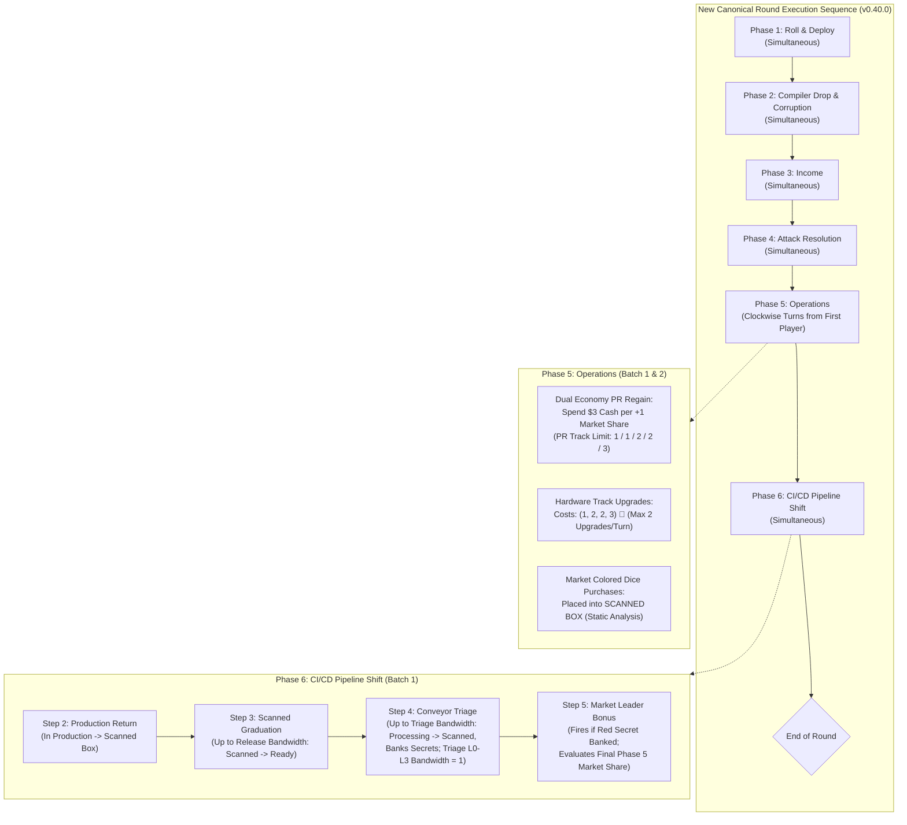

# Technical Architecture Specification: Phase 56 (v0.40.0 Candidate)
## Gameplay Balance, CI/CD Pipeline Re-Sequencing, Scanned Staging, Dual Economy ($ vs 🔬), Triage Backpressure, and Green Cube Cap

**Author:** Principal Engineer / Architect  
**Status:** Approved for Implementation (SDLC Architecture Phase)  
**Target Version:** `v0.40.0` Baseline  
**Source of Truth:** [`docs/findings/v400_playtest_feedback_modeling.md`](file:///home/mike/.gemini/antigravity/worktrees/rogue-agent/phase_fifty_six_playtest/docs/findings/v400_playtest_feedback_modeling.md) (User Playtest Feedback & Locked Modeling Plan)  
**Dependencies:**
- [`RULES.md`](file:///home/mike/.gemini/antigravity/worktrees/rogue-agent/phase_fifty_six_playtest/RULES.md) (Sections 2, 3, 4, 5)
- [`GLOSSARY.md`](file:///home/mike/.gemini/antigravity/worktrees/rogue-agent/phase_fifty_six_playtest/GLOSSARY.md) (Sections 2, 3, 4, 5, 6)
- [`docs/specs/spec_research_upgrade_limit.md`](file:///home/mike/.gemini/antigravity/worktrees/rogue-agent/phase_fifty_six_playtest/docs/specs/spec_research_upgrade_limit.md) (Hardware Upgrade Cap & Step Cost Architecture)
- [`docs/specs/v380_secret_faces_processing_box_spec.md`](file:///home/mike/.gemini/antigravity/worktrees/rogue-agent/phase_fifty_six_playtest/docs/specs/v380_secret_faces_processing_box_spec.md) (Secret Faces & Processing Box Architecture)

**Target Components:**
- [`sim/config.py`](file:///home/mike/.gemini/antigravity/worktrees/rogue-agent/phase_fifty_six_playtest/sim/config.py) (Levers, presets `GameConfig.v040()` and `v040_roster()`)
- [`sim/entities.py`](file:///home/mike/.gemini/antigravity/worktrees/rogue-agent/phase_fifty_six_playtest/sim/entities.py) (SETEC Version card profiles, threat staging payloads, cube cap enforcement)
- [`sim/engine/state.py`](file:///home/mike/.gemini/antigravity/worktrees/rogue-agent/phase_fifty_six_playtest/sim/engine/state.py) (PlayerState, GameState, Telemetry models)
- [`sim/engine/core.py`](file:///home/mike/.gemini/antigravity/worktrees/rogue-agent/phase_fifty_six_playtest/sim/engine/core.py) (Round sequence swap: Phase 5 Operations $\to$ Phase 6 Pipeline Shift)
- [`sim/engine/phase5_operations.py`](file:///home/mike/.gemini/antigravity/worktrees/rogue-agent/phase_fifty_six_playtest/sim/engine/phase5_operations.py) / [`sim/engine/phase6_operations.py`](file:///home/mike/.gemini/antigravity/worktrees/rogue-agent/phase_fifty_six_playtest/sim/engine/phase6_operations.py) (Cash PR regain, market dice routing to Scanned Box, R2 Ad Campaign sync)
- [`sim/engine/phase6_pipeline_shift.py`](file:///home/mike/.gemini/antigravity/worktrees/rogue-agent/phase_fifty_six_playtest/sim/engine/phase6_pipeline_shift.py) / [`sim/engine/phase5_pipeline_shift.py`](file:///home/mike/.gemini/antigravity/worktrees/rogue-agent/phase_fifty_six_playtest/sim/engine/phase5_pipeline_shift.py) (Scanned Graduation release bandwidth gate, Conveyor Triage FIFO banking, end-of-round Market Leader Bonus)
- [`sim/engine/research_tracks.py`](file:///home/mike/.gemini/antigravity/worktrees/rogue-agent/phase_fifty_six_playtest/sim/engine/research_tracks.py) (Triage L0–L4 recalibration, L2 milestone secret, step costs `(1, 2, 2, 3) 🔬`)
- [`sim/engine/phase2_compiler.py`](file:///home/mike/.gemini/antigravity/worktrees/rogue-agent/phase_fifty_six_playtest/sim/engine/phase2_compiler.py) (Global Green Cube Cap clamp during Corruption space resolution)
- [`sim/bots/research_policy.py`](file:///home/mike/.gemini/antigravity/worktrees/rogue-agent/phase_fifty_six_playtest/sim/bots/research_policy.py) (Step cost evaluation & upgrade prioritization)
- [`sim/bots/pr_push_policy.py`](file:///home/mike/.gemini/antigravity/worktrees/rogue-agent/phase_fifty_six_playtest/sim/bots/pr_push_policy.py) & [`sim/bots/market_share_policy.py`](file:///home/mike/.gemini/antigravity/worktrees/rogue-agent/phase_fifty_six_playtest/sim/bots/market_share_policy.py) (Dual economy cash allocation: PR regain vs dice purchases vs R2)
- New: [`tests/test_v400_gameplay_balance.py`](file:///home/mike/.gemini/antigravity/worktrees/rogue-agent/phase_fifty_six_playtest/tests/test_v400_gameplay_balance.py) (Unit tests TEST-V400-01 through TEST-V400-08)

---

## 1. System Overview & Mathematical Rationale

### 1.1 Playtest Findings & Pacing Friction Points
Empirical gameplay analysis from the two-player playtest session (DTO + Prodigy vs. Omnidyne + Phreaker) identified five structural pacing and balance bottlenecks:

1. **The Cash / Research Economic Divergence:**
   - Under the `v0.39.0` baseline, Research Tokens (`🔬`) carried extensive structural sinks (4 Terminal Hardware Tracks + PR Market Share regains at `3 🔬` per `+1`). Conversely, Cash (`$`) suffered premature saturation: dice purchases were capped at 2 per turn, and player pipeline throughput was naturally constrained. Players frequently accumulated `$15–$25+` in late rounds with no productive outlet.
2. **Phase Order Latency & Delayed Gratification:**
   - With Pipeline Shift in Phase 5 and Operations in Phase 6, upgrading Triage or Release Bandwidth in Phase 6 created a full-round delay before the hardware upgrade took effect during the subsequent round's Phase 5. This artificial latency dampened the excitement of engine-building investments.
3. **Absence of Early Pipeline Backpressure:**
   - Initial Triage Bandwidth at `2` allowed virtually all early Secret faces (`0.30` natural Secrets/round across 5,390 simulation rounds) to exit the Processing Box immediately in FIFO order, eliminating queueing tension.
4. **Purchased Dice Bypassing Release Bandwidth:**
   - Purchased Central Market colored dice entered `ready_for_release` directly, bypassing the CI/CD pipeline entirely. Players could inflate their active rolling pool without investing in Release Bandwidth infrastructure.
5. **Green Cube Saturation & Defensive Blackout:**
   - Uncapped Green Attack Cubes in circulation (reaching 6–7 cubes) combined with small Defense Grid capacity (2–4 slots with 1 pre-glitched) produced permanent defensive collapse, rendering players incapable of blocking Red or Blue cubes.

### 1.2 Approved Architecture & Design Synthesis
The `v0.40.0` architecture resolves these imbalances across three interconnected batches:



1. **Batch 1 (CI/CD Pipeline Flow & Phase Re-Sequencing):**
   - Phase 5 and Phase 6 swap execution order.
   - Operations executes as **Phase 5**, allowing research spent on Triage or Release Bandwidth to take effect **immediately** in Phase 6 of that same round.
   - Purchased Central Market colored dice enter the **Scanned Box** (`scanned_dice`), gating rolling pool expansion behind **Release Bandwidth**.
   - Triage Track is recalibrated to `(1, 1, 1, 1, 2)`: Levels 0–3 provide Bandwidth `1` (creating persistent backpressure on Secrets hunting), Level 2 awards a `+1 Corporate Secret` milestone, and Bandwidth `2` is reserved as the Level 4 Capstone.
   - Conveyor Triage banks Secrets in Phase 6; any Red Secret banked fires the **Market Leader Bonus** at round conclusion, evaluating final Market Share positions established during Phase 5 Operations.
2. **Batch 2 (The Dual Economy & PR Track):**
   - Regaining Market Share in Phase 5 Operations shifts from Research (`🔬`) to Cash (`$`), costing strictly **`$3` Cash per `+1` Market Share**.
   - PR Track sets per-turn regain capacity: L0–L1 max `1 MS`, L2–L3 max `2 MS`, L4 max `3 MS`.
   - PR Track Breakthroughs: L1 awards `+$3` Liquid Cash; L3 unlocks the 2nd Purple Specialist die from the Personal Reserve.
   - Terminal Hardware Track step costs re-calibrated to **`(1, 2, 2, 3) 🔬`** (`8 🔬` total per track), maintaining the strict **`max 2 hardware upgrades per turn`** cap.
   - Card synergies preserved: *R2 Ad Campaign* (`$4`) offers `$2` Cash per `+1` Market Share and bypasses the PR Track limit; *Y1* and *B2* act as cash sinks for Corporate Secrets.
3. **Batch 3 (Threat Pool & Version Profiles):**
   - **Global Green Cube Cap:** Total Green Compiler Cubes across the game are hard-capped at **5–6 cubes maximum** across setup and all Version cards combined.
   - **Asymmetric SETEC Version Specialization:** Version cards are structured into three distinct threat branches:
     - *Branch Alpha (Economic Extortion):* Red-heavy additions (`+1R`, `+2R`), direct cash fines (`-$2`, `-$3`).
     - *Branch Beta (Data Exfiltration):* Blue-heavy additions (`+1B`, `+2B`), direct Corporate Secret loss.
     - *Branch Gamma (Structural Sabotage):* Houses the 5–6 Green cubes alongside glitch spaces.

---

## 2. Configuration Architecture (`sim/config.py`)

### 2.1 Configuration Schema Extensions
The following configuration fields are introduced or updated in `sim/config.py`:

```python
# --- v0.40.0 Gameplay Balance & Architecture Extensions (INV-V400-*) ---
operations_before_pipeline_shift: bool = False  # If True, Phase 5 = Operations, Phase 6 = Pipeline Shift
purchased_dice_to_scanned: bool = False         # If True, market colored dice enter Scanned Box instead of Ready
share_regain_currency: str = "RESEARCH"        # "RESEARCH" (legacy v0.36-v0.39) | "MONEY" (v0.40.0)
share_regain_cost_money: int = 3               # [TUNE: $3] Cash per +1 Market Share when currency == "MONEY"
global_green_cube_cap: int = 5                 # [TUNE: 5] Hard cap on total Green cubes in circulation/setup
triage_l2_milestone_secrets: int = 1           # [TUNE: 1] Secrets awarded on reaching Triage Track Level 2
version_card_profile: str = "STANDARD"         # "STANDARD" | "AGGRESSIVE" | "V040_ASYMMETRIC"
```

### 2.2 Factory Presets: `GameConfig.v040()` and `GameConfig.v040_roster()`

```python
V040_TRIAGE_CAPACITY = (1, 1, 1, 1, 2)         # Levels 0..4 Triage Bandwidth
V040_TRACK_STEP_COSTS = (1, 2, 2, 3)          # (1, 2, 2, 3) 🔬 (8 🔬 total per track)
V040_SHARE_REGAIN_CAP = {0: 1, 1: 1, 2: 2, 3: 2, 4: 3}
V040_SHARE_REGAIN_COST_MONEY = {0: 3, 1: 3, 2: 3, 3: 3, 4: 3}

@classmethod
def v040(cls, **overrides) -> "GameConfig":
    """v0.40.0 candidate baseline (FINDINGS §50, spec v400):
    - CI/CD execution sequence swap: Phase 5 Operations -> Phase 6 CI/CD Pipeline Shift.
    - Market purchased dice enter Scanned Box (gated by Release Bandwidth).
    - Triage Track progression: Bandwidth (1, 1, 1, 1, 2), L2 +1 Secret milestone.
    - Dual economy: Market Share PR regain costs $3 Cash per +1 (PR caps: 1/1/2/2/3).
    - Hardware track step costs: (1, 2, 2, 3) 🔬 (8 🔬 total), max 2 upgrades/turn.
    - Global Green Cube Cap: max 5 Green cubes in circulation.
    - Asymmetric SETEC Version profiles (Alpha: Red, Beta: Blue, Gamma: Green).
    - Inherits all v0.38f / Headroom rules (Shogun Baffle, MS 13/16/20, Blue V038F direct secrets).
    """
    for k, v in (
        ("operations_before_pipeline_shift", True),
        ("purchased_dice_to_scanned", True),
        ("share_regain_currency", "MONEY"),
        ("share_regain_cost_by_level", dict(V040_SHARE_REGAIN_COST_MONEY)),
        ("share_regain_cap_by_level", dict(V040_SHARE_REGAIN_CAP)),
        ("track_step_costs", V040_TRACK_STEP_COSTS),
        ("max_hardware_upgrades_per_turn", 2),
        ("global_green_cube_cap", 5),
        ("version_card_profile", "V040_ASYMMETRIC"),
    ):
        overrides.setdefault(k, v)
    
    # Configure track capacity override for TRIAGE
    capacities = dict(cls().track_capacity_by_level)
    capacities["TRIAGE"] = V040_TRIAGE_CAPACITY
    overrides.setdefault("track_capacity_by_level", capacities)
    
    # Inherit from v038f baseline
    return cls.v038f(**overrides)

@classmethod
def v040_roster(cls, **overrides) -> "GameConfig":
    """v0.40.0 + bot autonomous PR push and cash allocation policies enabled."""
    overrides.setdefault("bot_pr_push", True)
    overrides.setdefault("bot_pr_push_params", PrPushParams())
    return cls.v040(**overrides)
```

### 2.3 Validation Rules (`_validate_v040`)
The `__post_init__` validator executes `_validate_v040()`:
1. If `operations_before_pipeline_shift is True`:
   - Requires `round_sequence == RoundSequence.SIX_PHASE`.
   - Requires `purchased_dice_to_scanned is True`.
2. If `share_regain_currency == "MONEY"`:
   - Requires `is_market_share is True`.
   - Requires all values in `share_regain_cost_by_level` to be integers `> 0`.
3. If `global_green_cube_cap < 1`:
   - Raise `ValueError("global_green_cube_cap must be >= 1")`.
4. Hardware step costs must have length 4, with strictly positive integer values.
5. Backwards parity check: `GameConfig.legacy_v035()`, `GameConfig.v037()`, `GameConfig.v038()`, and `GameConfig.v038f()` must remain completely unaffected.

---

## 3. Module Contracts & Mechanics Architecture

### 3.1 Batch 1: Execution Sequence Swap & Round Loop
In `sim/engine/core.py`, the canonical 6-phase execution loop is re-ordered when `config.operations_before_pipeline_shift is True`:

```python
def _run_round_six_phase(self) -> RoundTelemetry:
    s = self.state
    self._begin_research_telemetry()

    # Phase 1: Roll & Deploy (Simultaneous)
    commitments = self._execute_phase_1()
    p1_snap = self._snapshot_players()

    # Phase 2: Compiler Drop & Corruption (Simultaneous)
    cr = self._run_phase_2_compiler(commitments)
    tel = self._begin_telemetry(cr)
    tel.phase_snapshots[1] = p1_snap
    tel.phase_snapshots[2] = self._snapshot_players()
    if s.game_over:
        tel.player_snapshots = tel.phase_snapshots[2]
        return self._finalize_telemetry(tel, end_phase=2)

    # Phase 3: Income (Simultaneous, survivors only)
    incomes = self._run_phase_3_income(commitments)
    tel.income_by_player = {
        pid: {"money": r.money, "research": r.research, "secrets": r.secrets} for pid, r in incomes.items()
    }
    tel.purple_star_triggers_per_round = {pid: r.purple_star_triggers for pid, r in incomes.items()}
    tel.phases_executed.append(3)
    tel.phase_snapshots[3] = self._snapshot_players()

    # Phase 4: Attack Resolution (Simultaneous)
    tel.attack_strengths = self._run_phase_4_attack_resolution(commitments, cr)
    tel.phases_executed.append(4)
    tel.phase_snapshots[4] = self._snapshot_players()
    tel.player_snapshots = tel.phase_snapshots[4]
    if self.config.is_market_share:
        tel.market_share_after_p4 = {p.player_id: p.market_share for p in s.players}
    if s.game_over:
        return self._finalize_telemetry(tel, end_phase=4)

    if self.config.operations_before_pipeline_shift:
        # Phase 5: Operations (Clockwise turns from First Player)
        self._run_phase_operations()
        tel.phases_executed.append(5)
        tel.phase_snapshots[5] = self._snapshot_players()

        # Phase 6: CI/CD Pipeline Shift (Simultaneous)
        shifts = self._run_phase_pipeline_shift()
        tel.scanned_held_by_player = {pid: r.held_in_scanned for pid, r in shifts.items()}
        tel.graduated_by_player = {pid: len(r.graduated_ids) for pid, r in shifts.items()}
        tel.phases_executed.append(6)
        tel.phase_snapshots[6] = self._snapshot_players()
        pass_first_player_marker(self)
    else:
        # Legacy Sequence (v0.34 - v0.39): Phase 5 Shift -> Phase 6 Operations
        shifts = self._run_phase_pipeline_shift()
        tel.scanned_held_by_player = {pid: r.held_in_scanned for pid, r in shifts.items()}
        tel.graduated_by_player = {pid: len(r.graduated_ids) for pid, r in shifts.items()}
        tel.phases_executed.append(5)
        tel.phase_snapshots[5] = self._snapshot_players()

        self._run_phase_operations()
        tel.phases_executed.append(6)
        tel.phase_snapshots[6] = self._snapshot_players()

    if s.is_final_round:
        s.game_over = True
    else:
        s.current_round += 1
        if s.current_round > s.config.max_rounds:
            s.game_over = True
            s.end_reason = EndGameReason.ROUND_LIMIT
    return self._finalize_telemetry(tel, end_phase=6 if s.game_over else None)
```

### 3.2 Batch 1: Market Dice Delivery into Scanned Box
In `phase6_operations.py` (and re-exported `phase5_operations.py`), when a player purchases a Central Market colored die (`Red`, `Blue`, `Green`, `Yellow`) or exercises Prometheus *Algorithmic Arbitrage*:

```python
dest_zone = player.scanned_dice if engine.config.purchased_dice_to_scanned else player.ready_for_release_dice
dest_zone.append(new_die)
```

**Key Architectural Distinction:**
- **Central Market Purchases:** Delivered directly to `player.scanned_dice`.
- **Breakthrough Dice:** Gray dice from Defense/Release/Triage Level 1 and Purple die from PR Level 3 are one-time enterprise infrastructure awards and bypass Scanned, entering `player.ready_for_release_dice` directly.
- **Magnetic Splice:** Omnidyne ability pulls directly from `glitched_dice` into `player.ready_for_release_dice`.

### 3.3 Batch 1: Scanned Graduation Gated by Release Bandwidth
In Phase 6 CI/CD Pipeline Shift:
1. **Step 2 (Production Return):** All surviving `in_production_dice` return to `scanned_dice`.
2. **Step 3 (Scanned Graduation):** Up to `player.release_bandwidth` dice graduate from `scanned_dice` to `ready_for_release_dice`:
   - If `len(scanned_dice) <= release_bandwidth`, all dice graduate.
   - If `len(scanned_dice) > release_bandwidth`, the player selects which dice graduate.
   - Newly purchased dice compete directly with surviving returned dice.
   - Any hardware upgrade to Release Bandwidth purchased during Phase 5 Operations applies immediately during this step.

### 3.4 Batch 1: Triage Track Recalibration & Level 2 Milestone
In `sim/engine/research_tracks.py`:
- Track capacities: `track_capacity_by_level["TRIAGE"] = (1, 1, 1, 1, 2)`.
- When advancing the Triage Track to Level 2:
  ```python
  if t == "TRIAGE" and level == 2 and cfg.triage_l2_milestone_secrets > 0:
      player.gain_secrets(cfg.triage_l2_milestone_secrets, "triage_l2_milestone")
  ```
- Levels 0, 1, 2, 3 provide `triage_bandwidth = 1`.
- Level 4 provides `triage_bandwidth = 2`.

### 3.5 Batch 1: Conveyor Triage FIFO & Market Leader Bonus Sequence
During Phase 6 CI/CD Pipeline Shift (Step 4: Conveyor Triage):
1. Up to `player.triage_bandwidth` dice move from `glitched_dice` (Processing Box) to `scanned_dice` in oldest-first (FIFO) order.
2. Each moving die banks its Secret face yield in Corporate Secrets.
3. If at least one Red Secret face was banked during the round (either in Phase 3 or during Phase 6 Conveyor Triage), `secret_faces.fire_round_payout(cfg, state)` triggers at the end of Phase 6.
4. The bonus evaluates the final Market Share positions established during Phase 5 Operations, ensuring player PR investments directly contest the round payout.

---

### 3.6 Batch 2: The Dual Economy ($ vs 🔬) & PR Track
In Operations:
- Market Share regain shifts exclusively to Money (`$`):
  ```python
  def execute_share_regain(engine: GameEngine, player: PlayerState, wanted: int) -> int:
      cfg = engine.config
      player.regain_this_turn = 0
      done = 0
      if not cfg.is_share_regain or player.market_share is None:
          return 0
      use_money = (cfg.share_regain_currency == "MONEY")
      while done < int(wanted or 0):
          lvl = player.patent_level
          cap = cfg.share_regain_cap_by_level[lvl]
          cost = cfg.share_regain_cost_by_level[lvl]
          if player.regain_this_turn >= cap or player.market_share >= player.market_share_max:
              break
          if use_money:
              if player.money < cost:
                  break
              player.money -= cost
              player.money_spent_regain += cost
          else:
              if player.research_tokens < cost:
                  break
              player.research_tokens -= cost
              player.research_spent_regain += cost
          player.change_market_share(+1, "regain")
          player.regain_this_turn += 1
          done += 1
      return done
  ```
- **PR Track Breakthroughs:**
  - Level 1: Gain `+$3` Liquid Cash (`patent_l1_cash = 3`), providing immediate liquidity for a Market Share regain.
  - Level 3: Unlock 2nd Purple Specialist die from the Personal Reserve into `ready_for_release_dice`.

### 3.7 Batch 2: Hardware Track Step Costs `(1, 2, 2, 3) 🔬` & Upgrade Cap
- In `sim/config.py`: `track_step_costs = (1, 2, 2, 3)` across Defense Grid, Triage, Release, and Public Relations.
- The per-turn hardware upgrade cap is maintained: `max_hardware_upgrades_per_turn = 2`.
- Market Share PR regain is an operational resource expenditure and does not count toward the hardware upgrade cap.

### 3.8 Batch 2: Card Synergies & Economic Sinks
- ***R2 — Ad Campaign (`$4`):* Face 6 allows paying `$2` Cash in Operations to gain `+1` Market Share. Acts as a permanent `$2` discount coupon (saving `$1` over standard `$3` PR) and bypasses the player's PR track turn limit.
- ***Y1 — Algorithmic Trading (`$6`):* In Phase 5 Operations, pay `$2` Cash $\to$ gain `+1 Corporate Secret`.
- ***B2 — Deep R&D Vault (`$6`):* In Phase 5 Operations, pay `$4` Cash $\to$ gain `+1 Corporate Secret`.

---

### 3.9 Batch 3: Global Green Cube Cap Architecture
In `sim/engine/phase2_compiler.py` and cube injection helpers:
- Whenever threat cubes are added to the staging cup (from setup, autonomous pulses, or Version card Corruption spaces), Green cubes are clamped against the global cap:

```python
def clamp_green_cubes_to_add(state: GameState, cfg: GameConfig, requested_green: int) -> int:
    if cfg.global_green_cube_cap <= 0:
        return requested_green
    current_green = (
        state.staging_cup.count(CubeColor.GREEN)
        + state.exit_tray.count(CubeColor.GREEN)
        + state.tower.count(CubeColor.GREEN)
    )
    headroom = max(0, cfg.global_green_cube_cap - current_green)
    return min(requested_green, headroom)
```

- When resolving a Corruption space specifying `add_cubes={CubeColor.GREEN: N}`, the actual added Green cubes are `clamp_green_cubes_to_add(state, cfg, N)`.

### 3.10 Batch 3: Asymmetric SETEC Threat Profiles
When `version_card_profile == "V040_ASYMMETRIC"`, `get_all_version_cards()` generates three distinct thematic branches:

1. **Branch Alpha: Economic Extortion (Red-Heavy)**
   - *v1.0 Script Kiddie (Alpha):* Staging payload `{RED: 2, BLUE: 1}`. Corruption track adds Red cubes and direct cash fines (`-$2`).
   - *v2.0 RaaS (Alpha):* Corruption track features `Add 2R`, `All lose $3`, and `Add 1R + All lose $2`.
   - *v3.0 Zero-Day Override (Alpha):* Heavy Red attack cascades, corporate extortion penalties.
2. **Branch Beta: Data Exfiltration (Blue-Heavy)**
   - *v1.0 Data Scraper (Beta):* Staging payload `{RED: 1, BLUE: 2}`. Corruption track adds Blue cubes and research drain (`Lose 2 🔬`).
   - *v2.0 Spyware Mesh (Beta):* Blue spyware injections (`Add 2B`), corporate backdoors.
   - *v3.0 Corrupted Kernel (Beta):* Direct Corporate Secret theft (`Lose 1 Secret`), heavy Blue cube volume.
3. **Branch Gamma: Structural Sabotage (Balanced / Green Hazard)**
   - *v1.0 Logic Daemon (Gamma):* Staging payload `{RED: 1, BLUE: 1, GREEN: 1}`.
   - *v2.0 Polymorphic Worm (Gamma):* Houses the 5–6 Green cubes alongside shield slot glitches, strictly clamped by `global_green_cube_cap = 5`.
   - *v3.0 Subversion Engine (Gamma):* Pipeline wear and balanced threat pressure.

---

## 4. Bot Decision Architecture & Heuristics

### 4.1 Research Policy Adaptation
In `sim/bots/research_policy.py`:
- Evaluate step costs dynamically from `cfg.track_step_costs` (`(1, 2, 2, 3)`).
- Budget research tokens against `max_hardware_upgrades_per_turn = 2`.
- Prioritize:
  1. Cheap Level 1 Breakthroughs (`1 🔬` for Gray Legacy die, `$3` cash, or starting capacity).
  2. Level 2 Release Bandwidth (`2 🔬`) if rolling pool size exceeds 4.
  3. Level 2 Triage Milestone (`2 🔬`) for the `+1 Corporate Secret`.
  4. Level 3 Breakthroughs (`2 🔬`) for Specialist Purple die or market swap.
  5. Level 4 Capstones (`3 🔬`) for dedicated builds.

### 4.2 Cash Dual Economy Budgeting
In `sim/bots/market_share_policy.py` and `sim/bots/pr_push_policy.py`:
- Recognize that Market Share regain consumes **Cash**, not Research.
- During Phase 5 Operations planning, calculate liquid cash allocation in priority order:
  1. **Survival PR Regain:** If `market_share <= 4` and Cash $\ge \$3$, spend Cash to regain Market Share up to the PR Track limit.
  2. **Discounted R2 Actions:** If *R2 Ad Campaign* is available, spend `$2` Cash per `+1` Market Share before standard `$3` PR.
  3. **Module Dice Purchases:** Purchase high-priority colored dice (`$4–$6`) into Scanned Box if Release Bandwidth has capacity or will be upgraded.
  4. **Competitive PR Push:** If contesting 1st or 2nd place in Market Share and a Red Secret is queued in Processing, spend cash to secure the Market Leader Bonus.
  5. **Cash VP Sinks:** Spend excess cash on *Y1* (`$2`) or *B2* (`$4`) for direct Corporate Secrets.

### 4.3 Scanned Graduation Bot Priority Heuristic
In `sim/bots/base.py`:
- When `len(scanned_dice) > release_bandwidth`, choose graduates by descending strategic value:
  1. Purple Specialist dice (unrestricted utility).
  2. High-cost Central Market colored dice (`$6`, `$5`, `$4`).
  3. Gray Legacy starter dice.
  4. Ties broken by `die_id`.

---

## 5. Explicit System Invariants

- **`INV-V400-01` (Canonical Phase Execution Sequence Swap):**
  Under `v0.40.0`, the round execution sequence must strictly be: Phase 1 (Roll & Deploy) $\to$ Phase 2 (Compiler Drop & Corruption) $\to$ Phase 3 (Income) $\to$ Phase 4 (Attack Resolution) $\to$ Phase 5 (Operations) $\to$ Phase 6 (CI/CD Pipeline Shift). Hardware track upgrades purchased in Phase 5 must take effect immediately during Phase 6 of the same round.
- **`INV-V400-02` (Purchased Dice Scanned Placement):**
  Software Module Dice purchased from the Central Market during Phase 5 Operations (and Prometheus discounted market purchases) must enter the buyer's `scanned_dice` box. They must never enter `ready_for_release_dice` directly.
- **`INV-V400-03` (Scanned Graduation Release Bandwidth Gate):**
  In Phase 6 CI/CD Pipeline Shift (Step 3: Scanned Graduation), the number of dice moving from `scanned_dice` to `ready_for_release_dice` must not exceed `player.release_bandwidth`. Newly purchased dice and returning In Production dice must compete within this limit.
- **`INV-V400-04` (Triage Track Progression & L2 Milestone):**
  The Triage Track capacity progression across Levels 0–4 must be strictly `(1, 1, 1, 1, 2)`. Advancing from Level 1 to Level 2 must award strictly `+1 Corporate Secret` immediately upon advancement. Triage Bandwidth must be `1` at Levels 0, 1, 2, and 3, and increase to `2` if and only if Level 4 is reached.
- **`INV-V400-05` (Conveyor Triage FIFO & End-of-Round Market Leader Bonus):**
  In Phase 6 CI/CD Pipeline Shift (Step 4: Conveyor Triage), dice must move from `glitched_dice` (Processing Box) to `scanned_dice` in oldest-first (FIFO) order up to `triage_bandwidth`, banking their Secret face yields. If at least one Red Secret face was banked during the round, the Market Leader Bonus must evaluate and payout at the conclusion of Phase 6 using the final Market Share positions established during Phase 5 Operations.
- **`INV-V400-06` (Cash-Fueled PR Market Share Regain):**
  Regaining Market Share through the Public Relations Track must strictly consume Money (`$`) at `$3` Cash per `+1` Market Share. Research tokens must not be consumed for PR regains under `v0.40.0`. The per-turn regain count must be strictly bounded by the PR Track level: `1` at L0–L1, `2` at L2–L3, and `3` at L4.
- **`INV-V400-07` (Hardware Track Step Costs & Upgrade Limit):**
  Advancing any of the four Terminal Hardware Tracks must require Research tokens according to step costs `(1, 2, 2, 3) 🔬`. Each player must be constrained to at most `max_hardware_upgrades_per_turn = 2` hardware track advancements per Operations Turn. PR Market Share regain is exempt from this cap.
- **`INV-V400-08` (Global Green Cube Cap):**
  The total number of Green Compiler Cubes across all physical zones (tower baffles, staging cup, exit tray) must never exceed `global_green_cube_cap = 5` (or `6` if tuned). Any Version card Corruption space or setup rule that would inject Green cubes beyond this limit must be clamped to the remaining headroom.

---

## 6. Telemetry, State Models & Metrics

### 6.1 State & Telemetry Enhancements
1. **`PlayerState`:**
   - `money_spent_regain: int = 0` (tracks cumulative Cash spent on PR Market Share regains).
   - `scanned_dice_purchased_this_turn: int = 0` (audit telemetry for market purchases entering Scanned).
   - `triage_milestones_claimed: List[str] = field(default_factory=list)`.
2. **`RoundTelemetry`:**
   - Record `phase_snapshots[5]` as the state post-Operations.
   - Record `phase_snapshots[6]` as the state post-Pipeline Shift.
   - `phases_executed: List[int]` must record `[1, 2, 3, 4, 5, 6]`.
   - `green_cubes_clamped_per_round: int = 0`.
3. **`GameState`:**
   - `total_green_cubes_in_circulation(self) -> int`.

---

## 7. Test Specifications & Verification Plan

### `TEST-V400-01`: Phase Re-Sequencing & Immediate Hardware Gratification
- **Objective:** Verify Phase 5 Operations precedes Phase 6 Pipeline Shift, and hardware upgraded in Phase 5 takes effect in Phase 6 of the same round.
- **Setup:** `GameConfig.v040(num_players=2)`. Player 0 has `Release Bandwidth = 4`, `scanned_dice = 5`, and `research_tokens = 5`.
- **Action:** In Phase 5 Operations, Player 0 upgrades Release Track to Level 2 (Bandwidth becomes 5).
- **Assertion:**
  - `tel.phases_executed == [1, 2, 3, 4, 5, 6]`.
  - In Phase 6 Scanned Graduation, exactly 5 dice graduate from `scanned_dice` to `ready_for_release_dice`.
  - Confirms immediate gratification without round delay (`INV-V400-01`).

### `TEST-V400-02`: Market Purchases Placed into Scanned Box
- **Objective:** Verify purchased Central Market dice enter `scanned_dice`, while Breakthrough dice enter `ready_for_release_dice`.
- **Setup:** Player has `$10`, `ready_for_release = [d1, d2]`, `scanned_dice = []`.
- **Action:** Player purchases 1 Red die (`$4`) and 1 Blue die (`$5`) in Phase 5 Operations.
- **Assertion:**
  - Purchased dice are appended to `player.scanned_dice`.
  - `player.ready_for_release_dice` remains `[d1, d2]`.
  - `len(player.scanned_dice) == 2` (`INV-V400-02`).

### `TEST-V400-03`: Scanned Graduation Under Release Bandwidth Gate
- **Objective:** Verify Scanned Graduation strictly respects Release Bandwidth when both returned dice and purchased dice occupy Scanned.
- **Setup:** Player has `release_bandwidth = 4`. In Phase 5 Operations, 2 purchased dice enter `scanned_dice`. In Phase 6 Step 2, 4 surviving dice return to `scanned_dice` (total 6 dice in Scanned).
- **Action:** Execute Step 3 Scanned Graduation.
- **Assertion:**
  - Exactly 4 dice graduate to `ready_for_release_dice`.
  - Exactly 2 dice remain held in `scanned_dice`.
  - `INV-V400-03` holds.

### `TEST-V400-04`: Triage Track Progression & Level 2 Milestone
- **Objective:** Verify Triage Track bandwidth is 1 at L0–L3 and 2 at L4, and L2 grants `+1 Corporate Secret`.
- **Setup:** Player starts at Triage L0 (`triage_bandwidth = 1`, `secrets = 4`).
- **Action:** Upgrade Triage to L1, then to L2, L3, and L4.
- **Assertion:**
  - At L0, L1, L2, L3: `player.triage_bandwidth == 1`.
  - Upon reaching L2: `player.secrets == 5` (`+1 Corporate Secret` milestone).
  - At L4: `player.triage_bandwidth == 2` (`INV-V400-04`).

### `TEST-V400-05`: FIFO Conveyor Triage & Phase 6 Market Leader Bonus Trigger
- **Objective:** Verify Secret faces bank during Phase 6 Conveyor Triage, and a banked Red Secret triggers the Market Leader Bonus evaluating post-Phase 5 Market Share.
- **Setup:** Player 0 has Red Secret in `glitched_dice` (Processing Box). In Phase 5 Operations, Player 1 spends Cash to surpass Player 0 in Market Share.
- **Action:** Advance to Phase 6. Conveyor Triage moves the Red Secret.
- **Assertion:**
  - Red Secret banks `+2 Corporate Secrets`.
  - Market Leader Bonus triggers at conclusion of Phase 6.
  - Player 1 takes 1st Place bonus (`+3 Secrets`) based on Market Share established during Phase 5 Operations (`INV-V400-05`).

### `TEST-V400-06`: Cash-Fueled PR Regain & Per-Turn Limit
- **Objective:** Verify PR Market Share regain costs `$3 Cash` per `+1 MS` and enforces PR Track level caps.
- **Setup:** Player at PR L0 (`cap = 1`), `market_share = 10`, `money = $10`, `research = 0`.
- **Action:** Attempt to regain 2 Market Share in Phase 5 Operations.
- **Assertion:**
  - Player regains exactly 1 Market Share (`market_share == 11`).
  - Player spends `$3` Cash (`money == $7`).
  - Research tokens remain 0. Second regain rejected by level cap (`INV-V400-06`).

### `TEST-V400-07`: Hardware Step Costs `(1, 2, 2, 3) 🔬` & Upgrade Cap of 2
- **Objective:** Verify track step costs and per-turn upgrade limit of 2.
- **Setup:** Player has `research = 10`.
- **Action:** Upgrade Defense L0 $\to$ L1 (`1 🔬`), Triage L0 $\to$ L1 (`1 🔬`), attempt 3rd upgrade.
- **Assertion:**
  - First two upgrades succeed (total `2 🔬` spent).
  - Third upgrade rejected (`max_hardware_upgrades_per_turn = 2`).
  - Advancing from L1 to L2 on any track costs `2 🔬` (`INV-V400-07`).

### `TEST-V400-08`: Global Green Cube Cap Clamping
- **Objective:** Verify Green cube additions are clamped when the global cap of 5 is reached.
- **Setup:** Active Green cubes across tower, staging cup, and exit tray equal 4. Version card Corruption space calls for `Add 2G`.
- **Action:** Resolve Corruption space in Phase 2.
- **Assertion:**
  - Exactly 1 Green cube is added to the staging cup.
  - Total Green cubes in circulation equals strictly 5.
  - Excess Green cube suppressed without error (`INV-V400-08`).

---

## 8. Canonical Terminology & Governance

All mechanics, variable names, and documentation must strictly adhere to [`GLOSSARY.md`](file:///home/mike/.gemini/antigravity/worktrees/rogue-agent/phase_fifty_six_playtest/GLOSSARY.md):

| Canonical Term | Deprecated / Prohibited Terms (Never Use) |
| :--- | :--- |
| **Phase 5: Operations** | Phase 6: Operations (legacy sequence) |
| **Phase 6: CI/CD Pipeline Shift** | Phase 5: CI/CD Pipeline Shift (legacy sequence) |
| **Processing Box** | *Glitched Box* |
| **Scanned Box** | Verification Queue, Staging Box |
| **Generic (`Any`) Shield** | *Color-Specific Shield*, *Red / Blue / Green Shields* |
| **Glitched Shield Slot** | *Damaged Slot*, *Broken Shield* |
| **Public Relations Track** | *Cryptographic Patents Track*, *Patent Filing* |
| **Market Share** | *Reputation*, *Influence* |
| **Corporate Secrets** | *Victory Points*, *Data VP* |
| **Patient Zero** | Breach Out, Dead Player |
| **Market Collapse** | Financial Ruin, Bankruptcy |

---

## 9. Implementation Phasing & SDLC Hand-off Roadmap

Following approval of this Technical Architecture Specification, execution proceeds via the standard SDLC pipeline:

1. **Phase 56.2 (`senior-engineer`):**
   - Implement `sim/config.py` (`GameConfig.v040()`, `v040_roster()`, new levers).
   - Implement round loop swap in `sim/engine/core.py`.
   - Update `sim/engine/phase6_operations.py` / `phase5_operations.py` for Scanned routing and Cash PR regain.
   - Update `sim/engine/research_tracks.py` for Triage `(1, 1, 1, 1, 2)`, L2 milestone, and `(1, 2, 2, 3) 🔬` step costs.
   - Implement Global Green Cube Cap in `sim/engine/phase2_compiler.py`.
   - Update bot heuristics in `sim/bots/`.
   - Author and execute `tests/test_v400_gameplay_balance.py` (TEST-V400-01..08).
2. **Phase 56.3 (`staff-engineer`):**
   - Code review gate: audit invariants INV-V400-01..08, backwards parity with v0.37/v0.38/v0.39, and test pass rate.
3. **Phase 56.4 (`product-owner`):**
   - Execute 3,600-game Monte Carlo validation sweep across 2P, 3P, and 4P pods.
4. **Phase 56.5 (`game-designer`):**
   - Balance sign-off against Core Design Pillars (pacing, economy divergence, tri-modal end triggers).
5. **Phase 56.6 (Phase B Asset Sync):**
   - Sync `RULES.md`, `RULES_APPENDIX.md`, `GLOSSARY.md`, `pnp/generate_pnp.py`, and `web/`.
