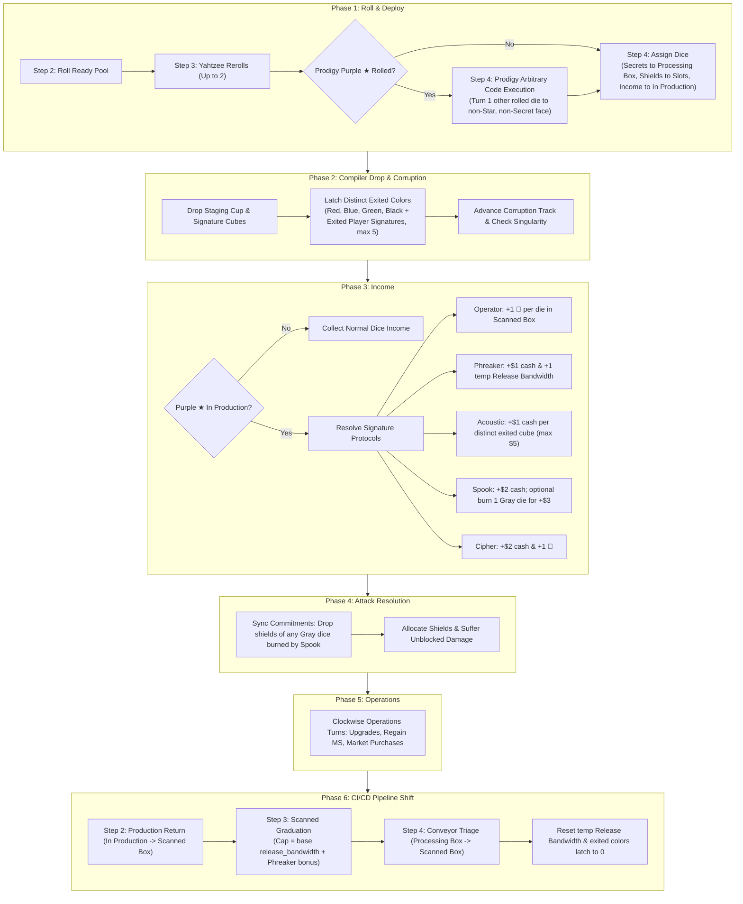

# Technical Architecture Specification: White Hat Face 6 (`Purple ★`) Signature Protocol Rebalance

**Author:** Principal Engineer / Architect  
**Status:** Approved for Implementation (SDLC Architecture Phase)  
**Baseline Version:** `v0.43.0` Baseline  
**Document Reference:** `docs/specs/white_hat_6f_rebalance_spec.md`  
**Upstream Analysis:** [`docs/findings/white_hat_6f_rebalance_analysis.md`](file:///home/mike/.gemini/antigravity/worktrees/rogue-agent/white_hat_abilities_review/docs/findings/white_hat_6f_rebalance_analysis.md)  
**Dependencies:**
- [`RULES.md`](file:///home/mike/.gemini/antigravity/worktrees/rogue-agent/white_hat_abilities_review/RULES.md)
- [`RULES_APPENDIX.md`](file:///home/mike/.gemini/antigravity/worktrees/rogue-agent/white_hat_abilities_review/RULES_APPENDIX.md)
- [`GLOSSARY.md`](file:///home/mike/.gemini/antigravity/worktrees/rogue-agent/white_hat_abilities_review/GLOSSARY.md)
- [`sim/config.py`](file:///home/mike/.gemini/antigravity/worktrees/rogue-agent/white_hat_abilities_review/sim/config.py)
- [`sim/entities.py`](file:///home/mike/.gemini/antigravity/worktrees/rogue-agent/white_hat_abilities_review/sim/entities.py)
- [`sim/engine/state.py`](file:///home/mike/.gemini/antigravity/worktrees/rogue-agent/white_hat_abilities_review/sim/engine/state.py)
- [`sim/engine/phase1_roll_deploy.py`](file:///home/mike/.gemini/antigravity/worktrees/rogue-agent/white_hat_abilities_review/sim/engine/phase1_roll_deploy.py)
- [`sim/engine/phase2_compiler.py`](file:///home/mike/.gemini/antigravity/worktrees/rogue-agent/white_hat_abilities_review/sim/engine/phase2_compiler.py)
- [`sim/engine/phase3_income.py`](file:///home/mike/.gemini/antigravity/worktrees/rogue-agent/white_hat_abilities_review/sim/engine/phase3_income.py)
- [`sim/engine/phase5_pipeline_shift.py`](file:///home/mike/.gemini/antigravity/worktrees/rogue-agent/white_hat_abilities_review/sim/engine/phase5_pipeline_shift.py)
- [`sim/bots/base.py`](file:///home/mike/.gemini/antigravity/worktrees/rogue-agent/white_hat_abilities_review/sim/bots/base.py)

---

## 1. System Overview & Approved Design Rationale

### 1.1 Problem Statement & Historical Context
Each player in *Too Many Secrets* commands a **White Hat Operative** who brings a unique **Signature Protocol** keyed to Face 6 (`Purple ★`) of the **Purple Proprietary Specialist Die**. Across iterations `v0.34` through `v0.42`, several Signature Protocols suffered from friction points:
1. **The Operator (*Logistics Bounty*):** Historically generated temporary contractor dice or evaluated pending Secret backlogs in the Processing Box. When evaluated against the Processing Box, mathematical modeling demonstrated an 85.1% empty rate in early rounds, starving the Operative of research.
2. **The Phreaker (*Jumper Diagnostics*):** Required rolling an offline die in Under Development during Phase 3, introducing physical rolling latency and inconsistent fallback triggers.
3. **The Acoustic (*Resonance Sensor*):** Counted compiler cubes in the Exit Tray but omitted player-colored **Operative Signature Cubes**, truncating dynamic threat feedback.
4. **The Spook (*Burn Notice*):** Permitted burning owned colored dice for Corporate Secrets, incentivizing late-game suicide VP culls rather than tactical bag-building tempo.
5. **The Prodigy (*Arbitrary Code Execution*):** Lacked precise phase step placement, resolving erratically both before and after Yahtzee rerolls.
6. **The Cipher (*Algorithmic Parity*):** Functioned as a rock-solid, predictable anchor (`+$2` cash and `+1 🔬`), providing the golden calibration baseline.

### 1.2 Signed-Off Mechanics (User Ratified)
The user has reviewed mathematical findings and ratified the following mechanics for `v0.43.0`:

| White Hat | Signature Protocol | Timing | Ratified Mechanical Effect |
| :--- | :--- | :---: | :--- |
| **The Operator** | *Logistics Bounty* | Phase 3: Income | Gain `+1 🔬` Research Token per die currently in your **Scanned Box** (no fallback if empty). |
| **The Phreaker** | *Jumper Diagnostics* | Phase 3: Income | Gain `+$1` cash AND `+1` **Release Bandwidth** this round (applies in Phase 6 Step 3; stacks on double Purple Star; resets at round end). |
| **The Acoustic** | *Resonance Sensor* | Phase 3: Income | Gain `+$1` cash per unique colored cube that exited the Cube Tower this round (counting `Red`, `Blue`, `Green`, `Black`, plus each distinct player-colored Operative Signature Cube that exited in Phase 2), up to `+$5` max. |
| **The Spook** | *Burn Notice* | Phase 3: Income | Gain `+$2` cash; optionally permanently return `1` owned **Gray Legacy die** to the box for `+$3` cash (may pull from any zone; if pulled from a Shield slot, it no longer blocks in Phase 4). |
| **The Prodigy** | *Arbitrary Code Execution* | Phase 1: Step 4 | Turn `1` other rolled die in your active pool to any legal non-Star face of its color other than the Secret face (must keep `Purple ★`). |
| **The Cipher** | *Algorithmic Parity* | Phase 3: Income | Gain `+$2` cash AND `+1 🔬` Research Token (unchanged baseline anchor). |

---

## 2. Terminology & Governance Alignment

In strict accordance with `GLOSSARY.md` (Section 7) and project rules:
* **Compliant Terms Utilized:** *White Hat Operative*, *White Hat Dossier Card*, *Signature Protocol*, *Purple Proprietary Specialist Die*, *Cube Tower*, *Compiler Drop*, *Operative Signature Cube*, *Target Lock*, *Exit Tray*, *Staging Cup*, *Company Terminal Mat*, *CI/CD Pipeline*, *Ready for Release Zone*, *In Production Area*, *Shield Slots*, *Income Slot*, *Under Development Pipeline*, *Processing Box*, *Scanned Box*, *Release Bandwidth*, *Scanned Graduation*, *Conveyor Triage*, *Corporate Secrets*, *Market Share*, *Research Token (`🔬`)*.
* **Prohibited Deprecated Terms Verified Absent:** *Consultancy*, *Consultancy Terminal Mat*, *Lead Consultant*, *CISO*, *Patches / 🔧*, *Unpatched Zone*, *Demote*, *Zero Wear Retention*, *Malware Fizzle*, *Emergency Hotfix*, *Passive Firewall*, *Cryptographic Patents Track*, *FinSec*, *Ransom Insurance*, *Threat Bounty*.

---

## 3. Core Architecture & System Invariants

### 3.1 Cross-Phase Execution Flow



### 3.2 Formal System Invariants

- **`INV-SIG-PROD-01` (In Production Prerequisite):** A Signature Protocol activates in Phase 3 if and only if its triggering Purple die is actively **In Production** (Income slot or Shield slot) at the onset of Phase 3. A Purple die demoted or removed during Phase 1 or 2 triggers nothing.
- **`INV-OPERATOR-SCANNED-01` (Operator Scanned Inventory):** The Operator's *Logistics Bounty* evaluates `len(player.scanned_dice)` instantaneously during Phase 3. Each Purple ★ In Production yields exactly `+1 🔬` per die currently in the Scanned Box. If the Scanned Box is empty (`len == 0`), it yields `0 🔬`. Scanned dice are not rolled, modified, or triaged by this effect.
- **`INV-PHREAKER-BANDWIDTH-01` (Phreaker Temporary Expansion):** Each Purple ★ In Production for The Phreaker yields `+$1` liquid cash and increments `player.temp_release_bandwidth_bonus += 1`.
- **`INV-PHREAKER-DURATION-02` (Phreaker Duration & Reset):** The Release Bandwidth bonus applies strictly during **Phase 6 Step 3 (Scanned Graduation)**. At the completion of Phase 6 (or round finalization), `player.temp_release_bandwidth_bonus` resets unconditionally to `0`.
- **`INV-ACOUSTIC-LATCH-01` (Acoustic Exit Tray Latch):** Distinct exited cube colors are calculated at the completion of the Phase 2 Compiler Drop as:
  $$\text{distinct\_colors} = \min\left(5, \; \sum_{c \in \{\text{Red, Blue, Green, Black}\}} \mathbb{I}(\text{count}(c) > 0) + \text{len}(\text{exited\_signature\_player\_ids})\right)$$
  This value is latched onto `GameState.distinct_exited_colors_this_round`.
- **`INV-ACOUSTIC-PAYOUT-02` (Acoustic Cash Payout):** Each Purple ★ In Production for The Acoustic awards `+$1` cash per latched distinct exited color, up to `+$5` max per Purple Star die.
- **`INV-SPOOK-BASE-01` (Spook Unconditional Payout):** Each Purple ★ In Production for The Spook awards `+$2` liquid cash unconditionally.
- **`INV-SPOOK-BURN-02` (Spook Gray Legacy Culling):** For each Purple ★ In Production, The Spook may optionally select 1 owned **Gray Legacy die** (`DieColor.GRAY`) and permanently return it to the box to gain `+$3` cash. The die may be selected from any player zone: `in_production_dice`, `scanned_dice`, `glitched_dice` (Processing Box), or `ready_for_release_dice`. The culled die is removed from the game (never returned to the Central Market).
- **`INV-SPOOK-SHIELD-SYNC-03` (Spook Shield Removal):** If a Gray die is burned from an active Shield slot In Production, it is removed immediately in Phase 3. The engine drops its commitment via `sync_commitments_with_production`, ensuring it provides **0 shields** during Phase 4 Attack Resolution.
- **`INV-SPOOK-DOUBLE-04` (Spook Double Star Stacking):** Two Purple Stars yield `+$4` baseline cash and allow burning up to **2 distinct Gray Legacy dice** for `+$3` each (up to `+$10` total cash). If the player owns 0 Gray Legacy dice, the burn option cannot be exercised, but baseline cash pays out in full.
- **`INV-PRODIGY-TIMING-01` (Prodigy Step 4 Placement):** *Arbitrary Code Execution* resolves strictly in **Phase 1: Step 4**, after all Yahtzee rerolls are complete and before assigning dice to In Production or the Processing Box. It does not resolve prior to rerolls.
- **`INV-PRODIGY-RESTRICT-02` (Prodigy Target Restrictions):** The target die must be another rolled die in the player's active pool (`target_idx != purple_star_idx`). The selected face must be a valid printed face of that die's color, subject to:
  1. `face.is_star == False` (cannot chain into another Star face).
  2. `face.secrets_pending == False` and not the Secret face (cannot set Face 5).
  3. The triggering Purple ★ die remains locked on `Purple ★`.
- **`INV-PRODIGY-DOUBLE-03` (Prodigy Double Star Execution):** If two Purple Stars are rolled, the player receives two distinct face overrides. Star Die 1 may target any non-Star die, or may target Star Die 2 (converting Star Die 2 into a non-Star face, which forfeits Star Die 2's override).
- **`INV-CIPHER-ANCHOR-01` (Cipher Determinism):** Each Purple ★ In Production for The Cipher awards `+$2` cash and `+1 🔬` unconditionally.

---

## 4. White Hat Module Contracts

### 4.1 The Operator (*Logistics Bounty*)
- **Code:** `WhiteHatCode.OPERATOR`
- **Timing Window:** Phase 3: Income
- **Signature Protocol Contract:**
  ```python
  def resolve_operator_logistics_bounty(player: PlayerState, triggers: int) -> int:
      """Awards +1 research per die currently in the Scanned Box per trigger.
      
      Preconditions:
          - player.white_hat.code == WhiteHatCode.OPERATOR
          - triggers == len(purple_star_dice_in_production(player)) >= 1
      Postconditions:
          - player.research_tokens increases by triggers * len(player.scanned_dice)
          - player.scanned_dice is unchanged in composition and length
      """
      scanned_count = len(player.scanned_dice)
      research_gain = triggers * scanned_count
      if research_gain > 0:
          player.gain_research(research_gain, "logistics_bounty")
      return research_gain
  ```

### 4.2 The Phreaker (*Jumper Diagnostics*)
- **Code:** `WhiteHatCode.PHREAKER`
- **Timing Window:** Phase 3: Income (cash & bandwidth grant); Phase 6 Step 3 (bandwidth application)
- **Signature Protocol Contract:**
  ```python
  def resolve_phreaker_jumper_diagnostics(player: PlayerState, triggers: int) -> int:
      """Awards +$1 cash and +1 temporary Release Bandwidth per trigger.
      
      Preconditions:
          - player.white_hat.code == WhiteHatCode.PHREAKER
          - triggers == len(purple_star_dice_in_production(player)) >= 1
      Postconditions:
          - player.money increases by triggers * 1
          - player.temp_release_bandwidth_bonus increases by triggers
      """
      cash_gain = triggers * 1
      player.money += cash_gain
      player.temp_release_bandwidth_bonus += triggers
      return cash_gain
  ```

### 4.3 The Acoustic (*Resonance Sensor*)
- **Code:** `WhiteHatCode.ACOUSTIC`
- **Timing Window:** Phase 3: Income
- **Signature Protocol Contract:**
  ```python
  def compute_distinct_exited_colors(exited_cubes: Dict[CubeColor, int], exited_signature_pids: Iterable[int]) -> int:
      """Calculates distinct exited colors from Phase 2 drop (capped at 5)."""
      compiler_colors = sum(1 for c, n in exited_cubes.items() if n > 0 and c in (CubeColor.RED, CubeColor.BLUE, CubeColor.GREEN, CubeColor.BLACK))
      sig_colors = len(set(exited_signature_pids))
      return min(5, compiler_colors + sig_colors)

  def resolve_acoustic_resonance_sensor(state: GameState, player: PlayerState, triggers: int) -> int:
      """Awards +$1 cash per distinct exited cube color (max $5) per trigger.
      
      Preconditions:
          - player.white_hat.code == WhiteHatCode.ACOUSTIC
          - triggers == len(purple_star_dice_in_production(player)) >= 1
          - state.distinct_exited_colors_this_round was latched in Phase 2
      Postconditions:
          - player.money increases by triggers * state.distinct_exited_colors_this_round
      """
      unit_cash = getattr(state, "distinct_exited_colors_this_round", 0)
      total_gain = triggers * unit_cash
      player.money += total_gain
      return total_gain
  ```

### 4.4 The Spook (*Burn Notice*)
- **Code:** `WhiteHatCode.SPOOK`
- **Timing Window:** Phase 3: Income
- **Signature Protocol Contract:**
  ```python
  def resolve_spook_burn_notice(
      engine: GameEngine,
      player: PlayerState,
      die_id: int,
  ) -> bool:
      """Permanently returns 1 owned Gray Legacy die to the box for +$3 cash.
      
      Preconditions:
          - die_id identifies an owned die where die.color == DieColor.GRAY
      Postconditions:
          - target die is removed from its containing player zone
          - target die is retired to the box (not returned to Central Market)
          - player.money increases by 3
          - if target die was in in_production_dice, commitments are dropped
      """
      target_die: Optional[Die] = None
      target_zone: Optional[List[Die]] = None
      for zone in (player.in_production_dice, player.scanned_dice, player.glitched_dice, player.ready_for_release_dice):
          for d in zone:
              if d.die_id == die_id and d.color == DieColor.GRAY:
                  target_die = d
                  target_zone = zone
                  break
          if target_die:
              break

      if not target_die or target_zone is None:
          return False

      target_zone.remove(target_die)
      if target_zone is player.glitched_dice:
          from sim.engine import secret_faces
          secret_faces.lose_pending(player, target_die)

      player.money += 3
      return True
  ```

### 4.5 The Prodigy (*Arbitrary Code Execution*)
- **Code:** `WhiteHatCode.PRODIGY`
- **Timing Window:** Phase 1: Step 4 (after rerolls loop, before slot assignments)
- **Signature Protocol Contract:**
  ```python
  def resolve_prodigy_purple_star_override(
      player: PlayerState,
      active_dice: List[Die],
      rng: random.Random,
      target_idx: Optional[int] = None,
      target_face: Optional[Face] = None,
  ) -> bool:
      """Turns 1 other rolled die to any legal non-Star, non-Secret face of that die's color.
      
      Preconditions:
          - At least 1 die in active_dice has current_face.star_code == "PURPLE_STAR"
      Postconditions:
          - active_dice[target_idx].current_face is set to target_face
          - target_face.is_star is False
          - target_face.secrets_pending is False (and not Secret face)
          - target_face is a valid face in active_dice[target_idx].faces
      """
      purple_star_indices = [
          i for i, d in enumerate(active_dice)
          if d.current_face and d.current_face.is_star and d.current_face.star_code == "PURPLE_STAR"
      ]
      if not purple_star_indices:
          return False

      if target_idx is None or target_face is None:
          choice = player.bot.choose_prodigy_purple_star_override(player, active_dice, rng)
          if choice is not None:
              target_idx, target_face = choice

      if target_idx is not None and target_face is not None:
          if 0 <= target_idx < len(active_dice):
              target_die = active_dice[target_idx]
              # Must not retarget triggering purple star (unless double star choosing to sacrifice)
              if target_idx in purple_star_indices and len(purple_star_indices) == 1:
                  return False
              if target_face.is_star or target_face.secrets_pending or getattr(target_face, "is_secret", False):
                  return False
              if target_face in target_die.faces:
                  target_die.current_face = target_face
                  target_die.is_locked = False
                  target_die.chosen_choice_index = None
                  return True
      return False
  ```

### 4.6 The Cipher (*Algorithmic Parity*)
- **Code:** `WhiteHatCode.CIPHER`
- **Timing Window:** Phase 3: Income
- **Signature Protocol Contract:**
  ```python
  def resolve_cipher_algorithmic_parity(player: PlayerState, triggers: int) -> Tuple[int, int]:
      """Awards +$2 cash and +1 research per trigger unconditionally."""
      cash_gain = triggers * 2
      research_gain = triggers * 1
      player.money += cash_gain
      player.gain_research(research_gain, "algorithmic_parity")
      return cash_gain, research_gain
  ```

---

## 5. State & Data Model Specifications (`sim/engine/state.py`)

### 5.1 `GameState` Extensions
```python
@dataclass
class GameState:
    ...
    distinct_exited_colors_this_round: int = 0
```
- **Lifecycle:**
  - Initialized to `0` at game start.
  - Calculated and written in `phase2_compiler.py` immediately following the compiler drop.
  - Read by Phase 3 Income for Acoustic.
  - Reset to `0` at round finalization in `core.py` (or start of next Phase 2).

### 5.2 `PlayerState` Extensions
```python
@dataclass
class PlayerState:
    ...
    temp_release_bandwidth_bonus: int = 0

    @property
    def effective_release_bandwidth(self) -> int:
        """Total Release Bandwidth for Phase 6 Step 3, combining track level and Phreaker bonuses."""
        return self.release_bandwidth + self.temp_release_bandwidth_bonus
```
- **Lifecycle:**
  - Initialized to `0` at player creation.
  - Incremented by `+1` per Purple Star In Production for Phreaker in Phase 3.
  - Read by `max_graduates(player)` in `phase5_pipeline_shift.py` during Phase 6 Step 3.
  - Reset to `0` at the completion of Phase 6 / round finalization.

### 5.3 `IncomeRecord` Telemetry Extensions
```python
@dataclass
class IncomeRecord:
    ...
    burned_gray_die_ids: List[int] = field(default_factory=list)
    phreaker_bandwidth_bonus: int = 0
    acoustic_colors_count: int = 0
    operator_scanned_count: int = 0
```

---

## 6. Engine Phase Integration Specifications

### 6.1 `sim/engine/phase1_roll_deploy.py`
1. **Purge Premature Step 2 Call:** Remove the pre-reroll invocation of `resolve_prodigy_purple_star_override` (lines 345–349).
2. **Anchor Strictly in Step 4:** Ensure `resolve_prodigy_purple_star_override` executes exclusively after the rerolls loop terminates, before assigning dice to In Production (Income/Shields) or the Processing Box.
3. **Double Star Handling:** If 2 Purple Stars are present in `active_dice`, permit calling `resolve_prodigy_purple_star_override` up to 2 times for distinct targets.

### 6.2 `sim/engine/phase2_compiler.py`
1. **Calculate Distinct Exited Colors:** Immediately following `state.tower.drop(...)`:
   ```python
   exited_sigs = getattr(state.tower, "last_exited_signatures", set())
   exited_signature_pids = set(exited_sigs)
   compiler_colors = sum(
       1 for c, n in state.last_exited_cubes.items()
       if n > 0 and c in (CubeColor.RED, CubeColor.BLUE, CubeColor.GREEN, CubeColor.BLACK)
   )
   state.distinct_exited_colors_this_round = min(5, compiler_colors + len(exited_signature_pids))
   ```

### 6.3 `sim/engine/phase3_income.py`
1. **Refactor Production Income Row (`_die_income_row`):**
   - **Operator:** `research += len(player.scanned_dice)`. `protocol_research = len(player.scanned_dice)`. Note: `star_note = f"Logistics Bounty (+{len(player.scanned_dice)} 🔬)"`.
   - **Phreaker:** `money += 1`. `player.temp_release_bandwidth_bonus += 1`. Note: `star_note = "Jumper Diagnostics (+$1, +1 Bandwidth)"`.
   - **Acoustic:** `gain = getattr(state, "distinct_exited_colors_this_round", 0)`. `money += gain`. Note: `star_note = f"Resonance Sensor (+${gain})"`.
   - **Spook:** `money += 2`. Note: `star_note = "Burn Notice (+$2)"`.
   - **Cipher:** `money += 2; research += 1`. `protocol_research = 1`. Note: `star_note = "Algorithmic Parity (+$2, +1 🔬)"`.
2. **Spook Optional Burn Notice Loop (`resolve_income_signature_protocols`):**
   - For each Purple Star trigger, query bot hook `choose_spook_burn_gray(player, state, rng)`.
   - If a valid Gray die ID is chosen, execute `resolve_spook_burn_notice(engine, player, die_id)` to permanently cull the die for `+$3` cash.
   - Record culled die ID in `record.burned_die_ids`.

### 6.4 `sim/engine/phase5_pipeline_shift.py`
1. **Update `max_graduates`:**
   ```python
   def max_graduates(player: PlayerState) -> int:
       return min(len(player.scanned_dice), player.effective_release_bandwidth)
   ```

### 6.5 `sim/engine/core.py`
1. **Round Reset Hook:** At the conclusion of `_run_round_six_phase`:
   ```python
   for p in s.players:
       p.temp_release_bandwidth_bonus = 0
   s.distinct_exited_colors_this_round = 0
   ```

---

## 7. Bot Architecture & Decision Heuristics (`sim/bots/`)

### 7.1 The Spook: `choose_spook_burn_gray` (`sim/bots/base.py`)
```python
def choose_spook_burn_gray(
    self,
    player_state: PlayerState,
    game_state: GameState,
    rng: random.Random,
    already_burned: Set[int],
) -> Optional[int]:
    """Evaluates whether to permanently return 1 owned Gray Legacy die for +$3 cash.
    
    Heuristic Priority:
    1. Scan owned Gray dice in: Scanned Box -> Ready for Release -> Processing Box.
       Burning these has 0 impact on current Phase 4 defense.
    2. Scan owned Gray dice In Production assigned to INCOME.
       Production income was already collected in Phase 3; burning these has 0 impact on Phase 4 defense.
    3. If only Gray dice in SHIELD slots remain:
       Compare total available shields against incoming Phase 2 compiler threat (cr.exited_cubes).
       Only burn from Shield slot if player has surplus shields (> attack strength),
       or if cash is desperately needed for a game-winning Phase 5 purchase / PR regain
       and incoming unblocked damage is non-lethal (player.secrets > unblocked damage).
    4. Return None to decline the burn.
    """
```

### 7.2 The Prodigy: `choose_prodigy_purple_star_override` (`sim/bots/base.py`)
```python
def choose_prodigy_purple_star_override(
    self,
    player_state: PlayerState,
    active_dice: List[Die],
    rng: random.Random,
) -> Optional[Tuple[int, Face]]:
    """Chooses 1 other rolled die to turn to an optimal non-Star, non-Secret face.
    
    Heuristic Priority:
    1. Threat Mitigation: If Staging Cup + stuck threat is high and current shields < expected damage,
       convert a weak Gray or Contractor die to Block 1 Any.
    2. Contractor Neutralization: If a White Contractor rolled Glitch, convert it to Face 1 (+$1, +1 🔬)
       or Face 3 (Block 1 Any).
    3. Economic Maximization:
       - Green die: convert to Face 1 (+2 🔬).
       - Yellow die: convert to Face 1 (+2 Market Share).
       - Red die: convert to Face 2/3/4 (+$2 cash).
       - Gray die: convert to Face 3 (+$1, +1 🔬) or Face 4 (+1 🔬).
    """
```

---

## 8. Telemetry, Logging & Analytics

### 8.1 Round Telemetry Attributes
- `purple_star_triggers_by_operative: Dict[str, int]`: Tracks activations per White Hat operative per round.
- `operator_research_harvested: int`: Total research tokens generated via *Logistics Bounty*.
- `phreaker_bandwidth_graduates: int`: Number of additional dice graduated specifically due to `temp_release_bandwidth_bonus`.
- `acoustic_cash_harvested: int`: Cash earned via *Resonance Sensor*.
- `spook_gray_dice_burned: int`: Total Gray starter dice culled across the match.
- `prodigy_overrides_executed: int`: Total dice face overrides executed via *Arbitrary Code Execution*.

---

## 9. Test Suite Specification (`tests/test_white_hat_6f_rebalance.py`)

A comprehensive unit test suite must be implemented in `tests/test_white_hat_6f_rebalance.py` validating the following specifications:

| Test ID | Method Name | Invariants Verified | Assertions & Edge Conditions |
| :--- | :--- | :---: | :--- |
| `TEST-WH-01` | `test_operator_scanned_box_zero_dice` | `INV-OPERATOR-SCANNED-01` | `len(scanned_dice) == 0` $\implies$ `gain == 0 🔬` (no fallback). |
| `TEST-WH-02` | `test_operator_scanned_box_scaling` | `INV-OPERATOR-SCANNED-01` | `len(scanned_dice) == 3` $\implies$ `gain == 3 🔬`. Scanned dice count unchanged after resolution. |
| `TEST-WH-03` | `test_operator_double_purple_star` | `INV-OPERATOR-SCANNED-01` | 2 Purple Stars In Production with 2 Scanned dice $\implies$ `gain == 4 🔬` (`2 * 2`). |
| `TEST-WH-04` | `test_phreaker_cash_and_bandwidth` | `INV-PHREAKER-BANDWIDTH-01` | 1 Purple Star $\implies$ `+$1` cash, `temp_release_bandwidth_bonus == 1`. Scanned Graduation cap increases from 4 to 5. |
| `TEST-WH-05` | `test_phreaker_double_purple_star` | `INV-PHREAKER-BANDWIDTH-01` | 2 Purple Stars $\implies$ `+$2` cash, `temp_release_bandwidth_bonus == 2`. Graduation cap increases from 4 to 6. |
| `TEST-WH-06` | `test_phreaker_bandwidth_reset_at_round_end` | `INV-PHREAKER-DURATION-02` | After round finalization, `temp_release_bandwidth_bonus == 0`. Next round starts with base bandwidth. |
| `TEST-WH-07` | `test_acoustic_zero_exited_cubes` | `INV-ACOUSTIC-LATCH-01` | Empty tray / overflow $\implies$ `distinct_colors == 0` $\implies$ `$0` cash. |
| `TEST-WH-08` | `test_acoustic_compiler_cubes_only` | `INV-ACOUSTIC-LATCH-01`, `02` | Red: 2, Blue: 1, Green: 1, Black: 0 $\implies$ 3 colors $\implies$ `+$3` cash. |
| `TEST-WH-09` | `test_acoustic_with_signature_cubes` | `INV-ACOUSTIC-LATCH-01`, `02` | 3 compiler colors + 1 signature cube $\implies$ 4 distinct colors $\implies$ `+$4` cash. |
| `TEST-WH-10` | `test_acoustic_max_five_cap` | `INV-ACOUSTIC-LATCH-01`, `02` | 4 compiler colors + 2 player signature cubes $\implies$ 6 colors $\implies$ capped at `+$5` max. |
| `TEST-WH-11` | `test_acoustic_double_purple_star` | `INV-ACOUSTIC-PAYOUT-02` | 2 Purple Stars with 4 exited colors $\implies$ `+$8` cash (`2 * $4`). |
| `TEST-WH-12` | `test_spook_base_cash_no_burn` | `INV-SPOOK-BASE-01` | 1 Purple Star, declining burn $\implies$ `+$2` cash, Gray dice unchanged. |
| `TEST-WH-13` | `test_spook_burn_from_scanned_or_ready` | `INV-SPOOK-BURN-02` | Burn Gray die from Scanned $\implies$ `+$5` cash (`$2 + $3`), die permanently removed. |
| `TEST-WH-14` | `test_spook_burn_from_income_slot` | `INV-SPOOK-BURN-02` | Burn Gray die from Income slot $\implies$ harvests Phase 3 income, then culls for `+$3` cash. |
| `TEST-WH-15` | `test_spook_burn_from_shield_slot` | `INV-SPOOK-SHIELD-SYNC-03` | Burn Gray die from Shield slot $\implies$ `+$5` cash, die removed, commitment dropped, does NOT block in Phase 4. |
| `TEST-WH-16` | `test_spook_double_purple_star_burn_two` | `INV-SPOOK-DOUBLE-04` | 2 Purple Stars, burn 2 Gray dice $\implies$ `+$10` cash (`$4 + $6`), 2 Gray dice removed. |
| `TEST-WH-17` | `test_spook_zero_gray_dice_owned` | `INV-SPOOK-DOUBLE-04` | Player owns 0 Gray dice $\implies$ burn option unavailable, awards `+$2` cash base. |
| `TEST-WH-18` | `test_spook_cannot_burn_colored_or_white` | `INV-SPOOK-BURN-02` | Cannot target Red, Blue, Green, Yellow, Purple, or White Contractor dice. |
| `TEST-WH-19` | `test_prodigy_timing_step4_only` | `INV-PRODIGY-TIMING-01` | Executes after rerolls loop, before deploying to In Production. Zero executions before rerolls. |
| `TEST-WH-20` | `test_prodigy_valid_face_conversion` | `INV-PRODIGY-RESTRICT-02` | Turn Green Face 3 to Green Face 1 (`+2 🔬`). Face verified on target die. |
| `TEST-WH-21` | `test_prodigy_forbidden_faces` | `INV-PRODIGY-RESTRICT-02` | Attempting to select Star face (Face 6) or Secret face (Face 5) is rejected and fails cleanly. |
| `TEST-WH-22` | `test_prodigy_cannot_retarget_trigger_star` | `INV-PRODIGY-RESTRICT-02` | Cannot alter the single triggering Purple ★ die. |
| `TEST-WH-23` | `test_prodigy_double_purple_star` | `INV-PRODIGY-DOUBLE-03` | 2 Purple Stars allow 2 independent overrides on other dice. |
| `TEST-WH-24` | `test_cipher_baseline_deterministic` | `INV-CIPHER-ANCHOR-01` | 1 Purple Star $\implies$ `+$2` cash, `+1 🔬`. 2 Purple Stars $\implies$ `+$4` cash, `+2 🔬`. |
| `TEST-WH-25` | `test_glitched_purple_suppression` | `INV-SIG-PROD-01` | Purple die in Processing Box $\implies$ 0 triggers for all White Hats. |
| `TEST-WH-26` | `test_all_36_pairings_smoke` | `INV-SETUP-03` | All 36 Company $\times$ White Hat pairings execute 1 complete round without exception. |

---

## 10. Senior Engineer File Touch List & Implementation Sequence

```
sim/
├── config.py                 # Protocol default modes and acoustic cap
├── entities.py               # Update WHITE_HATS dossier card descriptions
├── engine/
│   ├── state.py              # Add distinct_exited_colors_this_round, temp_release_bandwidth_bonus
│   ├── phase1_roll_deploy.py # Move Prodigy strictly into Step 4; double-star support
│   ├── phase2_compiler.py    # Compute and latch distinct_exited_colors_this_round
│   ├── phase3_income.py      # Update Operator, Phreaker, Acoustic, Spook protocol resolution
│   ├── phase5_pipeline_shift.py # max_graduates uses player.effective_release_bandwidth
│   └── core.py               # Reset temp bandwidth and latched colors at round end
└── bots/
    └── base.py               # Implement choose_spook_burn_gray; refine choose_prodigy_override
tests/
└── test_white_hat_6f_rebalance.py # Implement test suite TEST-WH-01 through TEST-WH-26
```
